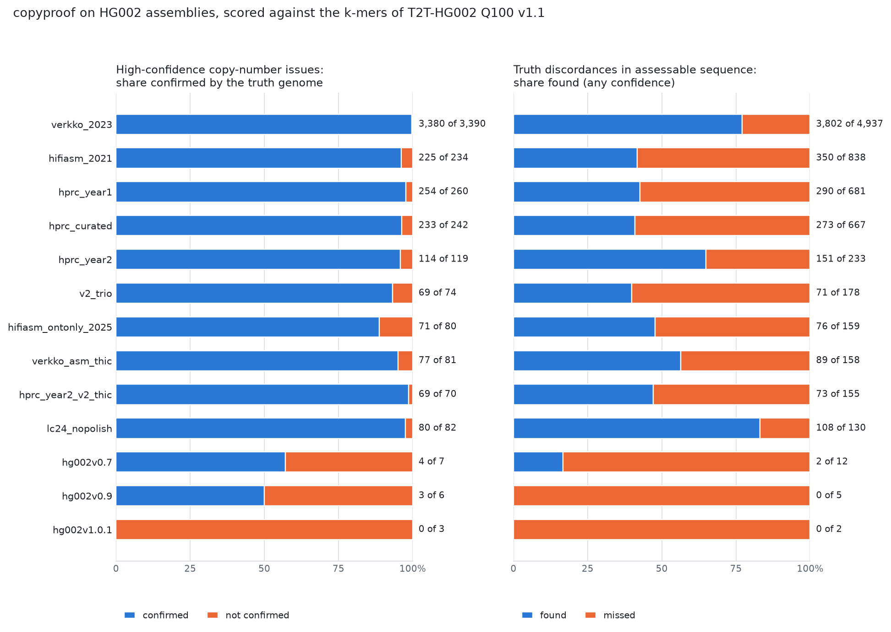
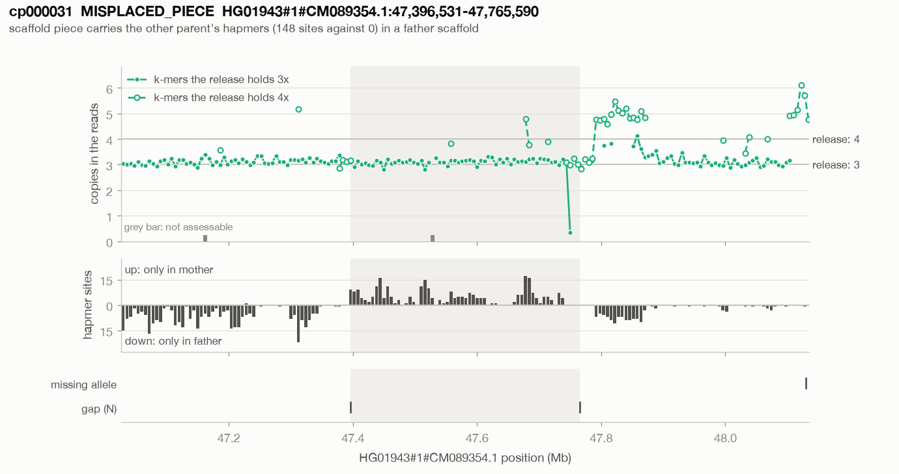

# copyproof

*Proofreading genome assemblies with the sample's own short reads: copies that are missing,
doubled or unsupported, sequence on the wrong haplotype, and read sequence the assembly lacks.*

**Status: working prototype (0.1.0).** The tool runs end to end on a laptop and has been tested on
synthetic genomes, on the T2T-HG002 Q100 truth genome with and without planted errors, on other
HG002 assemblies scored against that truth, and on the HPRC release-2 assembly of HG01943. What
was measured, and what was not, is in [NOTEBOOK.md](NOTEBOOK.md) and under
[experiments/](experiments/).

| File | What it is |
|---|---|
| [GUIDE.md](GUIDE.md) | The original design: why, with which data, and how to tell whether it works |
| [NOTEBOOK.md](NOTEBOOK.md) | Running log of experiments and decisions, newest first |
| [docs/method.md](docs/method.md) | How each channel works, as built |
| [docs/outputs.md](docs/outputs.md) | Every output file and column |
| [docs/thresholds.md](docs/thresholds.md) | Every numeric threshold: its value, where it came from, what was checked |
| [experiments/](experiments/README.md) | One folder per experiment: question, commands, result tables. Its index says where every number above comes from |
| [resources.tsv](resources.tsv) | Public data the work uses |
| `engine/` | The k-mer engine (`cpk`, Rust) |
| `src/copyproof/` | The Python package: model, segmentation, calls, evidence cards |
| `scripts/` | Data fetching, error planting, scoring and experiment drivers (`scripts/dev/`: aids for re-classifying cached segments) |
| `tests/` | Engine tests against a naive reference; synthetic genomes with planted errors of each class |

## The idea

Assembly QC in current releases asks whether read coverage looks wrong. Some copies are real but
misplaced: scaffolded into the wrong haplotype, collapsed onto a twin copy, or duplicated at a
join. Their coverage is normal, so they pass.

copyproof asks different questions, of every sequence in a release:

- **Does each sequence occur as often in the assembly as the reads say it should?** (S1) Every
  k-mer of the assembly has a multiplicity in the whole release and a count in the reads. A
  collapsed copy raises the reads' count by one copy's worth; a false duplication lowers it.
- **Do the reads carry sequence that is nowhere in the assembly?** (S2) Solid read k-mers absent
  from the release are localised by the flanks of the reads that carry them: a missing allele, a
  missing junction, or missing sequence.
- **Is every stretch on its own parent's haplotype?** (S3) With both parents' reads, k-mers
  inherited from exactly one parent show phase switches and misplaced scaffold pieces.
- **Does any long read link each scaffold join?** (S4, optional) Reads around every run of N are
  fetched through the index of a read-to-assembly BAM, which can stay remote.

It reports issues with their evidence, says what it could not assess, and draws one evidence card
per issue.

## What it finds

Measured on public data; each line links to the record with commands and tables.

**Real assemblies of one person, scored by a truth genome**
([experiments/2026-11-13_hg002_assemblies](experiments/2026-11-13_hg002_assemblies/README.md)).
Thirteen HG002 assemblies, three of them earlier drafts of the truth genome, were run with HG002's
36x short reads and scored against the k-mers of T2T-HG002 Q100, without alignment.



- About 95% of high-confidence copy-number issues are confirmed by the truth genome: 1,199 of
  1,258 in twelve assemblies. The thirteenth holds 150 Mb of surplus sequence and adds 3,380 of
  3,390, which makes the sum 4,579 of 4,648 (99%).
- The share is about the same before and after the method stopped changing: 737 of 770
  (95.7%) in the six assemblies scored while its rules were still being revised, 462 of 488
  (94.7%) in the six run afterwards. All are assemblies of one person read with one set of
  reads, so this is not the held-out test.
- The ones not confirmed number 1 to 10 per assembly, whether the confirmed ones number 0 or
  3,380, so the count says more than the share. The three drafts, which have almost no errors
  left, get 3 unconfirmed issues each beside 4, 3 and 0 confirmed.
- Of the surplus copies of 5 kb and more that lie in assessable sequence, 73% to 79% are found; of
  the collapsed copies, 25% to 54%; under 5 kb, 9% to 18%.
- Strong missing-allele calls are true 96% of the time; one-sided missing sequence is not
  (46% when strong), and is reported accordingly.

**Errors planted in the truth genome**
([experiments/2026-11-13_planted_errors](experiments/2026-11-13_planted_errors/README.md)). 111
edits of known kind, size and place in Q100, read with real short reads.

| Planted | Found, from 5 kb | Found at 2 kb |
|---|---|---|
| False duplication (tandem, or an identical extra sequence) | 46 of 47 | 3 of 8 |
| Deleted stretch, as a collapse on the homologue | 25 of 28 | 0 of 8 |
| Deleted or overwritten haplotype stretch, as a missing haplotype | 34 of 40 | 5 of 8 |
| Inversion breakpoint | 0 of 32 as a missing junction; all 24 that have k-mers show as unread assembly k-mers | |

Of 656 issues on the planted genome, 13 are neither at an edit nor present on the unedited genome.

**The truth genome itself**
([experiments/2026-11-13_hg002_q100_false_flags](experiments/2026-11-13_hg002_q100_false_flags/README.md)).
With short reads alone: about 25 high-confidence issues per haplotype, and an issue within 5 kb of
0.11% of 20,237 duplication boundaries (the design's target was at most 2%). With long reads
added, 1,123 runs of assembly k-mers that no short read holds are sorted by whether long reads
hold them: they do for 957; of the 119 they do not hold, 115 lie on the list of known issues that
the truth genome's own curators publish. Where the reads can be compared with the assembly there
(110 of the 119), they hold a different length of sequence in 106: an insertion or deletion,
often in a homopolymer.

**The truth genome with its parents**
([experiments/2026-11-13_hg002_trio](experiments/2026-11-13_hg002_trio/README.md)). No scaffold
piece is called misplaced (0 of 18). Phase switches, all false here, number 24 (0.4 Mb); the
strongest are the immunoglobulin heavy-chain locus, where a parent's B-cell line has lost the
haplotype it passed on. Before two filters that this run led to, there were 143. Of 12 planted
haplotype swaps the hapmer channel finds 7, the parent-free missing-haplotype call 11.

**HG01943 in HPRC release 2, the case this was built for**
([experiments/2026-11-13_hg01943_trio](experiments/2026-11-13_hg01943_trio/README.md)). All five
defects of the locus are flagged with 2 off-target calls, where the published QC of that assembly
finds 0 to 2. Two of copyproof's rules were added after its first run scored 3 of 5, so this is
not an independent test of those two. Genome-wide it reports one scaffold piece on the wrong
haplotype (the known one). Seven more scaffold joins have a surplus copy beside them, but none
shows what marks the known four: sequence repeated beside another join of the same scaffold.



*An evidence card: the piece between two joins of a paternal scaffold carries only maternal
hapmers; to its right the reads hold one copy more than the release.*

**Not yet measured.** Thresholds were adjusted on the same data they are reported on
([docs/thresholds.md](docs/thresholds.md) says which, and what moving them does); a second sample
with every threshold frozen beforehand is the missing test. Only human assemblies at 30x to 36x
of 150-bp reads were run.

## Install

Needs Rust (for the engine), Python 3.10 or newer, and `samtools` for BAM/CRAM inputs.

```bash
cd copyproof/engine && cargo build --release
```

```bash
cd copyproof && python3 -m venv .venv && .venv/bin/pip install -e ".[dev]"
```

```bash
cd copyproof && .venv/bin/python -m pytest
```

## Run

A release is every FASTA shipped for the sample: both haplotypes and any unplaced, EBV or
mitochondrial sequence. Leaving a file out makes its sequence look collapsed elsewhere.

```bash
copyproof run --out HG01943.copyproof \
  --asm pat=HG01943_pat_hprc_r2_v1.0.1.fa.gz --asm mat=HG01943_mat_hprc_r2_v1.0.1.fa.gz \
  --reads HG01943.final.cram --reference GRCh38_full_analysis_set_plus_decoy_hla.fa \
  --parent mother=HG01942.final.cram --parent father=HG01941.final.cram \
  --threads 10
```

- `--asm LABEL=FASTA` gives each file a group label; `--group-regex LABEL=REGEX` assigns
  sequences by name instead (for one FASTA that holds both haplotypes).
- `--reads` takes FASTQ/FASTA (gzipped or not) or BAM/CRAM.
- `--parent NAME=READS` twice switches on the hapmer audit and labels missing k-mers by parent.
- `--long-read-bam URL` (long reads aligned to the release, indexed; it can stay remote) adds the
  join audit and lets long reads settle what short reads cannot: whether assembly sequence that
  no short read holds is real.
- `--sample 8` halves memory (about 12 GB instead of 20 GB) at the cost of resolution.

Start with `issues.tsv`, `summary.json` and `cards/`. [docs/outputs.md](docs/outputs.md) explains
every file. A run draws cards for its best-scoring issues; for any other issue or region:

```bash
copyproof cards --run HG01943.copyproof --region "HG01943#1#CM089354.1:47300000-47900000"
```

## What it costs

Measured on a 10-core, 64 GB laptop (Apple M1 Max), k = 31, 1 in 4 k-mers tracked:

| Step | Input | Time | Peak memory |
|---|---|---|---|
| Count read k-mers | 107 Gb of 151-bp reads, two gzipped FASTQ files | 5 min | 20 GB |
| ... from a CRAM, through samtools | 30x | 30 min | 20 GB |
| Scan a diploid assembly | 6.0 Gb, one read set | 1.5 min | 17 GB |
| Window statistics | 6.0 million 1-kb windows, 6 processes | 1.2 min | about 12 GB |
| Copy number, with the lookup of other copies | | 1 to 4 min | |
| Missing sequence | one more pass over the reads | 5 to 15 min | |
| Long-read audit | about 2,000 remote region fetches | 10 to 20 min | |

No temporary files are written. A read set is counted once and its database (about 7 GB) serves
any assembly of the same sample; a scan writes a track of 10 to 13 GB. Stages are cached, so a
re-run after changing a threshold takes about 2 minutes.

These times need a disk that keeps up. A scan ends by writing its track in one stream, and the
other steps read it back. The portable USB drive used for this work takes writes at speed for a
while and then nearly stops for 10 to 20 minutes; on it the same scan took from 1.5 to over 20
minutes (NOTEBOOK entry o).

## What it cannot do

- It makes no copy-number statement where more than half of a window's k-mers occur more than
  8 times in the release (satellites, rDNA, large high-identity arrays), nor at extreme GC. These
  windows are listed in `cannot_assess.bed` (about 11% of a human genome).
- One copy more or fewer is a small step where the assembly already holds many: collapses in
  sequence held 4 to 8 times are mostly missed, and changes under 5 kb are mostly missed or of
  low confidence.
- Short reads fail on some sequence. A depth change that scales every k-mer class alike is filed
  under depth anomalies, not issues, and a real error inside such a stretch is missed. Stretches
  of 1 to 3 kb where one allele has no short reads at all look like a missing copy; without long
  reads they are low-confidence issues.
- An inversion or a false join leaves no missing k-mers when the other haplotype is right. Its
  unread assembly k-mers are reported only with long reads (`--long-read-bam`).
- A junction whose far side is a high-copy repeat is detected weakly (reads are not recruited
  from high-copy sequence).
- One copy too many in the assembly and one copy too few in the reads' DNA are the same
  observation. Cell lines rearrange (immunoglobulin loci in B-cell lines, sub-clonal losses), so
  an issue becomes an error only when the assembly's own long reads agree.
- A change carried by a fraction of the cells has no class. The copy-number states are whole
  copies, or one factor for every k-mer. A loss in 60% of the cells lowers a haplotype's own
  k-mers to 0.4 of their depth and the shared ones to 0.7, which fits neither. By the
  classifier's rules such a stretch lands among the depth anomalies and is not reported. That
  is a reading of the rules, not a result: HG01103, the guide's second case and a sub-clonal
  loss, has not been run.
- Calls land on the copies that remain. When a duplicate is collapsed, the reads pile up on its
  twin; which haplotype lost the copy is decided by haplotype-specific k-mers when there are any,
  and an identical extra copy cannot be told from the copy it repeats.
- Without the parents there is no phase audit. With them, the audit is specific for whole
  scaffold pieces and weak for switches under 50 kb (the missing-haplotype call finds those
  without parents), and where the parents' samples are cell lines, a switch at an immunoglobulin
  locus says something about the parents' cells, not the assembly.
- On an assembly that was phased with the parents' k-mers, the phase audit reads the evidence
  the assembler used and is not an independent test of phasing. There it finds what went wrong
  after phasing, such as HG01943's piece, scaffolded into the wrong haplotype. Of the 121 HPRC
  release-2 samples with both parents sequenced, 120 were assembled in trio mode
  (`../data/sample_overlap.tsv`). The audit tests phasing itself only on an assembly phased
  another way whose parents are sequenced.

## Conventions

- Reads, alignments, k-mer databases and assemblies stay out of git; the repository `.gitignore`
  excludes them.
- Flagged loci are "issues" until adjudicated. Share them with the releasing consortia as issues.
- Licences follow the repository root: code under MIT, text under CC BY 4.0.
