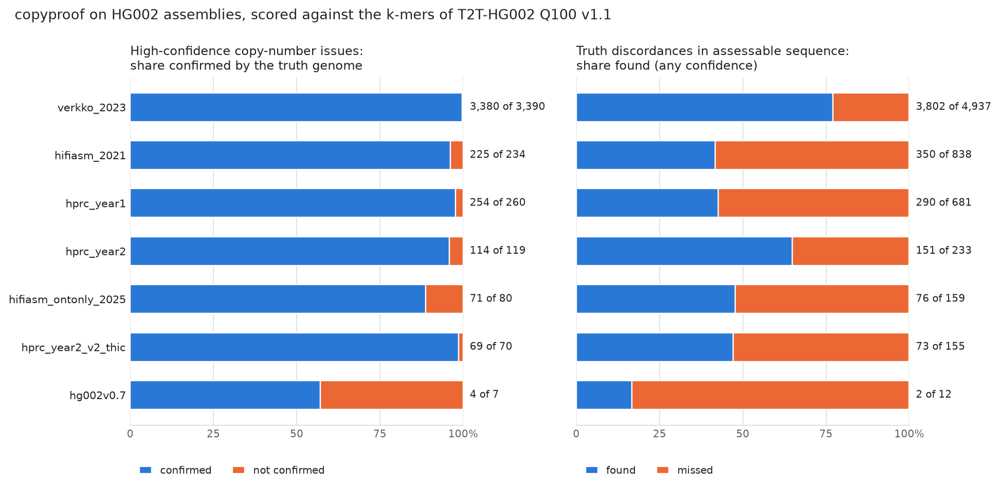

# Rung 4: real HG002 assemblies, scored by the truth genome's k-mers

**Question.** On assemblies with real errors, are copyproof's copy-number issues real, how many of
the real discordances does it find, and what do short-read k-mers say about consensus quality
(GUIDE §8 rung 4; decisions D4, D6)?

**Inputs.** Thirteen HG002 assemblies of different years, methods and data, three of them earlier
drafts of the truth genome itself (`assemblies.tsv`; all from the public Q100 benchmark folder);
HG002's NovaSeq PCR-free reads (36x), counted once; the k-mers of T2T-HG002 Q100 v1.1, counted
exactly. The read k-mer database built for rung 3 serves every assembly. Two of the assemblies
(`verkko_2023`, `hprc_curated`) carry no haplotype in their sequence names and are run as one
group. These are all the assemblies that were downloaded. The list holds one more name,
`hifi_q28_trio_hic`, whose file is the same as that of `verkko_asm_thic`, byte for byte; it is
counted once.

**Truth without alignment.** Each assembly is scanned with the truth genome's k-mer counts as an
extra read set, so every tracked k-mer of the assembly carries the copies the truth holds
(`copyproof/truth.py`). A *discordance* is a run of windows in which at least half of the k-mers
have more (gain) or fewer (loss) copies in the truth than in the assembly. An issue is
*confirmed* when a discordance of the same direction covers at least half of it; a discordance is
*found* when issues cover at least half of it. No aligner is involved, so the labels do not
inherit an aligner's choices in repeats. The label is about copy number of k-mers: the homologous
stretch of a collapsed copy is a true discordance too.

**Run.** `scripts/run_hg002_assemblies.sh DATA assemblies.tsv` (copy number and k-mer statistics;
`WITH_READS=1` adds the missing-sequence channel), `scripts/eval_truth.py`, `scripts/scoreboard.py`.

## Result

| Assembly | What it is | Size (Gb), sequences | Discordant with the truth (Mb) | Assessable discordances found | High-confidence issues confirmed | Low-confidence issues confirmed | QV by truth k-mers / by read k-mers |
|---|---|---|---|---|---|---|---|
| `verkko_2023` | Verkko HiFi + ONT, trio (2023); names carry no haplotype | 6.08, 3,258 | 149.6 | 3,802 of 4,937 (77%) | 3,380 of 3,390 (100%) | 429 of 551 (78%) | 44.3 / 42.03 |
| `hprc_year1` | HPRC year-1 assembly (hifiasm trio, 2021 data) | 6.02, 1,055 | 59.7 | 290 of 681 (43%) | 254 of 260 (98%) | 50 of 88 (57%) | 52.4 / 49.72 |
| `hprc_curated` | HPRC curated HG002 (accession names; one group) | 6.02, 869 | 59.5 | 273 of 667 (41%) | 233 of 242 (96%) | 60 of 179 (34%) | 52.6 / 49.82 |
| `hifiasm_2021` | hifiasm 0.12, HiFi only (2021) | 5.97, 1,030 | 53.4 | 350 of 838 (42%) | 225 of 234 (96%) | 85 of 135 (63%) | 50.8 / 48.43 |
| `verkko_asm_thic` | Verkko, trio + Hi-C | 5.97, 90 | 23.6 | 89 of 158 (56%) | 77 of 81 (95%) | 5 of 52 (10%) | 55.8 / 50.07 |
| `lc24_nopolish` | ONT-only (LC24), unpolished | 6.06, 891 | 20.6 | 108 of 130 (83%) | 80 of 82 (98%) | 21 of 69 (30%) | 47.0 / 45.23 |
| `hifiasm_ontonly_2025` | hifiasm, ONT only (2025) | 5.98, 163 | 18.8 | 76 of 159 (48%) | 71 of 80 (89%) | 4 of 57 (7%) | 45.7 / 43.89 |
| `hprc_year2_v2_thic` | HPRC year-2 v2, trio + Hi-C | 5.98, 209 | 17.9 | 73 of 155 (47%) | 69 of 70 (99%) | 10 of 45 (22%) | 52.7 / 48.79 |
| `hprc_year2` | HPRC year-2 pipeline, hifiasm trio, polished | 5.98, 302 | 16.5 | 151 of 233 (65%) | 114 of 119 (96%) | 31 of 74 (42%) | 51.4 / 49.21 |
| `v2_trio` | Verkko v2, trio | 6.00, 678 | 15.7 | 71 of 178 (40%) | 69 of 74 (93%) | 7 of 57 (12%) | 50.6 / 49.54 |
| `hg002v0.7` | Q100 draft v0.7 | 6.00, 48 | 2.2 | 2 of 12 (17%) | 4 of 7 (57%) | 2 of 38 (5%) | 56.9 / 51.18 |
| `hg002v0.9` | Q100 draft v0.9 | 6.00, 48 | 2.1 | 0 of 5 (0%) | 3 of 6 (50%) | 0 of 32 (0%) | 58.7 / 51.78 |
| `hg002v1.0.1` | Q100 v1.0.1 | 6.00, 48 | 0.2 | 0 of 2 (0%) | 0 of 3 (0%) | 0 of 43 (0%) | 59.3 / 51.95 |

Summed over the 13 assemblies, by size of the segment (`scoreboard.by_size.tsv`):

| Direction | Size | Assessable discordances | Found | Issues | Confirmed | High-confidence issues | Confirmed |
|---|---|---|---|---|---|---|---|
| The truth holds more (collapse) | under 5 kb | 438 | 41 (9%) | 26 | 19 (73%) | 0 |  |
|  | 5 to 20 kb | 537 | 133 (25%) | 155 | 141 (91%) | 140 | 129 (92%) |
|  | 20 to 100 kb | 431 | 215 (50%) | 229 | 214 (93%) | 217 | 207 (95%) |
|  | over 100 kb | 158 | 85 (54%) | 151 | 136 (90%) | 146 | 133 (91%) |
| The truth holds fewer (surplus copy) | under 5 kb | 367 | 65 (18%) | 702 | 26 (4%) | 4 | 4 (100%) |
|  | 5 to 20 kb | 3,515 | 2,778 (79%) | 2,555 | 2,527 (99%) | 2,135 | 2,123 (99%) |
|  | 20 to 100 kb | 2,213 | 1,605 (73%) | 1,856 | 1,844 (99%) | 1,643 | 1,633 (99%) |
|  | over 100 kb | 496 | 363 (73%) | 394 | 376 (95%) | 363 | 350 (96%) |

## What was learned

1. **High-confidence copy-number issues are real, down to a floor of a few per genome.** About
   95% are confirmed: 1,199 of 1,258 in the twelve assemblies other than `verkko_2023`, which
   alone adds 3,380 of 3,390 and lifts the sum to 4,579 of 4,648 (99%). Among the ten
   assemblies with 20 such issues or more, 89% to 100% each. The
   ones not confirmed number 1 to 10 per assembly (69 in all, `unconfirmed_high.tsv`) whether
   the confirmed ones number 0 or 3,380, so a share says little about an assembly with few
   errors. Of the 69, 44 lie where the truth shows no discordance at all and 22 where it shows
   one over 20% to just under 50% of the issue. Each was placed in the truth genome and sorted
   (section "The 69 unconfirmed issues, sorted" below; nothing is rescored):
   - **27 of 69 are DNA of which a cell holds another number than the truth genome lists.** 15
     are Epstein-Barr virus (five assemblies; the truth genome holds none of it), 2 are the
     mitochondrial genome, and 10 are one insertion of mitochondrial sequence 57 to 64 kb into
     chromosome 1 (five assemblies, and the truth genome's own run), where the surplus sits on
     the k-mers that the mitochondrial genome shares.
   - **24 of 69 lie on a difference between the assembly and the truth genome that the scoring
     rule did not count**: the truth genome holds another number of copies of at least half of
     the call's k-mers for 22, of a fifth to a half for 2.
   - **18 of 69 have only the reads behind them**: the assembly holds the truth genome's copy
     numbers. These are the tool's errors unless the truth genome is wrong there. 12 of the 18
     are two loci on the short arm of the paternal chromosome 13 (one called in ten assemblies,
     one in two and in the truth genome's own run); 15 of the 18 lie on acrocentric short arms.
     Long reads hold the truth genome's count at the loci of 13 of the 18, and at the 6-kb
     satellite block of a fourteenth (the rest of it was not tested). At the loci of the other 4
     they fall short as the short reads do, by up to 17% and 27%: those two loci are listed for
     the truth genome's curators, with the evidence that is missing.
   - **None lies on a known issue.** Of the 52 calls placed on nuclear sequence, the curators'
     list covers half of a principal placement of none and a tenth of 2; it touches one of 21,
     of 14 of them over less than 1%. v1.2 changed four positions inside the principal
     placements of 9 calls, by 1 to 14 bases.
   - **6 of the 27 loci are called in two or more independent assemblies, and hold 42 of the 69
     calls**: the virus (15 calls), the chromosome 1 insertion (10), the two chromosome 13 loci
     (10 and 2), and two others (3 and 2).

   The three drafts of the truth genome show the floor alone: 3 unconfirmed issues each, against
   4, 3 and 0 confirmed. Of these 9, 6 are the chromosome 1 insertion, 2 the recurrent
   chromosome 13 locus and 1 a stretch beside the centromere of chromosome 7.
2. **Surplus copies are found better than collapses.** For surplus copies of 5 kb and more, 73% to
   79% of the assessable discordances are found. For collapses it is 25% to 54%. A surplus copy
   of sequence the assembly holds three times lowers the depth of its k-mers by a third; a
   collapse among six copies raises it by a sixth, which is the size of the regional wander of
   depth. Most missed collapses are of that kind: in duplicated sequence where the assembly holds
   4 to 8 copies. Of the 64 assessable collapses of `hprc_year2`, 17 are found; of the other 47,
   20 show no departure in the reads at all (k-mers the assembly holds 6 times are read at 6.1
   copies where the truth holds 7: there the short reads agree with the assembly, not with the
   truth genome), 20 are seen as a change of depth by one factor, and 7 are covered in part or left ambiguous
   (`hprc_year2.collapses.tsv`, from `details.py`).
3. **Under 5 kb the channel is weak.** 9% to 18% of the discordances are found, and 4% of the
   surplus-copy issues are confirmed; nearly all of these issues are of low confidence by rule
   (fewer than 5 windows). This limit comes from 1-kb windows at 36x and a prior of 10^-6 per
   window.
4. **The classifier was revised here.** With the classifier of rungs 2 and 3, `hprc_year2` gave 8
   of 64 collapses found. The missed ones were long stretches where k-mers the assembly holds 4
   and 6 times were read at 4.9 and 7.3 copies while the 1- and 2-copy k-mers were exactly
   concordant: a whole-copy pattern, called ambiguous because each k-mer class was allowed the
   full regional wander of depth (7.7%) on its own. That wander is shared by all k-mers of a
   stretch. Giving every hypothesis one regional factor for all classes, and each class 4%
   around it, found 17 of 64 with 22 of 24 high-confidence collapses confirmed, kept the truth
   genome at 20 whole-copy segments (14 before), and lowered the planted-error results nowhere
   after a second change: classes that hold under 10% of a segment's k-mers may not veto a fit,
   because they are mixtures (a k-mer lying twice in a surplus copy loses two copies). Those
   counts are from pipeline runs between the changes and cannot be run again; the classifier of
   before is kept, and `../2026-11-13_threshold_sensitivity/` runs both on the same segments
   (collapses 8 and 17 of 64 there too, confirmed high-confidence issues 89 and 114).
5. **Short whole-copy calls are mostly not errors.** Of 18 whole-copy surplus calls on fewer than
   5 windows in `hprc_year2`, the truth confirms one (`hprc_year2.whole_copy_by_length.tsv`). They are the same family as 13 calls on
   the truth genome itself: 1 to 3 kb where one haplotype's own k-mers have no short reads. Long
   reads showed that the sequence is real in 10 of those 13 (rung 3). Such calls are now of low
   confidence, and dropped when long reads carry the k-mers.
6. **Depth anomalies are rightly left out.** The thirteen runs hold 35,372 segments that fit a
   depth factor or nothing regular. The truth confirms 1,310 (4%); without `verkko_2023`, 448 of
   31,937 (1%). Ambiguous segments without support: 1,465, of which 179 confirmed (12%).
7. **One release holds 150 Mb more than a diploid genome.** `verkko_2023` (3,258 sequences) has
   149.6 Mb of sequence discordant with the truth, nearly all surplus copies; copyproof raises
   3,390 high-confidence issues there and 3,380 are confirmed. The other ordinary assemblies carry
   16 to 60 Mb of discordant sequence, the three drafts 2.2, 2.1 and 0.2 Mb.
8. **Short-read k-mers understate consensus quality, by a floor.** The QV implied by assembly
   k-mers without any read is 2 to 7 units below the QV by the truth's k-mers, and the gap grows
   with quality: 1.1 to 2.8 units in the eight assemblies below QV 52.7, 3.9 to 5.7 in the three
   up to QV 57, and 6.9 and 7.3 in the two latest drafts. By read k-mers the three drafts reach
   51.2, 51.8 and 52.0 while the truth's k-mers give them 56.9, 58.7 and 59.3: 2.4 units between
   the drafts shrink to 0.8. The reason is the share of unread k-mers that are in fact correct
   sequence. In the three weakest assemblies most unread k-mers are errors (`verkko_2023` 90%
   wrong by the truth, `hifiasm_ontonly_2025` 86%, `lc24_nopolish` 82%); in the seven ordinary
   ones 40% to 62%; in the drafts 24%, 13% and 9%. The reads find 32% to 92% of the k-mers that are wrong by the
   truth.
9. **Missing alleles are real; one-sided missing sequence mostly is not.** For `hprc_year2` the
   missing-sequence channel was run with the reads (`hprc_year2.missing_clusters.tsv`). A cluster
   is true if the truth genome holds most of its missing k-mers. `MISSING_ALLELE`: 957 of 996
   strong clusters are true (96%), 175 of 273 weak ones. `MISSING_SEQUENCE` (reads anchored on one side only): 53 of 115 strong ones
   (46%), 92 of 1,010 weak ones (9%). The planted genome gives the same picture (96%, 64%, 51%,
   10%). Hence weak one-sided clusters are not issues, and strong ones are of low confidence.
10. **A second run gives the same output.** The assembly that the folder holds under two names
   was run under both, 43 minutes apart, before the duplicate was noticed. The issue list, the
   copy-number segments, the depth anomalies, the regions that cannot be assessed, the fitted
   model and the scored issues are identical file for file. It is the only repeat with
   unchanged code that was compared.
11. **The share confirmed is about the same before and after the method stopped changing.**
   Seven assemblies were scored while the classifier and the reporting rules were still being
   revised, so their scores could shape the rules; six were first run after the last change.
   Without `verkko_2023` the two groups give 95.7% and 94.7% (Fisher's exact test, p = 0.41).
   All are assemblies of one person read with one set of reads, so this is the nearest thing
   to a held-out number that these data hold, and no substitute for a new sample.

| Assemblies (`precision_split.tsv`) | High-confidence issues | Confirmed | Share |
|---|---|---|---|
| Scored while the rules were still being revised (7) | 4,160 | 4,117 | 99.0% |
| ... without `verkko_2023` (6) | 770 | 737 | 95.7% |
| Run after the last change (6) | 488 | 462 | 94.7% |
| ... without the two drafts (4) | 479 | 459 | 95.8% |
| All without `verkko_2023` (12) | 1,258 | 1,199 | 95.3% |

## The 69 unconfirmed issues, sorted

**Question.** A high-confidence issue that the truth genome does not confirm is the tool's error,
a real difference that the scoring missed, an error of the truth genome, or a difference between
the DNA that was read and the genome that was assembled. Which, for each of the 69 (review of
2026-11-14, point 3.2)?

**Method.** `place_unconfirmed.py` cuts every call out of its assembly (`cpk extract`) and locates
its tracked k-mers in T2T-HG002 Q100 v1.1 (`cpk locate --query`). Hits on one diagonal are one
placement (`copyproof.copies.copy_loci`); every placement that holds 5% of the located k-mers is
kept, and those with at least half the k-mers of the best one are *principal* (the other
haplotype's copy, paralogous copies). The same script reads each call's own k-mers from its run's
track: copies in the assembly, in the truth genome and in the reads, also for k-mers the assembly
holds more than 8 times, which the scoring rule leaves out. `sort_unconfirmed.py` annotates every
placement (known issues, segmental duplications, centromeres, satellites, v1.2 changes, and what
the truth genome's own run of rung 3 says there), groups the calls into loci (two calls are one
locus when the best placement of each overlaps a principal placement of the other over half of
the shorter interval) and sorts them by the rules at its head. `locus_depth.py` then counts the
k-mers of six loci in the short reads of HG002 and of both parents (the track of the trio run of
rung 3) and in the public HiFi reads, fetched by region. Every count below is a row of
`unconfirmed_summary.tsv` or of the table named beside it. Nothing is rescored: every call stays
unconfirmed, and the scoreboard above is unchanged.

All 69 calls have a placement (1,283 placements, 274 principal). The benchmark's own alignment of
an assembly covers 52 of the calls and overlaps a principal placement of 50; the other 2 are the
mitochondrial contigs, which that alignment puts on nuclear insertions of mitochondrial sequence.

| What the call lies on (`unconfirmed_by_sort.tsv`) | Calls | Assemblies | Loci | Collapse, expansion | With no truth discordance at all |
|---|---|---|---|---|---|
| Epstein-Barr virus | 15 | 5 | 1 | 15, 0 | 15 |
| The mitochondrial genome | 2 | 1 | 1 | 2, 0 | 2 |
| Nuclear sequence whose surplus is on k-mers that the mitochondrial genome shares | 10 | 5 | 1 | 10, 0 | 10 |
| A difference from the truth genome over at least half of the call's k-mers | 22 | 7 | 17 | 7, 14 (and 1 unsupported run) | 0 |
| ... over a fifth to a half | 2 | 2 | 2 | 0, 2 | 0 |
| The assembly agrees with the truth genome and only the reads depart: a recurrent locus | 12 | 11 | 2 | 0, 12 | 12 |
| ... the same, in one assembly | 6 | 4 | 4 | 0, 6 | 5 |

1. **Virus and mitochondrion (27 of 69): the reads' DNA holds them in numbers that no assembly
   and no truth genome lists.**
   - 15 calls in `hifiasm_2021` (5), `v2_trio` (4), `hifiasm_ontonly_2025` (3), `hprc_year2` (2)
     and `lc24_nopolish` (1) are contigs of Epstein-Barr virus; HG002's DNA is from a
     lymphoblastoid cell line. Their best placement is the virus genome that the draft v1.0.1
     carries as `chrEBV` (43% to 100% of a call's k-mers lie on it). The truth genome v1.1 has no
     such sequence and holds none of their k-mers. The reads hold 31 to 37 copies of them
     (median over each call's k-mers), whether the assembly holds 2, 3 or 6.
   - 2 calls are two 33-kb contigs of `hifiasm_ontonly_2025`, one in each haplotype's file,
     each holding the mitochondrial genome twice in a row. The reads hold 1,113 copies.
   - 10 calls are one 6-kb stretch 57 to 64 kb into chromosome 1, on both haplotypes of five
     assemblies (the three drafts, `hifiasm_ontonly_2025`, `hprc_year1`); the truth genome's own
     run calls it on both haplotypes too. 56% to 60% of a call's k-mers also occur in chrM
     (positions 3,340 to 9,175): the stretch is an insertion of mitochondrial sequence. Those
     k-mers are read at 183 to 366 times the assembly's count, the others at 1.06 to 1.08 times.
     On the truth genome the stretch's own 433 k-mers, found once in each haplotype, are read at
     1.07 of that count in the short reads and 1.03 in the long reads; the 857 that chrM shares
     are read at 1,138 copies (`unconfirmed_depth.loci.tsv`). No nuclear copy is missing. "Four
     more copies" in these calls is the ceiling of the window statistics, which cap a k-mer's
     count at four copies above its multiplicity.

   Each of these 27 calls says that the reads hold more copies than the release, which is true
   of this DNA, and a genome that lists the mitochondrion once and the virus not at all cannot
   confirm it. The tool sets such sequences aside by name only (`chrM`, `MT`, `EBV` and the
   like); these contigs carry assembler names, and the insertion on chromosome 1 is nuclear.
2. **Real differences that the scoring rule did not count (24 of 69).** For 22 calls the truth
   genome holds more copies (7 collapses) or fewer (14 expansions, 1 unsupported run) than the
   assembly of at least half of the call's k-mers: of all its tracked k-mers for 17, and for 5
   only of those the assembly holds at most 8 times, which are the ones the tool calls on. The
   scoring rule asks more: such k-mers must be the majority in 1-kb windows that cover half of
   the call. These 22 reach 16% to just under 50%, for three reasons:
   - 13 lie in sequence repeated many times: the median multiplicity of the call's k-mers is
     above 8 (9 to 255, where the track's count stops), so few windows have enough k-mers that
     the rule can use;
   - 4 are mostly gap: 63% to 86% of the call's bases are N, which hold no k-mers, and the
     discordance lies beside the gap;
   - 5 are wider than the difference: the discordance covers 40% to 48% of the call.

   In 7 of the 22 the benchmark's own alignment lists a structural difference inside the call,
   among them insertions of 891, 54.5 and 31.8 kb in three expansions. The 22 are in
   `verkko_2023` (8), `hprc_curated` (6), `hifiasm_2021` (3), `hprc_year2` (2),
   `hifiasm_ontonly_2025`, `hprc_year1` and `verkko_asm_thic` (1 each). In two more calls 42%
   and 45% of the k-mers are such. A k-mer's count in the truth genome is a count over the whole
   genome, so for k-mers repeated tens of times this shows that the assembly and the truth
   genome differ, not that they differ inside the call.
3. **Only the reads depart (18 of 69).** Under 15% of each call's k-mers have another count in
   the truth genome in the call's direction. All 18 are expansions: the reads hold fewer copies
   than the assembly and the truth genome. 15 lie on the short arms of chromosomes 13, 14 and 22,
   the other 3 beside the centromeres of chromosomes 7 and 9. At a principal placement of 15
   of them the truth genome's own run has a segment of the same direction: an issue for 2, and
   for 13 a segment that it labels a depth anomaly or ambiguous and does not report. So the
   reads depart from the truth genome itself at these places, and whether that becomes an issue
   depends on the assembly around it.
   - *chr13 paternal 7.26 Mb, 10 calls in ten assemblies (eight independent).* A 16.5-kb block
     annotated HSat1B (7,257,204 to 7,273,685) begins a 345-kb duplication with copies on
     chromosomes 13, 21, 22 and 14. Five assemblies call the first 5 to 7 kb of it, five the
     whole 344 or 345 kb, on 16 to 22 assessable windows. The truth genome's own run cannot
     assess the stretch (94% to 100% of it is masked there).
   - *chr13 paternal 10.04 Mb, 2 calls (`hprc_year2`, `verkko_asm_thic`).* An 11-kb stretch with
     four copies (chr13 and chr21, both haplotypes). The truth genome's own run reports it at
     high confidence on both copies of chromosome 13.
   - *One assembly each (6 calls).* chr7 paternal 58.66 Mb in the draft v1.0.1 (79 kb); chr9
     paternal 42.39 Mb in `hprc_curated` and `hprc_year1` (the same 7,030 bases); chr22 paternal
     3.88 to 3.91 Mb, beside the rDNA array, in the same two; and in `verkko_2023` the copy of
     the 345-kb duplication on the maternal chromosome 14, which begins with a copy of the
     HSat1B block.
4. **What the reads hold at these loci** (`unconfirmed_depth.loci.tsv`; copies as a ratio to the
   truth genome's count, lowest and highest over the classes of k-mers with 50 k-mers or more;
   depth of one copy from four stretches of ordinary sequence):

   | Locus | Calls | k-mers | HG002, short reads | Mother, short reads | Father, short reads | HG002, long reads |
   |---|---|---|---|---|---|---|
   | chr1 57 kb, the insertion's own k-mers | 10 | 433 | 1.07 | 1.63 | 0.56 | 1.03 |
   | chr13 paternal 7.26 Mb, the HSat1B block | 10 | 956 | 0.41 to 0.74 | 0.37 to 0.63 | 0.37 to 0.81 | 0.91 to 1.09 |
   | chr13 paternal 10.04 Mb | 2 | 1,716 | 0.79 to 0.95 | 0.77 to 0.94 | 0.87 to 0.96 | 0.83 to 0.99 |
   | chr7 paternal 58.7 Mb | 1 | 7,086 | 0.85 to 0.91 | 0.41 to 0.68 | 0.85 to 0.94 | 0.94 to 1.06 |
   | chr9 paternal 42.4 Mb | 2 | 927 | 0.42 to 0.89 | 0.45 to 0.96 | 0.48 to 0.86 | 0.98 to 1.10 |
   | chr22 paternal 3.9 Mb | 2 | 816 | 0.74 to 0.88 | 0.81 to 1.05 | 0.97 to 1.33 | 0.73 to 0.93 |

   (The mother's range at the HSat1B block leaves out the k-mers found only in this paternal
   copy, which she does not hold: 0.00.) The test asks who else falls short. A surplus copy in
   the truth genome is missing from both of HG002's read sets, and no long read runs through
   it. A copy lost from the DNA that the short reads were made of is missing from HG002's short
   reads only: its long reads and its parents' short reads hold it. Sequence that these short
   reads under-read is short in the short reads of all three people and whole in the long reads.
   - At the HSat1B block the long reads hold the truth genome's count and the short reads of all
     three people fall 19% to 63% short; each of the block's 11 copies has 12 or more long reads
     running through it. Short reads of this kind (three libraries, one platform) under-read
     this satellite, and the tool took a shortfall that is not one factor for all k-mers for a
     missing copy. The same holds for the 60 k-mers behind the chr9 calls (0.42, 0.45 and 0.48
     in the three people, 0.98 in the long reads), and more mildly for chr7 (0.85 to 0.91
     against 0.94 to 1.06). These are the loci of 13 calls. The fourteenth, in `verkko_2023`,
     begins with the block's copy on chromosome 14, which reads the same way; the rest of its
     277 kb was not tested.
   - At chr13 10.04 Mb and at chr22 3.9 Mb (4 calls) the long reads fall short as well. See 6.
5. **Known issues, v1.2 and recurrence.** Of the 52 calls whose best placement is nuclear, the
   curators' list of known issues (38.8 Mb) covers half of a principal placement of none, and a
   tenth of 2: the two expansions of `verkko_2023` near the end of chromosome 14 (27% each, on
   NucFlag intervals of 8.3 and 7.6 kb), which are sorted under real differences. It touches a
   placement of 21 calls, of 14 of them over less than 1% of it. No principal placement touches
   an issue that a user submitted. v1.2 changed four positions inside principal placements, of
   9 calls, by 1, 2, 2 and 14 bases: no copy number. The 69 calls are 27 loci. Six are called
   in two or more independent assemblies and hold 42 calls: the virus (15 calls, five
   assemblies), the chromosome 1 insertion (10; five assemblies, three independent), chr13
   7.26 Mb (10; eight independent), chr13 10.04 Mb (2), the far end of the short arm of
   chromosome 13 (2 calls, both real differences) and chromosome 9 beside the centromere (3: a
   real difference in `hprc_year2` and the two reads-only calls named under 3). Assemblies that
   are versions of one another count once: the three drafts, and `hprc_curated` with
   `hprc_year1`, two of whose calls are the same 7,030 bases (`unconfirmed_loci.tsv`).
6. **Two loci for the truth genome's curators, as open questions and not as findings.** At both,
   HG002's long reads hold fewer copies than v1.1, as its short reads do.
   - chr13_PATERNAL:10,040,061-10,051,081 with chr13_MATERNAL:14,126,060-14,137,080,
     chr21_MATERNAL:12,465,257-12,476,272 and chr21_PATERNAL:8,844,559-8,855,574. The 1,090
     k-mers that v1.1 holds once in each of these four copies are read at 3.41 copies in the
     short reads and 3.31 in the long reads; the mother's short reads give 3.48, the father's
     3.56 (`unconfirmed_depth.tsv`).
   - chr22_PATERNAL:3,899,668-3,906,693, 52 kb beyond the listed end of the paternal rDNA array,
     with its copies beside the other rDNA arrays and on chrY (11 stretches). k-mers that v1.1
     holds 2, 4, 6 and 8 times are read at 1.48, 3.11, 4.81 and 6.96 copies in the short reads
     and at 1.47, 3.47, 5.44 and 6.97 in the long reads; the parents' short reads are not
     short in the same way.

   Against a surplus copy in v1.1: every copy has long reads running through it (5 or more at
   the first locus, 11 or more at the second); the shortfall is under one copy in most classes;
   at the first locus both parents fall short by as much, and their reads owe nothing to HG002's
   assembly; and the long reads' alignment depth over all 29 short-arm stretches examined here
   is a median 0.89 of the depth over ordinary sequence (quartiles 0.73 and 1.03,
   `unconfirmed_depth.stretches.tsv`), so these arms are read less deeply as a whole. Missing:
   the same count in reads of a third kind (ONT, Element); the copy numbers of these k-mers in
   the parents' own genomes, without which their reads are no control; and whether the lower
   depth of the short arms belongs to the DNA or to the libraries, which was not tested.
7. **What this says about precision.** The scoreboard counts all 69 as not confirmed, and that
   stands: about 95% confirmed in the twelve assemblies other than `verkko_2023` (finding 1,
   finding 11). The sort says what the other 5% is made of (`unconfirmed_by_assembly.tsv`). Of
   the 59 issues not confirmed in those twelve assemblies, 27 are virus or mitochondrial
   sequence, which a truth genome cannot score; 16 sit on real differences; and 16 have only
   the reads behind them, which is 1.3% of the 1,258. Over all thirteen assemblies the last
   group is 18 of 4,648.
8. **Limits.** One family, one short-read library each, one long-read data set. Placement uses k-mers
   found at most 64 times in the truth genome. The depth of one copy comes from four stretches
   of 200 kb, whose own long-read depth spans 0.92 to 1.10 of their mean. The parents' copy
   numbers at these loci are not known. Which long read belongs to which copy rests on the
   aligner; the k-mer counts do not. The sort's thresholds (half, a fifth, a tenth of the
   k-mers) were chosen after looking at the calls.

## Files

- `assemblies.tsv`: name, FASTA, haplotype patterns and description of each assembly; the
  duplicate is commented out there.
- `details.py` and its three tables for `hprc_year2`: the missed collapses, whole-copy calls by
  length, and the clusters of read sequence the assembly lacks.
- `unconfirmed.py` and `unconfirmed_high.tsv`: every high-confidence copy-number issue the truth
  does not confirm, with the share of it that a truth discordance covers.
- `place_unconfirmed.py`: cuts those calls out of their assemblies and locates them in the truth
  genome; its output stays under `DATA/work/hg002_assemblies/unconfirmed/` (0.6 GB). It loads
  each assembly and the truth genome once.
- `sort_unconfirmed.py` and its tables: `unconfirmed_sorted.tsv` (one row per call: placement,
  locus, sort, the k-mer counts and annotations behind them; calls are numbered u01 to u69 in the
  order of `unconfirmed_high.tsv`), `unconfirmed_placements.tsv` (every placement of every call,
  annotated), `unconfirmed_loci.tsv`, `unconfirmed_by_sort.tsv`, `unconfirmed_by_assembly.tsv`
  (beside the scoreboard's counts) and `unconfirmed_summary.tsv` (every count quoted in the
  section above, with its denominator).
- `locus_depth.py`, `depth_regions.tsv` and their tables: `unconfirmed_depth.tsv` (per stretch
  and class of k-mers, the copies in each read set), `unconfirmed_depth.stretches.tsv` (long-read
  alignments per stretch) and `unconfirmed_depth.loci.tsv` (the table of item 4). The long reads
  are fetched by region from the public alignment (`hg002_q100_hifi_bam` in `resources.tsv`);
  a second run gave the same three tables byte for byte.
- `split.py` and `precision_split.tsv`: the share confirmed, by whether an assembly was scored
  before or after the method stopped changing.
- `scoreboard.tsv` (every number per assembly), `scoreboard.by_size.tsv`, `scoreboard.md` (the
  two tables above and the sums quoted in the text, as written by the script),
  `scoreboard.png` with its numbers in `scoreboard.json`.
