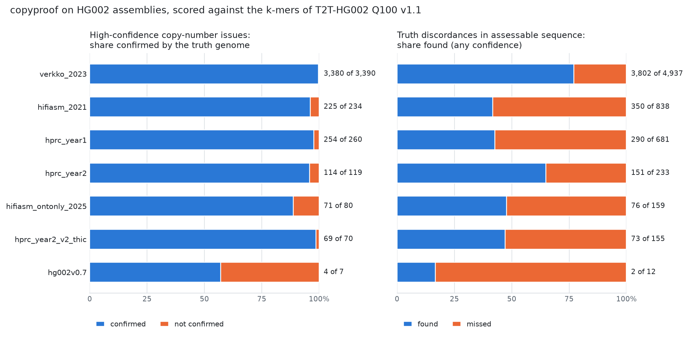

# Rung 4: real HG002 assemblies, scored by the truth genome's k-mers

**Question.** On assemblies with real errors, are copyproof's copy-number issues real, how many of
the real discordances does it find, and what do short-read k-mers say about consensus quality
(GUIDE §8 rung 4; decisions D4, D6)?

**Inputs.** Seven HG002 assemblies of different years, methods and data (`assemblies.tsv`; all
from the public Q100 benchmark folder); HG002's NovaSeq PCR-free reads (36x), counted once; the
k-mers of T2T-HG002 Q100 v1.1, counted exactly. The read k-mer database built for rung 3 serves
every assembly.

**Truth without alignment.** Each assembly is scanned with the truth genome's k-mer counts as an
extra read set, so every tracked k-mer of the assembly carries the copies the truth holds
(`copyproof/truth.py`). A *discordance* is a run of windows in which at least half of the k-mers
have more (gain) or fewer (loss) copies in the truth than in the assembly. An issue is
*confirmed* when a discordance of the same direction covers at least half of it; a discordance is
*found* when issues cover at least half of it. No aligner is involved, so the labels do not
inherit an aligner's choices in repeats. The label is about copy number of k-mers: the homologous
stretch of a collapsed copy is a true discordance too.

**Run.** `scripts/run_hg002_assemblies.sh DATA assemblies.tsv` (copy number and k-mer statistics;
`WITH_READS=1` adds the missing-sequence channel), `scripts/eval_truth.py`, `scripts/scoreboard.py`.

## Result

| Assembly | What it is | Size (Gb), sequences | Discordant with the truth (Mb) | Assessable discordances found | High-confidence issues confirmed | Low-confidence issues confirmed | QV by truth k-mers / by read k-mers |
|---|---|---|---|---|---|---|---|
| `verkko_2023` | Verkko HiFi + ONT, trio (2023); names carry no haplotype | 6.08, 3,258 | 149.6 | 3,802 of 4,937 (77%) | 3,380 of 3,390 (100%) | 429 of 551 (78%) | 44.3 / 42.03 |
| `hprc_year1` | HPRC year-1 assembly (hifiasm trio, 2021 data) | 6.02, 1,055 | 59.7 | 290 of 681 (43%) | 254 of 260 (98%) | 50 of 88 (57%) | 52.4 / 49.72 |
| `hifiasm_2021` | hifiasm 0.12, HiFi only (2021) | 5.97, 1,030 | 53.4 | 350 of 838 (42%) | 225 of 234 (96%) | 85 of 135 (63%) | 50.8 / 48.43 |
| `hifiasm_ontonly_2025` | hifiasm, ONT only (2025) | 5.98, 163 | 18.8 | 76 of 159 (48%) | 71 of 80 (89%) | 4 of 57 (7%) | 45.7 / 43.89 |
| `hprc_year2_v2_thic` | HPRC year-2 v2, trio + Hi-C | 5.98, 209 | 17.9 | 73 of 155 (47%) | 69 of 70 (99%) | 10 of 45 (22%) | 52.7 / 48.79 |
| `hprc_year2` | HPRC year-2 pipeline, hifiasm trio, polished | 5.98, 302 | 16.5 | 151 of 233 (65%) | 114 of 119 (96%) | 31 of 74 (42%) | 51.4 / 49.21 |
| `hg002v0.7` | Q100 draft v0.7 | 6.00, 48 | 2.2 | 2 of 12 (17%) | 4 of 7 (57%) | 2 of 38 (5%) | 56.9 / 51.18 |

Summed over the seven assemblies, by size of the segment (`scoreboard.by_size.tsv`):

| Direction | Size | Assessable discordances | Found | Issues | Confirmed | High-confidence issues | Confirmed |
|---|---|---|---|---|---|---|---|
| The truth holds more (collapse) | under 5 kb | 292 | 28 (10%) | 19 | 15 | 0 | |
| | 5 to 20 kb | 364 | 95 (26%) | 102 | 95 (93%) | 96 | 90 (94%) |
| | 20 to 100 kb | 290 | 144 (50%) | 149 | 141 (95%) | 147 | 139 (95%) |
| | over 100 kb | 103 | 50 (49%) | 89 | 82 (92%) | 89 | 82 (92%) |
| The truth holds fewer (surplus copy) | under 5 kb | 307 | 60 (20%) | 383 | 24 (6%) | 4 | 4 |
| | 5 to 20 kb | 3,334 | 2,682 (80%) | 2,431 | 2,417 (99%) | 2,059 | 2,052 (100%) |
| | 20 to 100 kb | 1,945 | 1,412 (73%) | 1,673 | 1,664 (99%) | 1,490 | 1,482 (99%) |
| | over 100 kb | 380 | 273 (72%) | 302 | 290 (96%) | 275 | 268 (97%) |

## What was learned

1. **High-confidence copy-number issues are real.** 4,117 of 4,160 are confirmed (99%); without
   the one assembly that contributes most of them, 737 of 770 (96%). Per assembly 89% to 100%,
   except the Q100 draft, which is so close to the truth that only 7 issues are raised at all.
2. **Surplus copies are found better than collapses.** For surplus copies of 5 kb and more, 72% to
   80% of the assessable discordances are found. For collapses it is 26% to 50%. A surplus copy
   of sequence the assembly holds three times lowers the depth of its k-mers by a third; a
   collapse among six copies raises it by a sixth, which is the size of the regional wander of
   depth. Most missed collapses are of that kind: in duplicated sequence where the assembly holds
   4 to 8 copies. Twenty of the 64 assessable collapses of `hprc_year2` show no departure in the
   reads at all (k-mers the assembly holds 6 times are read at 6.1 copies where the truth holds
   7): there the short reads agree with the assembly, not with the truth genome.
3. **Under 5 kb the channel is weak.** 10% to 20% of the discordances are found, and 6% of the
   surplus-copy issues are confirmed; nearly all of these issues are of low confidence by rule
   (fewer than 5 windows). This limit comes from 1-kb windows at 36x and a prior of 10^-6 per
   window.
4. **The classifier was revised here.** With the classifier of rungs 2 and 3, `hprc_year2` gave 8
   of 64 collapses found. The missed ones were long stretches where k-mers the assembly holds 4
   and 6 times were read at 4.9 and 7.3 copies while the 1- and 2-copy k-mers were exactly
   concordant: a whole-copy pattern, called ambiguous because each k-mer class was allowed the
   full regional wander of depth (7.7%) on its own. That wander is shared by all k-mers of a
   stretch. Giving every hypothesis one regional factor for all classes, and each class 4%
   around it, found 17 of 64 with 22 of 24 high-confidence collapses confirmed, kept the truth
   genome at 20 whole-copy segments (14 before), and lowered the planted-error results nowhere
   after a second change: classes that hold under 10% of a segment's k-mers may not veto a fit,
   because they are mixtures (a k-mer lying twice in a surplus copy loses two copies).
5. **Short whole-copy calls are mostly not errors.** Of 18 high-confidence surplus-copy calls
   under 5 kb in `hprc_year2`, the truth confirmed one. They are the same family as 13 calls on
   the truth genome itself: 1 to 3 kb where one haplotype's own k-mers have no short reads. Long
   reads showed that the sequence is real in 10 of those 13 (rung 3). Such calls are now of low
   confidence, and dropped when long reads carry the k-mers.
6. **Depth anomalies are rightly left out.** The seven runs hold 19,446 segments that fit a depth
   factor or nothing regular. The truth confirms 1,145 (6%); without `verkko_2023`, 283 of 16,011
   (2%). Ambiguous segments without support: 816, of which 132 confirmed.
7. **One release holds 150 Mb more than a diploid genome.** `verkko_2023` (3,258 sequences) has
   149.6 Mb of sequence discordant with the truth, nearly all surplus copies; copyproof raises
   3,390 high-confidence issues there and 3,380 are confirmed. The other ordinary assemblies carry
   16 to 60 Mb of discordant sequence, the Q100 draft 2 Mb.
8. **Short-read k-mers understate consensus quality, by a floor.** The QV implied by assembly
   k-mers without any read is 2 to 6 units below the QV by the truth's k-mers, and saturates near
   52 (rung 3). In the better assemblies half or more of the unread k-mers are correct sequence
   (`hprc_year2`: 50% of unread k-mers are wrong by the truth; the Q100 draft: 24%); in the
   weaker ones most are errors (`hifiasm_ontonly_2025` 86%, `verkko_2023` 90%). The reads find
   51% to 93% of the k-mers that are wrong by the truth.
9. **Missing alleles are real; one-sided missing sequence mostly is not.** For `hprc_year2` the
   missing-sequence channel was run with the reads. A cluster is true if the truth genome holds
   most of its missing k-mers. `MISSING_ALLELE`: 957 of 996 strong clusters are true (96%), 175
   of 273 weak ones. `MISSING_SEQUENCE` (reads anchored on one side only): 53 of 115 strong ones
   (46%), 92 of 1,010 weak ones (9%). The planted genome gives the same picture (96%, 64%, 51%,
   10%). Hence weak one-sided clusters are not issues, and strong ones are of low confidence
   unless a parent's reads hold the sequence.

## Not run

`assemblies.tsv` lists 14 assemblies. Seven were scored. The other seven (`hg002v0.9`,
`hg002v1.0.1`, `hprc_curated`, `verkko_asm_thic`, `v2_trio`, `hifi_q28_trio_hic`,
`lc24_nopolish`) are downloaded and not scanned: each scan writes a 13-GB track, and the USB
disk had dropped to 2 MB/s of writing by then. `scripts/run_hg002_assemblies.sh` runs whatever is
not done, and `scripts/scoreboard.py` rebuilds the table.

## Files

- `assemblies.tsv`: name, FASTA, haplotype patterns and description of each assembly.
- `scoreboard.tsv` (every number per assembly), `scoreboard.by_size.tsv`, `scoreboard.md`,
  `scoreboard.png` with its numbers in `scoreboard.json`.
