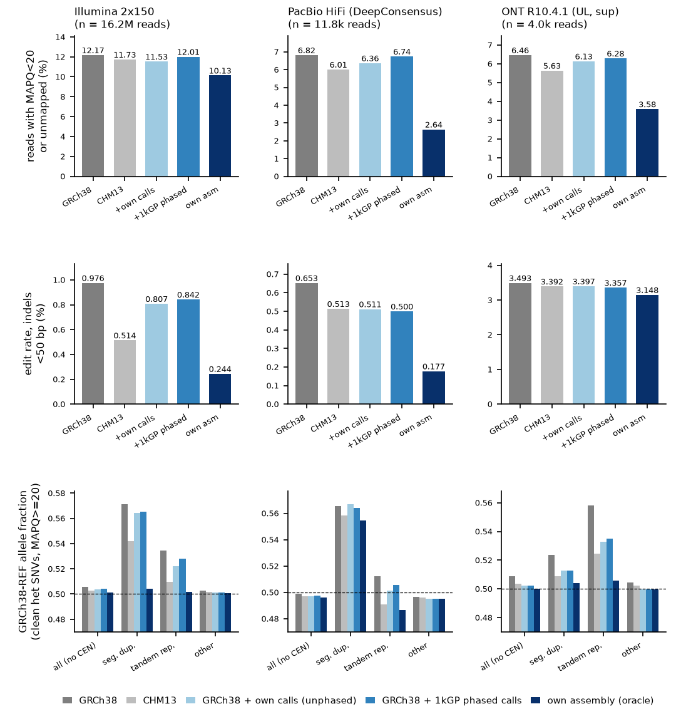
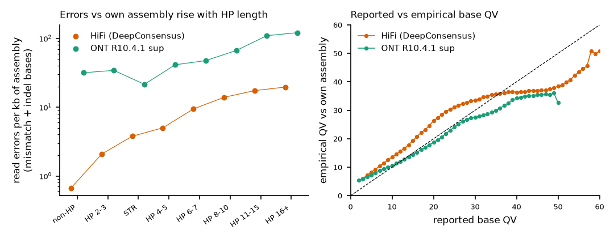

# L2/L3 litmus pilot: reference headroom on real 1kG data (NA19240, chr20)

*Track L2/L3, run 2026-11-11. One sample (NA19240, YRI), one chromosome (chr20), long reads at ~3x; every number below is provisional pilot evidence, not a population estimate.*

## Bottom line

1. **Short reads, mapping confidence.** 12.17% of the 16,157,058 Illumina reads in the NYGC chr20 slice are unmapped or MAPQ<20 on GRCh38 (minimap2 `-x sr`); mapping the same reads to the sample's own diploid assembly (per-template best haplotype) lowers this to 10.13%. A realistic two-pass personalized reference (bcftools calls from the same reads, unphased diploid pair) recovers 31% [13, 60] of that gap and a 1kGP-phased personalized diploid reference 8% [5, 12] (95% block-bootstrap CI); CHM13 recovers 21% [-9, 44]. Outside the chr20 centromere model (+-1 Mbp) the gap is 3.70% -> 2.91% and the recoveries are 23% [14, 36] and 12% [9, 16].
2. **Short reads, reference bias.** At 64,574 clean truth heterozygous SNVs (assembly-derived, outside the centromere model, no indel within 5-10 bp) the GRCh38-REF allele fraction among MAPQ>=20 Illumina reads is 0.506 [0.504, 0.508] on GRCh38 and 0.501 [0.500, 0.502] on the oracle. Small-variant personalization removes 44% (own calls) and 36% (1kGP phased) of the excess; CHM13 removes 66%. In segmental duplications (1,299 sites) bias falls from 0.571 [0.507, 0.639] to 0.504 [0.494, 0.520] with the oracle, but personalization removes only 11% / 9% of it, and the fraction of het SNVs with zero ALT reads at depth>=10 is 10.2% (own calls) and 9.1% (1kGP phased) versus 8.4% on GRCh38 and 0.6% on the oracle.
3. **Where the short-read headroom is.** In unique sequence ("other" stratum, 10,522,246 reads) personalization captures most of the small-variant headroom: perfect alignments (NM=0, unclipped) rise from 77.0% (GRCh38) to 89.2% (1kGP phased) versus 90.0% (oracle), i.e. 93% of the gap. Soft-clipping (>20 bp) is structural: CHM13 recovers 90% [86, 92] of the clipping gap across all reads, small-variant personalization 1% [0, 3].
4. **HiFi (11,752 chr20 reads, ~3x).** MAPQ<20/unmapped falls from 6.82% (GRCh38) to 2.64% (oracle); personalization recovers 11% [3, 23] (own calls) and 2% [1, 3] (1kGP phased) of the gap, CHM13 19% [6, 48]. Primary alignments clipped >1 kb: 3.02% -> 0.12%; CHM13 recovers 74% [57, 87], personalization 0% [-1, 1]. Personalization does remove most of the per-read divergence: median gap-compressed divergence 0.24% -> 0.05% (oracle), 0.08% with 1kGP phased (84% of the gap).
5. **ONT (3,994 chr20 reads, ~3x).** MAPQ<20/unmapped falls from 6.46% (GRCh38) to 3.58% (oracle); personalization recovers 11% [1, 29] (own calls) and 6% [2, 13] (1kGP phased) of the gap, CHM13 29% [13, 67]. Primary alignments clipped >1 kb: 7.68% -> 3.83%; CHM13 recovers 70% [51, 81], personalization 2% [-1, 7]. Personalization does remove most of the per-read divergence: median gap-compressed divergence 1.06% -> 0.87% (oracle), 0.94% with 1kGP phased (63% of the gap).
6. **Long-read reference bias is concentrated in tandem repeats (ONT).** GRCh38-REF fraction at clean het SNVs in TRs: ONT 0.558 [0.541, 0.574] (oracle 0.506 [0.489, 0.522]; own calls 0.533 [0.514, 0.550], 1kGP phased 0.535 [0.518, 0.551], CHM13 0.525 [0.510, 0.540]); HiFi 0.512 [0.496, 0.529] (oracle 0.487 [0.470, 0.504]). Genome-wide (non-CEN) ONT shows 0.509 [0.497, 0.520] versus 0.500 [0.489, 0.511] on the oracle.
7. **Residual long-read errors versus the own assembly.** HiFi (DeepConsensus) 1.82 errors/kb overall, rising from 0.67/kb outside homopolymers to 19.6/kb in runs >=16 bp; runs >=4 bp hold 9.7% of bases but 34% of error bases, and 89% of error bases are indels. ONT R10.4.1 (dorado sup 4.1.0, unfiltered) 34.0 errors/kb, 31.7/kb outside homopolymers to 121/kb in runs >=16 bp. Reported base QVs are over-confident at the top: HiFi bases reported Q40-49 are empirically Q36.9 and ONT Q40-49 bases Q34.9 (mismatch+insertion errors; the own-assembly floor limits empirical QV above ~Q40).

*Figure 1. Reference headroom for NA19240 chr20 reads by technology (columns). Rows: reads unmapped or MAPQ<20; pooled edit rate excluding indels >=50 bp; GRCh38-REF allele fraction at clean truth heterozygous SNVs (MAPQ>=20) by GRCh38 stratum (dashed line = unbiased 0.5). Bars: GRCh38, CHM13, GRCh38 personalized with the sample's own unphased bcftools calls, GRCh38 personalized with the 1kGP phased panel, and the sample's own HPRC release-2 assembly (oracle). Rows 1-2 include centromere-model reads (13.5% of Illumina reads), which dominate the totals; strata are in the tables.*

## Design

The pilot asks two questions on public 1kG-linked data. **L2 (oracle headroom):** how much better do the same reads align when the reference *is* the sample, i.e. the HPRC release-2 (preprint; [Lucas 2026](https://doi.org/10.64898/2026.07.21.739710)) trio-phased hifiasm ([Cheng 2021](https://doi.org/10.1038/s41592-020-01056-5)) assembly of NA19240 (hap1 = paternal `NA19240_pat_hprc_r2_v1.0.1`, hap2 = maternal), mapping every read to each whole haplotype separately and keeping, per template, the haplotype with the larger summed alignment score? **L3 (realistic recovery):** what fraction of that gap does a method that could be run on any 1kGP sample recover? Two realistic arms were built on chr20 of GRCh38 (the rest of the genome left as GRCh38): (i) **two-pass**, bcftools mpileup/call ([Danecek 2021](https://doi.org/10.1093/gigascience/giab008)) on the GRCh38 minimap2 alignment of the same Illumina reads (QUAL>=30, 8<=DP<=90), applied as an unphased diploid pair (A = all ALT alleles, R = homozygous ALT only); (ii) **1kGP phased**, the sample's genotypes from the 1kGP high-coverage phased SNV/INDEL/SV panel ([Byrska-Bishop 2022](https://doi.org/10.1016/j.cell.2022.08.004); sequence-resolved alleles; 137 symbolic SV records dropped) applied as haplotype 1 and 2. All references are whole genomes (no single-chromosome indexes); the same minimap2 2.31 ([Li 2018](https://doi.org/10.1093/bioinformatics/bty191)) preset is used for every reference: `-x sr` (Illumina), `-x map-hifi` (HiFi), `-x lr:hq` (ONT R10.4.1), with `--eqx -Y --secondary=no` for long reads.

| Read set | Source | Selection | Reads | Notes |
|---|---|---|---|---|
| Illumina 2x150, 30x | NYGC CRAM ERR3989410 (1kGP 698-related collection; md5 verified) | all primary, non-duplicate pairs with >=1 record on chr20 or mate on chr20 (mates elsewhere and unmapped mates included) | 16,157,058 reads (8,078,529 pairs) | selection by NYGC bwa-mem GRCh38 placement |
| PacBio HiFi | HPRC r2 DeepConsensus v1.2 q20 FASTQ, 3 SMRT cells | first 3.1 Gbp of each file (9.3 Gbp, ~3x), then chr20 prefilter + union rule | 11,752 reads | DC reads were also used to build the assembly |
| ONT R10.4.1 UL | HPRC r2 dorado 0.7.2 sup@v4.1.0 BAMs, 3 runs (read N50 ~100 kb) | first 3.1 Gbp of each file (9.3 Gbp, ~3x), then chr20 prefilter + union rule | 3,994 reads | no read-QV filter applied |

**Long-read selection.** Each streamed read was first mapped without base-level alignment to an index of the four chr20 sequences (GRCh38, CHM13, hap1 `CM099588.1`, hap2 `CM099626.1`); reads whose best single chain covered >=80% of the read were candidates (HiFi 17,726; ONT 6,184). Candidates were mapped to every whole-genome reference, and the analysed set is the union of reads whose primary alignment lies on chr20 in GRCh38, CHM13 or the oracle, so no single reference defines the set.

**Truth.** hap1/hap2 chr20 were aligned to whole-genome GRCh38 and CHM13 (`minimap2 -cx asm5 --cs -z200000,10000 -r2k`); dipcall-like rules ([Li 2018](https://doi.org/10.1038/s41592-018-0054-7)) kept GRCh38 chr20 bases covered by exactly one >=10 kb alignment of each haplotype (61,698,074 bp confident of 63,944,257 ACGT bp), giving 75,878 heterozygous and 34,353 homozygous-ALT SNVs; each het SNV carries its coordinate on hap1, hap2, CHM13 (both haplotype projections must agree; 70,650 sites) and on every personalized haplotype (bcftools consensus chain). The GRCh38 centromere model +-1 Mbp (chr20:25.44-31.04 Mb; 8,895 het sites, 8,604 of them clean) is reported separately because haplotype alpha-satellite aligned to the model sequence is not orthology. "Clean" sites additionally exclude SNVs within 5 bp of a truth indel or within 10 bp of any indel/complex record of either personalization call set, because equivalent haplotypes written with different indel/SNV combinations otherwise produce artefactual allele counts at a single coordinate.

**Strata** come from each read's GRCh38 primary alignment so that every reference is scored on identical read sets: CEN (>=50% of the aligned span in a centromere model +-1 Mbp), SD (>=50% in UCSC genomicSuperDups), TR (any overlap with UCSC simpleRepeat or homopolymers >=7 bp, padded 5 bp; short reads only), other, and unplaced (unmapped on GRCh38). Sites use the same intervals by position. **Statistics:** 95% intervals are block bootstraps (1,000 replicates, 1 Mbp GRCh38 blocks, identical weights for all references within a technology, so differences and gap recoveries are paired). Gap recovered = (GRCh38 - X)/(GRCh38 - oracle).

## Results

### Read-level metrics, all reads

| Tech | Reference | unmapped | MAPQ0 | MAPQ<20 or unmapped | clipped (>20 bp SR, >1 kb LR) | with supplementary | edit rate (indels<50 bp) | proper pair / median divergence |
|---|---|---|---|---|---|---|---|---|
| Illumina | GRCh38 | 0.43% | 5.40% | 12.17% | 4.19% | 1.45% | 0.976% | 95.09% |
| Illumina | CHM13 | 0.50% | 7.83% | 11.73% | 2.09% | 0.41% | 0.514% | 96.11% |
| Illumina | GRCh38+own calls (unphased) | 0.42% | 4.95% | 11.53% | 4.16% | 1.54% | 0.807% | 95.06% |
| Illumina | GRCh38+1kGP phased | 0.43% | 5.15% | 12.01% | 4.16% | 1.47% | 0.842% | 95.10% |
| Illumina | own assembly (oracle) | 0.38% | 6.39% | 10.13% | 1.87% | 0.42% | 0.244% | 96.81% |
| HiFi | GRCh38 | 0.26% | 0.01% | 6.82% | 3.02% | 2.62% | 0.653% | 0.24% |
| HiFi | CHM13 | 0.00% | 0.20% | 6.01% | 0.86% | 0.80% | 0.513% | 0.23% |
| HiFi | GRCh38+own calls (unphased) | 0.26% | 0.03% | 6.36% | 2.95% | 2.65% | 0.511% | 0.12% |
| HiFi | GRCh38+1kGP phased | 0.26% | 0.02% | 6.74% | 3.02% | 2.67% | 0.500% | 0.08% |
| HiFi | own assembly (oracle) | 0.00% | 0.00% | 2.64% | 0.12% | 0.16% | 0.177% | 0.05% |
| ONT | GRCh38 | 0.28% | 0.15% | 6.46% | 7.68% | 6.65% | 3.493% | 1.06% |
| ONT | CHM13 | 0.03% | 0.23% | 5.63% | 4.98% | 4.28% | 3.392% | 1.04% |
| ONT | GRCh38+own calls (unphased) | 0.25% | 0.08% | 6.13% | 7.71% | 6.80% | 3.397% | 0.97% |
| ONT | GRCh38+1kGP phased | 0.30% | 0.10% | 6.28% | 7.61% | 6.58% | 3.357% | 0.94% |
| ONT | own assembly (oracle) | 0.08% | 0.25% | 3.58% | 3.83% | 3.63% | 3.148% | 0.87% |
| Illumina | NYGC production bwa-mem 0.7.15 (GRCh38+alt+decoy+HLA), context only | 0.14% | 7.96% | 10.79% | 4.58% | n/a | 0.753% | 93.69% |

More complete references expose real paralogy that GRCh38 hides: relative to GRCh38, the oracle promotes 472,385 Illumina reads from MAPQ<20 to >=20 but demotes 142,082 (1.0% of GRCh38 MAPQ>=20 reads); CHM13 promotes 260,282 and demotes 189,334, and MAPQ0 in SDs rises from 7.1% (GRCh38) to 13.1% (oracle). MAPQ<20 is therefore a net, not a monotone, quality signal; the oracle defines the attainable level.

### MAPQ<20 by stratum and fraction of the oracle gap recovered

| Tech | Stratum (reads) | GRCh38 | oracle | CHM13: gap recovered | own calls: gap recovered | 1kGP phased: gap recovered |
|---|---|---|---|---|---|---|
| Illumina | all (16,157,058) | 12.17% | 10.13% | 21% [-9, 44] | 31% [13, 60] | 8% [5, 12] |
| Illumina | all_noCEN (13,976,554) | 3.70% | 2.91% | 24% [-30, 55] | 23% [14, 36] | 12% [9, 16] |
| Illumina | CEN (2,180,504) | 66.45% | 56.36% | 20% [-22, 46] | 36% [9, 87] | 6% [2, 12] |
| Illumina | SD (262,655) | 28.51% | 23.31% | -11% [-616, 70] | 42% [21, 167] | 17% [7, 74] |
| Illumina | TR (3,121,657) | 7.23% | 5.98% | -3% [-72, 52] | 28% [12, 44] | 10% [7, 17] |
| Illumina | other (10,522,246) | 1.40% | 0.94% | 46% [37, 55] | 15% [10, 24] | 12% [7, 20] |
| HiFi | all (11,752) | 6.82% | 2.64% | 19% [6, 48] | 11% [3, 23] | 2% [1, 3] |
| HiFi | all_noCEN (10,404) | 0.89% | 0.01% | 41% [-16, 93] | 7% [0, 13] | 1% [0, 5] |
| HiFi | CEN (1,348) | 52.52% | 22.92% | 14% [6, 51] | 12% [2, 32] | 2% [1, 4] |
| HiFi | SD (164) | 18.90% | 0.00% | 77% [50, 93] | 6% [0, 8] | 3% [0, 8] |
| HiFi | nonSD (10,209) | 0.30% | 0.01% | -33% [-82, 100] | 13% [0, 18] | 0% [0, 0] |
| ONT | all (3,994) | 6.46% | 3.58% | 29% [13, 67] | 11% [1, 29] | 6% [2, 13] |
| ONT | all_noCEN (3,602) | 1.78% | 1.14% | 65% [37, 138] | 13% [0, 25] | 13% [0, 25] |
| ONT | CEN (392) | 49.49% | 26.02% | 20% [5, 66] | 11% [-1, 35] | 4% [0, 12] |
| ONT | SD (67) | 13.43% | 0.00% | 78% [44, 100] | 11% [0, 50] | 11% [0, 50] |
| ONT | nonSD (3,524) | 1.25% | 0.85% | 57% [25, 200] | 14% [0, 40] | 14% [0, 40] |

### Reference bias at clean truth het SNVs (GRCh38-REF fraction, MAPQ>=20)

| Tech | Stratum (sites) | GRCh38 | CHM13 | own calls | 1kGP phased | oracle |
|---|---|---|---|---|---|---|
| Illumina | all non-CEN (64,574) | 0.506 [0.504, 0.508] | 0.503 [0.501, 0.505] | 0.504 [0.502, 0.506] | 0.504 [0.502, 0.506] | 0.501 [0.500, 0.502] |
| Illumina | SD (1,299) | 0.571 [0.507, 0.639] | 0.542 [0.495, 0.613] | 0.564 [0.502, 0.630] | 0.565 [0.503, 0.635] | 0.504 [0.494, 0.520] |
| Illumina | TR (4,506) | 0.535 [0.526, 0.543] | 0.510 [0.505, 0.515] | 0.522 [0.515, 0.529] | 0.528 [0.519, 0.537] | 0.502 [0.498, 0.506] |
| Illumina | other (58,769) | 0.503 [0.501, 0.504] | 0.502 [0.500, 0.503] | 0.501 [0.500, 0.503] | 0.501 [0.500, 0.503] | 0.501 [0.500, 0.502] |
| Illumina | CEN (8,604) | 0.585 [0.521, 0.622] | 0.514 [0.493, 0.539] | 0.593 [0.521, 0.627] | 0.582 [0.518, 0.618] | 0.480 [0.459, 0.490] |
| HiFi | all non-CEN (64,574) | 0.499 [0.491, 0.507] | 0.497 [0.488, 0.505] | 0.497 [0.489, 0.506] | 0.497 [0.489, 0.506] | 0.496 [0.487, 0.504] |
| HiFi | SD (1,299) | 0.566 [0.489, 0.672] | 0.558 [0.481, 0.684] | 0.567 [0.488, 0.677] | 0.564 [0.486, 0.671] | 0.555 [0.483, 0.676] |
| HiFi | TR (4,506) | 0.512 [0.496, 0.529] | 0.491 [0.473, 0.509] | 0.502 [0.486, 0.517] | 0.506 [0.489, 0.522] | 0.487 [0.470, 0.504] |
| HiFi | other (58,769) | 0.497 [0.488, 0.505] | 0.496 [0.487, 0.504] | 0.495 [0.486, 0.503] | 0.495 [0.487, 0.504] | 0.495 [0.487, 0.503] |
| HiFi | CEN (8,604) | 0.606 [0.521, 0.629] | 0.533 [0.506, 0.555] | 0.607 [0.518, 0.627] | 0.605 [0.520, 0.628] | 0.514 [0.492, 0.541] |
| ONT | all non-CEN (64,574) | 0.509 [0.497, 0.520] | 0.504 [0.492, 0.515] | 0.502 [0.491, 0.513] | 0.502 [0.491, 0.513] | 0.500 [0.489, 0.511] |
| ONT | SD (1,299) | 0.524 [0.471, 0.641] | 0.509 [0.459, 0.638] | 0.513 [0.462, 0.634] | 0.513 [0.463, 0.631] | 0.504 [0.456, 0.615] |
| ONT | TR (4,506) | 0.558 [0.541, 0.574] | 0.525 [0.510, 0.540] | 0.533 [0.514, 0.550] | 0.535 [0.518, 0.551] | 0.506 [0.489, 0.522] |
| ONT | other (58,769) | 0.505 [0.493, 0.515] | 0.502 [0.491, 0.513] | 0.500 [0.488, 0.511] | 0.500 [0.488, 0.511] | 0.500 [0.488, 0.511] |
| ONT | CEN (8,604) | 0.621 [0.529, 0.653] | 0.549 [0.463, 0.599] | 0.621 [0.527, 0.650] | 0.619 [0.526, 0.650] | 0.530 [0.483, 0.551] |

Illumina sites (depth>=10) with zero ALT reads at MAPQ>=20: all non-CEN 0.43% (GRCh38), 0.26% (CHM13), 0.51% (own calls), 0.45% (1kGP phased), 0.11% (oracle); SD 8.38%, 7.02%, 10.20%, 9.13%, 0.56%; TR 2.10%, 0.53%, 2.63%, 2.36%, 0.09%. CHM13 carries the GRCh38-ALT allele at 24.5% of these het sites, so part of its gain is allele choice rather than completeness.

### Quality of the personalization inputs (chr20 confident region minus centromere model, 58,548,541 bp)

| Call set | het SNV recall | hom-ALT SNV recall | SNV precision | phase agreement with trio assembly | adjacent switch rate |
|---|---|---|---|---|---|
| two-pass bcftools (same Illumina reads) | 95.4% | 96.3% | 98.35% | unphased | n/a |
| 1kGP phased panel | 94.8% | 94.4% | 99.45% | 99.96% | 0.066% |

| Stratum (clean truth het SNVs) | present in two-pass calls | present in 1kGP phased panel |
|---|---|---|
| other (58,769) | 99.0% | 98.9% |
| TR (4,506) | 79.5% | 72.8% |
| SD (1,299) | 74.0% | 72.1% |
| CEN (8,604) | 49.2% | 39.6% |

### Long-read residual errors versus the own assembly

| Context | HiFi errors/kb | HiFi del events/kb | ONT errors/kb | ONT del events/kb | share of assembly bases |
|---|---|---|---|---|---|
| HP1 | 0.67 | 0.16 | 31.7 | 6.8 | 50.0% |
| HP2-3 | 2.08 | 1.19 | 34.3 | 8.2 | 39.1% |
| STR | 3.78 | 1.25 | 21.5 | 3.9 | 1.2% |
| HP4-5 | 5.01 | 3.52 | 41.3 | 11.9 | 7.9% |
| HP6-7 | 9.43 | 6.75 | 47.5 | 14.4 | 1.1% |
| HP8-10 | 13.91 | 8.97 | 66.7 | 18.4 | 0.3% |
| HP11-15 | 17.41 | 10.27 | 109.6 | 27.8 | 0.2% |
| HP16+ | 19.60 | 10.43 | 121.0 | 25.5 | 0.3% |
| ALL | 1.82 | 0.99 | 34.0 | 7.9 | 100.0% |

*HP1 = assembly bases outside homopolymer runs and outside 2-6 bp-unit STRs; HPk = bases inside a homopolymer run of length k; deletion events are attributed to the first deleted assembly base.*

| Reported QV bin | HiFi bases | HiFi empirical QV | ONT bases | ONT empirical QV |
|---|---|---|---|---|
| 0-9 | 0.2% | 8.9 | 9.7% | 7.9 |
| 10-19 | 1.0% | 19.4 | 8.5% | 13.4 |
| 20-29 | 15.3% | 31.3 | 15.7% | 23.3 |
| 30-39 | 39.6% | 35.2 | 29.0% | 30.2 |
| 40-49 | 27.5% | 36.9 | 25.1% | 34.9 |
| 50-99 | 16.4% | 40.9 | 11.8% | 32.8 |

*Figure 2. Left: long-read errors per kb of the sample's own assembly by assembly context (homopolymer run length, 2-6 bp-unit STR), MAPQ>=20 alignments of chr20 reads to their best haplotype. Right: reported base QV versus empirical QV (mismatch and insertion errors per aligned base; bins with >=10k bases); dashed line = perfect calibration.*

## Interpretation

**The oracle gap is real but mostly structural, and the two realistic personalizations attack a different part of it than CHM13 does.** For Illumina the own assembly lowers MAPQ<20 from 12.2% to 10.1% of reads; the gain is concentrated in the centromere model, segmental duplications and tandem repeats, where GRCh38 is collapsed, incomplete or modelled. CHM13 recovers 82-93% of the Illumina soft-clipping gap in every stratum and 77-78% of the SD and CEN edit-rate gap, consistent with the completeness gains reported for T2T-CHM13 ([Nurk 2022](https://doi.org/10.1126/science.abj6987); [Aganezov 2022](https://doi.org/10.1126/science.abl3533); [Vollger 2022](https://doi.org/10.1126/science.abj6965)), while small-variant personalization recovers 0-4% of the clipping gap. Conversely, in unique sequence personalization captures most of the small-variant headroom (93% of the perfect-alignment gap; 84% of the HiFi median-divergence gap), which CHM13 does not (1% and 5%). No single realistic arm approaches the oracle on MAPQ: the best is the unphased two-pass reference at 31% [13, 60] of the gap. This is the quantitative case for combining a complete backbone with haplotype-resolved, SV-aware sample sequence rather than choosing between them, which is what haplotype sampling from a pangenome attempts ([Sirén 2024](https://doi.org/10.1038/s41592-024-02407-2)).

**MAPQ is not a monotone quality signal.** Relative to GRCh38 the oracle promotes 472k Illumina reads to MAPQ>=20 but demotes 142k, and CHM13 demotes 189k; MAPQ0 in SDs nearly doubles on the oracle (7.1% -> 13.1%). These demotions are reads whose paralogous copies are absent or collapsed in GRCh38, so GRCh38's confidence was overstated. Any claim of "more reads mapped confidently" must therefore be reported as a fraction of the oracle gap together with demotions, not as an absolute MAPQ gain.

**Reference bias for short reads is small genome-wide but large where it matters, and phasing alone does not remove it.** The GRCh38-REF fraction at clean het SNVs is 0.506 overall but 0.571 in SDs and 0.535 in TRs; the oracle brings both to 0.50. Personalization removes 38.5%/19.9% of the TR excess (own calls / 1kGP) but only 11%/9% in SDs, and the fraction of SD het sites with no ALT read at depth>=10 rises from 8.4% (GRCh38) to 9.1-10.2%, versus 0.6% on the oracle. Two effects combine. About a quarter of clean SD het SNVs are absent from both call sets (present: 74.0% two-pass, 72.1% 1kGP), so reference bias suppresses exactly the variants that personalization would need. Where the ALT base is added, ALT reads that are placed on a paralog are not brought back; the oracle, which contains the sample's own paralog copies, is the only arm that restores them. Personalized and graph references have been shown to recover allele-specific signal ([Groza 2020](https://doi.org/10.1186/s13059-020-02038-8); [Chen 2021](https://doi.org/10.1186/s13059-020-02229-3)), and allele-aware remapping is the standard short-read fix ([van de Geijn 2015](https://doi.org/10.1038/nmeth.3582); [Degner 2009](https://doi.org/10.1093/bioinformatics/btp579)); this pilot shows that in SDs both approaches leave most of the bias, because the defect is in the paralog content of the reference. The 1kGP panel arm is weaker than the own-calls arm in TRs because it contains fewer of the TR het SNVs (72.8% versus 79.5% of clean TR sites; 98.9% versus 99.0% in unique sequence). Breaking this circularity needs an independent variant source, such as long reads or an assembly, rather than the biased short-read calls themselves.

**Long reads.** HiFi shows no detectable genome-wide allele bias (0.499 [0.491, 0.507]); its oracle gap is placement and clipping in SD/CEN, where CHM13 recovers 72-80% of the clipping gap across strata and 77% of the SD MAPQ gap. ONT retains a TR-specific bias (0.558 versus 0.506 on the oracle) that personalization halves. Residual errors against the own assembly are dominated by homopolymer deletions for HiFi (89% of error bases are indels; error rate 29x higher in runs >=16 bp than outside homopolymers) and by mismatches plus deletions for unfiltered ONT R10.4.1 sup reads, in line with reported chemistry behaviour ([Wenger 2019](https://doi.org/10.1038/s41587-019-0217-9); [Sereika 2022](https://doi.org/10.1038/s41592-022-01539-7)). Base QVs are informative but not calibrated (error-weighted reported versus empirical QV per bin, mismatch+insertion errors). DeepConsensus QVs ([Baid 2022](https://doi.org/10.1038/s41587-022-01435-7)) are under-confident below about Q35 (reported Q20-24 -> empirical Q28.9) and over-confident above Q40 (Q45-49 -> Q37.2; Q50+ -> Q40.9). ONT QVs are calibrated near Q10-19, about 1 QV over-confident at Q20-29 and increasingly over-confident above Q30 (Q45-49 -> Q35.6). The ONT top bin is not monotone (Q50+ -> Q32.8).

**Context, not a comparison.** The NYGC production alignment of the same reads (bwa-mem 0.7.15 against GRCh38 with alt, decoy and HLA contigs; [Byrska-Bishop 2022](https://doi.org/10.1016/j.cell.2022.08.004)) has 10.8% MAPQ<20, below minimap2 on GRCh38 (12.2%). This is not a like-for-like comparison: the read set was selected by that alignment's own chr20 placement, decoys absorb reads, and alt contigs change MAPQ semantics.

## Proposals

1. **Oracle-gap ("reference headroom") reporting as the standard for reference, aligner and pangenome claims.** *Area:* cross-cutting. *Status:* prototype (this pilot). *Idea:* every proposed reference or alignment method is scored on public samples that have HPRC/HGSVC assemblies, as the fraction of the GRCh38-to-own-assembly gap it recovers, with paired block-bootstrap CIs and a demotion count. *Litmus:* NA19240, NYGC chr20 Illumina slice (16.16M reads) plus 3x HiFi/ONT chr20 reads, metrics MAPQ<20, clipping and clean-het-SNV REF fraction by stratum. Measured baselines: own-calls personalization 31% [13, 60] / 1% [0, 4] / 44%; 1kGP-phased 8% [5, 12] / 1% [0, 3] / 36%; CHM13 21% [-9, 44] / 90% [86, 92] / 66%. A method *passes* if the lower CI bound of gap recovered is >0 for all three metrics and SD ALT-dropout does not rise above GRCh38 (8.4%). *Expected impact:* removes ambiguity from MAPQ-based claims and makes reference choices comparable across tracks. *Closest prior work:* biastools ([Lin 2024](https://doi.org/10.1186/s13059-024-03240-8)), GIAB stratifications ([Dwarshuis 2024](https://doi.org/10.1038/s41467-024-53260-y)), and the mapping evaluations of the HPRC drafts ([Liao 2023](https://doi.org/10.1038/s41586-023-05896-x)) and HPRC2 (preprint; [Lucas 2026](https://doi.org/10.64898/2026.07.21.739710)), none of which normalizes to a per-sample assembly oracle.
2. **Complete backbone plus phased, SV-aware personalization for 1kGP-scale re-alignment.** *Area:* short-read alignment. *Status:* implemented-not-adopted (haplotype sampling, [Sirén 2024](https://doi.org/10.1038/s41592-024-02407-2); Giraffe, [Sirén 2021](https://doi.org/10.1126/science.abg8871); production cohorts still align to GRCh38). *Idea:* build each sample's diploid reference from a T2T-complete backbone plus haplotypes sampled from the HPRC release-2 graph and the sample's own phased small variants and SVs, then align linearly with standard tools. *Litmus:* same NA19240 chr20 read set, leave-one-out graph (NA19240 haplotypes removed). Pass if MAPQ<20 gap recovered >=50% (measured best realistic 31%), clipping gap >=70% (CHM13 alone 90%, personalization 1%), SD REF fraction <=0.53 (GRCh38 0.571, oracle 0.504), SD ALT-dropout <=2% (GRCh38 8.4%). *Expected impact:* targets the SD/TR headroom that neither CHM13 nor small-variant personalization recovers on its own; variants should come from sources not subject to short-read reference bias (in SDs both short-read call sets miss about a quarter of het SNVs). *Closest prior work:* reference flow ([Chen 2021](https://doi.org/10.1186/s13059-020-02229-3)), personalized and graph genomes ([Groza 2020](https://doi.org/10.1186/s13059-020-02038-8)), Pangenome-aware DeepVariant (preprint; [Asri 2025](https://doi.org/10.1101/2025.06.05.657102)), Giraffe long/short-read mapping (preprint; [Chang 2025](https://doi.org/10.1101/2025.09.29.678807)).
3. **Haplotype-likelihood allele counting for long reads in tandem repeats.** *Area:* long-read alignment. *Status:* open for ONT allele counting (allele-aware remapping exists for short reads, [van de Geijn 2015](https://doi.org/10.1038/nmeth.3582)). *Idea:* for reads overlapping a het site in a TR, realign the local window to both phased haplotypes with a homopolymer/STR-aware error model and assign the allele by likelihood ratio instead of reading the pileup base. *Litmus:* ONT R10.4.1 chr20 reads, 4,506 clean TR het SNVs; measured REF fraction 0.558 [0.541, 0.574] (GRCh38), 0.533-0.535 (personalized), 0.506 (oracle). Pass if <=0.52 with "other" sites unchanged (0.505 +-0.005). *Expected impact:* removes the one long-read bias that survives personalization; matters for allele-specific methylation and expression from ONT. *Closest prior work:* WASP, biastools, Kolmogorov 2023 haplotype-resolved ONT pipelines ([Kolmogorov 2023](https://doi.org/10.1038/s41592-023-01993-x)).
4. **Assembly-anchored, context-aware base-QV recalibration for HiFi and ONT.** *Area:* long-read alignment. *Status:* open. *Idea:* use public samples with own assemblies (HPRC release 2; 1kG-ONT samples that are also in HPRC) as truth to recalibrate QVs by homopolymer length, position in run and read QV, and export the empirical error model to aligners and callers. *Litmus:* train on NA19240 chromosomes other than chr20, test on chr20 reads against the own assembly. Measured miscalibration: HiFi Q20-29 -> empirical 31.3, Q40-49 -> 36.9, Q50+ -> 40.9; ONT Q40-49 -> 34.9, Q50+ -> 32.8. Pass if |empirical - reported| <=2 QV in every bin with >=10k bases up to the assembly floor (about Q40-45). *Expected impact:* calibrated QVs are a prerequisite for likelihood-based genotyping in homopolymers, where 34% of HiFi error bases arise. *Closest prior work:* DeepConsensus ([Baid 2022](https://doi.org/10.1038/s41587-022-01435-7)), Merqury k-mer QV ([Rhie 2020](https://doi.org/10.1186/s13059-020-02134-9)).

## Caveats and deviations

- One sample and one chromosome. NA19240 chr20 (64.4 Mbp, 2% of the genome) was used throughout; no fallback sample was needed. All rates are provisional.
- **Illumina selection bias.** The read set is the NYGC chr20 slice: pairs with a primary, non-duplicate record or mate on chr20 in the NYGC bwa-mem GRCh38+decoy alignment. chr20-origin reads that NYGC placed elsewhere, or left fully unmapped, are missing. Reads from paralogs that NYGC placed on chr20 are included. The selection favours GRCh38, so the measured headroom is a lower bound. Duplicates, QC-fail, secondary and supplementary records were excluded at extraction.
- **Long-read sampling.** The first 3.1 Gbp of each of three files per technology were used (about 3x each), not a uniform random sample. ONT reads were not QV-filtered. The chr20 candidate rule (best chain >=80% of the read on any of four chr20 sequences) may miss chimeric or low-quality chr20 reads. The ONT union set is 187 Mbp (about 2.8x) against an expected about 3x.
- **Oracle circularity.** The HiFi DeepConsensus and ONT UL reads were inputs to the hifiasm assembly, so the long-read oracle is partly self-consistent. The Illumina reads are independent of the assembly.
- **Personalization scope.** Both realistic arms modify chr20 only; the rest of the genome stays GRCh38. The two-pass arm is unphased (an A/R pair). The 1kGP arm drops 137 symbolic SV records. Overlapping records skipped by bcftools consensus: 12 and 4 (1kGP hap1/hap2), 2,698 and 17 (two-pass A/R; the A haplotype cannot hold overlapping heterozygous alleles).
- **Truth limits.** Truth is dipcall-like and assembly-based on chr20 only. Sites in the centromere model +-1 Mbp are reported separately. Allele balance uses "clean" sites (64,574 of 66,983 non-CEN het SNVs). SD truth can still contain paralog-alignment errors.
- **Alignment scope.** bwa mem was not run because of time and CPU budget; the NYGC production alignment is shown as context only. ONT was mapped with `lr:hq` only (no `map-ont`). HGSVC3 assemblies were not used.
- **Error and QV scope.** Long-read QV calibration counts mismatches and insertions only, since deletions have no base QV. Empirical QV above about Q40 is bounded by assembly accuracy and alignment ambiguity.
- **Resource budget.** Per-reference minimap2 peaks (index construction or mapping) were 14.2-15.7 GB RSS (maximum: hap1 `-x sr` index build, about 1 min), above the 14 GB budget. Early in the run, downloads, the long-read prefilter and CRAM decoding overlapped and briefly exceeded 4 threads; everything was serialized from then on. The CRAM (15.07 GB, md5 verified) was downloaded whole to scratch and deleted after slicing.
- **Strata.** Strata use UCSC genomicSuperDups, simpleRepeat and homopolymers >=7 bp on GRCh38, assigned by GRCh38 placement. GIAB v3.x stratification BEDs and a CHM13 SD track were not used.

## Reproduction

`scripts/run_all.sh OUTDIR [threads=4] [keep_scratch=0]` reruns everything in a `mktemp` scratch directory that is deleted on exit (peak about 120 GB disk, about 14 GB RAM, 4 threads, about 5-6 h wall time on an M1-class Mac; the 15 GB CRAM download and 18 GB of long-read streaming dominate I/O). Steps: [00_fetch.sh](00_fetch.sh) (references, assembly, panel, CRAM, long reads via [01_stream_long_reads.sh](01_stream_long_reads.sh)), [01b_truth_and_strata.sh](01b_truth_and_strata.sh) ([l2l3_truth.py](l2l3_truth.py), [l2l3_strata.py](l2l3_strata.py), [l2l3_sites.py](l2l3_sites.py)), [02_illumina_slice.sh](02_illumina_slice.sh), [03_lr_prefilter.sh](03_lr_prefilter.sh), [05_map_reference.sh](05_map_reference.sh) (GRCh38), [04_two_pass_personalize.sh](04_two_pass_personalize.sh) (panel and two-pass), [07_run_refs.sh](07_run_refs.sh) (all references, using [05_map_reference.sh](05_map_reference.sh) and [06_post.sh](06_post.sh) with [l2l3_reads.py](l2l3_reads.py) and [l2l3_pileup.py](l2l3_pileup.py)), [08_summarize.sh](08_summarize.sh) ([l2l3_calleval.py](l2l3_calleval.py), [l2l3_lrerr.py](l2l3_lrerr.py), [l2l3_summarize.py](l2l3_summarize.py), [l2l3_ci.py](l2l3_ci.py), [l2l3_figures.py](l2l3_figures.py)). Tool versions: minimap2 2.31-r1302 (latest release, 2026-05-19), samtools/bcftools/htslib 1.25, seqkit 2.14.0, Python 3.11.18 with pysam 0.24.1, numpy 2.4.6, pandas 3.1.1, pytrf 1.5.0 and matplotlib 3.11.2. Data URLs and checksums are in [L2L3_provenance.tsv](L2L3_provenance.tsv).

## References

Aganezov 2022, Science, [10.1126/science.abl3533](https://doi.org/10.1126/science.abl3533) · Asri 2025, bioRxiv preprint, [10.1101/2025.06.05.657102](https://doi.org/10.1101/2025.06.05.657102) · Baid 2022, Nat Biotechnol, [10.1038/s41587-022-01435-7](https://doi.org/10.1038/s41587-022-01435-7) · Byrska-Bishop 2022, Cell, [10.1016/j.cell.2022.08.004](https://doi.org/10.1016/j.cell.2022.08.004) · Chang 2025, bioRxiv preprint, [10.1101/2025.09.29.678807](https://doi.org/10.1101/2025.09.29.678807) · Chen 2021, Genome Biol, [10.1186/s13059-020-02229-3](https://doi.org/10.1186/s13059-020-02229-3) · Cheng 2021, Nat Methods, [10.1038/s41592-020-01056-5](https://doi.org/10.1038/s41592-020-01056-5) · Danecek 2021, GigaScience, [10.1093/gigascience/giab008](https://doi.org/10.1093/gigascience/giab008) · Degner 2009, Bioinformatics, [10.1093/bioinformatics/btp579](https://doi.org/10.1093/bioinformatics/btp579) · Dwarshuis 2024, Nat Commun, [10.1038/s41467-024-53260-y](https://doi.org/10.1038/s41467-024-53260-y) · Groza 2020, Genome Biol, [10.1186/s13059-020-02038-8](https://doi.org/10.1186/s13059-020-02038-8) · Kolmogorov 2023, Nat Methods, [10.1038/s41592-023-01993-x](https://doi.org/10.1038/s41592-023-01993-x) · Li 2018 (minimap2), Bioinformatics, [10.1093/bioinformatics/bty191](https://doi.org/10.1093/bioinformatics/bty191) · Li 2018 (dipcall / synthetic-diploid benchmark), Nat Methods, [10.1038/s41592-018-0054-7](https://doi.org/10.1038/s41592-018-0054-7) · Liao 2023, Nature, [10.1038/s41586-023-05896-x](https://doi.org/10.1038/s41586-023-05896-x) · Lin 2024, Genome Biol, [10.1186/s13059-024-03240-8](https://doi.org/10.1186/s13059-024-03240-8) · Lucas 2026, bioRxiv preprint, [10.64898/2026.07.21.739710](https://doi.org/10.64898/2026.07.21.739710) · Nurk 2022, Science, [10.1126/science.abj6987](https://doi.org/10.1126/science.abj6987) · Rhie 2020, Genome Biol, [10.1186/s13059-020-02134-9](https://doi.org/10.1186/s13059-020-02134-9) · Sereika 2022, Nat Methods, [10.1038/s41592-022-01539-7](https://doi.org/10.1038/s41592-022-01539-7) · Sirén 2021, Science, [10.1126/science.abg8871](https://doi.org/10.1126/science.abg8871) · Sirén 2024, Nat Methods, [10.1038/s41592-024-02407-2](https://doi.org/10.1038/s41592-024-02407-2) · van de Geijn 2015, Nat Methods, [10.1038/nmeth.3582](https://doi.org/10.1038/nmeth.3582) · Vollger 2022, Science, [10.1126/science.abj6965](https://doi.org/10.1126/science.abj6965) · Wenger 2019, Nat Biotechnol, [10.1038/s41587-019-0217-9](https://doi.org/10.1038/s41587-019-0217-9)

## Files

- [L2L3_metrics.tsv](L2L3_metrics.tsv) - per technology x reference read-level metrics (all reads)
- [L2L3_metrics_by_stratum.tsv](L2L3_metrics_by_stratum.tsv) - same metrics by GRCh38 stratum (CEN/SD/TR/other/unplaced; nonSD for long reads) incl. NYGC bwa-mem context
- [L2L3_mapq_transitions.tsv](L2L3_mapq_transitions.tsv) - reads promoted to / demoted from MAPQ>=20 relative to GRCh38
- [L2L3_readmetric_ci.tsv](L2L3_readmetric_ci.tsv) - MAPQ<20 and clipping with block-bootstrap CIs and fraction of oracle gap recovered
- [L2L3_allele_balance.tsv](L2L3_allele_balance.tsv) - allele counts at truth het SNVs: REF fraction, ALT dropout, depth, by site set/stratum/MAPQ
- [L2L3_allele_balance_ci.tsv](L2L3_allele_balance_ci.tsv) - REF fraction with block-bootstrap CIs and paired differences vs GRCh38
- [L2L3_callsets_vs_truth.tsv](L2L3_callsets_vs_truth.tsv) - two-pass and 1kGP phased call sets vs assembly truth
- [L2L3_lr_error_context_hifi.tsv](L2L3_lr_error_context_hifi.tsv) - HiFi residual errors vs own assembly by context
- [L2L3_lr_error_context_ont.tsv](L2L3_lr_error_context_ont.tsv) - ONT residual errors vs own assembly by context
- [L2L3_lr_qv_calibration_hifi.tsv](L2L3_lr_qv_calibration_hifi.tsv) - HiFi reported vs empirical base QV
- [L2L3_lr_qv_calibration_ont.tsv](L2L3_lr_qv_calibration_ont.tsv) - ONT reported vs empirical base QV
- [L2L3_truth_summary.json](L2L3_truth_summary.json) - chr20 truth-set summary
- [L2L3_truth_chr20_het_snv.tsv.gz](L2L3_truth_chr20_het_snv.tsv.gz) - NA19240 chr20 assembly-truth het SNVs (GRCh38 pos, alleles, hap1/hap2/CHM13 coordinates and orientation)
- [L2L3_truth_chr20_homalt_snv.tsv.gz](L2L3_truth_chr20_homalt_snv.tsv.gz) - NA19240 chr20 assembly-truth homozygous-ALT SNVs
- [L2L3_truth_chr20_confident.bed.gz](L2L3_truth_chr20_confident.bed.gz) - GRCh38 chr20 bases covered by exactly one alignment of each haplotype
- [L2L3_provenance.tsv](L2L3_provenance.tsv) - data URLs, checksums, tool versions
- [L2L3_references.json](../../references/tracks/L2L3_references.json) - verified bibliography (DOIs) for this track
- [L2L3_callset_recall_by_stratum.tsv](L2L3_callset_recall_by_stratum.tsv) - truth het SNVs present in each personalization call set, by stratum
- [L2L3_fig1_reference_headroom.png](L2L3_fig1_reference_headroom.png) - Figure 1
- [L2L3_fig2_longread_residuals.png](L2L3_fig2_longread_residuals.png) - Figure 2
- [run_all.sh](run_all.sh) - end-to-end driver (mktemp scratch, trap cleanup)
- [00_fetch.sh](00_fetch.sh) - downloads with checksums
- [01_stream_long_reads.sh](01_stream_long_reads.sh) - long-read subset streaming
- [01b_truth_and_strata.sh](01b_truth_and_strata.sh) - assembly truth, strata, site tables
- [02_illumina_slice.sh](02_illumina_slice.sh) - single-pass CRAM pair extraction
- [03_lr_prefilter.sh](03_lr_prefilter.sh) - chr20 long-read candidate prefilter
- [04_two_pass_personalize.sh](04_two_pass_personalize.sh) - 1kGP-phased and two-pass personalized references
- [05_map_reference.sh](05_map_reference.sh) - matched minimap2 mapping per reference
- [06_post.sh](06_post.sh) - per-read metrics, best-of-two, pileups
- [07_run_refs.sh](07_run_refs.sh) - sequential loop over references
- [08_summarize.sh](08_summarize.sh) - tables, CIs, figures
- [l2l3_truth.py](l2l3_truth.py) - dipcall-like truth and coordinate projection
- [l2l3_strata.py](l2l3_strata.py) - SD/TR/CEN intervals
- [l2l3_sites.py](l2l3_sites.py) - per-reference site tables, clean-site rule
- [l2l3_reads.py](l2l3_reads.py) - per-read metrics and best-of-two haplotype selection
- [l2l3_pileup.py](l2l3_pileup.py) - allele counting
- [l2l3_lrerr.py](l2l3_lrerr.py) - long-read error context and QV calibration
- [l2l3_calleval.py](l2l3_calleval.py) - call set vs truth
- [l2l3_summarize.py](l2l3_summarize.py) - metric tables
- [l2l3_ci.py](l2l3_ci.py) - block bootstrap
- [l2l3_figures.py](l2l3_figures.py) - figures
- [l2l3_report.py](l2l3_report.py) - report generator
- [report_tail.md](report_tail.md) - static report sections
- [l2l3_recall_strata.py](l2l3_recall_strata.py) - call-set presence of truth het SNVs by stratum
