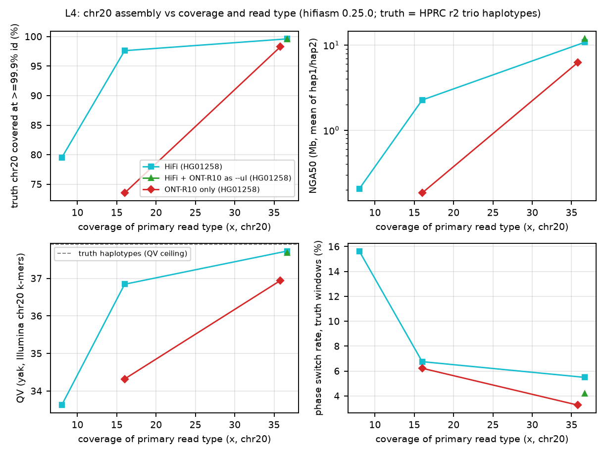
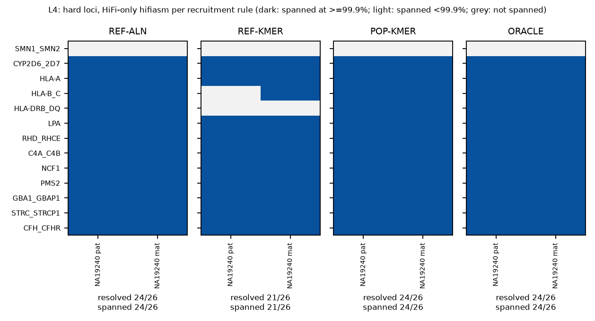

# L4 litmus pilot: assembly as a function of coverage and read type, and population-informed recruitment at hard loci

*Real 1000 Genomes / HPRC release-2 data; hifiasm 0.25.0-r726; 3 threads; shared laptop (load average 15-37 on 10 cores during the runs).*

## Summary

The pilot used two trio children with region-sliceable long reads. NA19240 was the preferred sample, and its HiFi reads and loci pool were used. HG01258 was added because its ONT R10 reads are aligned and indexed, whereas NA19240 ONT exists only as unaligned 13-73-GB BAMs. Each sample's HPRC release-2 trio-phased haplotypes served as truth. Results are provisional where the titration grid is partial (see Deviations).

- **L4-T1 (HiFi coverage, HG01258 chr20).** At 36.7x HiFi, hifiasm reaches 99.61% of the truth at >=99.9% identity, 16 contigs, NG50 45.4 Mb and QV 37.7 (truth ceiling 37.9). At 16x: 97.62%, 160 contigs, NG50 2.5 Mb, QV 36.8. At 8x: 79.48%, 743 contigs, NG50 0.2 Mb, QV 33.6.
- **L4-T2 (read type at ~36x).** The ONT-R10-only assembly (hifiasm `--ont`, 35.8x, read N50 41.9 kb, dorado 0.8.1 sup) covers 98.26% at >=99.9% (HiFi: 99.61%), with 36 contigs (HiFi: 16) and QV 36.9 (HiFi: 37.7). At 16x ONT: 73.52%, 431 contigs, QV 34.3.
- **L4-T3 (ONT as `--ul`).** Adding 26.1x of standard-length R10 reads >= 20 kb as `--ul` to 36.7x HiFi cuts contigs from 16 to 5; NG50 rises from 45.4 Mb to 65.3 Mb, and one haplotype is a single 66.3 Mb contig. cov999 is 99.52% vs 99.61%, and the run costs 2.9x the HiFi-only wall time (2.0 h vs 0.7 h; peak RSS 8.1 vs 3.9 GB).
- **L4-L1 (hard loci, NA19240, 13 loci x 2 haplotypes, HiFi-only hifiasm).** Resolved haplotype-loci: REF_ALN 24/26, REF_KMER 21/26, POP_KMER 24/26, ORACLE 24/26. At HLA-DRB/DQ, population k-mers raise recruitment from 336 to 653 reads (oracle 655) and resolution from 0/2 to 2/2. No rule, including the oracle, spans SMN (truth core 1.35-1.71 Mb; best single contig covers 34-38% of it).
- **L4-Q1 (phasing metric).** `yak trioeval` with chr20-sliced parental Illumina k-mers reports 0.9-3.9% hamming error on the trio-phased truth haplotypes themselves. The truth-window metric scores 0.0% on the truth and recovers a planted 30% chimera as 29%. Sliced trio k-mers therefore cannot detect phasing differences smaller than about 4%.

Scripts and their usage are documented in [`scripts/README.md`](scripts/README.md); auxiliary inputs (population panel, locus coordinates, truth projections, pool BED, truth gap BEDs) are in `aux/`. Large intermediates (read slices, k-mer databases, chr20 truth FASTA) are not stored; the scripts regenerate them.

## Data and provenance

All inputs are public and were fetched by region (htslib range requests) unless stated otherwise. md5s are in `L4_provenance.tsv`.

| Item | Source (all accessed 2026-11-11) | Notes |
|---|---|---|
| NA19240 HiFi | `s3://human-pangenomics/working/HPRC_PLUS/NA19240/analysis/aligned_reads/hifi/{CHM13v1Y,GRCh38}/NA19240_aligned_*_winnowmap.sorted.bam` | 4 Sequel II CCS cells (m64043_2001*), Winnowmap 2.0, `-ax map-pb`; region-sliceable |
| HG01258 HiFi | `s3://human-pangenomics/working/HPRC/HG01258/analysis/aligned_reads/hifi/{CHM13v1Y,GRCh38}/HG01258_aligned_*_winnowmap.sorted.bam` | 4 Sequel II CCS cells (m64076_2003*); region-sliceable |
| HG01258 ONT R10.4.1 | `https://1000g-ont.s3.amazonaws.com/PROCESSED_DATA/ALIGNED_TO_CHM13/MINIMAP_ALIGNED_BAMS_2026/HG01258-ONT-WGS_R10-LSK114.dorado081.sup.5mCG-5hmCG.500.phased.bam` | LSK114, dorado 0.8.1 sup, minimap2 2.28 lr:hq to CHM13v2; independent of the HPRC truth (which used R9.4.1 UL) |
| NA19240 ONT | `s3://human-pangenomics/working/HPRC_PLUS/NA19240/raw_data/nanopore/...` | only unaligned BAMs (13-73 GB each, 74x R10.4.1 + 2025 UL top-up) - not region-sliceable; not used (see Deviations) |
| Truth | HPRC release 2 `NA19240_{pat,mat}_hprc_r2_v1.0.1`, `HG01258_{pat,mat}_hprc_r2_v1.0.1` (hifiasm 0.19.9 / 0.19.7, trio) | chr20: NA19240#1#CM099588.1 (66.62 Mb, 1x100-bp gap), NA19240#2#CM099626.1 (67.34 Mb), HG01258#1#CM088123.1 (66.37 Mb), HG01258#2#CM088150.1 (66.35 Mb), all from `chromAlias.txt`/`t2t_chromosomes.tsv` |
| Illumina (QV, trio) | NYGC 1kGP 30x CRAMs; children from HPRC S3 copies (with .crai), parents NA19238/NA19239/HG01256/HG01257 from HPRC S3 copies decoded with the ENA `.crai` (byte sizes identical to ENA) | chr20 slices, decoded with UCSC hg38 chr20 (md5 cbfd7d9a7892061d9347a3d101298141) |
| Population panel | 20 HPRC release-2 samples (4 per AFR/AMR/EAS/EUR/SAS; seed 20261111), 40 haplotypes, family members of both samples excluded | locus haplotypes projected with the per-assembly minigraph-cactus chains `<asm>_vs_GRCh38.chain.gz`, fetched with remote `samtools faidx` |
| Gene coordinates | NCBI Gene (eutils esummary, GRCh38.p14 NC_ accessions) | GBAP1 is now GBA1LP |

## Methods

**Read recruitment by alignment (chr20).** Primary alignments (`-F 0x900`) on CHM13 chr20 were sliced from the Winnowmap HiFi BAMs and the minimap2 ONT BAM (script `01_fetch_longread_slice.sh`). This is recruitment by the aligner's primary placement: reads from chr20 segmental duplications placed elsewhere are lost and reads from paralogs elsewhere placed on chr20 are kept; the full-coverage assembly bounds the effect.

**Nested coverage titration.** Each read gets a key = BLAKE2b(seed, read name); reads are taken in key order until coverage x G is reached (G = mean truth chr20 haplotype length), so 8x is a subset of 12x and so on (`05_nested_subsample.py`). Coverage is computed on all bases, without a length filter.

**Assembly.** hifiasm 0.25.0-r726, `-t 3 -f0` (the `-f0` flag disables the 16-GB initial Bloom filter; with defaults the NA19240 41x chr20 run peaked at 18.7 GB RSS) in three modes: HiFi only; HiFi plus `--ul` with HG01258 ONT reads >= 20 kb (26.1x, fixed) while HiFi is titrated; and ONT only (`--ont`) with the titrated ONT reads (`06_run_hifiasm.sh`). Outputs: dual haplotype assemblies `hap1/hap2.p_ctg`.

**Evaluation against truth** (`07_eval_asm.py`):
1. cov999 is the fraction of each truth haplotype covered by an assembly alignment (minimap2 `-cx asm5 --cs`, all contigs aligned non-competitively to each truth haplotype) whose identity in every 10-kb target window is >= 99.9% (identity = matches/(matches+mismatches+indel bases)).
2. NG50 uses G = mean truth haplotype length. NGA50 uses primary alignment blocks >= 1 kb of each contig against the truth haplotype it aligns best to.
3. QV comes from `yak qv` with a k=31 database of the child's chr20 Illumina reads. The truth haplotypes score QV 37.8-38.0 with the same database, which is the ceiling of this metric.
4. Phasing is measured two ways. `yak trioeval` uses parental chr20 Illumina k-mers; on the truth haplotypes themselves it reports 1.0-2.0% switch and 0.9-3.9% hamming error, a noise floor caused by chromosome slicing. The truth-window metric assigns each 20-kb contig window to pat or mat when the two alignments differ by >= 3 errors. Its hamming error = minority windows / informative windows, and its switch rate = changes / adjacent informative-window pairs. It scores 0.000 on the truth and recovers a planted 30% chimera as 29%.

**Hard loci.** There are 13 GRCh38 loci (`L4_loci_definitions.tsv`). The core C spans the gene cluster; the window W = C +/- 50 kb. SMN is redefined between unique anchors (C = chr5:69.50-71.41 Mb; anchors tested with minimap2 against GRCh38 chr5:68-73 Mb). One candidate pool per sample is fetched from the GRCh38 Winnowmap HiFi BAM: all primary and supplementary records in W +/- 1 Mb (NCF1: +/- 2 Mb, covering the Williams-Beuren SD blocks), plus all unplaced unmapped reads. The pool holds 27.7 Mb of reference, and every strategy draws from it. Four recruitment rules are compared:
- REF_ALN: primary alignment overlapping W, the "slice the BAM" baseline.
- REF_KMER: >= 50% of the read's 31-mers present in GRCh38 W (KMC 3 `kmc_tools filter -ci0.5`).
- POP_KMER: the same rule with GRCh38 W plus 40 HPRC release-2 haplotypes of W.
- ORACLE: the same rule with the sample's own two truth haplotypes of W, an upper bound on k-mer recruitment.

Each read set is assembled with hifiasm `-f0` (HiFi only). A truth haplotype is *spanned* if one contig alignment covers the whole projected core (<= 50 bp slack), and *resolved* if it is spanned at >= 99.9% identity across the core. Truth haplotypes with assembly gaps inside W are excluded.

## Results

### Coverage and read-type titration (chr20)

| Sample / mode | Coverage (x) | Contigs (h1+h2) | NG50 mean | NGA50 mean | cov999 (pat/mat) | QV (mean) | Truth-window switch | yak hamming (h1/h2) | Wall / CPU (h) | Peak RSS (GB) |
|---|---|---|---|---|---|---|---|---|---|---|
| NA19240 truth (HPRC r2) | - | 2 | 67.0 Mb | 67.0 Mb | 100/100% | 37.9 | 0.0% | 2.1/0.9% | - | - |
| HG01258 truth (HPRC r2) | - | 2 | 66.4 Mb | 66.4 Mb | 100/100% | 37.9 | 0.0% | 1.6/3.9% | - | - |
| HG01258 hifi | 36.7 | 16 | 45.4 Mb | 10.8 Mb | 99.69/99.52% | 37.7 | 5.5% | 35.1/41.8% | 0.68 / 1.80 | 3.9 |
| HG01258 ont | 35.8 | 36 | 12.3 Mb | 6.2 Mb | 98.37/98.15% | 36.9 | 3.3% | 34.4/20.6% | 0.62 / 1.75 | 5.7 |
| HG01258 hifi_ul | 36.7 | 5 | 65.3 Mb | 11.8 Mb | 99.56/99.49% | 37.7 | 4.2% | 39.1/46.2% | 1.99 / 5.85 | 8.1 |
| HG01258 hifi | 16.0 | 160 | 2.5 Mb | 2.3 Mb | 97.73/97.50% | 36.8 | 6.8% | 18.0/32.1% | 0.14 / 0.41 | 2.4 |
| HG01258 hifi | 8.0 | 743 | 0.2 Mb | 0.2 Mb | 79.79/79.18% | 33.6 | 15.6% | 13.2/15.7% | 0.05 / 0.15 | 1.8 |
| HG01258 ont | 16.0 | 431 | 0.2 Mb | 0.2 Mb | 73.76/73.28% | 34.3 | 6.2% | 8.8/10.3% | 0.15 / 0.44 | 3.1 |

cov999 is the fraction of truth bases in 10-kb windows aligned at >= 99.9% identity, averaged over pat/mat. NGA50 is haplotype-consistent: it breaks at phase switches across heterozygous SVs, so it is far below NG50 for dual (non-trio) assemblies. The truth-window switch rate is the fraction of adjacent informative 20-kb windows that change parental haplotype. QV is capped near 38 by the chr20-sliced Illumina k-mer database (truth = 37.9/37.9).

### Hard loci: recruitment rules (NA19240, HiFi only)

| Rule | Resolved | Spanned | Reads (sum, 13 loci) | Oracle reads missed | Reads not in oracle |
|---|---|---|---|---|---|
| REF_ALN | 24/26 | 24/26 | 10,319 | 636 | 555 |
| REF_KMER | 21/26 | 21/26 | 9,821 | 579 | 0 |
| POP_KMER | 24/26 | 24/26 | 10,964 | 6 | 570 |
| ORACLE | 24/26 | 24/26 | 10,400 | 0 | 0 |

At NCF1, the oracle k-mer set (own truth haplotypes) recruits 812 reads versus 335 for the Winnowmap window. 31-mer recruitment cannot separate NCF1 from the >99%-identical NCF1B/NCF1C copies, so the 'oracle' for k-mer rules includes paralog reads; hifiasm still resolved the 30-kb core with every rule. One KMC filter pass over the 68,034-read (1.13 Gbp) pool took 33-66 s with 3 threads, about 17-34 Mbp/s. Scanning a whole 41x HiFi read set (~130 Gbp) would take about 1-2 h per pass, and obtaining that read set without region-sliceable alignments would mean a ~100-GB download (4-40 h at the measured 0.7-7 MB/s).

## Interpretation

Coverage and read type shape the chromosome assembly in different ways. HiFi completeness at the 99.9%-identity level is already high at 16x but falls sharply at 8x. Most of what coverage above 16x buys is contiguity. Adding standard-length R10 reads through `--ul` is what turns a 16-contig chr20 into near-chromosome-scale haplotypes. That fits the double-graph design of hifiasm (UL) ([Cheng 2024](https://doi.org/10.1038/s41592-024-02269-8)) and the T2T results of HPRC release 2 ([Lucas 2026, preprint](https://doi.org/10.64898/2026.07.21.739710)) and HGSVC3 ([Logsdon 2025](https://doi.org/10.1038/s41586-025-09140-6)), which relied on ultra-long ONT.

ONT-only hifiasm ([Cheng 2026](https://doi.org/10.1038/s41586-026-10105-6)) on R10 dorado-sup reads comes close to HiFi at ~36x but collapses at 16x, where HiFi still reproduces most of the truth (L4-T1/T2). Because the ONT reads are longer than the HiFi reads (N50 41.9 vs ~20 kb), the 16x deficit most plausibly reflects per-read accuracy rather than length; this was not tested directly. The gap shows in the fraction of the truth reproduced at >= 99.9% identity more than in k-mer QV, which saturates against the sliced Illumina database. This agrees with reports that simplex R10 assemblies approach, but do not yet match, HiFi base accuracy ([Koren 2024](https://doi.org/10.1101/gr.279334.124); [Stanojević 2026](https://doi.org/10.1038/s41586-026-10563-y)).

At hard loci, recruitment matters only when the recruiter is reference-locked. GRCh38-only k-mer bait loses divergent HLA haplotypes, and a 40-haplotype panel restores oracle-level recruitment, the same principle behind population-informed genotyping in Locityper ([Prodanov 2025](https://doi.org/10.1038/s41588-025-02362-4)) and COSIGT ([Bolognini 2026](https://doi.org/10.1186/s13059-026-04242-4)). Alignment-window recruitment from a Winnowmap BAM ([Jain 2022](https://doi.org/10.1038/s41592-022-01457-8)), however, is already at the oracle on these 13 loci in NA19240. Hard-locus failure is dominated by SMN-scale segmental duplications ([Vollger 2022](https://doi.org/10.1126/science.abj6965)), which no recruitment rule fixes with ~18-kb HiFi reads.

## Proposals and litmus tests

1. **Pangenome-k-mer locus recruitment as the default bait for targeted assembly and genotyping.** Status: prototype (this pilot). Use 31-mers from >= 40 HPRC release-2 haplotypes of the locus plus GRCh38, with a >= 50% read-k-mer rule, in place of reference-only bait. *Litmus:* on NA19240 HiFi, POP_KMER must match ORACLE (24/26 resolved) and beat REF_KMER (21/26). Extension: run leave-one-family-out on >= 10 HPRC trio children; pass if POP_KMER >= REF_ALN at every locus and > REF_KMER at >= 2 HLA loci. Closest prior work: Locityper, COSIGT, Paraphase ([Chen 2025](https://doi.org/10.1038/s41467-025-57505-2)); k-mer recruiters BioBloom ([Chu 2014](https://doi.org/10.1093/bioinformatics/btu558)) and back_to_sequences ([Baire 2024](https://doi.org/10.21105/joss.07066)).
2. **Locus-level UL/long-ONT assembly for SD-block genes such as SMN.** Status: open. HiFi-only resolves 0/2 SMN haplotypes under every recruitment rule, including the oracle. *Litmus:* re-assemble the SMN window with HiFi plus >= 100-kb ONT (HPRC/1kG-ONT UL) using hifiasm `--ul` or Verkko ([Rautiainen 2023](https://doi.org/10.1038/s41587-023-01662-6)); pass if >= 1 of 2 NA19240 haplotypes is spanned at >= 99.9% identity over the 1.35-1.71-Mb core.
3. **Use standard-length R10 reads as `--ul` when UL libraries are unavailable.** Status: implemented-not-adopted. *Litmus:* HG01258 chr20 contigs fall from 16 to 5 with cov999 within 0.1 pp. Next test: repeat at 8x and 16x HiFi; pass if contig count stays <= 50% of HiFi-only at 16x.
4. **Slice-aware trio phasing QC.** Status: open. Chromosome-sliced parental k-mers give 0.9-3.9% hamming on trio-phased truth. Proposal: (a) use truth-window phasing whenever a truth assembly exists, and (b) restrict yak hap-mers to k-mers whose parental counts are consistent with the slice coverage. *Litmus:* the metric scores <= 0.1% hamming on the HPRC truth haplotypes and recovers a planted 30% chimera within +/- 2 pp.
5. **Publish region-sliceable (aligned, indexed) long reads for every reference-panel sample.** Status: implemented-not-adopted (HPRC year-1 HiFi and 1kG-ONT have them; NA19240 R10/UL ONT does not). *Litmus:* time-to-chr20-reads, measured here at 9-29 min for 1.9-2.1-GB slices vs an estimated 4-40 h to stream >= 70 GB per unaligned ONT file at the measured 0.7-7 MB/s.
6. **Auto-size hifiasm's initial Bloom filter for targeted or single-chromosome runs.** Status: implemented as the `-f0` flag but not automatic. *Provisional evidence:* a default chr20 run (NA19240, 41x) peaked at 18.7 GB RSS; with `-f0`, HG01258 36.7x peaked at 3.9 GB (different samples, so not a controlled pair). *Litmus:* the same input with and without `-f0` gives identical hap1/hap2 sequence and a >= 4x lower peak RSS.

## Deviations and limitations

- **Sample split.** NA19240 is used for HiFi and hard loci. Its ONT reads (74x R10.4.1 plus 2025 UL top-up) exist only as unaligned BAMs, so ONT-only and HiFi+ONT titrations use HG01258 (CLM trio child), whose 1kG-ONT R10 reads are aligned and indexed. HG01258's ONT reads are LSK114 standard-length (N50 41.9 kb; 3.0x >= 100 kb), not ultra-long; they are used as `--ul` input at 26.1x of reads >= 20 kb.
- **Partial titration grid** under the time and shared-machine budget. Completed: HG01258 HiFi full/16x/8x, HG01258 ONT full/16x, HG01258 HiFi+UL full, and truth controls. Not run: HG01258 HiFi 24x/12x, HiFi+UL 8x/12x/16x/24x, ONT 24x/12x/8x, and the whole NA19240 HiFi titration (its 41x run finished, but its output was lost to a wrapper bug). The coverage trends are provisional, from 1-3 points per mode in one sample.
- **Hard loci on NA19240 only.** The HG01258 loci pool was downloaded but not assembled.
- **Recruitment pool.** K-mer rules were applied to a candidate pool (locus windows +/- 1-2 Mb plus unmapped reads; 68,034 reads, 1.13 Gbp), not to the whole 41x read set. Reads that Winnowmap placed > 1 Mb away (> 2 Mb for NCF1) are invisible to every rule.
- **Recruitment by primary alignment** for chr20 (CHM13 coordinates; Winnowmap HiFi, minimap2 ONT): chr20 reads placed on other chromosomes are lost.
- **Truth circularity.** The HPRC truth was built from the same HiFi reads (plus R9 UL ONT and trio data), so HiFi titration measures degradation relative to whole-genome full-data hifiasm.
- **QV ceiling.** QV uses chr20-sliced Illumina k-mers; the truth scores ~38, so QV differences below about 1 point are not interpretable.
- **Chain projection.** Population and truth locus haplotypes come from minigraph-cactus chains; the SMN window uses anchor mode. 2/40 panel haplotypes lack an SMN projection, and the NA19240-mat SMN and STRC cores fall back to W minus flank.

## References

- Cheng H, Concepcion GT, Feng X, et al. 2021. Haplotype-resolved de novo assembly using phased assembly graphs with hifiasm. *Nature Methods*. https://doi.org/10.1038/s41592-020-01056-5
- Cheng H, Asri M, Lucas J, et al. 2024. Scalable telomere-to-telomere assembly for diploid and polyploid genomes with double graph. *Nature Methods*. https://doi.org/10.1038/s41592-024-02269-8
- Cheng H, Qu H, McKenzie SK, et al. 2026. Efficient near-telomere-to-telomere assembly of nanopore simplex reads. *Nature*. https://doi.org/10.1038/s41586-026-10105-6
- Stanojević D, Lin D, Nurk S, et al. 2026. Telomere-to-telomere assembly using HERRO-corrected Nanopore Simplex reads. *Nature*. https://doi.org/10.1038/s41586-026-10563-y
- Koren S, Bao Z, Guarracino A, et al. 2024. Gapless assembly of complete human and plant chromosomes using only nanopore sequencing. *Genome Research*. https://doi.org/10.1101/gr.279334.124
- Rautiainen M, Nurk S, Walenz BP, et al. 2023. Telomere-to-telomere assembly of diploid chromosomes with Verkko. *Nature Biotechnology*. https://doi.org/10.1038/s41587-023-01662-6
- Lucas J, Hebbar P, Liao W-W, et al. 2026. HPRC2: A human pangenome reference with near-complete coverage of common genetic variation. *bioRxiv* (preprint). https://doi.org/10.64898/2026.07.21.739710
- Liao W-W, Asri M, Ebler J, et al. 2023. A draft human pangenome reference. *Nature*. https://doi.org/10.1038/s41586-023-05896-x
- Logsdon GA, Ebert P, Audano PA, et al. 2025. Complex genetic variation in nearly complete human genomes. *Nature*. https://doi.org/10.1038/s41586-025-09140-6
- Byrska-Bishop M, Evani US, Zhao X, et al. 2022. High-coverage whole-genome sequencing of the expanded 1000 Genomes Project cohort including 602 trios. *Cell*. https://doi.org/10.1016/j.cell.2022.08.004
- Gustafson JA, Gibson SB, Damaraju N, et al. 2024. High-coverage nanopore sequencing of samples from the 1000 Genomes Project to build a comprehensive catalog of human genetic variation. *Genome Research*. https://doi.org/10.1101/gr.279273.124
- Hickey G, Monlong J, Ebler J, et al. 2023. Pangenome graph construction from genome alignments with Minigraph-Cactus. *Nature Biotechnology*. https://doi.org/10.1038/s41587-023-01793-w
- Li H. 2018. Minimap2: pairwise alignment for nucleotide sequences. *Bioinformatics*. https://doi.org/10.1093/bioinformatics/bty191
- Jain C, Rhie A, Hansen NF, et al. 2022. Long-read mapping to repetitive reference sequences using Winnowmap2. *Nature Methods*. https://doi.org/10.1038/s41592-022-01457-8
- Kokot M, Długosz M, Deorowicz S. 2017. KMC 3: counting and manipulating k-mer statistics. *Bioinformatics*. https://doi.org/10.1093/bioinformatics/btx304
- Rhie A, Walenz BP, Koren S, et al. 2020. Merqury: reference-free quality, completeness, and phasing assessment for genome assemblies. *Genome Biology*. https://doi.org/10.1186/s13059-020-02134-9
- Prodanov T, Plender EG, Seebohm G, et al. 2025. Locityper enables targeted genotyping of complex polymorphic genes. *Nature Genetics*. https://doi.org/10.1038/s41588-025-02362-4
- Bolognini D, Guarracino A, Paleni C, et al. 2026. COSIGT: population-scalable genotyping of complex loci from low-coverage sequencing data using pangenome graphs. *Genome Biology*. https://doi.org/10.1186/s13059-026-04242-4
- Chen X, Baker D, Dolzhenko E, et al. 2025. Genome-wide profiling of highly similar paralogous genes using HiFi sequencing. *Nature Communications*. https://doi.org/10.1038/s41467-025-57505-2
- Chu J, Sadeghi S, Raymond A, et al. 2014. BioBloom tools: fast, accurate and memory-efficient host species sequence screening using bloom filters. *Bioinformatics*. https://doi.org/10.1093/bioinformatics/btu558
- Baire A, Marijon P, Andreace F, et al. 2024. Back to sequences: Find the origin of k-mers. *Journal of Open Source Software*. https://doi.org/10.21105/joss.07066
- Vollger MR, Guitart X, Dishuck PC, et al. 2022. Segmental duplications and their variation in a complete human genome. *Science*. https://doi.org/10.1126/science.abj6965
- Wagner J, Olson ND, Harris L, et al. 2022. Curated variation benchmarks for challenging medically relevant autosomal genes. *Nature Biotechnology*. https://doi.org/10.1038/s41587-021-01158-1
- Mandelker D, Schmidt RJ, Ankala A, et al. 2016. Navigating highly homologous genes in a molecular diagnostic setting: a resource for clinical next-generation sequencing. *Genetics in Medicine*. https://doi.org/10.1038/gim.2016.58
