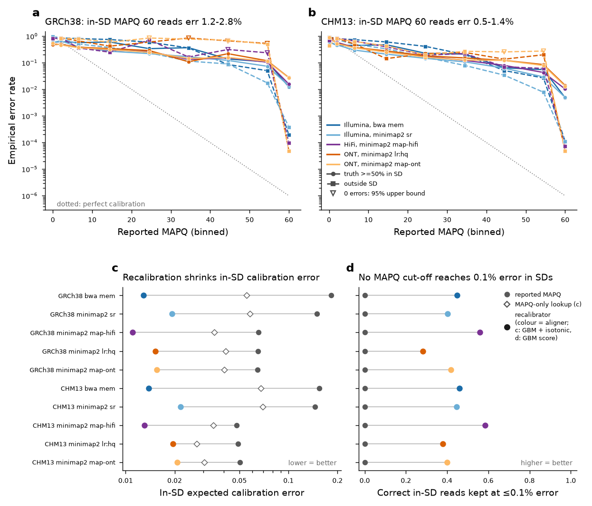

# L5 — Are aligner MAPQs calibrated, and can a learned recalibrator fix them?

*Litmus pilot L5 · NA19240 (HPRC release 2) haplotype simulations · GRCh38 and CHM13 · bwa 0.7.19 and minimap2 2.31 · 2026-11-11*

## Litmus statement

Inside segmental duplications (SDs), reported MAPQ 60 is wrong one to three times in a hundred, not once in a million. On GRCh38, bwa mem MAPQ 60 errs for 1.23% of in-SD reads (403/32,777; empirical Phred 19), minimap2 map-hifi for 1.57% (130/8,261) and minimap2 lr:hq for 2.77% (136/4,906). On GRCh38 the usual MAPQ ≥ 30 filter lets through 2.6–5.4% wrong in-SD reads. CHM13 lowers these rates by 34–60% (to 0.49%, 1.03% and 1.42%) but does not remove them.

A chromosome-held-out recalibrator fixes most of this. It is gradient boosting on SAM-only and reference-annotation features, followed by isotonic post-calibration. It cuts in-SD expected calibration error (ECE) by 59–93% across all ten aligner × reference runs, for example bwa GRCh38 0.183 → 0.013 (−93%) and map-hifi GRCh38 0.065 → 0.011 (−83%). Its own MAPQ ≥ 30 filter has 0.04–0.34% in-SD error. Ranking by the boosted score keeps 28–58% of correctly placed in-SD reads at ≤0.1% error, a level that no reported-MAPQ threshold reaches (0% for every run).

Pass/fail criteria and their outcomes are in [Litmus test definition](#litmus-test-definition).

## Bottom line

**What is miscalibrated.** Outside SDs, MAPQ 60 errs at 4.8×10⁻⁵ to 3.8×10⁻⁴. That is far above the nominal 10⁻⁶ but rarely consequential. Inside SDs the miscalibration is large for every aligner and technology tested. Mid-range values are also off: GRCh38 bwa reads at MAPQ 40 are wrong 14.6% of the time (10,231 reads; 68% of them have AS = XS and nearly all are properly paired).

**Why it happens.** 71–96% of wrong MAPQ-60 placements are reads that align *better* to the reported paralog than to their true locus. Genuine search failures account for 0–14%. The errors therefore come from sample-versus-reference paralog divergence, which a score-gap MAPQ cannot detect by construction. For long reads, 81–96% of these errors span a structural difference between NA19240 and the reference ortholog.

**What a recalibrator buys.**
- A MAPQ-only lookup table, which adds no information, already fixes genome-wide calibration (ECE 0.012–0.018 → ≤0.0005 for short reads), but it cannot see SD context.
- The boosted model adds SD-aware calibration and better ranking: in-SD AUPRC for wrong placements rises from 0.57–0.59 to 0.71–0.73 for short reads and from 0.36–0.55 to 0.39–0.63 for long reads.
- Isotonic post-calibration is needed, because the raw boosted probabilities are over-confident when only a few hundred in-SD errors are available for training.

**Caveat on truth.** For long reads the measured error depends on the truth definition. With ≥50% of the read lifted to its orthologous locus, in-SD MAPQ-60 error is 1.0–2.8%. With ≥90% of the read colinear with that locus, it is 0.12–0.33%, which is still about 10³ times above nominal.

## Background

Mapping quality was introduced as the Phred-scaled probability that a read is placed at the wrong locus ([Li 2008](https://doi.org/10.1101/gr.078212.108)). Modern aligners estimate it heuristically from how much better the reported hit scores than its alternatives. Examples are bwa mem ([Li 2013, preprint](https://arxiv.org/abs/1303.3997)) and minimap2, which uses primary and secondary chaining scores ([Li 2018](https://doi.org/10.1093/bioinformatics/bty191); [Li 2021](https://doi.org/10.1093/bioinformatics/btab705)). Downstream tools treat these values as probabilities or hard filters: GATK HaplotypeCaller drops reads below MAPQ 20 by default ([Wilton 2023](https://doi.org/10.1093/bioinformatics/btad480)), and deep-learning callers ingest MAPQ as an input channel ([Poplin 2018](https://doi.org/10.1038/nbt.4235)).

Two lines of prior work recalibrate MAPQ with models trained on simulated reads. LoQuM fitted a logistic regression to read and alignment statistics and reported that aligner MAPQ often correlates weakly with accuracy ([Ruffalo 2012](https://doi.org/10.1093/bioinformatics/bts408)). Qtip simulates "tandem" reads that resemble the input reads but have known origin, and learns MAPQ from them ([Langmead 2017](https://doi.org/10.1186/s13059-017-1290-3)). A plant study combined AdaBoost with isotonic calibration and found modest SNP-calling gains ([Cline 2020](https://doi.org/10.7717/peerj.10501)). None of these is part of a standard human pipeline today. None was evaluated on long reads, on T2T-CHM13, or against haplotype-resolved truth.

On the long-read side, minimap2's MAPQ is essentially bimodal: mapeval reports only Q0 and Q60 groups ([Ekim 2023](https://doi.org/10.1101/gr.277679.123)). SD-specific remapping with paralogous sequence variants raises the share of correctly and confidently placed reads in SDs ([Prodanov 2020](https://doi.org/10.1093/nar/gkaa829)). Other routes are repeat-aware seeding ([Jain 2022](https://doi.org/10.1038/s41592-022-01457-8)) and pangenome mapping ([Sirén 2021](https://doi.org/10.1126/science.abg8871)). The T2T-CHM13 reference resolves most collapsed and missing SDs ([Nurk 2022](https://doi.org/10.1126/science.abj6987); [Vollger 2022](https://doi.org/10.1126/science.abj6965)) and improves variant analysis ([Aganezov 2022](https://doi.org/10.1126/science.abl3533)).

What has been missing is a calibration measurement whose truth reflects a real diploid human genome rather than a mutated reference. HPRC release-2 haplotypes ([Liao 2023](https://doi.org/10.1038/s41586-023-05896-x)), aligned to both references with wfmash/impg ([Garrison 2024](https://doi.org/10.1038/s41592-024-02430-3)), now make that measurement possible.

## Data and truth

**Haplotypes.** NA19240 HPRC release-2 assemblies (hifiasm 0.19.9, trio-phased): hap1 = paternal `NA19240_pat_hprc_r2_v1.0.1.fa.gz` (64 contigs, 3,038,833,213 bp; md5 2cd406c57e30c7b5a911b276bb255b1e) and hap2 = maternal `NA19240_mat_hprc_r2_v1.0.1.fa.gz` (65 contigs, 3,024,651,147 bp; md5 b9ed3f11aeb037a0d83f23fb93f8d1fc), from `s3://human-pangenomics/working/HPRC_PLUS/NA19240/assemblies/release2/` (paths from `assemblies_release2_v1.0.index.csv`).

**References.** GRCh38 no-alt analysis set (NCBI `GCA_000001405.15_GRCh38_no_alt_analysis_set.fna.gz`, md5 a08035b6a6e31780e96a34008ff21bd6) with NCBI's prebuilt bwa index (md5 a4f359513f544d8713a74537da7c3322); CHM13v2.0 analysis set `chm13v2.0_maskedY_rCRS.fa.gz` (T2T bucket; chrY PARs masked, rCRS mitochondrion), the exact target used by the impg alignments; bwa index built locally (bwa 0.7.19, 48.5 min).

**Truth by liftover.** The HPRC release-2 impg "all-vs-1" wfmash PAFs whose target is the reference (`GCA_000001405.15_GRCh38_no_alt_analysis_set.PanSN.merged.paf.gz`, 6.5 GB; `chm13v2.0_maskedY_rCRS.fa.PanSN.merged.paf.gz`, 5.6 GB) are BGZF files grouped by query sample, so the NA19240 rows were extracted with HTTP range requests (`l5_fetch_paf_range.py`; 38,248 rows vs GRCh38, 30,872 vs CHM13). Each row carries a full `cg:Z` CIGAR, which `l5_liftover.py` turns into gap-free match segments. A read's origin interval on the haplotype is projected through every overlapping record; the record covering most read bases defines the truth interval and strand, and the runner-up record is kept. On the haplotype side 95.4% (GRCh38) / 96.3% (CHM13) of bases are covered by exactly one record, ~2% by two or more, and 2.6% / 1.2% by none. A read has valid truth when ≥90% (short) or ≥50% (long) of its bases are lifted; reads whose runner-up record covers ≥0.9× the best are flagged *ambiguous truth*, and a placement at either locus counts as correct (sensitivity analysis excludes them). Sanity check: 2,000 simulated Illumina reads differ from CHM13 at their lifted locus by 0.50 mismatches per 150 bp on average (99.1% ≤3 mismatches, none >20), as expected from 0.2% sequencing error plus NA19240 SNVs.

**Segmental duplications.** GRCh38: UCSC `genomicSuperDups` (175.4 Mb merged, 5.66%); CHM13: T2T SEDEF table `chm13v2.0_SD.full.bed` (both sides of each pair; 227.4 Mb merged, 7.29%). A read is *in SD* when ≥50% of its truth interval lies in merged SDs; the identity of an SD interval is the maximum `fracMatch` of the pairs merged into it.

## Read simulation

pbsim3 3.0.5 installed (bioconda osx-arm64), but template mode did not deliver the requested accuracy: on 30 × 15 kb CHM13 templates `QSHMM-ONT-HQ --accuracy-mean 0.99` gave mean 3.3% / median 1.6% / max 15.4% per-read error, and the RS II model at 0.999 gave 2–13% error on 3 reads. A documented numpy simulator (`l5_simulate.py`) was therefore used:

| Technology | Reads | Length | Error model | Realised error |
|---|---|---|---|---|
| Illumina 2×150 | 600,000 pairs | fragment ~N(450, 60) | uniform substitutions 0.2% (≡ `wgsim -e 0.002 -r 0 -R 0`) | 0.200% |
| HiFi | 40,095 | ~N(17 kb, 2.5 kb), 12–24 kb (mean 17.0 kb) | per-read Q ~N(30, 3) [22, 40]; 30% substitutions, 50% homopolymer ±1, 10% insertions, 10% deletions | 0.126% (median Q30) |
| ONT R10.4.1-like | 24,005 | lognormal, median 30 kb, 20–50 kb (mean 31.2 kb) | per-read Q ~N(20, 2.5) [12, 28]; 35% substitutions, 35% homopolymer ±1 (60% shortening), 10% insertions, 20% deletions | 1.18% (median Q20) |

Origins are uniform over both haplotypes (contig chosen ∝ length; strand 50/50). For long reads, a uniform pool of 300,000 candidate origins was lifted first; candidates with ≥20% of their truth interval in SDs on either reference (8.4% of the HiFi pool, 8.4% of the ONT pool) were kept with probability 0.636 (HiFi) / 0.382 (ONT) and the rest with 0.0873 / 0.0524. Every read carries the inverse-probability weight, so weighted statistics equal those of uniform sampling; within the in-SD stratum all weights are 1. Illumina reads were not stratified (weight 1).

## Mapping

minimap2 2.31-r1302 (`-ax sr --secondary=yes`, `-ax map-hifi`, `-ax lr:hq`, `-ax map-ont`; `-t 2 -K 100M`; prebuilt single-part indexes k21w11 / k19w19 (shared by map-hifi and lr:hq, identical k/w in `options.c`) / k15w10) and bwa 0.7.19-r1273 (`bwa mem -t 2 -K 10000000`), all reads against both full references. `--secondary=yes` only adds secondary records for the sr preset (they feed the secondary-count features); it does not change primary placements or MAPQ.

## Evaluation

`l5_extract.py` re-implements `paftools.js mapeval` (minimap2 v2.31) mode 0: among non-secondary records the one with the most matching bases is evaluated; MAPQ is capped at 60; the placement is correct iff it is on the truth chromosome and strand with overlap/union > 0.1. Unmapped reads and reads without valid truth are counted but excluded. Calibration is reported per reported-MAPQ bin as the weighted empirical error with a Jeffreys 95% interval on the Kish effective sample size.

## Recalibrator

Four predictors of P(wrong) are compared on held-out chromosomes: (i) RAW = 10^(−MAPQ/10); (ii) ISO = isotonic regression of Jeffreys-smoothed per-MAPQ error fitted on the training fold (a calibration lookup table that adds no information); (iii) GBM = scikit-learn 1.9.1 `HistGradientBoostingClassifier` (learning rate 0.05, ≤600 iterations with early stopping, 31 leaves, min 40 samples/leaf, L2 = 1, monotone non-increasing in MAPQ, inverse-probability sample weights); (iv) GBM + ISO = the same GBM refit on a random 70% of the training fold, followed by isotonic regression of its scores fitted on the remaining 30% (held-out post-hoc calibration). Features come only from SAM records and reference annotation: MAPQ, AS, XS (bwa), s1, s2, ms, cm, nn, de, rl, NM, number of secondary / supplementary / XA / SA alignments, best secondary AS relative to AS, soft/hard clipping, read and aligned length, aligned fraction, reference span ratio, proper-pair / mate-unmapped flags, |TLEN|, mate MAPQ / AS / XS / s2, mate concordance, and SD fraction / identity of the *mapped* interval. Truth-derived columns are never features. Folds: truth chromosome parity (odd autosomes + chrX vs even autosomes, chrY, chrM, unplaced contigs; `_random` contigs inherit their parent). Each fold is predicted by the model trained on the other and the pooled out-of-fold predictions are scored with: ECE (8 bins on predicted Phred: 0–3, 3–10, 10–20, 20–30, 30–40, 40–50, 50–60, ≥60), Brier score, log-loss (p clipped to [10⁻⁶, 1−10⁻⁶]), AUPRC for wrong placements, precision at 99% / 99.5% recall of correct reads, and the number (fraction) of correctly placed reads retained in the largest confidence-ordered set whose weighted error is ≤10⁻³ (and ≤10⁻⁴), with tied scores kept together. That last threshold is chosen on held-out labels, so it measures ranking. Two label-free operating points measure calibration in use: (a) the largest score-ordered set whose mean *predicted* error is ≤10⁻³, scored by its realised error; (b) a MAPQ ≥ 30 filter applied to reported vs recalibrated MAPQ. Recalibrated probabilities are converted back to MAPQ = min(60, round(−10 log10 p)); `l5_recal.py --save-models` exports a final model per run (GBM on all evaluable reads, plus the GBM + isotonic pair); `l5_apply.py` uses the calibrated pair by default to rewrite MAPQ in a name-grouped SAM/BAM (original in `om:i`, P(wrong) in `pw:f`). Train-time and apply-time features agree to the 4-significant-digit rounding of `pw`.

## Result tables

### Table 1. Reported MAPQ versus empirical error

| Run | Evaluable reads | MAPQ 0: n (error) | MAPQ 60: n, wrong | MAPQ 60 error, outside SD | MAPQ 60 in SD: wrong / n | MAPQ 60 error, in SD (Phred) | MAPQ≥30 error, in SD |
|---|---|---|---|---|---|---|---|
| GRCh38 · Illumina · bwa mem | 1,163,145 | 33,700 (75.6%) | 1,084,363, 605 | 0.00019 | 403 / 32,777 | 1.23% (19) | 5.44% |
| GRCh38 · Illumina · minimap2 sr | 1,162,960 | 30,460 (73.8%) | 1,083,298, 860 | 0.00038 | 458 / 34,160 | 1.34% (19) | 3.65% |
| GRCh38 · HiFi · minimap2 map-hifi | 37,114 | 100 (57.4%) | 33,877, 140 | 9.5e-05 | 130 / 8,261 | 1.57% (18) | 2.58% |
| GRCh38 · ONT · minimap2 lr:hq | 21,651 | 25 (48.0%) | 20,357, 141 | 4.9e-05 | 136 / 4,906 | 2.77% (16) | 3.55% |
| GRCh38 · ONT · minimap2 map-ont | 21,651 | 26 (53.8%) | 20,293, 136 | 4.9e-05 | 131 / 4,842 | 2.71% (16) | 3.44% |
| CHM13 · Illumina · bwa mem | 1,181,658 | 53,200 (80.9%) | 1,085,570, 276 | 0.00011 | 158 / 32,277 | 0.49% (23) | 2.48% |
| CHM13 · Illumina · minimap2 sr | 1,180,566 | 49,322 (80.2%) | 1,083,671, 284 | 0.00011 | 166 / 33,297 | 0.50% (23) | 1.79% |
| CHM13 · HiFi · minimap2 map-hifi | 38,813 | 166 (73.2%) | 33,962, 92 | 7.2e-05 | 86 / 8,326 | 1.03% (20) | 1.73% |
| CHM13 · ONT · minimap2 lr:hq | 22,741 | 67 (91.2%) | 20,458, 75 | 4.8e-05 | 70 / 4,933 | 1.42% (18) | 2.37% |
| CHM13 · ONT · minimap2 map-ont | 22,741 | 76 (72.2%) | 20,373, 69 | 4.8e-05 | 64 / 4,843 | 1.32% (19) | 2.23% |

### Table 2. Held-out recalibration inside segmental duplications

| Run | ECE reported | ECE MAPQ-only | ECE GBM | ECE GBM+iso | ECE change (GBM+iso) | Brier reported → GBM+iso | AUPRC(wrong) reported → GBM | Correct kept at ≤0.1% error: reported / GBM / GBM+iso |
|---|---|---|---|---|---|---|---|---|
| GRCh38 · Illumina · bwa mem | 0.183 | 0.055 | 0.015 | 0.013 | -93% | 0.184 → 0.104 | 0.57 → 0.72 | 0% / 45% / 43% |
| GRCh38 · Illumina · minimap2 sr | 0.150 | 0.058 | 0.019 | 0.019 | -87% | 0.164 → 0.105 | 0.57 → 0.73 | 0% / 40% / 36% |
| GRCh38 · HiFi · minimap2 map-hifi | 0.065 | 0.035 | 0.041 | 0.011 | -83% | 0.076 → 0.064 | 0.41 → 0.42 | 0% / 56% / 0% |
| GRCh38 · ONT · minimap2 lr:hq | 0.065 | 0.041 | 0.039 | 0.015 | -77% | 0.073 → 0.063 | 0.37 → 0.41 | 0% / 28% / 0% |
| GRCh38 · ONT · minimap2 map-ont | 0.064 | 0.040 | 0.042 | 0.016 | -76% | 0.073 → 0.065 | 0.36 → 0.39 | 0% / 42% / 0% |
| CHM13 · Illumina · bwa mem | 0.154 | 0.067 | 0.019 | 0.014 | -91% | 0.157 → 0.098 | 0.59 → 0.71 | 0% / 46% / 46% |
| CHM13 · Illumina · minimap2 sr | 0.145 | 0.070 | 0.025 | 0.022 | -85% | 0.152 → 0.098 | 0.59 → 0.73 | 0% / 45% / 35% |
| CHM13 · HiFi · minimap2 map-hifi | 0.048 | 0.035 | 0.018 | 0.013 | -73% | 0.064 → 0.057 | 0.55 → 0.63 | 0% / 58% / 0% |
| CHM13 · ONT · minimap2 lr:hq | 0.049 | 0.027 | 0.024 | 0.020 | -60% | 0.061 → 0.057 | 0.52 → 0.58 | 0% / 38% / 0% |
| CHM13 · ONT · minimap2 map-ont | 0.050 | 0.030 | 0.021 | 0.021 | -59% | 0.062 → 0.057 | 0.52 → 0.58 | 0% / 40% / 0% |

### Table 3. Selecting reads with the score alone (thresholds never see truth labels)

| Run | in SD: MAPQ≥30 error / kept, reported | in SD: MAPQ≥30 error / kept, GBM+iso | in SD: realised error at 0.1% target, reported / GBM / GBM+iso | genome-wide: MAPQ≥30 error / kept, reported | genome-wide: MAPQ≥30 error / kept, GBM+iso | genome-wide: realised error at 0.1% target, reported / GBM / GBM+iso |
|---|---|---|---|---|---|---|
| GRCh38 · Illumina · bwa mem | 5.44% / 76% | 0.05% / 35% | 10.46% / 0.20% / 0.06% | 0.37% / 98% | 0.00% / 95% | 1.16% / 0.15% / 0.13% |
| GRCh38 · Illumina · minimap2 sr | 3.65% / 72% | 0.10% / 36% | 5.71% / 0.17% / 0.20% | 0.23% / 98% | 0.01% / 95% | 0.62% / 0.16% / 0.16% |
| GRCh38 · HiFi · minimap2 map-hifi | 2.58% / 88% | 0.11% / 53% | 4.13% / 0.51% / 0.22% | 0.14% / 99% | 0.00% / 97% | 0.39% / 0.25% / 0.10% |
| GRCh38 · ONT · minimap2 lr:hq | 3.55% / 91% | 0.24% / 44% | 5.00% / 0.80% / 0.40% | 0.18% / 99% | 0.01% / 95% | 0.38% / 0.25% / 0.13% |
| GRCh38 · ONT · minimap2 map-ont | 3.44% / 90% | 0.28% / 39% | 4.67% / 0.75% / 0.33% | 0.18% / 99% | 0.01% / 97% | 0.39% / 0.26% / 0.11% |
| CHM13 · Illumina · bwa mem | 2.48% / 74% | 0.04% / 30% | 6.15% / 0.19% / 0.09% | 0.18% / 98% | 0.00% / 94% | 0.76% / 0.15% / 0.10% |
| CHM13 · Illumina · minimap2 sr | 1.79% / 70% | 0.08% / 35% | 3.35% / 0.19% / 0.13% | 0.11% / 98% | 0.00% / 95% | 0.44% / 0.14% / 0.13% |
| CHM13 · HiFi · minimap2 map-hifi | 1.73% / 87% | 0.17% / 40% | 2.79% / 0.10% / 0.14% | 0.12% / 99% | 0.00% / 96% | 0.46% / 0.17% / 0.07% |
| CHM13 · ONT · minimap2 lr:hq | 2.37% / 89% | 0.25% / 41% | 3.47% / 0.46% / 0.23% | 0.15% / 99% | 0.01% / 95% | 0.39% / 0.21% / 0.14% |
| CHM13 · ONT · minimap2 map-ont | 2.23% / 88% | 0.34% / 50% | 3.21% / 0.30% / 0.34% | 0.14% / 99% | 0.02% / 97% | 0.44% / 0.23% / 0.13% |

### Table 4. Why MAPQ-60 placements are wrong (each read realigned to its truth and reported loci ±2 kb)

| Run | Wrong at MAPQ 60 | In SD | Read scores better at reported locus | Tie | Truth locus better (search error) | Read does not align at truth locus | Median truth-SD identity |
|---|---|---|---|---|---|---|---|
| GRCh38 · Illumina · bwa mem | 605 | 67% | 501 (83%) | 41 | 3 | 59 | 0.984 |
| GRCh38 · Illumina · minimap2 sr | 860 | 53% | 659 (77%) | 93 | 19 | 89 | 0.979 |
| GRCh38 · HiFi · minimap2 map-hifi | 140 | 93% | 120 (86%) | 1 | 19 | 0 | 0.995 |
| GRCh38 · ONT · minimap2 lr:hq | 141 | 96% | 134 (95%) | 0 | 7 | 0 | 0.997 |
| GRCh38 · ONT · minimap2 map-ont | 136 | 96% | 128 (94%) | 0 | 8 | 0 | 0.997 |
| CHM13 · Illumina · bwa mem | 276 | 57% | 232 (84%) | 34 | 0 | 10 | 0.993 |
| CHM13 · Illumina · minimap2 sr | 284 | 58% | 201 (71%) | 70 | 4 | 9 | 0.987 |
| CHM13 · HiFi · minimap2 map-hifi | 92 | 94% | 85 (92%) | 0 | 7 | 0 | 0.995 |
| CHM13 · ONT · minimap2 lr:hq | 75 | 93% | 71 (95%) | 0 | 4 | 0 | 0.995 |
| CHM13 · ONT · minimap2 map-ont | 69 | 93% | 66 (96%) | 0 | 3 | 0 | 0.995 |

### Table 5. Long reads under a stricter truth (≥90% of the read colinear with its orthologous locus)

| Run | MAPQ 60 in-SD error: ≥50% / ≥90% colinear truth | ECE reported / MAPQ-only / GBM / GBM+iso (strict) | Correct kept at ≤0.1%: reported / GBM / GBM+iso (strict) | Realised error at 0.1% target: MAPQ-only / GBM+iso (strict) |
|---|---|---|---|---|
| GRCh38 · HiFi · minimap2 map-hifi | 1.57% / 0.33% | 0.035 / 0.011 / 0.024 / 0.005 | 0% / 71% / 0% | 0.41% / 0.15% |
| GRCh38 · ONT · minimap2 lr:hq | 2.77% / 0.12% | 0.024 / 0.009 / 0.019 / 0.009 | 0% / 71% / 0% | 0.19% / 0.29% |
| GRCh38 · ONT · minimap2 map-ont | 2.71% / 0.15% | 0.023 / 0.007 / 0.014 / 0.009 | 0% / 74% / 0% | 0.19% / 0.28% |
| CHM13 · HiFi · minimap2 map-hifi | 1.03% / 0.22% | 0.031 / 0.024 / 0.023 / 0.013 | 0% / 67% / 0% | 0.25% / 0.53% |
| CHM13 · ONT · minimap2 lr:hq | 1.42% / 0.23% | 0.022 / 0.016 / 0.020 / 0.011 | 0% / 70% / 0% | 0.27% / 0.25% |
| CHM13 · ONT · minimap2 map-ont | 1.32% / 0.14% | 0.022 / 0.019 / 0.023 / 0.011 | 0% / 74% / 0% | 0.16% / 0.45% |

## Figure

*Figure 1 (`L5_mapq_calibration.png`).*
- **(a, b)** Weighted empirical error rate per reported-MAPQ bin, for reads whose truth lies ≥50% in SDs (solid) or outside SDs (dashed). The dotted line is perfect calibration (error = 10^(−MAPQ/10)). Open triangles are 95% upper bounds where no error was observed.
- **(c)** In-SD ECE of reported MAPQ (grey), a MAPQ-only isotonic lookup (open diamond) and the GBM + isotonic recalibrator (aligner colour).
- **(d)** Fraction of correctly placed in-SD reads kept at ≤0.1% error, ranking by reported MAPQ (grey) versus the GBM score (colour). The threshold is the best achievable on held-out labels, so this panel is a ranking measure; Table 3 gives the label-free operating points.

All predictions are out-of-fold (odd vs even truth chromosomes). Read counts: Illumina 1.16–1.18 M evaluable reads per run, HiFi 37–39 k, ONT 21.7–22.7 k; Table 1 has the exact values.

## Results

### Reported MAPQ is over-confident, mostly inside SDs

Table 1 shows that every aligner over-states confidence. The gap is modest outside SDs and severe inside them.

- **Outside SDs.** MAPQ 60 errs at 4.8×10⁻⁵ to 3.8×10⁻⁴: 50–380 times the nominal 10⁻⁶, but small in absolute terms.
- **Inside SDs.** MAPQ 60 is wrong for 1.23–2.77% of reads on GRCh38 and 0.49–1.42% on CHM13, i.e. empirical Phred 16–23.
- **Mid-range MAPQ on GRCh38.** bwa assigns exactly MAPQ 40 to 10,231 reads whose empirical error is 14.6% (11.4% across MAPQ 40–49). 68% of them have AS = XS and 99.9% are properly paired, so their confidence comes from the pair, not from the read.
- **MAPQ 0.** It means "multi-mapped" rather than "certainly wrong": 48–91% of MAPQ-0 placements are wrong (Table 1).
- **Reference effect.** CHM13 lowers the in-SD MAPQ-60 error by 34–63% in every configuration (least for HiFi, 1.57% → 1.03%). Genome-wide, bwa's high-confidence errors fall from 605 to 276, consistent with the resolved SDs of the T2T assembly.
- **ONT on GRCh38.** The MAPQ-60 class itself errs at 0.13% genome-wide (141/20,357 for lr:hq; 136/20,293 for map-ont). So no MAPQ cut-off reaches 0.1% error genome-wide, while ranking by the boosted score keeps 99.1% / 99.0% of all correct reads at ≤0.1% error.

### High-confidence errors are paralog divergence, not search failures

To learn whether better search could remove these errors, every wrong MAPQ-60 read was realigned (same preset, ±2 kb) to its truth locus and to its reported locus (Table 4).

- **Most reads score better at the wrong paralog.** In 71–96% of cases the read aligns better at the reported locus. Search errors, where the truth locus scores better, are 0–19 reads per run.
- **Short reads.** 9–10% of GRCh38 cases do not align at the truth locus at all. These could be truth artefacts and are counted as errors throughout.
- **Long reads.** The truth locus typically matches only part of the read: 81–96% of wrong MAPQ-60 long reads have <90% of their bases colinear with the ortholog, with median score gaps of 2.1–2.3 k (HiFi) and 12–15 k (ONT) AS units. These reads come from SD copies whose NA19240 structure differs from the reference ortholog but matches a paralog end-to-end.

A MAPQ computed from the reference alone cannot flag such reads, because the aligner did find the best-scoring locus. A model that knows the locus is a high-identity SD (identity ~0.98–0.997 here) can lower the confidence. Fixing the placement itself needs information beyond the linear reference: paralog-specific variants, population haplotypes, or the sample's own assembly.

### Learned recalibration

Table 2 compares the four predictors inside SDs on held-out chromosomes.

- **MAPQ-only isotonic lookup.** It cuts in-SD ECE for short reads by 52–70% (0.145–0.183 → 0.055–0.070). It cannot rank in-SD reads any better than MAPQ, so no subset of in-SD reads reaches ≤0.1% error.
- **Gradient boosting (GBM).** Features include s1/s2, AS–XS, secondary/supplementary counts, mate MAPQ/AS, rl and the SD fraction/identity of the mapped interval. It improves ranking: in-SD AUPRC for wrong placements rises 0.57–0.59 → 0.71–0.73 (short reads) and 0.36–0.55 → 0.39–0.63 (long reads). It keeps 28–58% of correct in-SD reads at ≤0.1% error.
- **GBM probabilities are over-confident at the top end.** Selecting reads by the GBM's own predicted error with a 0.1% target realises 0.10–0.80% error in SDs (Table 3).
- **GBM + isotonic.** Adding isotonic post-calibration on a held-out 30% of the training fold ([Zadrozny 2002](https://doi.org/10.1145/775047.775151)) gives the best in-SD calibration in 9 of 10 runs: ECE −59% to −93% versus reported MAPQ. It brings realised error at the 0.1% target to 0.06–0.40%, versus 2.8–10.5% for reported MAPQ.
- **Price of calibration.** For long reads the isotonic step merges the highest-confidence in-SD reads into one tied block, so ranking resolution is lost there. Use the GBM score to rank and the GBM + isotonic probability as MAPQ.
- **Genome-wide.** Log-loss falls 38–83% versus reported MAPQ (0.034–0.165 → 0.016–0.031). A MAPQ-only lookup already achieves the lowest genome-wide ECE (≤0.0005), so the boosted model's distinctive value is SD-aware calibration and ranking, not global rescaling.

### Robustness

- **Ambiguous truth.** 1.2–2.4% of reads (weighted) have origins covered by two assembly-alignment records of near-equal length. Excluding them changes in-SD MAPQ-60 error only slightly: GRCh38 bwa 1.23% → 0.97%, HiFi 1.57% → 1.52%, lr:hq 2.77% → 2.73%; CHM13 HiFi 1.03% → 1.01%.
- **Stricter truth, short reads.** Requiring ≥99% of bases lifted gives GRCh38 bwa 1.23% → 0.86% and CHM13 0.49% → 0.36%.
- **Stricter truth, long reads (Table 5).** Requiring ≥90% colinearity reduces in-SD MAPQ-60 error 4.7- to 23-fold, to 0.12–0.33%, which is still ~10³ times nominal. Under this definition GBM + isotonic still has the lowest in-SD ECE for both HiFi runs and all CHM13 runs. For GRCh38 ONT the MAPQ-only lookup is as good or better (lr:hq 0.009 vs 0.009; map-ont 0.007 vs 0.009). The GBM ranking still keeps 67–74% of correct in-SD reads at ≤0.1% error versus 0% for reported MAPQ.

## Litmus test definition

**Dataset.** Reads simulated from NA19240 HPRC release-2 haplotypes, with truth lifted through the impg/wfmash GRCh38 and CHM13 PAFs. Scripts are listed below.

**Metrics.** All on reads whose truth lies ≥50% in SDs, using out-of-fold predictions with chromosome-parity folds:
- in-SD ECE;
- in-SD realised error of a recalibrated MAPQ ≥ 30 filter;
- fraction of correct in-SD reads kept at ≤0.1% error.

**Measured baseline (reported MAPQ).**
- in-SD MAPQ-60 error 0.49–2.77%;
- ECE 0.048–0.183;
- MAPQ ≥ 30 in-SD error 1.73–5.44%;
- 0% of correct in-SD reads kept at ≤0.1% error.

**Pass criteria and outcomes.** The test passes only if (i)–(iii) hold in every configuration; the stretch criterion is reported but not required.

| Criterion | Measured | Result |
|---|---|---|
| (i) ECE reduced ≥50% in all 10 runs | −59% to −93% | **PASS (10/10)** |
| (ii) recalibrated MAPQ ≥ 30 in-SD error ≤0.5% | 0.04–0.34% | **PASS (10/10)** |
| (iii) ≥25% of correct in-SD reads kept at ≤0.1% error | 28–58% (GBM ranking) | **PASS (10/10)** |
| Stretch: realised in-SD error at the 0.1% target ≤0.2% | 0.06–0.40% | **4/10** (passes GRCh38 bwa 0.06%, CHM13 bwa 0.09%, CHM13 minimap2 sr 0.13%, CHM13 HiFi 0.14%; GRCh38 minimap2 sr misses narrowly at 0.20%; the long-read runs with the fewest in-SD training errors fail at 0.22–0.40%) |

Real-data check (not run here): a recalibrated MAPQ should shift variant-call precision/recall in SDs against an assembly-based truth set, e.g. HPRC/HGSVC3 calls for NA19240 ([Logsdon 2025](https://doi.org/10.1038/s41586-025-09140-6)).

## Improvement proposals

1. **SD-aware learned MAPQ recalibration as a post-processor.** *Status: prototype here; closest prior is implemented but not adopted: LoQuM, Qtip.* Train per aligner × preset × reference on pangenome-haplotype simulations, then rewrite MAPQ and add a `pw:f` P(wrong) tag (`l5_apply.py`). New relative to Qtip/LoQuM: haplotype-resolved truth, long reads, CHM13, SD-aware reference features, held-out calibration. Next litmus: train on NA19240, test on a second HPRC sample such as HG01943. Pass if in-SD ECE stays ≥50% below reported MAPQ, and realised error at a 0.1% target is ≤0.3%.
2. **Stop saturating at MAPQ 60; emit a calibrated probability.** *Status: open.* Most long reads sit at MAPQ 60, which mixes 10⁻⁵-error and 10⁻²-error reads. Aligners or a post-processor should emit a calibrated P(wrong) at full resolution. Litmus: among reported-MAPQ-60 in-SD reads, the calibrated score must split off a subset that holds ≥50% of the wrong reads in ≤20% of the reads. Measured: the top 20% by GBM score hold 77–92% of the wrong placements (error 2.1–11.0%), leaving 0.085–0.78% error in the other 80%. **PASS (10/10).** Source: [L5_mapq60_split.tsv](L5_mapq60_split.tsv).
3. **Divergence-aware placement in SDs.** *Status: implemented but not adopted (Giraffe, DuploMap); open for long reads on CHM13.* 71–96% of high-confidence errors are reads that genuinely match a paralog better, so only extra information can fix placement: population haplotypes (pangenome graphs), paralog-specific variants, or the sample's own assembly. Headroom litmus: re-map the same wrong-MAPQ-60 in-SD reads to the HPRC release-2 Minigraph-Cactus graph. Count how many reach their orthologous haplotype path (oracle ceiling: all 69–860 wrong MAPQ-60 reads per run, Table 4).
4. **A public calibration benchmark.** *Status: prototype.* HPRC release-2 haplotypes + impg PAF liftover + mapeval-compatible scoring with SD stratification and inverse-probability weights, released as a harness. Calibration curves become a standard aligner release metric next to sensitivity and speed. Litmus: rerunning the harness on another sample reproduces Table 1 within Jeffreys 95% intervals.

## Limitations and deviations

- **Simulation realism.** One sample (NA19240). Simulated reads only: no real-data validation. Custom error models; pbsim3 3.0.5 template mode missed the Q20/Q30 targets. No chimeras, adapters, PCR duplicates or basecaller-context errors.
- **Truth coverage.** Truth exists only where the wfmash alignments cover the haplotype; 2.6% (GRCh38) / 1.2% (CHM13) of haplotype bases are uncovered. Reads with too little lifted sequence (3.1–4.6% on GRCh38, 1.5–2.5% on CHM13, weighted) are excluded. Long-read error rates depend on the truth definition (Table 5).
- **Sample size.** Reads are a small subsample (600k pairs, 40k HiFi, 24k ONT). Long reads were SD-enriched with inverse-probability weights. In-SD long-read training sets hold only ~520–1,170 wrong reads per run (about half per training fold), which limits top-end calibration. Out-of-fold metrics also reuse the same simulated sample for training and testing, with chromosome hold-out. Cross-sample transfer is untested.
- **Design choice after seeing test folds.** The isotonic post-calibration variant was added after seeing the boosted model's over-confidence on held-out folds. Folds were never used for fitting, but the design choice was informed by them.
- **Memory budget.** Single-part human minimap2 indexes peaked at 13.0–15.7 GB while building, and five minimap2 mapping runs peaked at 12.6–14.3 GB, above the 12 GB budget. Jobs ran strictly one at a time and no swapping occurred. The bwa index for CHM13 took 48.5 min; its RSS was not measurable in the sandbox.
- **Settings.** minimap2 sr ran with `--secondary=yes`, which only adds output records (verified in minimap2 2.31 `map.c`). Other aligners were not evaluated: bwa-mem2, strobealign, Winnowmap2, vg Giraffe.

## Reproduction

`l5_run_all.sh OUTDIR [THREADS]` runs everything end to end in a `mktemp` scratch directory (removed on exit; ~70 GB at peak) and copies the tables and figure to OUTDIR. Tool versions: minimap2 2.31-r1302, bwa 0.7.19-r1273, samtools 1.25, pysam 0.24.1, scikit-learn 1.9.1, pbsim3 3.0.5 (tested, not used). Wall time on 2 threads: ≈98 min mapping, ≈8 min minimap2 index builds, ≈49 min bwa CHM13 index, ≈30 min recalibration (Table `L5_resources.tsv`).

Scripts and their roles:
- `l5_fetch_data.sh` and `l5_fetch_paf_range.py`: inputs, md5 checks, BGZF range extraction of NA19240 rows from the impg PAFs.
- `l5_liftover.py`: CIGAR liftover.
- `l5_simulate.py`: simulation.
- `l5_pipeline.sh` and `l5_map.sh`: indexes and mapping.
- `l5_features.py` and `l5_extract.py`: mapeval-mode-0 labelling and features.
- `l5_recal.py`: the four predictors and metrics.
- `l5_q60_diag.py`: diagnosis of wrong MAPQ-60 placements.
- `l5_apply.py`: rewrites MAPQ in a BAM.
- `l5_tables.py` and `l5_figure.py`: reporting.

## Artifacts

Result files:

- [L5_mapq_calibration.png](L5_mapq_calibration.png) — Figure 1
- [L5_calibration.tsv](L5_calibration.tsv) — empirical error per reported / recalibrated MAPQ bin × stratum × run (Jeffreys CIs)
- [L5_recalibrator_metrics.tsv](L5_recalibrator_metrics.tsv) — ECE, Brier, log-loss, AUPRC, retained-at-error, label-free selection, MAPQ0/60 counts per run × stratum × predictor
- [L5_strict_truth_recalibrator_metrics.tsv](L5_strict_truth_recalibrator_metrics.tsv) — same metrics, long reads, ≥90% colinear truth
- [L5_q60_error_diagnosis_summary.tsv](L5_q60_error_diagnosis_summary.tsv) — Table 4 source
- [L5_q60_error_diagnosis_reads.tsv](L5_q60_error_diagnosis_reads.tsv) — per-read realignment diagnosis of wrong MAPQ-60 placements
- [L5_truth_summary.tsv](L5_truth_summary.tsv) — simulated read sets: lengths, error rates, truth coverage, SD shares
- [L5_resources.tsv](L5_resources.tsv) — wall time and peak RSS per step
- [L5_input_md5.tsv](L5_input_md5.tsv) — input md5 checks
- [L5_run_meta.json](L5_run_meta.json) — per-run read counts, features, GBM iterations
- [L5_tables.md](L5_tables.md) — Tables 1–5 rendered from the TSVs
- [L5_bibliography.json](../../references/tracks/L5_bibliography.json) — verified references (JSON)
- [L5_bibliography.bib](../../references/tracks/L5_bibliography.bib) — verified references (BibTeX)
- [L5_mapping_rss.log](L5_mapping_rss.log) — raw per-command resource log
- [L5_mapq60_split.tsv](L5_mapq60_split.tsv) — share of wrong reported-MAPQ-60 in-SD reads isolated by the top 20% of the recalibrated score

Scripts:

- [l5_run_all.sh](l5_run_all.sh)
- [l5_fetch_data.sh](l5_fetch_data.sh)
- [l5_fetch_paf_range.py](l5_fetch_paf_range.py)
- [l5_liftover.py](l5_liftover.py)
- [l5_common.py](l5_common.py)
- [l5_simulate.py](l5_simulate.py)
- [l5_pipeline.sh](l5_pipeline.sh)
- [l5_map.sh](l5_map.sh)
- [l5_runrss.py](l5_runrss.py)
- [l5_features.py](l5_features.py)
- [l5_extract.py](l5_extract.py)
- [l5_recal.py](l5_recal.py)
- [l5_apply.py](l5_apply.py)
- [l5_q60_diag.py](l5_q60_diag.py)
- [l5_tables.py](l5_tables.py)
- [l5_figure.py](l5_figure.py)

## References

- Aganezov; Yan; Soto et al. (2022). A complete reference genome improves analysis of human genetic variation. *Science*. [10.1126/science.abl3533](https://doi.org/10.1126/science.abl3533)
- Behera; Catreux; Rossi et al. (2024). Comprehensive genome analysis and variant detection at scale using DRAGEN. *Nature Biotechnology*. [10.1038/s41587-024-02382-1](https://doi.org/10.1038/s41587-024-02382-1)
- BRIER (1950). VERIFICATION OF FORECASTS EXPRESSED IN TERMS OF PROBABILITY. *Monthly Weather Review*. [10.1175/1520-0493(1950)078<0001:VOFEIT>2.0.CO;2](https://doi.org/10.1175/1520-0493%281950%29078%3C0001:VOFEIT%3E2.0.CO;2)
- Cheng; Concepcion; Feng et al. (2021). Haplotype-resolved de novo assembly using phased assembly graphs with hifiasm. *Nature Methods*. [10.1038/s41592-020-01056-5](https://doi.org/10.1038/s41592-020-01056-5)
- Cline; Wisittipanit; Boongoen et al. (2020). Recalibration of mapping quality scores in Illumina short-read alignments improves SNP detection results in low-coverage sequencing data. *PeerJ*. [10.7717/peerj.10501](https://doi.org/10.7717/peerj.10501)
- Dwarshuis; Kalra; McDaniel et al. (2024). The GIAB genomic stratifications resource for human reference genomes. *Nature Communications*. [10.1038/s41467-024-53260-y](https://doi.org/10.1038/s41467-024-53260-y)
- Ekim; Sahlin; Medvedev et al. (2023). Efficient mapping of accurate long reads in minimizer space with mapquik. *Genome Research*. [10.1101/gr.277679.123](https://doi.org/10.1101/gr.277679.123)
- Garrison; Guarracino; Heumos et al. (2024). Building pangenome graphs. *Nature Methods*. [10.1038/s41592-024-02430-3](https://doi.org/10.1038/s41592-024-02430-3)
- Guo; Pleiss; Sun; Weinberger (2017). On Calibration of Modern Neural Networks. *arXiv*. [arXiv:1706.04599 (preprint)](https://arxiv.org/abs/1706.04599)
- Jain; Rhie; Hansen et al. (2022). Long-read mapping to repetitive reference sequences using Winnowmap2. *Nature Methods*. [10.1038/s41592-022-01457-8](https://doi.org/10.1038/s41592-022-01457-8)
- Langmead (2017). A tandem simulation framework for predicting mapping quality. *Genome Biology*. [10.1186/s13059-017-1290-3](https://doi.org/10.1186/s13059-017-1290-3)
- Li (2018). Minimap2: pairwise alignment for nucleotide sequences. *Bioinformatics*. [10.1093/bioinformatics/bty191](https://doi.org/10.1093/bioinformatics/bty191)
- Li (2021). New strategies to improve minimap2 alignment accuracy. *Bioinformatics*. [10.1093/bioinformatics/btab705](https://doi.org/10.1093/bioinformatics/btab705)
- Li (2013). Aligning sequence reads, clone sequences and assembly contigs with BWA-MEM. *arXiv*. [arXiv:1303.3997 (preprint)](https://arxiv.org/abs/1303.3997)
- Li; Durbin (2009). Fast and accurate short read alignment with Burrows–Wheeler transform. *Bioinformatics*. [10.1093/bioinformatics/btp324](https://doi.org/10.1093/bioinformatics/btp324)
- Li; Ruan; Durbin (2008). Mapping short DNA sequencing reads and calling variants using mapping quality scores. *Genome Research*. [10.1101/gr.078212.108](https://doi.org/10.1101/gr.078212.108)
- Liao; Asri; Ebler et al. (2023). A draft human pangenome reference. *Nature*. [10.1038/s41586-023-05896-x](https://doi.org/10.1038/s41586-023-05896-x)
- Logsdon; Ebert; Audano et al. (2025). Complex genetic variation in nearly complete human genomes. *Nature*. [10.1038/s41586-025-09140-6](https://doi.org/10.1038/s41586-025-09140-6)
- Nurk; Koren; Rhie et al. (2022). The complete sequence of a human genome. *Science*. [10.1126/science.abj6987](https://doi.org/10.1126/science.abj6987)
- Ono; Hamada; Asai (2022). PBSIM3: a simulator for all types of PacBio and ONT long reads. *NAR Genomics and Bioinformatics*. [10.1093/nargab/lqac092](https://doi.org/10.1093/nargab/lqac092)
- Pakdaman Naeini; Cooper; Hauskrecht (2015). Obtaining Well Calibrated Probabilities Using Bayesian Binning. *Proceedings of the AAAI Conference on Artificial Intelligence*. [10.1609/aaai.v29i1.9602](https://doi.org/10.1609/aaai.v29i1.9602)
- Pedregosa; Varoquaux; Gramfort et al. (2012). Scikit-learn: Machine Learning in Python. *arXiv*. [arXiv:1201.0490 (preprint)](https://arxiv.org/abs/1201.0490)
- Poplin; Chang; Alexander et al. (2018). A universal SNP and small-indel variant caller using deep neural networks. *Nature Biotechnology*. [10.1038/nbt.4235](https://doi.org/10.1038/nbt.4235)
- Prodanov; Bansal (2020). Sensitive alignment using paralogous sequence variants improves long-read mapping and variant calling in segmental duplications. *Nucleic Acids Research*. [10.1093/nar/gkaa829](https://doi.org/10.1093/nar/gkaa829)
- Ruffalo; Koyutürk; Ray et al. (2012). Accurate estimation of short read mapping quality for next-generation genome sequencing. *Bioinformatics*. [10.1093/bioinformatics/bts408](https://doi.org/10.1093/bioinformatics/bts408)
- Sirén; Monlong; Chang et al. (2021). Pangenomics enables genotyping of known structural variants in 5202 diverse genomes. *Science*. [10.1126/science.abg8871](https://doi.org/10.1126/science.abg8871)
- Vollger; Guitart; Dishuck et al. (2022). Segmental duplications and their variation in a complete human genome. *Science*. [10.1126/science.abj6965](https://doi.org/10.1126/science.abj6965)
- Wilton; Szalay (2023). Short-read aligner performance in germline variant identification. *Bioinformatics*. [10.1093/bioinformatics/btad480](https://doi.org/10.1093/bioinformatics/btad480)
- Zadrozny; Elkan (2002). Transforming classifier scores into accurate multiclass probability estimates. *Proceedings of the eighth ACM SIGKDD international conference on Knowledge discovery and data mining*. [10.1145/775047.775151](https://doi.org/10.1145/775047.775151)
