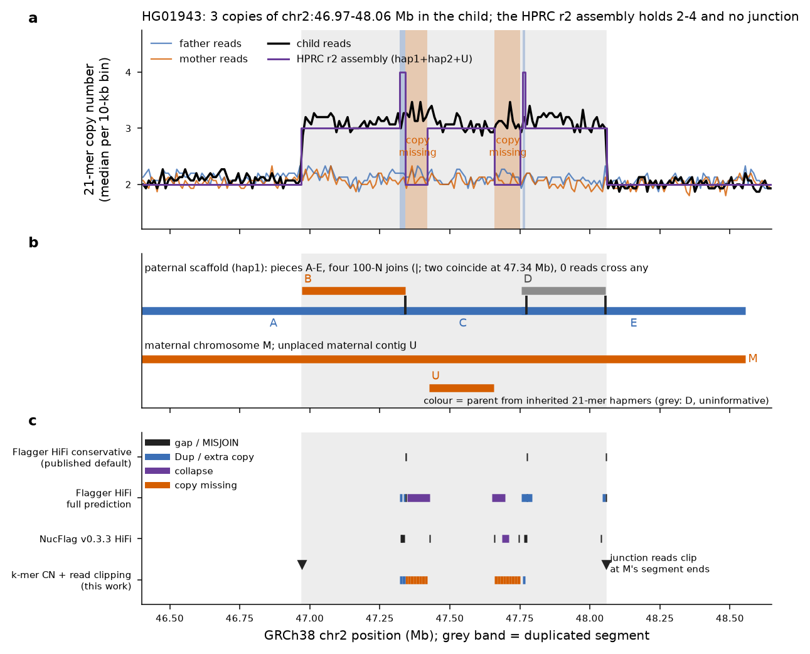
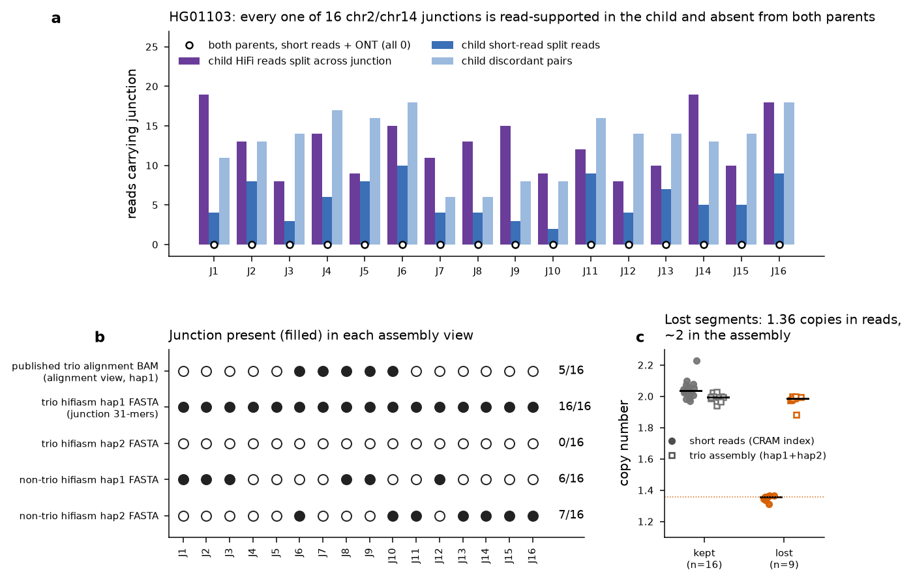

# Two flagged 1000 Genomes cases as assembly regression tests: HG01943 and HG01103

Both user-flagged events are real, and in both the public long-read assemblies misrepresent them, in different ways.

**HG01943.** The child carries a constitutional, de novo, maternal 1.09-Mb tandem duplication of chr2:46,970,725-48,057,041. HPRC's release-2 assembly has the correct sequence but the wrong structure: no sequence anywhere in either haplotype holds the junction. The second maternal copy survives as fragments, two of them scaffolded into the paternal chromosome at four unsupported joins. Every coverage signal looks haploid-normal.

**HG01103.** The cell line carries a sub-clonal chromothripsis of the paternal chr2 and chr14, with 16 junctions in about two-thirds of cells. The public trio assembly contains the sequence of all 16 junctions, not the 5 an alignment-based reading shows. However, at 11 of the 16 forks its long contigs follow the minority (normal) clone, leaving the derivative branch as a short stub. It keeps every lost segment at one copy per haplotype, and at least one contig switches between clones.

This document summarises the independent re-test, the QC signals that do and do not detect each failure, and the assembler and QC changes that would have prevented them. The regression tests built from these cases are defined in regression_tests.md. The per-test evidence is in [flagged_cases_evidence.tsv](flagged_cases_evidence.tsv).

The cases come from the repositories [jlanej/AssemblyReview](https://github.com/jlanej/AssemblyReview) (HG01943; read at the 2026-11-04 head) and [jlanej/svreview-](https://github.com/jlanej/svreview-) (HG01103; read at the 2026-11-07 head). Their claims, coordinates and data sources were read from the READMEs, `case.json`, `MANIFEST.tsv`, the lab notes and the HG01103 example tables. Nothing below reuses their derived files. Every number was recomputed here from public region slices, by the scripts listed at the end, except the 186,866-bp missing-copy length, which is marked as a repository figure.

## Case 1: HG01943, chr2 tandem duplication

### The call holds

Every read-based test reproduces the repository's call. Copy number from the CRAM indexes alone is 3.05 copies in the segment for the child, against 2.03 and 2.05 for father HG01941 and mother HG01942, using 1000 Genomes 30x NYGC data ([Byrska-Bishop 2022](https://doi.org/10.1016/j.cell.2022.08.004)).

The child's short reads carry 6 split reads (3 with both parts at MAPQ ≥ 20) and 29 outward-facing pairs across the junction; neither parent carries any. In the HPRC/Yale HiFi alignment, 31 reads split across the junction, against 64 straight through the segment start and 69 through its end. That junction fraction, 0.189, matches the 1/5 expected for a heterozygous tandem duplication present in every cell. The 31 reads come from 5 SMRT cells on two instruments (Sequel II 15, Revio 16).

Using trio SNVs called here, 29 of the 31 junction reads are maternal and 2 are unphased. At 395 parent-opposite sites the child's maternal allele share is 0.656 inside the segment and 0.498 outside it. That is two maternal copies to one paternal.

One detail differs from the repository. Reads at the junction do not show 1 bp of microhomology: All 31 junction reads show chr2:48,057,041 joined to chr2:46,970,725 through a 2-bp non-templated insertion (`CT`; 27 identical across the junction, 4 with downstream sequencing indels). The plain concatenation of the two reference ends occurs in no junction read (the single plain-join 21-mer seen in the child's reads is identical to reference sequence, because chr2:48,057,041 and chr2:46,970,724 are both A), while the read-derived junction 21-mers are present in the child's Illumina reads (22/22, median count 12) and absent from both parents (0/22 each). By k-mers, too, the event is de novo.

### The assembly has the sequence but not the structure

HPRC release 2 assembled HG01943 with trio-phased hifiasm 0.19.9 ([Cheng 2021](https://doi.org/10.1038/s41592-020-01056-5); trio binning per [Koren 2018](https://doi.org/10.1038/nbt.4277)). Its own Winnowmap records give the same seven pieces as the repository ([pieces table](hg01943_assembly_pieces.tsv)).

The maternal chromosome M holds the segment once. An unplaced maternal contig, U, holds 230 kb from inside it. The paternal chromosome CM089354.1 is a scaffold of five pieces, A-E, joined by four 100-N gaps.

Direct comparison confirms that B and D are base-identical to M (0 differences over 369,059 and 301,419 bp). Inherited 21-mer hapmers built here from the trio's Illumina slices make B maternal: 5,638 maternal against 0 paternal hapmers, where A carries 0 against 10,698 ([Rhie 2020](https://doi.org/10.1186/s13059-020-02134-9)). D is uninformative (50 against 23) and is placed as maternal only by its identity to M. Where paternal pieces overlap, the scaffold doubles sequence: A's end equals C's start over 20,512 bp, and C's end equals E's start over 18,759 bp.

Streaming both complete HPRC haplotype FASTAs (244 sequences, 5.98 Gb) found none of the 28 junction-spanning 31-mers anywhere. So the junction is absent from the assembly altogether, not merely misplaced. A positional k-mer copy-number track ([table](hg01943_kmer_cn_bins.tsv)) compares 21-mers of the child's reads with 21-mers of the assembly along GRCh38. Inside the segment the reads read 3.13 copies, while the assembly holds 3 copies in 87 bins, 2 in 17 and 4 in 3. The CN-2 bins (chr2:47.34-47.42 and 47.66-47.75 Mb) are the missing second copy; the CN-4 bins are the false duplications.

*Figure 1. (a) Median 21-mer copy number per 10-kb bin: the child's reads, each parent's reads, and the HPRC release-2 assembly (hap1 + hap2 + U). Orange bands: assembly holds a copy fewer than the reads; blue bands: a copy more. (b) Assembly pieces placed on GRCh38, coloured by inherited hapmers; ticks are the four 100-N joins, two of which fall at 47.34 Mb. (c) HPRC's published HMM-Flagger v1.2.0 (conservative default and full prediction) and NucFlag v0.3.3 calls, lifted to GRCh38 through the pieces, against the signals used here. n = 225 bins; Illumina 30x slices of chr2:46.4-48.65 Mb.*

### Mechanism: dual-haplotype scaffolding of a hemizygous duplication

The HPRC2 preprint states that release-2 assemblies were made with hifiasm using ultra-long integration and the options `--ul-cut 50000 --dual-scaf --telo-m CCCTAA` ([Lucas 2026, preprint](https://doi.org/10.64898/2026.07.21.739710)). hifiasm's dual scaffolding fills gaps in one haplotype from the homologous region of the other. Contigs carry no N runs, so the four 100-N joins are scaffolding joins.

The order of the paternal pieces, A → B → C → D → E, is exactly the order of their start positions on the homologous maternal sequence. That is what reference-guided ordering of overlapping, partly redundant contigs produces. The inference is that the extra maternal copy's fragments (B, D), sitting in the paternal partition, were ordered by a guide that holds the segment only once.

A local reassembly shows the contig layer is not the only problem. hifiasm 0.25.0 ([Cheng 2024](https://doi.org/10.1038/s41592-024-02269-8)) was run in trio mode, with yak databases from the parents' Illumina slices, on the 7,225 HiFi reads of chr2:46.79-48.24 Mb. It keeps the junction: all 28 junction 31-mers are on a 44,405-bp maternal contig, h2tg000002l. It still collapses the duplication, though, giving 4 maternal contigs totalling 1,582,212 bp, where two tandem copies would be about 2.54 Mb.

The non-trio run behaves the same way. In its unitig graph the junction unitig (44 kb, read depth 17) leads into a 369-kb unitig of depth 66, twice the 30-33 of single-haplotype unitigs. That unitig's other entry is the maternal flank. The multiplicity needed to walk flank → copy 1 → junction → copy 2 is therefore present in the graph, but no stage uses it. The segment is longer than any read, so copy order can only come from that multiplicity, or from ultra-long or Hi-C linkage. Tying the copy-discriminating stretch (47,590,351-47,704,313) to the junction needs ONT reads of at least 353 kb. HG01943 has 62.6x R9.4.1 ONT (19.4x in reads ≥ 100 kb, read N50 69.3 kb) and 124.8x Hi-C in HPRC release 2, so the information is in the data but no assembler step requires the walk to be consistent with copy number.

Flye 2.9.6 ([Kolmogorov 2019](https://doi.org/10.1038/s41587-019-0072-8)) could not be compared, because its consensus stage crashed in this sandbox.

### Which QC signals see it

Coverage alone is uninformative, because the misplaced copies are real. Realigned to HPRC's own sequence, every piece sits at one haplotype's depth (median 31-36x). HMM-Flagger's duplication state requires both low coverage and a low high-MAPQ share, so a correctly covered but wrongly placed copy reads as haploid.

The signals that do separate the error are positional:
- reads crossing a join: 0 of 0, 0, 0 and 0;
- read parent per piece: B receives maternal reads only, 30.9x against 0x, all at MAPQ 0;
- inherited hapmers per scaffold piece;
- the k-mer copy-number track;
- long-clip clusters at the two ends of M's single copy, where 31 and 30 junction reads end, against 33 and 36 straight-through reads. None of the 31 aligns end to end.

The published QC misses most of this ([calls at the locus](hg01943_hprc_qc_calls_at_locus.tsv)). HPRC's conservative HMM-Flagger track ([Asri 2026, preprint](https://doi.org/10.64898/2026.02.27.708355); [Liao 2023](https://doi.org/10.1038/s41586-023-05896-x)) marks only the N bases. HPRC also published the full prediction, which does call Dup on both sides of joins 2 and 4, a collapse in C, and a collapse on M exactly where the missing copy's reads pile up. The conservative filter removed every one of these calls.

NucFlag v0.3.3 (software: [logsdon-lab/NucFlag](https://github.com/logsdon-lab/NucFlag)) calls a MISJOIN at all four joins and a COLLAPSE in C. However, it also calls 1,054 MISJOINs on the paternal haplotype genome-wide and 1,220 on the maternal one, with every one of the 42 gaps among them. A MISJOIN at a gap is therefore close to automatic.

No published track marks M's segment ends, which is where the junction is missing. In the five-target QC test defined in regression_tests.md, the conservative tracks score 0/5, and the full HiFi, full ONT and NucFlag tracks each score 2/5.

The assembly-based call sets inherit the scaffold. The repository lists PAV paternal insertions ([Ebert 2021](https://doi.org/10.1126/science.abf7117)) and no record from dipcall ([Li 2018b](https://doi.org/10.1038/s41592-018-0054-7)); those VCFs were not re-derived here.

### What would have prevented it

Three changes act at different stages:
1. **Guard dual scaffolding.** Refuse a join that no read spans, whose inserted piece carries the other parent's hapmers, or whose neighbours overlap each other.
2. **Make the graph walk copy-number-consistent.** Traverse a unitig of twice haploid depth twice when a junction unitig links its end to its start. Then keep both copies in the haplotype whose hapmers they carry.
3. **Add positional QC.** Use a k-mer copy-number track and read-split clusters on the assembly itself, as in Inspector or CRAQ ([Chen 2021](https://doi.org/10.1186/s13059-021-02527-4); [Li 2023](https://doi.org/10.1038/s41467-023-42336-w)). Either would have flagged the locus even with the assembly unchanged.

## Case 2: HG01103, sub-clonal chr2/chr14 chromothripsis

### Public long-read data exist

HG01103 is not in HPRC release 2 or in the 1kGP-LRSC 500-sample ONT set, and the Vienna ONT collection has no child CRAM (HTTP 404). It also appears in none of the nine HGSVC3 assembly tables ([Logsdon 2025](https://doi.org/10.1038/s41586-025-09140-6)).

The 1KGP_PacBio_WGS collection in the 1000g-ont bucket, however, holds:
- the child's Revio HiFi reads (48.3 GB unaligned, from runs dated 2026);
- haplotagged GRCh38 and CHM13 alignments of those reads, indexed;
- a trio and a non-trio hifiasm 0.25.0 assembly;
- assembly-to-reference BAMs, published without an index;
- 12 SV VCFs (10 callers and 2 Truvari-collapsed sets).

Both parents have Vienna ONT CRAMs ([Schloissnig 2025](https://doi.org/10.1038/s41586-025-09290-7)). These are the data the repository used, and all of them are reachable through the virtual-hosted bucket URL.

### The event holds, and is not constitutional

Copy number from the CRAM indexes puts the nine lost segments at 1.36 copies (length-weighted) against 2.02 for kept segments, so f = 0.64 of cells carry the derivatives ([segments](hg01103_segments_cn.tsv)). Every one of the 16 junctions is read-supported in the child:
- 203 HiFi junction reads, 8-19 per junction (the repository's per-junction table sums to 204);
- 91 short-read split reads and 206 discordant pairs.

Both parents carry 0 junction short reads and 0 junction nanopore reads, against 511 (father) and 333 (mother) nanopore reads straight through the breaks ([junctions](hg01103_junctions.tsv)).

In lost segments the paternal haplotag of the HiFi reads runs at 0.42-0.46 of the maternal, against 0.95-0.97 in kept segments, which puts f near 0.55-0.58 in the HiFi DNA batch. The HiFi junction fraction gives a median of 0.70. A fraction well below 1, absence from both parents, and the repository's IGH-clone argument together point to an event acquired in the cell line, of the chromothripsis type ([Stephens 2011](https://doi.org/10.1016/j.cell.2010.11.055)). A constitutional mosaic cannot be excluded from these data.

### What the assemblies hold, a correction

Read from the published assembly-to-GRCh38 BAMs, the trio assembly's paternal haplotype holds 5 of 16 junctions (J6-J10) and the maternal haplotype runs straight through all 16, exactly as the repository reports. The BAM is incomplete, however. It holds records for only 142 of the 217 paternal contigs: 75 contigs (22.9 Mb) are absent and no record has MAPQ below 5.

Searching the FASTA itself for read-derived junction 31-mers finds all 16 junctions on the paternal haplotype and none on the maternal. Four sit on short contigs absent from the BAM:
- J1 on h1tg000172l, 42,428 bp;
- J2 and J3 on h1tg000204l, 68,547 bp;
- J12 on h1tg000159l, 41,909 bp.

Seven more sit 18-64 kb from a contig end, in pieces that have no BAM record. Re-aligned here with minimap2 2.31 ([Li 2018a](https://doi.org/10.1093/bioinformatics/bty191)), each of these places at MAPQ 60 with the orientation the derivative chromosomes predict. Only the five junctions internal to long contigs (J6-J10) are visible in the published alignments.

The assembly therefore does not omit the derivatives. At each fork it continued the long contig along one clone, on the normal (minority) path at 11 of 16 forks, and emitted the other branch as a stub. Lost segments are held once per haplotype (0.88-1.00 copies each), so the 46-Mb loss is invisible as copy number. At least one contig, h1tg000031l, runs the normal path through a lost segment and then carries the derivative junction J14: a sequence that exists in no single cell.

The non-trio assembly holds 13 of 16 junctions, split between haplotypes (6 and 7); J4, J5 and J7 are absent.

*Figure 2. (a) Reads carrying each junction: child HiFi, child short-read split reads and discordant pairs, and both parents' short reads plus nanopore reads (all 0). (b) Junction present in each assembly view: the published trio alignment BAM, junction 31-mers in the trio haplotype FASTAs, and junction 31-mers in the non-trio FASTAs. (c) Copy number of kept (n = 16) and lost (n = 9) segments of ≥ 100 kb, from the CRAM indexes and from the trio assembly's aligned bases. The chr14 p-arm and centromere piece is excluded. Dotted line: 2 − f with f = 0.64.*

### Which QC signals see it

There is no published QC for this assembly, so the QC behaviour below is projected from measured read depths, not run.

The paternal contigs that hold lost segments receive about 0.45 of haploid HiFi depth. That sits close to the half-coverage that HMM-Flagger models as a false duplication, so a coverage QC would most likely call 46 Mb of real, sub-clonal sequence "Dup".

Junction stubs and the normal-path contigs at each fork would show split-read clusters at fractions near f and 1 − f. Genome-wide Merqury completeness would not move, because 410 missing or extra junction k-mers are negligible among billions ([Rhie 2020](https://doi.org/10.1186/s13059-020-02134-9)).

The direct tests used here are junction k-mers in the FASTA, branch read fractions at each fork, and haplotagged depth. They see the event; alignment-only review of the published BAM does not.

### What would have prevented it

The assembler change is a clone-aware output. Keep both branches at a fork where read support splits roughly f : 1 − f, label them with their read fractions, and thread the majority clone through the long contigs. Do not let independent fork decisions mix clones within one contig.

The evaluation change is to test assemblies at sequence level, with read-derived junction k-mers, as well as through reference alignments. Published alignment files may omit short contigs and short terminal pieces.

## Verdicts

| | HG01943 | HG01103 |
|---|---|---|
| Event | Constitutional de novo maternal tandem duplication, 1,086,317 bp; 2-bp insertion at the junction | Sub-clonal chromothripsis of paternal chr2/chr14 in the cell line (f ≈ 0.6-0.7), 16 junctions, 46.2 Mb lost |
| Missing content | Yes: junction absent genome-wide; 186,866 bp of copy 2 missing (repository figure; CN-2 bins confirm two stretches) | No: all 16 junctions present in the paternal FASTA |
| Misassembly | Yes: four unsupported scaffold joins, maternal pieces in the paternal scaffold, two false duplications | Clone mixing: normal path chosen at 11/16 forks, derivative branches left as stubs, ≥ 1 cross-clone contig; loss hidden as copy number |
| Detected by published QC | Partly: the unfiltered (full) Flagger calls and NucFlag v0.3.3 each hit 2/5 targets (conservative default tracks 0/5); never at the missing junction | No public QC |
| Detected by alignment-only review | Yes (structure), via pieces and parent alleles | Under-detected: 5/16 junctions visible |

## Caveats

- All reads are region slices. k-mer QV and completeness from slices are local and edge-biased, so the Merqury numbers are not genome-wide values.
- NucFlag v1.0.2 could not be run here, because its compiled dependency has no arm64 macOS wheel and the sandbox blocked an osx-64 environment. Flye 2.9.6 crashed in its consensus stage. HMM-Flagger was not re-run; HPRC's published outputs were scored instead.
- The genome-wide specificity of the new signals (clip clusters on the assembly, the positional k-mer copy-number track) was not measured.
- For HG01103, why the published BAM lacks 75 contigs and the short terminal pieces is not documented. The observation stands either way: no record below MAPQ 5, 22.6-kb to 7.2-Mb contigs missing.

## Files

- [flagged_cases_evidence.tsv](flagged_cases_evidence.tsv): every test, the value found here, the repository's value, and agreement.
- [hg01943_kmer_cn_bins.tsv](hg01943_kmer_cn_bins.tsv), [hg01943_assembly_pieces.tsv](hg01943_assembly_pieces.tsv), [hg01943_gaps.tsv](hg01943_gaps.tsv), [hg01943_hprc_qc_calls_at_locus.tsv](hg01943_hprc_qc_calls_at_locus.tsv), [hg01943_junction_31mers.tsv](hg01943_junction_31mers.tsv), [hg01943_this_work_qc_calls.bed](hg01943_this_work_qc_calls.bed).
- [hg01103_junctions.tsv](hg01103_junctions.tsv), [hg01103_junction_31mers.tsv](hg01103_junction_31mers.tsv), [hg01103_segments_cn.tsv](hg01103_segments_cn.tsv).
- Scripts and regression definitions: see regression_tests.md.

*Corrected on 2026-11-12 after an independent fact-check (`factcheck/factcheck_report.md`).*
