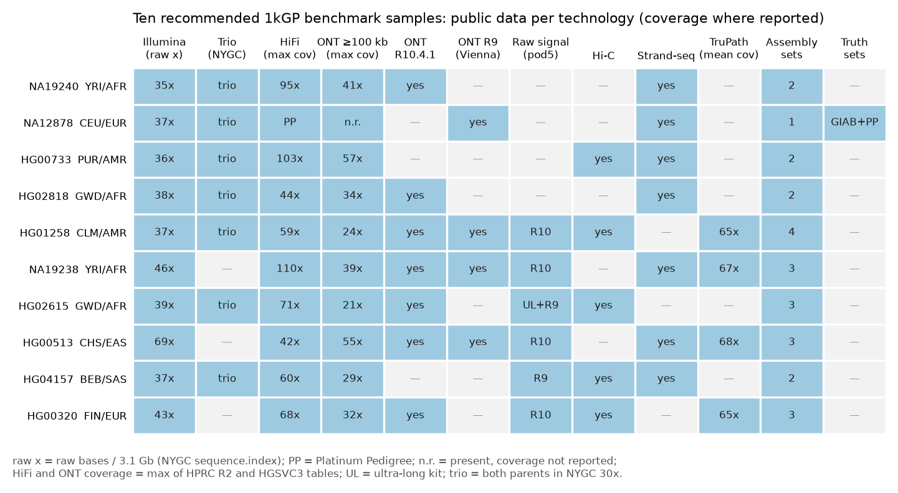
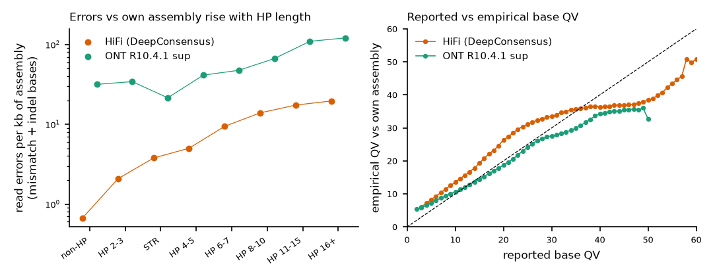

<div class="part"><span class="partno">Part I</span><br/>Assessment and recommendations</div>


**How to read this report.** Part I (chapters 1-6) gives the assessment: the state of play, ranked proposals, detailed methods for seven flagships, a roadmap and the limitations. Part II (chapters 7-10) is the full literature review: read alignment, genome assembly, transferable ideas from adjacent fields, and public data with an open benchmark protocol. Part III (chapters 11-15) documents the litmus pilots run for this report on public 1kG-linked data. Citations are inline links to DOIs or preprint identifiers; preprints are marked. Scripts, result tables and full pilot write-ups are in the repository (`litmus/`, `reviews/`, `data/`).

# Executive summary

**Bottom line.** In 2026 neither speed nor contiguity is the binding constraint. Read aligners are fast enough that mapping is a small share of a pipeline, and HPRC release 2 assembled 35% of its chromosomes gapless telomere to telomere, with 23% more as gapped T2T scaffolds. The errors that remain concentrate where sequence is duplicated, satellite, or structurally different from the reference, and they are increasingly *silent*. Aligners give wrong placements in segmental duplications their top mapping quality. Assemblies carry misplaced copies and cell-line rearrangements that pass coverage-based QC. The highest-impact opportunity is therefore not another aligner or assembler. It is **calibrated placement**: methods that know where reads and contigs belong, say how certain they are, and are trained and tested against the hundreds of public 1kG-sample haplotypes released in 2025-2026 (HPRC release 2: 232 genomes; HGSVC3: 65 genomes; 1kG nanopore: 1,019 genomes in the Vienna cohort and about 500 in the 1kGP-LRSC set; NYGC: 3,202 genomes at 30x).

**What the litmus pilots measured** (public data; simulated reads where noted; details in Part III):

- *Mapping quality is badly miscalibrated where it matters, and that is fixable (L5; simulated NA19240 reads).* Inside SDs, MAPQ 60 was wrong for 1.23-2.77% of reads on GRCh38 and 0.49-1.42% on CHM13, against a nominal 10^−6^ (long reads scored against ≥ 50%-lifted truth; under a strict ≥ 90%-colinear truth their in-SD error is 0.12-0.33%). Across all wrong MAPQ-60 placements, 71-96% (80-97% of those inside SDs) were reads that genuinely match the wrong paralog better, so better search cannot fix them. A chromosome-held-out learned recalibrator cut in-SD calibration error by 59-93% in all 10 aligner-by-reference runs. Ranking reads by its score, with the threshold set on held-out labels, kept 28-58% of correctly placed in-SD reads at ≤ 0.1% error, a level no reported-MAPQ threshold reaches; with label-free thresholds at a 0.1% target, the calibrated model realised 0.06-0.40% in-SD error, against 2.8-10.5% for reported MAPQ.
- *A drop-in sketching change makes minimap2 smaller and faster without losing confident-mapping accuracy (L1; simulated reads).* A strand-symmetric open-closed mod-minimizer cut index entries by 13.1-26.1% across presets without reducing the share of unique-sequence long reads with ≥ 3 true-origin seeds (−0.11 points for Illumina). Implemented as a 241-line patch, it gave 14-22% smaller indexes (whole-genome CHM13 `map-ont` index 8.83 → 6.88 GB), 12-30% less mapping CPU on chr20, and equal or lower wrong-mapping rates at MAPQ ≥ 1. Index construction was 1.3-1.9x slower.
- *Small-variant personalization is nearly exhausted; the remaining headroom is structural (L2/L3; real NA19240 reads, chr20).* Personalizing GRCh38 with the sample's 1kGP phased small variants captured 93% of the Illumina perfect-alignment gap in unique sequence (88% with its own two-pass calls). It captured only 9-11% of the Illumina reference-bias excess in SDs (GRCh38-REF fraction 0.571; oracle 0.504) and 0-2% of the soft-clipping gap, which CHM13 closed by 70-90%.
- *Current assembly QC misses real structural errors that positional evidence catches (case studies; real data).* HG01943 carries a de novo 1.09-Mb tandem duplication. HPRC release 2 holds none of its 28 junction 31-mers, has scaffolded maternal fragments into the paternal chromosome at four joins no read spans, and scores 0/5 on the conservative published QC tracks. A positional k-mer copy-number track, piece-level hapmers and join audits detect every target. In HG01103 a sub-clonal chromothripsis (16 junctions, about 64% of cells) is fully present in the trio assembly, but its long contigs follow the minority normal clone at 11/16 forks. An alignment-only review sees just 5/16 junctions because the published alignment BAM omits 75 of 217 paternal contigs and the junction-side ends of five others.
- *ONT-only assembly has a high coverage floor, and population k-mers fix reference-locked recruitment but not SD-block genes (L4; real reads, chr20 and 13 loci; provisional).* On HG01258 chr20, hifiasm reproduced 99.6% of the HPRC truth at ≥ 99.9% identity from 36.7x HiFi and 98.3% from 35.8x R10 nanopore reads alone. At 16x, ONT-only fell to 73.5% (HiFi 97.6%), which puts the 16.9x R9.4.1 Vienna cohort below the floor for de novo assembly. Standard-length R10 reads used as `--ul` cut HiFi contigs from 16 to 5. At 13 hard loci in NA19240, 40-haplotype population k-mers raised resolved haplotype-loci from 21/26 (GRCh38 k-mers) to 24/26, equal to alignment-window recruitment and the oracle; no rule resolved SMN. Only 6 of 15 planned titration runs were completed, on one sample.

**What we should do.** One shared machine serves both fields: haplotype-resolved truth from the HPRC release-2 and HGSVC3 assemblies of 1kG samples, base-level liftover through the published impg alignments, positional k-mer evidence, and calibrated probabilities. Applied to reads, it gives calibrated, structure-aware read placement; applied to contigs, it gives placement-aware assembly validation and repair. We recommend, in order:

1. **Build the open placement-truth benchmark (F1)** on the four 1kGP genomes with two independent assemblies (NA19240, HG00733, HG02818, NA19036) plus HG002, with leakage-free panels. This takes weeks, not months; pilot L5 built its NA19240 component on a laptop.
2. **Ship calibrated MAPQ with paralog posteriors (F2)** as an aligner-agnostic BAM post-processor, then inside minimap2 and strobealign. Acceptance is real-read transfer to held-out samples.
3. **Ship placement-aware assembly QC (F4, detection)** and scan all 462 HPRC release-2 haplotypes with published QC (HG002 excluded) and 130 HGSVC3 haplotypes for the HG01943 class. The prevalence result is itself publishable, and the HG01943/HG01103 regression tests are ready.
4. **Upstream the minimap2 sketching patch (F6)** after a real-read accuracy check, coordinated with the open pull request lh3/minimap2#1361.
5. **Then build structural population-aware references (F3)** and **assembler repairs (F4 repair; F5 clone-aware output)**, and take them to population scale with trio-phased, QC'd ONT-only diploid assemblies of the high-coverage 1kG nanopore samples, and pangenome-constrained haplotypes for the low-coverage ones (F7).

If only one direction is funded, fund the shared core, F1 and F2: it is cheap, openly demonstrable on 1kG data, already shown to work in simulation, and it improves every downstream analysis of the 3,202 NYGC genomes and the roughly 1,500 1kG nanopore genomes.


# State of play in November 2026

Table 2.1 condenses Part II into one view: for each task, the open state of the art, what it has solved, and where it still fails. Two patterns run through every row. First, the remaining failures sit in the same few percent of sequence for every method: segmental duplications (SDs; 7.0% of a complete human genome, [Vollger et al. 2022](https://doi.org/10.1126/science.abj6965)), centromeric and acrocentric satellites, and loci whose structure varies between people. Second, the failures are increasingly *silent*. Aligners give wrong SD placements their highest mapping quality, and assemblies carry misplaced copies and cell-line rearrangements that pass coverage-based QC. A method that is slightly faster or more contiguous does not address either pattern. A method that knows where sequence belongs, and says how certain it is, addresses both.

Table 2.1. Open state of the art and residual failures (tool versions from GitHub releases on 2026-11-11; numbers from Part II and Part III).

| Task | Open state of the art | Largely solved | Still failing (evidence) |
|-----------------|------------------------------------------------------------|-------------------------------------------|----------------------------------------------------------------------|
| Short-read mapping | BWA-MEM2 2.3, strobealign 0.20.0, minimap2 2.31 `-x sr`, Bowtie2 2.5.5; vg Giraffe 1.78 on pangenomes | Throughput; accuracy in unique sequence | Placement in SDs: MAPQ 60 wrong for 1.23-1.34% of in-SD reads on GRCh38 (chapter 13). Reference bias. Population-aware linear mapping is proprietary (DRAGEN; [Behera et al. 2024](https://doi.org/10.1038/s41587-024-02382-1)) |
| Long-read mapping | minimap2 2.31 (`map-hifi`, `lr:hq`, experimental `lr:hqae`), pbmm2, Winnowmap2; long-read Giraffe (preprint) | Speed; alignment contiguity | MAPQ is effectively binary ([Ekim et al. 2023](https://doi.org/10.1101/gr.277679.123)); in-SD MAPQ-60 error 1.0-2.8% (≥ 50% lifted truth) or 0.12-0.33% (≥ 90% colinear truth) (chapter 13) |
| Pangenome mapping | Giraffe with haplotype sampling ([Sirén et al. 2024](https://doi.org/10.1038/s41592-024-02407-2)), minigraph, GraphAligner, Locityper, PanGenie | Mapping to hundreds of haplotypes at linear-mapper speed | Shared coordinates and uncertainty model for downstream tools; evaluation without panel leakage |
| Indexing and seeding | Random minimizers (minimap2), syncmers and randstrobes (strobealign), FM-index (BWA) | Seed sensitivity in unique sequence | Near-optimal sampling unadopted: 13.1-26.1% fewer index entries at unchanged long-read seed sensitivity (−0.11 points for Illumina; chapter 11) |
| Diploid assembly | hifiasm 0.25.0 (HiFi + UL, trio or Hi-C), Verkko 2.3.2 | 35% of HPRC release-2 chromosomes gapless T2T, mean QV 55 ([Lucas et al. 2026](https://doi.org/10.64898/2026.07.21.739710), preprint) | Acrocentrics (7.9% gapless) and chrY (6.1%); rDNA; misplaced duplicate copies (HG01943, chapter 15); centromeres correct in both assemblers for only 28.3% of 1,246 ([Logsdon et al. 2025](https://doi.org/10.1038/s41586-025-09140-6)) |
| ONT-only assembly | hifiasm ONT mode ([Cheng et al. 2026](https://doi.org/10.1038/s41586-026-10105-6)); HERRO correction + Verkko ([Stanojević et al. 2026](https://doi.org/10.1038/s41586-026-10563-y)) | Near-T2T haplotypes from simplex reads | The 1,019-genome 1kG-ONT Vienna cohort (16.9x R9.4.1) has no whole-genome assemblies ([Schloissnig et al. 2025](https://doi.org/10.1038/s41586-025-09290-7)); the separate 1kGP-LRSC ONT set has Shasta-HapDup (~500) and hifiasm ONT-mode dual assemblies (247 R10 samples), but no trio-phased, QC'd release (chapter 10) |
| Assembly QC | Merqury, yak, HMM-Flagger, NucFlag, CRAQ, Inspector | Base-level QV; collapse and false-duplication calls where coverage moves | HiFi and ONT flags overlap on only 38.5-49.6% of bases; positional errors are invisible (HG01943: conservative published tracks 0/5 targets, chapter 15) |
| Cell-line effects | Manual release notes (HPRC2) | None | Sub-clonal rearrangements misrepresented (HG01103: long contigs follow the minority clone at 11/16 forks, chapter 15) |

# Ranked proposals

The review tracks produced 25 proposals (12 for alignment, 13 for assembly), the ideas scout 33 candidate ideas, and the pilots 24 further proposals (L1 5, L2/L3 4, L4 6, L5 4, case studies 5). Merging duplicates and dropping ideas that already ship in mainstream tools left 26 distinct proposals. The dropped ideas include recombination-aware chaining and haplotype sampling in vg, multi-context seeds and collinear chaining in strobealign, minimap2's `lr:hq`/`lr:hqae` presets and `ds:Z` tags, pangenome-aware DeepVariant, DRAGEN's personalised pangenome, and deep-learning read correction (HERRO, hifiasm ONT mode).

Each proposal was scored from 1 to 5 on four axes:

- *impact* (I): size and breadth of the benefit to community analyses;
- *adoption gap* (G): 5 when nothing open and maintained exists, 1 when it ships;
- *feasibility* (F) for a small team within 3-9 months;
- *demonstrability* (D): whether existing public 1kG-linked data and truth can accept or reject it.

Evidence from this report's pilots (E) adds 1 when a baseline or headroom was measured and 2 when an improvement was demonstrated. The scores are judgments, recorded with their sources in `report/ranked_proposals.tsv` so that readers can re-weight them.

Table 3.1. Ranked proposals. Status follows the review convention: open (nothing found), prototype, implemented-not-adopted, implemented. E for U12, U13, U18 and U22 comes from the assembly pilot (chapter 14), whose titration grid is partial. Sources (A = alignment review, S = assembly review, ideas = ideas scout, L = pilot) are listed in the TSV.

<div class="smalltable">

| Rank | Proposal | Status | I | G | F | D | E | Total | Flagship | Litmus pass criterion |
|---|-------------------------------------------------------------|-----------------|---|---|---|---|---|----|------|-------------------------------------------------------|
| 1 | Calibrated MAPQ with paralog-group posteriors (post-processor, then in-aligner) (U2) | prototype | 5 | 3 | 5 | 5 | 2 | 20 | F2 | Real-read transfer: in-SD ECE −50%, SD Mendelian errors −20% at matched calls |
| 2 | Placement-aware assembly QC: positional k-mer copy number, missing-junction recovery, join audit (U3) | prototype | 5 | 4 | 4 | 5 | 2 | 20 | F4 | Flags 5/5 HG01943 targets; ≤2% false flags on T2T-HG002 |
| 3 | Open multi-ancestry placement-truth benchmark on 1kG genomes (U1) | prototype | 5 | 4 | 5 | 5 | 1 | 20 | F1 | ≥1.5x stratum difference between NA19240 and HG002 outside CI, or aligner ranks change (τ < 0.8) |
| 4 | Low-density, strand-symmetric sketching in minimap2 (--mod-oc) plus hash fix (U4) | prototype | 3 | 3 | 5 | 5 | 2 | 18 | F6 | Real reads: ≥15% smaller index, ≤0.1-point accuracy loss, equal variant calls |
| 5 | Structural population-aware references for linear mappers (ALT panel + structural personalization) (U5) | implemented-not-adopted | 5 | 3 | 3 | 5 | 1 | 17 | F3 | Recovers ≥50% of oracle MAPQ gap and SD bias excess (small-variant personalization, Illumina: 8-31%, 9-11%) |
| 6 | Copy-number-consistent graph walk and haplotype-guarded dual scaffolding in hifiasm (U6) | open | 4 | 5 | 3 | 4 | 1 | 17 | F4 | Patched hifiasm holds both HG01943 copies, all 28 junction 31-mers, no unsupported join |
| 7 | Clone-aware assembly output and cell-line provenance labels (U7) | open | 4 | 5 | 3 | 4 | 1 | 17 | F5 | Majority clone at ≥15/16 HG01103 forks; ≤1 false non-germline label per control genome |
| 8 | Calibrated multi-evidence assembly reliability tracks (conformal per-base QV) (U9) | prototype | 4 | 4 | 3 | 4 | 1 | 16 | F4 | AUPRC ≥1.25x best single detector; calibration slope 0.9-1.1 |
| 9 | QC provenance carried into pangenome graphs and VCFs (U10) | open | 4 | 4 | 4 | 4 | 0 | 16 | — | Flagged singleton SV alleles ≥5x more often lack independent read support |
| 10 | Pangenome copy-number-aware mappability track (also an F2 feature) (U8) | open | 3 | 4 | 4 | 5 | 0 | 16 | F2 | ≥1.5x more error sites captured than Umap at equal genome fraction |
| 11 | Locus-level pangenome genotyping as a standard second pass (U18) | implemented-not-adopted | 4 | 2 | 4 | 4 | 1 | 15 | — | Median QV ≥30 with trio excluded; ≥+8 QV in SD loci |
| 12 | PSV/divergence-aware read re-placement in segmental duplications (U11) | prototype | 4 | 3 | 3 | 4 | 1 | 15 | F2/F3 | +8 points correctly placed SD reads at ≤0.5% confident-wrong |
| 13 | Trio-phased, QC'd ONT-only diploid assemblies for the 1kG nanopore samples (U12) | implemented-not-adopted | 4 | 2 | 3 | 5 | 1 | 15 | F7 | On the 12 LRSC samples in HPRC R2: ≥98% of truth at ≥99.9% identity, QV ≥45, ≥5 T2T contigs per haplotype |
| 14 | Pangenome-constrained haplotypes from intermediate-coverage long reads (U13) | prototype | 4 | 4 | 2 | 4 | 1 | 15 | F7 | QV ≥50 genome-wide, ≥40 in complex loci at 16.9x |
| 15 | Open proximity-aware mapping for Illumina TruPath reads (U16) | open | 4 | 5 | 2 | 4 | 0 | 15 | — | Placement and phasing gains over pair-only mapping on 5 HPRC-overlap TruPath samples |
| 16 | Reference-defect correction by default (FixItFelix/CHM13) for 1kGP pipelines (U14) | implemented-not-adopted | 3 | 2 | 5 | 5 | 0 | 15 | — | Recall ≥95% in the 33 affected genes |
| 17 | Determinism as a tested contract (order, batch, thread and strand invariance) (U15) | implemented-not-adopted | 2 | 3 | 5 | 5 | 0 | 15 | — | <0.01% changed placements after tie-break patch |
| 18 | Paralog-safe correction and homopolymer-length polishing; calibrated long-read base QVs (U19) | implemented-not-adopted | 3 | 3 | 3 | 4 | 1 | 14 | — | ≤0.5% paralog misassignment; ≥90% exact length for homopolymers >20 bp |
| 19 | Locus-level hifiasm-Verkko reconciliation, with ultra-long locus assembly for SD-block genes (SMN) (U22) | implemented-not-adopted | 3 | 3 | 3 | 4 | 1 | 14 | — | ≥1,150 of 1,246 HGSVC3 centromeres complete and accurate |
| 20 | Methylation-linked phasing across homozygous stretches in assembly graphs (U17) | open (in assemblers) | 3 | 4 | 3 | 4 | 0 | 14 | — | Phase-block NG50 ≥1.5x with ≤0.1-point hamming increase |
| 21 | Learned anchor and chain scoring for long reads (U20) | open | 2 | 5 | 3 | 4 | 0 | 14 | — | Fewer confident misplacements at equal speed |
| 22 | Exact chaining and alignment optimality audit (U21) | prototype | 2 | 3 | 4 | 4 | 0 | 13 | — | ≥10% fewer confident errors in SD/satellite strata |
| 23 | rDNA and acrocentric completion with sized gaps (U24) | prototype | 3 | 3 | 2 | 3 | 1 | 12 | — | ≥50% of acrocentric haplotypes T2T (baseline 7.9%) |
| 24 | Graph-guided adaptive finishing with ONT adaptive sampling (U25) | implemented-not-adopted | 3 | 3 | 3 | 3 | 0 | 12 | — | ≥80% of gaps closed with ≤40% of UL bases |
| 25 | Graph neural networks trained on T2T truth for residual tangles (U23) | prototype | 3 | 3 | 2 | 4 | 0 | 12 | — | ≥25% more T2T contigs at equal flagged bases |
| 26 | Raw-signal mapping for CPU-only adaptive sampling (U26) | implemented-not-adopted | 2 | 2 | 3 | 4 | 0 | 11 | — | F1 ≥0.9x basecall arm at ≤50% CPU |

</div>


The top tier is consistent across the evidence. Four of the top seven proposals are about *knowing where sequence belongs and how sure we are*: the truth benchmark, calibrated MAPQ, placement-aware assembly QC, and copy-number-consistent assembly. Three of these already have a demonstrated improvement or a measured failure from this report's pilots. The two cheapest wins, the minimap2 sketching patch and a calibrated post-processor for existing aligners, keep the reference, coordinate system and output formats unchanged and can ship first.

The pilots also moved some popular ideas down. In L5, search failures explain only 0-14% of confident misplacements, which caps what exact chaining (U21) or learned chain scoring (U20) can add to accuracy. In L2/L3, small-variant personalization captured almost none of the structural headroom, so personalization research is redirected to structural haplotypes (U5). Learned genomic priors (genomic language models, graph neural networks, reinforcement learning) remain prototypes with leakage and bias risks (chapter 9), and are not ranked above the calibration work they would depend on.


# Flagship methods

The flagships below are written as methods sections: the problem and the evidence for it, the algorithm, how it plugs into existing tools, the litmus test that would accept or reject it on public 1kG data, and the main risks. Numbers marked "measured" come from the pilots in Part III; all others are cited.

## F1. An open placement-truth benchmark on 1kG genomes

**Problem.** Most claims about alignment or assembly accuracy in difficult sequence are tested on one or two European-ancestry GIAB genomes (HG002, NA12878). The field cannot say how often a MAPQ-60 read in an SD is wrong in a Yoruba genome, or whether an assembler's error profile differs by ancestry. A systematic benchmark called for African, Hispanic and mixed-ancestry gold standards ([Barbitoff et al. 2022](https://doi.org/10.1186/s12864-022-08365-3)). The data to build them became public in 2025-2026: HPRC release 2 assembled 232 genomes, 227 of them 1kGP samples ([Lucas et al. 2026](https://doi.org/10.64898/2026.07.21.739710), preprint), and HGSVC3 assembled 65 more ([Logsdon et al. 2025](https://doi.org/10.1038/s41586-025-09140-6)). Four 1kGP samples carry two independent consortium assemblies: NA19240 (YRI), HG00733 (PUR), HG02818 (GWD) and NA19036 (LWK) (measured, chapter 10).

**Method.**

1. *Truth tiers.* T1 is the HG002 Q100 genome ([Hansen et al. 2026](https://doi.org/10.1016/j.cell.2026.06.016)). T2 covers the four doubly assembled 1kGP genomes, restricted to sequence where the HPRC release-2 and HGSVC3 haplotypes agree and neither carries a reliability flag. T3 covers single-assembly 1kGP genomes outside flagged sequence. Each tier is released as per-haplotype FASTA plus BED masks.
2. *Coordinates.* Haplotype-to-reference maps come from the HPRC release-2 impg/wfmash alignments, whose `cg:Z` CIGARs give base-level liftover to GRCh38 and CHM13. The all-vs-1 PAFs are BGZF-compressed and grouped by query sample, so one sample's rows can be range-fetched (about 30 MB instead of 6.5 GB by the L5 fetch script's estimate; 38,248 NA19240 rows against GRCh38; chapter 13).
3. *Reads with known origin.* Illumina, HiFi and ONT R10.4.1 reads are simulated from each haplotype with empirical error models. The models are fitted to the same sample's real reads aligned to its own assembly (the same-genome error panel of chapter 10). Each read's origin interval is lifted to both references and labelled unique, multi-copy (by k-mer multiplicity in its haplotype) or reference-absent.
4. *Real reads.* NYGC 30x CRAMs ([Byrska-Bishop et al. 2022](https://doi.org/10.1016/j.cell.2022.08.004)), HPRC HiFi/ONT and 1kG nanopore reads are mapped to the sample's own diploid assembly with minimap2 (`-x sr` for Illumina; a long-read preset such as `lr:hqae` for HiFi and ONT). Long reads are fetched by region from aligned, indexed files: in L4 a chr20 slice took 9-29 minutes, whereas streaming one unaligned 13-73-GB nanopore BAM would take hours to days at the bandwidth measured there. Reads with a unique own-assembly placement are lifted to the references as real-read truth.
5. *Leakage control.* Panels used by any method under test must exclude the test sample and its parents. The HPRC Minigraph-Cactus v2.1 "-eval" graphs already hold out HG002, HG005 and NA19240 (chapter 10), and vg supports `--ban-sample`.
6. *Metrics.* For reads: confident-misplacement rate at MAPQ thresholds, expected calibration error (ECE), and unmapped and reference-absent rates. For variants: dipcall-style truth ([Li et al. 2018](https://doi.org/10.1038/s41592-018-0054-7)) scored per GIAB v3.6 stratum ([Dwarshuis et al. 2024](https://doi.org/10.1038/s41467-024-53260-y)). For assemblies: the regression tests of chapter 15 plus Merqury/yak QV and switch error, computed with whole-genome parental k-mers (chromosome-sliced k-mers gave a 0.9-3.9% hamming floor on the truth haplotypes themselves in L4).

**Litmus test.** The benchmark is informative if at least one stratum shows a ≥1.5-fold difference in confident misplacement between NA19240 and HG002 outside bootstrap 95% CIs, or if aligner rankings change between samples (Kendall τ < 0.8). Pilot L5 (chapter 13) built the NA19240 component of this benchmark in one session on a laptop, so feasibility is shown.

**Risks.** Assembly errors leak into truth; the T2 agreement mask and the regression tests of chapter 15 bound this. Simulated error models may be optimistic; the real-read tier checks them.

## F2. Calibrated mapping quality with paralog-group posteriors

**Problem.** MAPQ is defined as a Phred-scaled probability that the placement is wrong ([Li et al. 2008](https://doi.org/10.1101/gr.078212.108)). Every production aligner computes it heuristically from best and second-best scores, and the learned predictors (LoQuM, [Ruffalo et al. 2012](https://doi.org/10.1093/bioinformatics/bts408); Qtip, [Langmead 2017](https://doi.org/10.1186/s13059-017-1290-3); [Cline et al. 2020](https://doi.org/10.7717/peerj.10501)) were never adopted; Qtip, the most general, has had no commit since 2017. Pilot L5 measured how far the heuristics are from the definition inside SDs. On GRCh38, MAPQ 60 was wrong for 1.23% (bwa mem), 1.34% (minimap2 `sr`), 1.57% (`map-hifi`), 2.77% (`lr:hq`) and 2.71% (`map-ont`) of in-SD reads (long-read values against ≥ 50%-lifted truth); the nominal rate is 10^−6^. On GRCh38 the reported MAPQ ≥ 30 filter passed 2.58-5.44% wrong in-SD reads (1.73-5.44% across both references). Realignment showed that 71-96% of all wrong MAPQ-60 placements (80-97% of those inside SDs) were reads that genuinely score better at the reported paralog than at their true locus. Better search cannot fix such errors, because the best-scoring alignment is the wrong one. The information that can fix them is population-level: which paralog-specific variants (PSVs) are fixed, and how divergent a haplotype can be from the reference copy.

**Method.**

1. *Features available at alignment time.* Aligner tags (AS, XS or minimap2 `s1`/`s2`, `de`, NM, `cm`, `ms`), read length, aligned fraction, clipping, counts of secondary and supplementary alignments, SD membership of the reported locus, and a pangenome copy-number prior. For each 100-bp reference window, the prior is the fraction of HPRC release-2 haplotypes carrying 0, 1 or ≥2 homologous copies (alignment-review proposal 4).
2. *Model.* Gradient-boosted trees trained on F1 truth from panel haplotypes that exclude the test sample, with chromosome-held-out folds, followed by held-out isotonic calibration of the predicted error probability. L5 found that the plain gradient-boosting model is over-confident on held-out folds without this step.
3. *Output.* A full-resolution calibrated error probability in a new tag (`pw:f`, as written by `l5_apply.py`, with the original MAPQ kept in `om:i`), a recalibrated MAPQ that no longer saturates at 60, and, for reads in SD families, a paralog-group ID with posterior weights over candidate loci. Callers can then weight reads instead of discarding them at a MAPQ cut-off; ParascopyVC gained recall by using reads regardless of MAPQ ([Prodanov & Bansal 2023](https://doi.org/10.1093/bioinformatics/btad268)).
4. *Integration.* An aligner-agnostic post-processor (BAM in, BAM out) first; then the feature extraction moves into minimap2 and strobealign, which already compute most of it. L5 delivered a working apply-to-BAM script (`litmus/L5_mapq_calibration/l5_apply.py`).

**Litmus test (measured in L5, simulated NA19240 reads).** Out of fold, the recalibrator cut in-SD ECE by 59-93% in all 10 aligner-by-reference runs (bwa mem on GRCh38: 0.183 → 0.013; `map-hifi` on GRCh38: 0.065 → 0.011). A recalibrated MAPQ ≥ 30 filter had 0.04-0.34% in-SD error while keeping 30-53% of in-SD reads, against 1.73-5.44% error at 70-91% kept for the reported filter. Ranking by the model's score, with the threshold set on held-out labels, kept 28-58% of correctly placed in-SD reads at ≤ 0.1% error, a level that no reported-MAPQ threshold reaches; with label-free thresholds at a 0.1% target, the calibrated model realised 0.06-0.40% in-SD error. The acceptance test that remains is real-read transfer: calibration trained on panel haplotypes must hold on held-out samples (HG00733, HG02818, NA19036) and on real NYGC and HPRC reads, scored against F1 real-read truth. The test passes if in-SD ECE falls by ≥ 50% and Mendelian errors at SD sites in the NA19240 trio fall by ≥ 20% at matched call counts.

**Risks.** Over-fitting to one sample's paralog structure; the cross-sample test addresses it. Long-read error estimates depend on the truth definition: in-SD MAPQ-60 error was 1.0-2.8% with ≥ 50% lifted truth but 0.12-0.33% with ≥ 90% colinear truth (L5). A conservative truth definition must be fixed in advance.

## F3. Structural, population-aware references for standard linear mappers

**Problem.** The most effective short-read approach measured on GIAB samples, a linear mapper with population haplotypes and per-sample personalisation, is proprietary. DRAGEN's GRCh38 plus 64-haplotype multigenome cut SNV and indel errors by 54.2% on HG001-HG007 ([Behera et al. 2024](https://doi.org/10.1038/s41587-024-02382-1)). The open routes either change the whole toolchain (graph mapping with the HPRC pangenome cut small-variant errors by 34%; [Liao et al. 2023](https://doi.org/10.1038/s41586-023-05896-x)) or remain research pipelines: Reference Flow ([Chen et al. 2021](https://doi.org/10.1186/s13059-020-02229-3)), impute-first diploid references, which cut errors by 38.7% on HG002 ([Vaddadi et al. 2026](https://doi.org/10.1101/gr.280989.125)), and haplotype sampling ([Sirén et al. 2024](https://doi.org/10.1038/s41592-024-02407-2)). At population scale, a linear-coordinate pangenome mapper applied to 57,630 Icelandic genomes found 6.17% more variants ([Holley et al. 2026](https://doi.org/10.1038/s41586-026-10924-7)).

Pilots L2/L3 and L5 show *which* population information matters. Small-variant personalization captured 88-93% of the Illumina perfect-alignment gap in unique sequence (own calls 88%, 1kGP phased 93%). It captured only 9-11% of the Illumina reference-bias excess in SDs and 0-2% of the soft-clipping gap, and it slightly raised the share of SD heterozygous sites with no ALT read. A reference with the right structure did what personalization could not: CHM13 recovered 70-90% of the clipping gap, and the sample's own assembly removed the SD bias entirely. In L5, 71-96% of confident misplacements were reads that genuinely match the wrong paralog better, and for long reads 81-96% of these spanned a structural difference. The missing ingredient is therefore *structural* haplotypes in SDs, tandem repeats and SV-rich loci, not more SNVs.

**Method.**

1. *Structural panel.* For each difficult locus (GIAB difficult strata, SDs, tandem-repeat and SV-rich loci, CMRG-style genes), query the homologous interval in every HPRC release-2 and HGSVC3 haplotype through the impg alignments. Exclude the test sample and its relatives. Cluster the haplotype segments by sequence (minimizer sketches, then exact comparison) and select a small set of representatives that covers population k-mer diversity, by greedy set cover on locus-specific k-mers. Emit the representatives as ALT contigs with base-level liftover to the primary assembly.
2. *Per-sample structural personalization.* Count the sample's read k-mers at each locus and pick the two most likely structural haplotypes. The model is a Li-Stephens copying model over the panel, allowing switches between haplotype blocks; Locityper, which picks the likeliest pair of whole panel haplotypes per locus from read alignments, is the single-locus precedent ([Prodanov et al. 2025](https://doi.org/10.1038/s41588-025-02362-4)). The personalized reference is CHM13 (or GRCh38) with the selected structural haplotypes as ALT contigs. As an alternative, keep the whole panel as ALTs and let the mapper resolve them.
3. *Mapping and projection.* Map with bwa-mem2 or minimap2 using ALT-aware placement (BWA's ALT-aware mode; minimap2 `--alt`). Compute MAPQ over equivalence classes of primary and ALT copies, calibrated as in F2. Project alignments to primary coordinates so that BAM-based callers run unchanged.
4. *Comparators.* GRCh38; CHM13; CHM13 plus SNV personalization; Giraffe with haplotype sampling and `--ban-sample`; the oracle (own assembly).

**Litmus test.** First on the L2/L3 setup (NA19240 chr20, real reads), then genome-wide through F1. Structural personalization passes if it recovers ≥ 50% of the oracle's MAPQ gap and ≥ 50% of the SD reference-bias excess, against 8-31% and 9-11% for small-variant personalization of Illumina reads (measured), with no loss in unique sequence. It must also reduce FN + FP by ≥ 30% in SD and low-mappability strata against bwa-mem2 on GRCh38, with ≤ 1% more errors elsewhere (alignment-review proposal 3).

**Risks.** ALT contigs multiply multi-mapping; equivalence-class MAPQ and F2 calibration are prerequisites, not options. Liftover across structural variants can misplace projected alignments; F1's real-read truth tests this. Panel leakage inflates gains; leave-trio-out panels and the HPRC "-eval" graphs control it.


## F4. Placement-aware assembly validation and copy-number-consistent repair

**Problem.** Current assembly QC asks whether a region's coverage looks wrong. A copy that is real but sits in the wrong place has normal coverage. In HG01943 (chapter 15) a de novo maternal 1.09-Mb tandem duplication is supported by 3.05 copies of read depth, 31 HiFi junction reads and 35 short-read junction pairs or splits, and by none in either parent. HPRC release 2 contains none of the 28 junction-spanning 31-mers in either haplotype. Two maternal fragments were scaffolded into the paternal chromosome at four joins that no read spans, and two false duplications were created. The release used hifiasm with `--dual-scaf` ([Lucas et al. 2026](https://doi.org/10.64898/2026.07.21.739710), preprint), and the paternal pieces are ordered exactly as their homologous starts on the maternal sequence, the signature of reference-guided ordering against a haplotype that holds the segment once. Coverage is haploid-normal on every piece. The conservative HMM-Flagger tracks that HPRC publishes by default ([Asri et al. 2026](https://doi.org/10.64898/2026.02.27.708355), preprint) flag none of five scored targets (0/5); the unfiltered predictions and NucFlag reach 2/5, and no track marks the missing junction. A local hifiasm 0.25.0 reassembly ([Cheng et al. 2024](https://doi.org/10.1038/s41592-024-02269-8)) recovers the junction as a 44-kb contig but still collapses the second copy. Yet the non-trio run's unitig graph, built from the same reads, holds a 369-kb unitig at twice haploid depth, entered both from the maternal flank and from the junction unitig. The multiplicity that the correct walk needs is in the graph; no stage uses it.

**Method: detection (assembly-agnostic, runs on any released assembly).**

1. *Positional k-mer copy-number track.* In 10-kb windows along each haplotype, or along the reference through the impg alignments, compare the copy number implied by read k-mers with the copy number of the same k-mers in the diploid assembly (both haplotypes plus unplaced contigs). Read copy number is the k-mer count in Illumina or HiFi reads divided by haploid k-mer depth. Windows where the two disagree for a minimum run, under a negative-binomial test, are flagged. In HG01943 the track gives 3.13 read copies against 3 assembly copies in 87 bins, 2 in 17 bins (the missing copy) and 4 in 3 bins (the false duplications).
2. *Missing-junction recovery.* Collect solid read k-mers absent from both haplotypes and cluster them by read co-occurrence. Assemble each cluster locally into a missing unitig and map its flanks back. Distant flanks mark a missing junction (tandem duplication, translocation, chromothripsis); local flanks mark a missing allele or a collapsed copy. Genome-wide Merqury completeness ([Rhie et al. 2020](https://doi.org/10.1186/s13059-020-02134-9)) cannot see this, because 28 missing k-mers are negligible among billions; the localised version can.
3. *Join and piece audit.* For every scaffold gap and contig adjacency, record: flank-anchored spanning reads (≥ 5 kb each side, MAPQ ≥ 20); the inherited parental hapmer composition of each piece; and overlaps between neighbouring pieces from self-alignment. Flag joins that no read spans when the inserted piece carries the other parent's hapmers (HG01943: 5,638 maternal against 0 paternal hapmers in a paternal scaffold piece) or when neighbours overlap.
4. *Clip clusters on the assembly itself.* Cluster soft-clip ends of reads realigned to the assembly ([Chen et al. 2021](https://doi.org/10.1186/s13059-021-02527-4); [Li et al. 2023](https://doi.org/10.1038/s41467-023-42336-w)). In HG01943, 31 and 30 junction reads end at the two ends of the maternal copy.
5. *Calibrated output.* Each flagged locus receives a probability from a model trained on assemblies with T2T truth (HG002 against Q100; CHM13), using the four signals above plus the existing HMM-Flagger and NucFlag calls as features. This joins assembly-review proposal P1, which targets the measured disagreement between QC streams.

**Method: repair (assembler level).**

1. *Copy-number-consistent walk.* Estimate integer unitig copy numbers from depth with a Poisson or negative-binomial mixture anchored at haploid depth, and add junction-unitig support. Then require each haplotype walk to traverse a unitig as many times as its copy number allows. When a junction unitig links a 2x unitig's end to its start, the walk goes flank → copy 1 → junction → copy 2 → flank. This is a small integer-flow problem on the local subgraph and can be solved exactly; segments much longer than reads can be ordered in no other way unless ultra-long or Hi-C links reach them. In HG01943, tying the copy-discriminating stretch to the junction would need ONT reads of at least 353 kb.
2. *Trio-consistent copy assignment.* Assign every copy to the haplotype whose hapmers it carries.
3. *Guarded dual scaffolding.* Refuse a join that no read spans when the inserted piece carries the other parent's hapmers or overlaps its neighbours.

**Litmus test.** The five HG01943 regression tests (R1-R5, `litmus/cases_HG01943_HG01103/regression_tests.md`) define the targets. Detection passes if the detector flags all 5 targets on the HPRC release-2 assembly while flagging at most 2% of anchored duplication junctions on T2T-HG002 v1.1, the negative control. Repair passes if a patched hifiasm on the same reads produces a maternal haplotype that contains all 28 junction 31-mers, holds both copies (about 2.54 Mb against 1.58 Mb now) and leaves no unsupported join. Scale-up is then to scan all 462 HPRC release-2 haplotypes with published QC (HG002 excluded) and 130 HGSVC3 haplotypes for the same class.

**Risks.** Copy-number estimation in satellites and collapsed SDs is noisy, so the walk constraint must be local and evidence-gated. The detector's genome-wide false-flag rate is unmeasured (chapter 15), which is why the HG002 negative control is part of the test.

## F5. Clone-aware assembly of cell-line genomes

**Problem.** Every 1kG assembly is of a lymphoblastoid cell line (LCL). LCLs acquire sub-clonal rearrangements in culture. HPRC release 2 withheld NA18612 because of chr16-chr17 joins and annotated EBV integrations, a chrX inversion and chrY loss in other samples (assembly review, Part II). In HG01103 (chapter 15) a sub-clonal chromothripsis of the paternal chr2 and chr14 is present in about 64% of cells, with 16 junctions supported by 203 HiFi reads and 297 short-read splits or pairs, and with no supporting read in either parent. The trio hifiasm assembly contains all 16 junctions. But at 11 of 16 forks its long contigs follow the minority (normal) clone, and it holds the lost segments at one copy per haplotype, so the 46-Mb loss is invisible as copy number. At least one contig switches clones, producing a sequence that exists in no single cell. A coverage QC would most likely call the 46 Mb of real sub-clonal sequence a false duplication, because those contigs receive about 0.45 of haploid depth.

**Method.**

1. *Fork read fractions.* At every bubble or junction cluster, estimate the haplotagged read fraction supporting each branch.
2. *Shared clone fraction.* Fit one clone fraction *f* per event across all of its forks, as a mixture model with a common *f* per haplotype. Use it to thread the majority clone consistently through long contigs, and emit the minority branches as labelled alternates (for example GFA/AGP tags `clone=minor;f=0.36`). Independent fork decisions must not mix clones within a contig.
3. *Provenance classification.* For each large junction (interchromosomal, or a copy change or inversion of 50 kb or more), combine four signals: allele fraction; parental transmission in NYGC trio reads; replication in independent DNA preparations of the same line (NYGC, HPRC, 1kGP-LRSC ONT and 1KGP PacBio data were generated by separate projects from separately prepared DNA); and recurrence in the pangenome. Label each junction inherited germline, de novo germline, culture-acquired or unresolved, and carry the label into the pangenome so genotypers do not treat culture artefacts as population alleles (assembly-review proposals P4 and P7).
4. *Sequence-level evaluation.* Test released assemblies with read-derived junction k-mers, not only with reference alignments. The published HG01103 assembly-to-GRCh38 BAM lacks 75 of 217 paternal contigs and the junction-side ends of five others, so an alignment-only review sees 5 of 16 junctions (chapter 15).

**Litmus test.** On HG01103 (1KGP PacBio HiFi plus NYGC trio data), a clone-aware assembly follows the majority clone at ≥ 15/16 forks, contains no cross-clone contig, and labels all 16 junctions culture-acquired or unresolved. On controls, the 12 HPRC release-2 samples in the 1kGP-LRSC ONT set (independent DNA and reads), it assigns at most one false non-germline label per genome.

## F6. Low-density sketching in minimap2 (a drop-in improvement, measured)

**Problem.** minimap2 2.31 samples k-mers with random minimizers at density 2/(w+1). Theory now gives schemes within a few percent of a near-tight lower bound ([Kille et al. 2024](https://doi.org/10.1093/bioinformatics/btae736); [Groot Koerkamp & Pibiri 2024](https://doi.org/10.4230/lipics.wabi.2024.11); [Groot Koerkamp et al. 2025](https://doi.org/10.1186/s13015-025-00270-0); [Golan et al. 2025](https://doi.org/10.1093/bioinformatics/btaf251)), but no mainstream mapper uses them. An open pull request (lh3/minimap2#1361, self-described as a draft) adds a plain mod-minimizer at sketch time only. It refuses `-d` and prebuilt `.mmi` indexes, because its author found that a persisted mod-minimizer index without a new magic number is mapped silently wrong by old binaries, and it gives no gain when t = k (`map-hifi`, `lr:hq`, `asm5`, `asm10`).

**Method.** Pilot L1 ported minimap2's `mm_sketch` to numba bit-exactly and compared ten schemes. It then implemented the best one, a strand-symmetric open-closed (OC) mod-minimizer, in a 241-line patch (`--mod-oc`) with a distinct index magic (`MMI\3`), so that older binaries do not load it as an index (stock 2.31 treated it as FASTA and mapped 0 of 400 test reads, with exit status 0) instead of mapping wrongly. Strand symmetry matters. Taking the minimum over strands erodes orders optimised on one strand (GreedyMini at w = 10, k = 15: density 0.1344 rises to 0.1671), whereas open-closed schemes are lossless when k − s is even.

**Litmus test (measured, CHM13 chr20 and whole-genome CHM13, simulated reads).** At minimap2's unchanged (k, w), index entries fell by 26.1% (`sr`), 24.6% (`map-ont`), 18.8% (`map-hifi`), 24.6% (`asm20`) and 13.1% (`lr:hqae`). Reads with ≥ 3 true-origin seeds in unique sequence were unchanged for long reads (0.00 percentage points) and fell by 0.11 points for Illumina. The patched binary gave 14-22% smaller chr20 indexes and 12-30% less mapping CPU. Wrong mappings at MAPQ ≥ 1 stayed equal or fell (`sr`: 0.319% → 0.271%; `map-ont`: 0.259% → 0.259%; `map-hifi`: 0.345% → 0.138%), and MAPQ-60 counts moved by at most 0.3%. Whole-genome CHM13 indexes shrank from 5.99 to 5.14 GB (`map-hifi`) and from 8.83 to 6.88 GB (`map-ont`). Peak build memory fell from 7.70 to 5.19 GB for `map-hifi` but rose from 7.18 to 8.71 GB for `map-ont`. On whole-genome `map-hifi` mapping of 2,942 simulated HiFi reads, MAPQ 60 covered 2,880 reads with 1 wrong, against 2,847 with 0 wrong for stock minimap2. The main cost is index construction, which was 1.3-1.9x slower. L1 also found that minimap2's `hash64` is a weak random order at k ≤ 15, because its mixing steps touch few bits when 2k ≤ 31. A width-adapted invertible mixer removes 2.8% of `map-ont` index entries with no other change.

**What remains before upstreaming.** Real-read accuracy on whole genomes (NA19240 HiFi, ONT and Illumina through F1); variant-calling equivalence; the effect on minimap2's `occ_dist` rescue of high-occurrence seeds, which L1 did not model and which acts on the 0.6-5.8% of reads that are repeat-dominated; and coordination with PR #1361. The gain grows with index size, so pangenome-scale indexes over hundreds of haplotypes are the natural next target.

## F7. Population-scale nanopore diploid assemblies for 1kG (coverage floor measured)

**Problem.** About 1,500 distinct 1kG samples have nanopore data, in two projects: the 1kG-ONT Vienna cohort (1,019 genomes, R9.4.1, median 16.9x; [Schloissnig et al. 2025](https://doi.org/10.1038/s41586-025-09290-7)) and the 1kGP-LRSC ONT set (about 500 genomes, 253 R9.4.1 and 247 R10.4.1; [Gustafson et al. 2024](https://doi.org/10.1101/gr.279273.124)). Neither has a trio-phased, QC'd diploid assembly release. The Vienna study avoided whole-genome assembly. The LRSC bucket holds Shasta-HapDup assemblies for about 500 samples and hifiasm ONT-mode dual assemblies for 247 R10 samples, without parental phasing or published QC (chapter 10). Most 1kG samples therefore exist only as reads aligned to a reference. That limits the pangenome, which holds 232 HPRC genomes, and every method in this report that needs a sample's own haplotypes.

**What L4 measured (chapter 14; one sample, chr20, provisional).** hifiasm 0.25.0 in ONT mode, on standard-length R10 dorado-sup reads (read N50 41.9 kb), reproduced 98.26% of HG01258's HPRC truth at ≥ 99.9% identity from 35.8x (36 contigs). The same run on 36.7x HiFi reproduced 99.61% (16 contigs). At 16x, ONT-only collapsed to 73.52% (431 contigs), while 16x HiFi kept 97.62%. Two consequences follow. ONT-only assembly is viable for high-coverage R10 samples such as HG01258 (35.8x on chr20). The Vienna cohort, at 16.9x of the older R9.4.1 chemistry, is below the floor seen here, so it needs pangenome-constrained haplotype inference (U13) rather than de novo assembly. Separately, using the same standard-length R10 reads (≥ 20 kb) as `--ul` input cut a 36.7x HiFi chr20 assembly from 16 contigs to 5 (NG50 45.4 → 65.3 Mb) at 2.9x the wall time, so samples with both HiFi and ordinary R10 reads need no ultra-long library to approach chromosome scale.

**Method.**

1. *Tiering by chemistry and coverage.* Measure per-sample R10 coverage and read N50 from the LRSC metadata. Assemble samples with at least about 30x R10 using hifiasm ONT mode ([Cheng et al. 2026](https://doi.org/10.1038/s41586-026-10105-6)). Bin haplotypes with NYGC parental Illumina k-mers where the parents are among the 602 NYGC trios, and emit dual assemblies otherwise. Where HiFi also exists, add R10 reads ≥ 20 kb as `--ul`. Samples below the floor go to the pangenome-constrained arm (U13). Their reads are mapped to the HPRC release-2 graph with the sample's family excluded, two haplotype paths are inferred with a copying model, and de novo sequence is patched in only where reads support it, for example by local SV assembly as in the Vienna study.
2. *QC and labelling.* Score every assembly with the F4 placement-aware tracks, HMM-Flagger's ONT preset, and F5 provenance labels for large junctions. Compute QV and trio switch and hamming error with whole-genome NYGC k-mers, never chromosome-sliced ones: in L4, sliced parental k-mers reported 0.9-3.9% hamming error on the truth haplotypes themselves.
3. *Calibration panel.* The 12 HPRC release-2 samples in the LRSC set (HG00097, HG00126, HG00232, HG00253, HG00320, HG00706, HG01258, HG02615, HG03369, HG03583, HG04157, NA18879) have independent HiFi and ultra-long truth. The 42 HPRC release-2 samples in the Vienna cohort calibrate the low-coverage arm.
4. *Engineering.* Size hifiasm's initial Bloom filter from the input. The default 2^37^-bit filter (16 GiB) made one chr20 run peak at 18.65 GB, against 1.8-8.1 GB for `-f0` runs (not a controlled pair). Release aligned, indexed reads for every sample, so that loci and chromosomes can be fetched by region.

**Litmus test.** On the 12 LRSC samples in HPRC release 2, trio-phased ONT-only assemblies from R10 reads must meet four targets: ≥ 98% of each HPRC truth haplotype reproduced at ≥ 99.9% identity (the L4 chr20 value at about 36x), QV ≥ 45 with whole-genome NYGC k-mers, ≥ 5 T2T contigs per haplotype, and no more than twice HPRC's ONT-flagged bases (the assembly-review P6 targets). The low-coverage arm passes if, on the same samples downsampled to 16.9x, it reaches QV ≥ 50 genome-wide and ≥ 40 in complex loci. It must also reproduce more of the truth at ≥ 99.9% identity than de novo ONT-only assembly at the same coverage (L4 baseline: 73.5% of chr20 at 16x R10).

**Risks.** The L4 floor comes from one sample, one chromosome and a partial grid with standard-length reads, so the threshold of about 30x is an estimate. R9.4.1 reads are less accurate than R10. Pangenome-constrained inference cannot recover sequence that is absent from the panel unless reads support a local assembly, so private structural variants need a dedicated path.


# Roadmap

The order of work follows the dependencies between the flagships. Measurement comes first, because every later acceptance test needs it. Calibration and detection come second, because they improve existing tools without changing their outputs' coordinates. Repair and new references come third, because they change what tools emit and need the first two to prove that the change helps. All work uses public 1kG-linked data and region-sliced access, so every result can be reproduced by others on a workstation.

Table 5.1. Phased plan (months from start).

| Phase | Months | Deliverables | Acceptance (litmus) |
|------------------------|-----|----------------------------------------------------------------------|--------------------------------------------------------------|
| 0. Quick wins and scaffolding | 0-1 | minimap2 `--mod-oc` and hash-mixer patch evaluated on real reads, then proposed upstream (F6); MAPQ recalibrator released as a BAM post-processor (F2); HG01943/HG01103 regression tests run against current hifiasm and Verkko releases; determinism and reference-defect checks (U14, U15) | F6: ≥15% smaller index at ≤0.1-point accuracy loss on real reads; regression tests reproduce published failures |
| 1. Truth and calibration | 1-3 | Placement-truth benchmark v1 on NA19240, HG00733, HG02818, NA19036 and HG002 with leakage-free panels (F1); calibration transfer study across samples and real reads (F2); pangenome copy-number mappability track (U8) | F1 informative (stratum or ranking differences); F2 in-SD ECE −50% on held-out samples |
| 1. Assembly detection | 1-3 | Placement-aware QC tool (F4 detection) and a scan of 462 HPRC release-2 haplotypes with published QC and 130 HGSVC3 haplotypes for misplaced copies and clone mixing; calibrated reliability tracks (U9) | 5/5 HG01943 targets; ≤2% false flags on T2T-HG002; prevalence estimate with confidence intervals |
| 2. Structure-aware placement | 3-9 | Structural ALT panel and per-sample structural personalization for linear mappers (F3); PSV-aware SD re-placement (U11); paralog posteriors consumed by a caller | F3: ≥50% of oracle MAPQ gap and SD bias recovered; FN+FP −30% in SD strata |
| 2. Assembler repair | 3-9 | Copy-number-consistent walk and guarded dual scaffolding in hifiasm (F4 repair); clone-aware output with provenance labels (F5); QC provenance propagated into pangenome VCFs (U10) | HG01943 both copies and junction assembled; HG01103 majority clone at ≥15/16 forks |
| 3. Population scale | 6-18 | Trio-phased, QC'd ONT-only diploid assemblies of the high-coverage 1kGP-LRSC R10 samples, plus pangenome-constrained haplotypes for the 16.9x Vienna cohort (F7); methylation-linked phasing (U17); proximity-aware TruPath mapping (U16) | Targets in F7; released panels pass F4/F5 QC |

**Openness.** Every deliverable should be released as code under a permissive licence with containers. Truth sets and benchmark tables should be versioned on Zenodo. Each method should ship with the litmus test that accepts or rejects it, run on public 1kG data. Leakage rules are part of the benchmark: no panel may contain the test sample or its relatives, and graph-based comparisons use the HPRC "-eval" graphs.

**Compute.** The pilots for this report ran on one laptop: about 3-8 hours of wall time per pilot where recorded (L4, the longest, 7.8 h including region downloads on a shared machine), with peak memory of 13-16 GB for single-part whole-genome minimap2 indexes. Phase 1 needs a modest workstation or cloud allocation. A rough estimate is a few thousand CPU-hours to simulate and map reads for five genomes across three technologies, and to scan about 600 assembled haplotypes. Phase 3 needs cluster-scale compute for about 500 nanopore assemblies (the 1kGP-LRSC set) and pangenome-constrained inference for the 1,019 Vienna genomes; hifiasm's ONT mode assembled HG002 in 8.4 hours ([Cheng et al. 2026](https://doi.org/10.1038/s41586-026-10105-6)).

# Limitations of this assessment

**Literature.** The four review tracks verified 446 unique DOIs or preprint identifiers. Most quantitative claims about published tools come from abstracts, release notes and READMEs; full texts were read only for key papers (DRAGEN, HPRC release 2, HGSVC3, both 1kG nanopore papers (1kGP-LRSC and Vienna), hifiasm ONT mode, HERRO, HG002 Q100, Verkko2, hifiasm UL). Several central 2025-2026 sources are preprints: HPRC release 2, long-read Giraffe, HMM-Flagger and pangenome-aware DeepVariant. Their numbers may change on publication. "Open" status means that targeted searches of PubMed, OpenAlex, arXiv, bioRxiv and GitHub found no implementation; it does not prove absence. Vendor claims about DRAGEN, sequencing platforms and costs are labelled as such.

**Pilots.** Every pilot is small by design.

- L1 and L5 use simulated reads, mostly with custom error models: pbsim3's HiFi mode needs PacBio's `ccs`, which is unavailable on this platform (L1); its template mode missed the accuracy targets (L5); and L1's one pbsim3 ONT read set realised 2.95% error rather than the R10 target. Simulation measures what a method can do, not what it will do on real reads; the real-read acceptance tests are in F1, F2 and F6.
- L1's seed metrics cover chr20, and minimap2's rescue of high-occurrence seeds was not modelled.
- L5 covers one sample, and its long-read error rates depend on the truth definition: in-SD MAPQ-60 error is 1.0-2.8% or 0.12-0.33% depending on whether ≥ 50% or ≥ 90% of a read must lift colinearly.
- L2/L3 covers one sample and one chromosome, with about 3x long reads. Its Illumina slice was selected by the original GRCh38 placement, so the headroom is a lower bound. Its long-read oracle is partly circular, because those reads built the assembly.
- The case studies use region slices, so their k-mer QV and completeness are local, not genome-wide. NucFlag 1.x and Flye could not run in the sandbox, and HMM-Flagger was not re-run; HPRC's published outputs were scored instead.
- L4 is provisional. Only 6 of 15 planned titration runs finished, all on one sample (HG01258, chr20), and the hard loci were assembled for one sample (NA19240). Recruitment drew on a candidate pool rather than the whole read set, hifiasm ran with the non-default `-f0`, and QV and trio phasing used chromosome-sliced Illumina k-mers (QV ceiling about 38; trio hamming floor 0.9-3.9%). The HPRC truth was built from the same HiFi reads, so the HiFi titration measures degradation relative to full-data hifiasm. The HG01258 nanopore reads are standard-length, not ultra-long.

**Scores.** The ranking in chapter 3 is a structured judgment, not a measurement. The scores are recorded per proposal with their sources so that readers can re-weight them.

**Corrections to the case repositories.** The re-test found two details that differ from the original case repositories. All 31 HG01943 junction reads carry a 2-bp non-templated `CT` insertion; the repository's 1 bp of microhomology describes the reference-level join, which no read shows. The HG01103 trio paternal assembly contains all 16 junctions, not 5; the shortfall comes from contigs and contig ends missing from the published alignment BAM. Both are reported with their evidence in chapter 15 and in `litmus/cases_HG01943_HG01103/flagged_cases_evidence.tsv`.


<div class="part"><span class="partno">Part II</span><br/>Literature review</div>


*Reading Part II.* These chapters are the four review tracks, edited for length. Identifiers are local to each chapter: A1-A12 (chapter 7) and P1-P13 (chapter 8) are review proposals; codes such as ML1, P1 or DM3 in chapters 9 and 10 are ideas-scout IDs (`reviews/ideas_matrix.tsv`); T0-T3, B1-B8, AT1-AT5 and LT1-LT6 in chapter 10 are truth tiers and benchmark tests. Unless the 1,019-genome Vienna cohort is named, 1kG-ONT here means the 1kGP-LRSC nanopore set (about 500 samples, the `1000g-ont` bucket). Numbers quoted for hifiasm's ONT mode and the HG002 Q100 benchmark were read from the bioRxiv preprints (10.1101/2025.04.14.648685; 10.1101/2025.09.21.677443); the published versions are cited.

# Read alignment: state of the art and opportunities

Raw speed no longer limits read alignment in 2026. Mapping once took more than 30% of a CPU germline pipeline ([Vasimuddin et al. 2019](https://doi.org/10.1109/ipdps.2019.00041)), but BWA-MEM2 is up to 3.5x faster than BWA-MEM at identical output, strobealign is several times faster than traditional aligners ([Sahlin 2022](https://doi.org/10.1186/s13059-022-02831-7)), and accelerated stacks run a complete 35x germline analysis in about half an hour ([Behera et al. 2024](https://doi.org/10.1038/s41587-024-02382-1)). The errors that still matter sit in a small, well-defined part of the genome: segmental duplications (SDs), satellites and structurally polymorphic loci. SDs alone make up 7.0% of a complete human genome ([Vollger et al. 2022](https://doi.org/10.1126/science.abj6965)). Alongside these is allelic reference bias against non-reference haplotypes. Three developments define the 2021-2026 state of the art. Complete references (T2T-CHM13) remove false duplications and collapses ([Nurk et al. 2022](https://doi.org/10.1126/science.abj6987); [Aganezov et al. 2022](https://doi.org/10.1126/science.abl3533)). Pangenome references (HPRC release 1, and release 2 in 2026) are now consumed either by graph mappers or by linear mappers that carry alternate haplotypes and personalisation ([Liao et al. 2023](https://doi.org/10.1038/s41586-023-05896-x); [Lucas et al. 2026](https://doi.org/10.64898/2026.07.21.739710); [Behera et al. 2024](https://doi.org/10.1038/s41587-024-02382-1)). And a wave of algorithmic primitives has appeared: low-density sampling schemes, syncmer and strobemer seeds, exact chaining with gap costs, wavefront and A* alignment, and move-structure indexes. Only a fraction of these primitives has reached production tools.

The largest remaining opportunities are not new mappers. First, calibrated uncertainty. Mapping quality (MAPQ) is a heuristic, nearly binary for long reads, and has not been checked against assembly-derived truth in difficult regions since 2017 ([Langmead 2017](https://doi.org/10.1186/s13059-017-1290-3); [Ekim et al. 2023](https://doi.org/10.1101/gr.277679.123)). Second, open and auditable versions of the pangenome-augmented linear mapping that already ships in a proprietary product. Third, a multi-ancestry, assembly-derived read-placement benchmark on 1000 Genomes (1kG) samples, so that candidate improvements can be accepted or rejected on the samples the community actually analyses. The final section of this chapter turns these and nine further gaps into proposals with falsifiable litmus tests. Tool versions quoted are those listed on the projects' release pages on 11 November 2026. Preprints are marked as such in the bibliography.

## Current aligners and references

### Short-read aligners

The BWA family is still the default short-read mapper, and since 2018 its development has been about speed at identical output, not accuracy. BWA-MEM seeds with supermaximal exact matches from a bidirectional FM-index, chains seeds greedily, extends with banded affine-gap Smith-Waterman and derives MAPQ heuristically from the best and sub-optimal alignment scores ([Li 2013](https://doi.org/10.48550/arxiv.1303.3997), arXiv preprint; [Li & Durbin 2009](https://doi.org/10.1093/bioinformatics/btp324)). BWA-MEM2 rewrote the three kernels that account for more than 85% of BWA-MEM compute time. It reached 3.5x (single thread) and 2.4x (single socket) speedups with identical output, in a setting where mapping takes more than 30% of GATK best-practice compute ([Vasimuddin et al. 2019](https://doi.org/10.1109/ipdps.2019.00041)). Seeding alone still takes about 40% of BWA-MEM2 time, because the FMD-index touches about 68.5 KB of index data per 101-bp read. An enumerated radix tree cut that bandwidth 4.5-fold and, combined with extension accelerators, gave 2.1x overall throughput ([Subramaniyan et al. 2021a](https://doi.org/10.1109/isca52012.2021.00038)). Learned indexes went further on seeding alone. BWA-MEME reports 3.45x seeding throughput over BWA-MEM2 with identical SAM output ([Jung & Han 2022](https://doi.org/10.1093/bioinformatics/btac137)); LISA reports up to 4.7x on the BWA-MEM2 exact-search module ([Ho et al. 2020](https://doi.org/10.1101/2020.12.22.423964), preprint); and Sapling speeds suffix-array queries more than twofold for <1% extra memory ([Kirsche et al. 2020](https://doi.org/10.1093/bioinformatics/btaa911)). None of these changed which reads map where. The release record reflects this stasis: bwa 0.7.19 (March 2025) states that it produces alignments identical to 0.7.17, bwa-mem2 2.3 (June 2025) is a memory-allocation fix, and BWA-MEME's last release (1.0.6) dates from March 2023.

Benchmarks of short-read pipelines agree that the mapper matters mainly at the extremes. In a GIAB-based comparison of four aligners and nine callers, Bowtie2 was significantly worse for medical variant calling. Among BWA, Isaac and Novoalign, accuracy depended mostly on the variant caller ([Barbitoff et al. 2022](https://doi.org/10.1186/s12864-022-08365-3)). Bowtie2 (FM-index, multi-seed heuristics, SIMD dynamic programming; [Langmead & Salzberg 2012](https://doi.org/10.1038/nmeth.1923)) has since scaled to hundreds of threads ([Langmead et al. 2018](https://doi.org/10.1093/bioinformatics/bty648)), and version 2.5.5 (February 2026) added a deterministic `-d` reporting mode. An empirical study with 70 replicate runs found that DRAGEN mapping gave systematically higher F1 than BWA-MEM2 for SNVs and indels in both easy and difficult regions, and the lowest Mendelian error in GIAB trios ([Betschart et al. 2022](https://doi.org/10.1038/s41598-022-26181-3)). The precisionFDA Truth Challenge V2 likewise found graph-based methods scored best for short reads ([Olson et al. 2022](https://doi.org/10.1016/j.xgen.2022.100129)). A broad survey of 107 methods with an 11-aligner evaluation remains the best map of the design space ([Alser et al. 2021](https://doi.org/10.1186/s13059-021-02443-7)). Accel-Align replaced seed filtering with randomized embedding into Hamming space and was 3-12x faster at comparable accuracy ([Yan et al. 2021](https://doi.org/10.1186/s12859-021-04162-z)). A 2025 preprint measured reproducibility by perturbing input order and strand. Across eight aligners, mapping accuracy changed by 0.0001% to 4.4% of primary reads, so determinism cannot be assumed ([Baykal et al. 2025](https://doi.org/10.1101/2025.05.08.652934)).

Strobealign is the short-read mapper whose algorithm has changed most. It indexes randstrobes, linked syncmer-derived k-mers that act as fuzzy seeds of dynamic size, and was several times faster than traditional aligners at similar or higher accuracy for reads of 150 nt and longer ([Sahlin 2022](https://doi.org/10.1186/s13059-022-02831-7)). Multi-context seeds store seeds of different lengths in one index and fall back to a single strobe when no full seed matches. They improved accuracy at little runtime cost and no memory overhead ([Tolstoganov et al. 2026](https://doi.org/10.1186/s13059-026-04017-x)). The release notes show how quickly the design is moving. Multi-context seeds arrived as an option in v0.15 (December 2024), became a default rescue path in v0.16 and an "always" strategy in v0.17 (December 2025). v0.17 also replaced non-overlapping approximate matches with minimap2-style collinear chaining. v0.18 (August 2026) is a Rust port with piecewise extension, made SIMD-accelerated in v0.19, and v0.20.0 (6 November 2026) adds `--exclude-alt` for GRCh38 ALT contigs. The same notes record MAPQ defects: single-end multimappers received high MAPQ until v0.12, and improperly paired reads could receive MAPQ 60 despite equally good alternatives until v0.18. MAPQ correctness is still treated as an afterthought, even in new tools.

Proprietary accelerated stacks now set the accuracy bar for short reads, and they incorporate pangenomes. DRAGEN maps to a multigenome reference: GRCh38 plus 64 phased haplotypes from 32 samples as secondary contigs, together with corrections of known GRCh38 errors. Seed-based mapping considers primary and secondary contigs. Alignment and MAPQ are adjusted using the established primary-secondary relationships, and variants are projected back to GRCh38 or CHM13. On HG001-HG007 the pangenome reference reduced SNV plus indel errors by 54.2% on average, and DRAGEN's SNV F-measure exceeded Giraffe's (99.85% versus 99.74%) ([Behera et al. 2024](https://doi.org/10.1038/s41587-024-02382-1)). Its release notes for v4.4 (2025) describe a 128-sample pangenome with SV haplotypes and a "personalized pangenome", a two-haplotype reference computed per sample. Illumina reports a 17.76% reduction in false positives plus false negatives for small variants and about 30% higher SV accuracy; these vendor figures have not been peer reviewed. A DRAGEN 4.4 reanalysis of the 1kGP cohort is public on AWS Open Data. NVIDIA Parabricks provides GPU ports of BWA-MEM (fq2bam, compatible with 0.7.17 as of 4.8), minimap2 (updated to 2.30 in 4.7) and vg Giraffe (since 4.4; v1.75.1 in 4.8, with haplotype sampling since 4.5.1), plus pangenome-aware DeepVariant (4.6). Its peer-reviewed benchmark reported up to 65x acceleration of germline calling ([O’Connell et al. 2023](https://doi.org/10.1186/s12859-023-05292-2)). Neither stack exposes its mapping algorithm for independent improvement, which motivates Proposal 3.

### Long-read aligners

Minimap2 is the reference long-read mapper. Its 2021-2026 evolution was substantial, yet largely invisible, because genomic long-read output has been stable since v2.27 apart from the v2.31 bug fixes. The original design indexes (w,k)-minimizers under a random hash order. It chains anchors by dynamic programming with a concave gap cost, extends with the ksw2 implementation of difference-recurrence SIMD alignment, and computes MAPQ from chaining scores as 40·(1−f2/f1)·min(1,m/10)·log f1 ([Li 2018](https://doi.org/10.1093/bioinformatics/bty191)). v2.22 added more accurate mapping to repeats and alignment through indels up to 100 kb ([Li 2021](https://doi.org/10.1093/bioinformatics/btab705)). The release notes give the finer history:

1. v2.19 (May 2021) back-ported minigraph's RMQ chaining, rescue of high-occurrence seeds in long satellites and the `map-hifi` preset.
2. v2.22 chose best alignments with a logarithmic gap penalty and query-specific mismatch penalty.
3. v2.23 added `--q-occ-frac` against pathological repetitive reads.
4. v2.24 (December 2021) added an X-drop-like chaining heuristic after earlier versions chained through poorly aligned regions.
5. v2.27 (March 2024) added `lr:hq` (k=19, w=19) for ~1%-error reads at ONT's suggestion, `map-iclr`, a transition-specific mismatch penalty and the `ds:Z` indel-position-uncertainty tag.
6. v2.28 added the experimental `lr:hqae`, because `map-hifi` and `lr:hq` produce many wrong alignments around centromeres when accurate reads are mapped back to a diploid assembly built from them.
7. v2.29 (April 2025) added `splice:sr` and changed spliced MAPQ.
8. v2.31 (May 2026) fixed two long-standing bugs (secondary and supplementary flags; an out-of-bounds access in inversion alignment) found while porting minimap2 to Rust.

The man page now defines `map-hifi` as `lr:hq` with different scoring and exposes `--alt` and `--alt-drop` for ALT contigs, an often-overlooked hook for pangenome-augmented references.

Repeat-aware mapping has advanced, but mostly in tools that are no longer developed. Winnowmap down-weights repetitive k-mers during minimizer sampling ([Jain et al. 2020b](https://doi.org/10.1093/bioinformatics/btaa435)). Winnowmap2 then computes mappings through minimal confidently alignable substrings, which reduced allelic bias in long near-identical repeats where a non-reference allele can pull a read to the wrong copy ([Jain et al. 2022b](https://doi.org/10.1038/s41592-022-01457-8)). Its last release, v2.03, dates from May 2021. VerityMap targets error-exposing, partially diploid-aware mapping to complete assemblies ([Bzikadze et al. 2022](https://doi.org/10.1101/gr.276871.122)). DuploMap re-places reads within SDs using paralogous sequence variants (PSVs). On simulated data it raised the fraction of reads mapped correctly with high confidence from 74.3% to 90.6% for minimap2, and on real data it placed an additional 8-21% of SD reads with high confidence ([Prodanov & Bansal 2020](https://doi.org/10.1093/nar/gkaa829)). None of these ideas is in minimap2 or pbmm2. pbmm2, PacBio's minimap2 wrapper (26.2.x in 2026), inherits minimap2's seeding, chaining and MAPQ.

SV-oriented and speed-oriented mappers fill niches. NGMLR introduced convex gap costs for SV-spanning reads ([Sedlazeck et al. 2018](https://doi.org/10.1038/s41592-018-0001-7)) but has not been released since 2018. LRA uses sparse dynamic programming with a concave gap cost and gained 3.2% Truvari F1 over minimap2 for contig-based SV calling ([Ren & Chaisson 2021](https://doi.org/10.1371/journal.pcbi.1009078)). VACmap's non-linear mapping raised duplication detection in the CMRG benchmark from 20% to 90% and improved LPA, GBA1 and STRC ([Ding et al. 2026](https://doi.org/10.1038/s41467-025-67096-7)). mapquik indexes only k-min-mers unique in the reference and pseudochains in linear time, reaching 37x the speed of minimap2 on human HiFi data ([Ekim et al. 2023](https://doi.org/10.1101/gr.277679.123)). BLEND finds fuzzy seed matches with SimHash and mapped reads on average 1.7x faster than minimap2 ([Firtina et al. 2023a](https://doi.org/10.1093/nargab/lqad004)). Benchmarks show that the choice of long-read aligner propagates into results. Five aligners disagreed widely on which reads to leave unaligned, and none resolved all large SVs in NA12878 ([LoTempio et al. 2023](https://doi.org/10.7717/peerj.16515)). Among 53 long-read SV pipelines, combining callers on the same aligner improved performance ([Liu et al. 2024](https://doi.org/10.1186/s13059-024-03324-5)). A 2023 survey documents how far long-read mapper heuristics have drifted from their published descriptions ([Sahlin et al. 2023](https://doi.org/10.1186/s13059-023-02972-3)).

### Tandem repeats and homopolymers

In tandem repeats and homopolymers the mapping problem is representation rather than placement, and callers, not mappers, carry the fix. Nanopore data from the first 100 1kG samples agreed closely with earlier studies for SNVs and indels except in homopolymer regions ([Gustafson et al. 2024](https://doi.org/10.1101/gr.279273.124)). Inside a repeat, a mapper must choose one of many equally scoring indel placements. Minimap2 has left-aligned gaps since v2.3 and, since v2.27, can report the ambiguity in the `ds:Z` tag. Downstream tools re-solve the problem locally. ExpansionHunter genotypes repeats on sequence graphs, including repeats adjacent to other variants and imperfect repeats ([Dolzhenko et al. 2019](https://doi.org/10.1093/bioinformatics/btz431)). TRGT derives consensus repeat alleles and methylation from HiFi reads, with 98.38% Mendelian concordance across 937,122 repeats ([Dolzhenko et al. 2024](https://doi.org/10.1038/s41587-023-02057-3)). DeepVariant 1.10 (March 2026) added "fuzzy channels" for nanopore homopolymers, with a reported 20-25% error reduction (release notes). None of these tools consumes the mapper's own uncertainty annotation, which is part of the case for Proposal 2.

### Aligner comparison

The table summarises the mapping core of each tool. "As upstream" means the port reimplements the upstream algorithm. A dash means the component is not described in the cited sources.

| Tool (latest release) | Seeds and index | Chaining or candidate selection | Base-level extension | MAPQ and uncertainty | Pangenome support | Speed and accuracy evidence |
|-----------------------------|----------------------------------|-------------------------------------|----------------------------|-------------------------------|----------------------------|--------------------------------------------------|
| BWA-MEM (bwa 0.7.19, Mar 2025) | SMEMs on FMD-index with re-seeding | Greedy colinear seed chaining | Banded affine-gap SW, Z-drop, clipping penalty | Heuristic from best vs sub-optimal score; XA alternatives | ALT-aware mode (bwa-postalt) | De facto baseline ([Li 2013](https://doi.org/10.48550/arxiv.1303.3997)) |
| BWA-MEM2 (2.3, Jun 2025) | As BWA-MEM; ERT branch | As BWA-MEM | SIMD SW | Identical to BWA-MEM | As BWA-MEM | 3.5x single-thread vs BWA-MEM, identical output ([Vasimuddin et al. 2019](https://doi.org/10.1109/ipdps.2019.00041)) |
| BWA-MEME (1.0.6, Mar 2023) | Learned index over suffix array | As BWA-MEM2 | As BWA-MEM2 | Identical to BWA-MEM2 | As BWA-MEM | 3.45x seeding throughput ([Jung & Han 2022](https://doi.org/10.1093/bioinformatics/btac137)) |
| Bowtie2 (2.5.5, Feb 2026) | FM-index, multi-seed | Seed-hit prioritisation, re-seeding | SIMD DP, end-to-end or local | Heuristic from AS/XS (0-42); `-d` deterministic mode | None | Worse for medical variant calling ([Barbitoff et al. 2022](https://doi.org/10.1186/s12864-022-08365-3)) |
| strobealign (0.20.0, Nov 2026) | Randstrobes in hash index; multi-context seeds | Collinear chaining (default since 0.17) | Piecewise SIMD extension | Heuristic; random placement of multimappers | `--exclude-alt` | Several-fold faster than BWA-MEM at similar accuracy ([Sahlin 2022](https://doi.org/10.1186/s13059-022-02831-7); [Tolstoganov et al. 2026](https://doi.org/10.1186/s13059-026-04017-x)) |
| minimap2 (2.31, May 2026) | Random-order (w,k)-minimizers; occurrence filters | DP chaining, concave gap cost, skip/iteration caps; RMQ for long gaps | ksw2 difference recurrences, Z-drop | Chain-score formula; `ds:Z` indel uncertainty | `--alt` ALT contigs | Long-read standard ([Li 2018](https://doi.org/10.1093/bioinformatics/bty191); [Li 2021](https://doi.org/10.1093/bioinformatics/btab705)) |
| Winnowmap2 (2.03, May 2021) | Weighted minimizers | Chaining over confidently alignable substrings | minimap2 | minimap2-derived | None | Less allelic bias in repeats ([Jain et al. 2022b](https://doi.org/10.1038/s41592-022-01457-8)) |
| pbmm2 (26.2.x, 2026) | minimap2 | minimap2 | minimap2 | minimap2 | None | Wrapper with PacBio presets and BAM I/O |
| LRA (1.3.7, Mar 2023) | Minimizers | Sparse DP, concave gap cost | - | - | None | +3.2% Truvari F1 for contigs ([Ren & Chaisson 2021](https://doi.org/10.1371/journal.pcbi.1009078)) |
| NGMLR (0.2.7, Jun 2018) | Sub-read k-mer candidate search | Candidate regions | Convex gap-cost alignment | - | None | SV-oriented, unmaintained ([Sedlazeck et al. 2018](https://doi.org/10.1038/s41592-018-0001-7)) |
| VACmap (2026 paper) | - | Non-linear segment mapping | - | - | None | CMRG duplications 20% to 90% detected ([Ding et al. 2026](https://doi.org/10.1038/s41467-025-67096-7)) |
| mapquik (2023 paper) | k-min-mers unique in reference | Linear-time pseudochaining | - | Binary (0 or 60) | None | 37x minimap2 on human HiFi ([Ekim et al. 2023](https://doi.org/10.1101/gr.277679.123)) |
| DRAGEN (4.4.x, 2025) | Hash-table seeds, FPGA | Proprietary | Proprietary | Adjusted over primary-secondary contig relations | 64 haplotypes (paper); 128 samples and per-sample 2-haplotype reference (4.4) | ~30 min per 35x genome end to end ([Behera et al. 2024](https://doi.org/10.1038/s41587-024-02382-1)) |
| Parabricks (4.8, 2026) | GPU ports of BWA-MEM, minimap2 2.30, Giraffe 1.75.1 | As upstream | As upstream | As upstream | Giraffe, haplotype sampling, pangenome-aware DeepVariant | Up to 65x germline calling ([O’Connell et al. 2023](https://doi.org/10.1186/s12859-023-05292-2)) |
| vg Giraffe (vg 1.78.0, Oct 2026) | Minimizers (optionally weighted) over GBZ haplotypes, distance index, zip codes | Short: clustering and gapless extension; long: zip-code-tree chaining, recombination-aware | Dozeu and DP between anchors | Score-difference with multiplicity corrections | Native; haplotype sampling | Linear-mapper speed ([Sirén et al. 2021](https://doi.org/10.1126/science.abg8871)); >10x GraphAligner on long reads ([Chang et al. 2025](https://doi.org/10.1101/2025.09.29.678807)) |
| GraphAligner (1.0.20, Dec 2024) | Graph seeds | Extends best seeds individually | Bit-parallel banded graph DP | - | Native | 13x faster than prior graph aligners ([Rautiainen & Marschall 2020](https://doi.org/10.1186/s13059-020-02157-2)) |
| minigraph (0.21, Apr 2024) | Minimizers on graph segments | Linear then graph chaining | Optional | - | Native SV graphs | Graph construction and SV mapping ([Li et al. 2020](https://doi.org/10.1186/s13059-020-02168-z)) |
| Minichain/PanAligner (1.3, Jan 2024) | Minimizers | Gap-sensitive DAG chaining with path cover; recombination penalty | Graph alignment | - | Native DAG | 98.7% precision on 95 haplotypes ([Chandra & Jain 2023a](https://doi.org/10.1089/cmb.2023.0186); [Chandra et al. 2024](https://doi.org/10.1101/gr.279143.124)) |

### Pangenome and graph mapping

Graph mapping moved from research to production between 2018 and 2026, and vg Giraffe is now its reference implementation for both read types. vg mapped reads to variation graphs and reduced reference bias ([Garrison et al. 2018](https://doi.org/10.1038/nbt.4227)). Giraffe then mapped short reads to thousands of haplotypes threaded through a graph at speeds comparable to linear mapping, and genotyped 167,000 SVs in 5,202 genomes ([Sirén et al. 2021](https://doi.org/10.1126/science.abg8871)). With the HPRC release-1 pangenome, short-read workflows had 34% fewer small-variant errors and detected 104% more SVs per haplotype than GRCh38-based workflows ([Liao et al. 2023](https://doi.org/10.1038/s41586-023-05896-x)). Haplotype sampling imputes a personalised subgraph from read k-mer counts instead of filtering rare variants, cutting small-variant genotyping errors fourfold relative to GATK ([Sirén et al. 2024](https://doi.org/10.1038/s41592-024-02407-2)). Long-read Giraffe (preprint) maps HiFi and R10 reads to a graph of more than 450 haplotypes at speeds comparable to linear mappers and over an order of magnitude faster than GraphAligner, with similar or better variant calls ([Chang et al. 2025](https://doi.org/10.1101/2025.09.29.678807)). The vg release notes show this capability maturing quickly:

1. Long-read presets `hifi` and `r10` appeared in v1.63 (January 2025).
2. Recombination-aware chaining appeared in v1.69 (October 2025) and became the default for long-read presets in v1.75 (June 2026).
3. Chain scoring adopted minimap2's log-gap model, and single-command haplotype sampling arrived, in v1.74.
4. `--ban-sample`, which enables leave-one-out evaluation, arrived in v1.71.

The same notes record fragility at the interface between mapping and calling. v1.64's presets "add more wrong MAPQ 60 HiFi reads", and v1.69 warns that faster long-read mapping may reduce HiFi calling accuracy with existing DeepVariant models. Pangenome-aware DeepVariant, which adds pangenome haplotypes to the pileup, reduced errors by up to 25.5% ([Asri et al. 2025](https://doi.org/10.1101/2025.06.05.657102), preprint) and now runs on GPU in Parabricks.

For long reads, chaining theory has been carried over from sequences to graphs, and the best formulations are not yet in the fastest tools. GraphAligner made long-read graph alignment practical, 13x faster with a third of the memory of earlier tools ([Rautiainen & Marschall 2020](https://doi.org/10.1186/s13059-020-02157-2)), and minigraph introduced graph chaining for SV-level pangenomes ([Li et al. 2020](https://doi.org/10.1186/s13059-020-02168-z)). Sparse dynamic programming on directed acyclic graphs (DAGs) with a small minimum path cover made colinear chaining on DAGs efficient ([Mäkinen et al. 2019](https://doi.org/10.1145/3301312)). Minichain added gap costs and reached 98.7% precision with <2% unmapped reads on a 95-haplotype graph ([Chandra & Jain 2023b](https://doi.org/10.1007/978-3-031-29119-7_4); [Chandra & Jain 2023a](https://doi.org/10.1089/cmb.2023.0186)). PanAligner added a recombination penalty and proved near-matching lower bounds under the strong exponential time hypothesis ([Chandra et al. 2024](https://doi.org/10.1101/gr.279143.124)). GraphChainer aligned 12-17% more real PacBio CLR reads than GraphAligner ([Ma et al. 2023](https://doi.org/10.1093/bioinformatics/btad460)). For exact sequence-to-graph alignment, the graph wavefront algorithm was up to four orders of magnitude faster than other exact methods ([Zhang et al. 2022](https://doi.org/10.48550/arxiv.2206.13574), preprint), and A* with a seed heuristic gave optimal alignments ([Ivanov et al. 2022](https://doi.org/10.1007/978-3-031-04749-7_22)). Hardness results explain why practical mappers restrict search to known haplotype paths. Alignment becomes NP-complete once graph edits are allowed, although query-only edits are solvable in O(|V|+m|E|) ([Jain et al. 2020a](https://doi.org/10.1089/cmb.2019.0066)). Under the orthogonal vectors hypothesis, no polynomial-time graph index supports sub-quadratic queries ([Equi et al. 2023](https://doi.org/10.1016/j.tcs.2023.114128)).

Graph mappers have competitors that keep linear coordinates. The Seven Bridges graph pipeline aligned reads across 2,800 diploid genomes and raised variant-calling recall by 0.5% ([Rakocevic et al. 2019](https://doi.org/10.1038/s41588-018-0316-4)). HISAT2 indexed 14.5 million variants in a graph FM-index ([Kim et al. 2019](https://doi.org/10.1038/s41587-019-0201-4)). Moni-align built short-read alignment on the r-index, with accuracy comparable to vg map and Giraffe, though it is currently suited to localised pangenomes ([Varki et al. 2025](https://doi.org/10.1101/gr.279858.124)). Weaver mapped 57,630 Icelandic genomes to the HPRC pangenome extended with 698 Icelandic haplotypes. Variant calls rose 6.17% over a linear reference, revealing pathogenic variants in GBA1 and CBS within low-mappability regions ([Holley et al. 2026](https://doi.org/10.1038/s41586-026-10924-7)). Graph construction has matured as well. Minigraph-Cactus ([Hickey et al. 2023](https://doi.org/10.1038/s41587-023-01793-w)) and PGGB ([Garrison et al. 2024](https://doi.org/10.1038/s41592-024-02430-3)) build the HPRC graphs, and the HPRC release-2 preprint reports 460 haplotypes capturing over 99% of common variation in the All of Us v8 cohort ([Lucas et al. 2026](https://doi.org/10.64898/2026.07.21.739710), preprint). Two results bear on graph design for mapping. GraphSlimmer showed that small variant subsets can preserve read mappability guarantees ([Tavakoli et al. 2024](https://doi.org/10.1089/cmb.2024.0601)), and a 2025 review catalogues the remaining sequence-to-graph challenges ([Cui et al. 2025](https://doi.org/10.1186/s13059-025-03606-6)).

### Alignment-free and local genotyping

The most accurate short-read results in difficult loci now come from methods that avoid genome-wide alignment decisions altogether. PanGenie infers genotypes from k-mer counts over haplotype-resolved pangenomes. It was more than four times faster than mapping-based workflows at 30x and more concordant, especially for large insertions and repeats ([Ebler et al. 2022](https://doi.org/10.1038/s41588-022-01043-w)). With HGSVC3 assemblies, this whole-genome inference reached a median QV of 45 and 26,115 SVs per individual ([Logsdon et al. 2025](https://doi.org/10.1038/s41586-025-09140-6)). KAGE added population genotype priors and was an order of magnitude faster at comparable accuracy ([Grytten et al. 2022](https://doi.org/10.1186/s13059-022-02771-2)). Paragraph genotypes SVs on local sequence graphs ([Chen et al. 2019](https://doi.org/10.1186/s13059-019-1909-7)). Locityper recruits reads to each target locus and chooses the likeliest haplotype pair using alignment, insert size and depth. Across 256 challenging medically relevant loci it achieved a median QV above 35 from short or long reads, 10.9 and 1.7 QV points above standard Illumina and HiFi pipelines, in 1 h 35 min per sample on eight threads ([Prodanov et al. 2025](https://doi.org/10.1038/s41588-025-02362-4)). ctyper genotypes allele-specific copy number from pangenome alleles: across 3,351 CNV genes it captured 96.5% of phased variants with ≥99.1% copy-number correctness, at 1.5 h per genome on one CPU ([Ma & Chaisson 2025](https://doi.org/10.1038/s41588-025-02346-4)). The common limitation is dependence on the haplotype panel. Novel alleles absent from the panel are approximated rather than called. Panel-membership effects are rarely quantified with leave-one-out designs on non-European samples.

### Reference bias evidence

Reference choice measurably changes results at cohort scale, and the effect is largest where the reference is wrong rather than merely different. T2T-CHM13 improved mapping and calling for all 3,202 1kGP short-read samples, eliminated tens of thousands of spurious variants per sample and reduced false positives in 269 medically relevant genes by up to a factor of 12 ([Aganezov et al. 2022](https://doi.org/10.1126/science.abl3533)). In 1,000 Swedish genomes, CHM13 increased properly paired reads, lowered mismatch rates and added 10 million variants, including 5.5 million singletons. It also increased ambiguous alignments, because SDs collapsed in GRCh38 are expanded in CHM13 ([Schmitz et al. 2025](https://doi.org/10.1101/gr.279320.124)). GRCh38 contains 1.2 Mbp of falsely duplicated and 8.04 Mbp of collapsed sequence affecting 33 protein-coding genes, and FixItFelix remaps the affected reads within minutes ([Behera et al. 2023](https://doi.org/10.1186/s13059-023-02863-7)). In HG002, masking false duplications raised recall in genes such as CBS, CRYAA and KCNE1 from 8% to 100% ([Wagner et al. 2022](https://doi.org/10.1038/s41587-021-01158-1)).

Allelic bias against non-reference alleles is documented across applications, and the mitigations now form a ladder of increasing personalisation. In 1kGP phase 1, 18.6% of SNP genotypes in HLA genes were wrong, with reference allele frequencies systematically overestimated ([Brandt et al. 2015](https://doi.org/10.1534/g3.114.015784)). Similar biases distort ancient-DNA population genetics ([Günther & Nettelblad 2019](https://doi.org/10.1371/journal.pgen.1008302); [Martiniano et al. 2020](https://doi.org/10.1186/s13059-020-02160-7)), epigenomic peak calls ([Groza et al. 2020](https://doi.org/10.1186/s13059-020-02038-8)) and, in a non-human example, estimates of diversity and FST ([Akopyan et al. 2025](https://doi.org/10.1016/j.cell.2025.08.034)). Population-specific sequence is large. An African pan-genome assembled 296.5 Mb missing from GRCh38 ([Sherman et al. 2018](https://doi.org/10.1038/s41588-018-0273-y)), and Chinese assemblies add 189 Mb of euchromatic polymorphic sequence ([Gao et al. 2023](https://doi.org/10.1038/s41586-023-06173-7)). The mitigations, in order of personalisation:

1. Reference flow matched vg's bias reduction with 14% of the memory at 5.5x the speed ([Chen et al. 2021b](https://doi.org/10.1186/s13059-020-02229-3)).
2. Graph mapping removed allelic imbalance in ancient DNA ([Martiniano et al. 2020](https://doi.org/10.1186/s13059-020-02160-7)).
3. Haplotype sampling cut genotyping errors fourfold relative to GATK ([Sirén et al. 2024](https://doi.org/10.1038/s41592-024-02407-2)).
4. An impute-first diploid linear reference raised HG002 F1 to 99.77%, against 99.62% linear, 99.72% graph and 99.75% personalised graph, cutting errors by 38.7%, 15.0% and 6.1% respectively ([Vaddadi et al. 2026](https://doi.org/10.1101/gr.280989.125)).

Nearly all of these numbers come from GIAB samples, which belong to many panels and to the European-weighted part of the benchmark landscape. The resources for leave-one-out evaluation on diverse 1kG samples now exist: the 30x 1kGP cohort with 602 trios ([Byrska-Bishop et al. 2022](https://doi.org/10.1016/j.cell.2022.08.004)), 1kG nanopore data ([Gustafson et al. 2024](https://doi.org/10.1101/gr.279273.124)), long reads for 1,019 1kGP individuals ([Schloissnig et al. 2025](https://doi.org/10.1038/s41586-025-09290-7)), and HGSVC2 and HGSVC3 assemblies ([Ebert et al. 2021](https://doi.org/10.1126/science.abf7117); [Logsdon et al. 2025](https://doi.org/10.1038/s41586-025-09140-6)). Truth sets include the HG002 Q100 diploid benchmark ([Hansen et al. 2026](https://doi.org/10.1016/j.cell.2026.06.016)), the Platinum Pedigree ([Kronenberg et al. 2025](https://doi.org/10.1038/s41592-025-02750-y)) and stratifications for GRCh38 and CHM13 ([Dwarshuis et al. 2024](https://doi.org/10.1038/s41467-024-53260-y)).

### Mapping quality and paralogs

MAPQ was defined as the phred-scaled probability that a read's reported position is wrong ([Li et al. 2008](https://doi.org/10.1101/gr.078212.108)), but every production mapper computes it heuristically, and its calibration has not been systematically re-checked in the T2T era. Qtip predicted MAPQ by simulating tandem reads that resemble the input reads but have known origins, and it worked with popular aligners ([Langmead 2017](https://doi.org/10.1186/s13059-017-1290-3)). It was not adopted. When minimap2 was published, it and NGMLR were the mappers that rarely gave repetitive hits high MAPQ, whereas others were sometimes overconfident ([Li 2018](https://doi.org/10.1093/bioinformatics/bty191)). For simulated HiFi reads, paftools mapeval reported only two MAPQ groups for minimap2, Q0 and Q60 ([Ekim et al. 2023](https://doi.org/10.1101/gr.277679.123)). Long-read MAPQ therefore carries little graded information. Release notes from vg and strobealign quoted above show that MAPQ regressions ship and are later fixed. Our searches of PubMed, OpenAlex and the web found no calibration study of long-read or pangenome MAPQ against assembly-derived truth after 2017.

Paralog resolution has been delegated to locus-specific callers, and the information they use is not fed back into alignment. The SMN caller combines depth with eight informative SMN1/SMN2 differences: 99.8% of SMN1 and 99.7% of SMN2 copy-number calls agreed with orthogonal methods across 12,747 genomes ([Chen et al. 2020](https://doi.org/10.1038/s41436-020-0754-0)). Cyrius genotypes CYP2D6 ([Chen et al. 2021a](https://doi.org/10.1038/s41397-020-00205-5)), and DRAGEN bundles nine such callers ([Behera et al. 2024](https://doi.org/10.1038/s41587-024-02382-1)). Parascopy estimates aggregate and paralog-specific copy number using population-derived PSVs ([Prodanov & Bansal 2022](https://doi.org/10.1038/s41467-022-30930-3)). ParascopyVC calls variants jointly across repeat copies using reads regardless of MAPQ, reaching precision 0.991 and recall 0.909 in HG002 low-copy repeats ([Prodanov & Bansal 2023](https://doi.org/10.1093/bioinformatics/btad268)). With HiFi reads, Paraphase phases all copies of paralogous genes, first for SMN1/SMN2 ([Chen et al. 2023](https://doi.org/10.1016/j.ajhg.2023.01.001)) and then for 316 genes in 160 SDs ([Chen et al. 2025](https://doi.org/10.1038/s41467-025-57505-2)). In a clinical cohort, standard HiFi callers found 95 of 125 known variants in paralogous genes, and Paraphase found the remaining 30 ([van der Sanden et al. 2026](https://doi.org/10.1016/j.ajhg.2026.04.014)). Long-read alignment alone does not solve paralogs, and the field has built a parallel stack of locus-specific models, covering hundreds of genes, on top of mappers that discard the same information ([Ebbert et al. 2019](https://doi.org/10.1186/s13059-019-1707-2)).

## Algorithmic primitives and hardware

### Sampling schemes and seeds

Minimizer theory has advanced further since 2018 than any other alignment primitive, and production mappers have adopted none of the new orders. Minimizers and winnowing ([Schleimer et al. 2003](https://doi.org/10.1145/872757.872770); [Roberts et al. 2004](https://doi.org/10.1093/bioinformatics/bth408)) are usually implemented with a random order, as in minimap2, and a random-order minimizer samples k-mers at density 2/(w+1) ([Groot Koerkamp et al. 2025](https://doi.org/10.1186/s13015-025-00270-0)). The window guarantee imposes a lower bound of 1/w ([Groot Koerkamp & Pibiri 2024](https://doi.org/10.4230/lipics.wabi.2024.11)). The successive results are:

1. Asymptotically optimal orders exist ([Marçais et al. 2018](https://doi.org/10.1093/bioinformatics/bty258)).
2. Miniception gave the first practical scheme with provably better density ([Zheng et al. 2020](https://doi.org/10.1093/bioinformatics/btaa472)).
3. Decycling-set orders extended low density to large k ([Pellow et al. 2023](https://doi.org/10.1101/gr.277644.123)).
4. The mod-minimizer approaches 1/w as k grows ([Groot Koerkamp & Pibiri 2024](https://doi.org/10.4230/lipics.wabi.2024.11)), and the open-closed mod-minimizer improves the k ≤ w regime used by long-read mappers ([Groot Koerkamp et al. 2025](https://doi.org/10.1186/s13015-025-00270-0)).
5. GreedyMini generates orders with expected density close to the lower bound at popular parameters ([Golan et al. 2025](https://doi.org/10.1093/bioinformatics/btaf251)), and a 2026 paper addresses the direct generation of minimum-density minimizers ([Shur et al. 2026](https://doi.org/10.1007/978-3-032-42866-0_20)).
6. A near-tight lower bound on forward schemes showed that at minimap2's HiFi setting (w = k = 19) the double-decycling order is at most 3% denser than optimal ([Kille et al. 2024](https://doi.org/10.1093/bioinformatics/btae736)).

By the formulas in these papers, the random minimizer samples at 0.100 at w = 19, against a lower bound of about 3/39 ≈ 0.077 at w = k = 19 ([Kille et al. 2024](https://doi.org/10.1093/bioinformatics/btae736), Theorem 2). At most about 23% of minimizer occurrences, and the anchors they generate, are therefore avoidable at the same window guarantee. Density is not the whole objective, however. A theoretical analysis of k-mer conservation, tested inside minimap2, found that more conserved selection (open syncmers) increased mapped reads by up to 8.2%. The selected k-mers were also more repetitive, which increased runtime ([Shaw & Yu 2021](https://doi.org/10.1093/bioinformatics/btab790)). A sampling scheme for alignment must therefore be judged on density, conservation under mutation and repetitiveness together ([Ndiaye et al. 2024](https://doi.org/10.1186/s13059-024-03414-4)). That three-way evaluation has not been done at human scale (Proposal 10).

Seeds have diversified beyond fixed k-mers, and the successful designs trade exactness for robustness to variation. Syncmers are selected by sequence content alone and can achieve lower density and higher conservation than minimizers at minimap2's parameters ([Edgar 2021](https://doi.org/10.7717/peerj.10805)). Strobemers link short k-mers by hashing, giving matches that are evenly distributed and less sensitive to mutation rate ([Sahlin 2021](https://doi.org/10.1101/gr.275648.121)). They underlie strobealign and, with multi-context lookups, its 2026 accuracy gains ([Tolstoganov et al. 2026](https://doi.org/10.1186/s13059-026-04017-x)). BLEND makes similar seeds collide through SimHash ([Firtina et al. 2023a](https://doi.org/10.1093/nargab/lqad004)). mapquik uses k consecutive minimizers as long, unique seeds ([Ekim et al. 2023](https://doi.org/10.1101/gr.277679.123)). Winnowmap and Giraffe (since vg 1.49) down-weight frequent k-mers. Seed-chain-extend also now has theory. For a random reference and mutation rate θ < 0.206, the expected runtime is O(m n^f(θ) log n) with f(θ) < 2.43θ, more than a 1−O(1/m) fraction of homologous bases is recoverable from an optimal chain, and sketching does not much reduce accuracy ([Shaw & Yu 2023](https://doi.org/10.1101/gr.277637.122)). The guarantee assumes random sequence, which is exactly the assumption SDs and satellites violate.

### Chaining

Chaining is where production mappers rely most on unpublished heuristics. Exact algorithms with gap costs are now fast enough to replace them. Whether that would change placements has, to our knowledge, not been measured. Minimap2 chains anchors by dynamic programming with a concave gap cost. It caps the work with `--max-chain-iter` (5,000 partial chains) and `--max-chain-skip` (25), uses RMQ-based re-chaining for long gaps, and adds an X-drop-like rule ([Li 2018](https://doi.org/10.1093/bioinformatics/bty191); [Li 2021](https://doi.org/10.1093/bioinformatics/btab705)). The release history records failures of these heuristics: missing alignments around long inversions in v2.19-v2.22, and chaining through poorly aligned regions before v2.24. Exact formulations have caught up. Chaining with overlapping anchors is solvable in O(n log n) for fixed-length anchors ([Mäkinen & Sahlin 2020](https://doi.org/10.4230/lipics.cpm.2020.25)). ChainX gave Õ(n) algorithms for chaining with overlaps and gap costs and proved that, under a suitable cost, the optimal chain equals an anchored edit distance ([Jain et al. 2022a](https://doi.org/10.1089/cmb.2022.0266)). LRA's concave-cost sparse dynamic programming is exact for its cost model ([Ren & Chaisson 2021](https://doi.org/10.1371/journal.pcbi.1009078)). On graphs, path-cover-parameterised chaining ([Mäkinen et al. 2019](https://doi.org/10.1145/3301312); [Chandra & Jain 2023a](https://doi.org/10.1089/cmb.2023.0186)) and haplotype-aware chaining with recombination penalties ([Chandra et al. 2024](https://doi.org/10.1101/gr.279143.124)) are now reflected in vg Giraffe's recombination-aware long-read mode. Strobealign switched to minimap2-style chaining in v0.17. Accelerator work shows why chaining deserves attention: chaining takes 40-68% of minimap2 time for long ONT reads ([Dong et al. 2024](https://doi.org/10.1145/3698587.3701366)) and about 60-70% for long noisy reads in another analysis ([Sadasivan et al. 2023](https://doi.org/10.26502/jbb.2642-91280067)). It is the stage where both speed and placement errors are decided.

### Base-level alignment kernels

Exact pairwise alignment is no longer the bottleneck it was, and its remaining value for mapping lies in long indels, tandem repeats and contig alignment. ksw2 descends from difference recurrences that store adjacent-cell differences in 8 bits, filling the SIMD width; the original implementation ran 2.1x faster than the previous state of the art ([Suzuki & Kasahara 2018](https://doi.org/10.1186/s12859-018-2014-8)). The wavefront algorithm (WFA) computes exact gap-affine alignments in O(ns) time and was 20-300x faster on short reads and 10-100x on noisy long reads ([Marco-Sola et al. 2020](https://doi.org/10.1093/bioinformatics/btaa777)). Its bidirectional variant needs only O(s) memory ([Marco-Sola et al. 2023](https://doi.org/10.1093/bioinformatics/btad074)), and WFA2-lib reached v2.3.6 in March 2026. Block Aligner computes adaptive blocks of the DP matrix, 5-10x faster with <3% error on long reads ([Liu & Steinegger 2023](https://doi.org/10.1093/bioinformatics/btad487)). Edlib popularised bit-parallel exact edit distance ([Šošić & Šikić 2017](https://doi.org/10.1093/bioinformatics/btw753)). A*PA scales near-linearly with length at 4% divergence and is >500x faster than Edlib and BiWFA at 10^7 bp ([Groot Koerkamp & Ivanov 2024](https://doi.org/10.1093/bioinformatics/btae032)). A*PA2 combines band doubling, bit-packing and SIMD blocks for up to 19x faster exact global alignment ([Groot Koerkamp 2024](https://doi.org/10.4230/lipics.wabi.2024.17)). GPU kernels exist for affine-gap and wavefront alignment ([Ahmed et al. 2019](https://doi.org/10.1186/s12859-019-3086-9); [Aguado-Puig et al. 2023](https://doi.org/10.1093/bioinformatics/btad701)). In production, minimap2 still uses banded ksw2 with Z-drop, vg uses X-drop extension (dozeu) between anchors, and WFA appears mainly in pangenome construction (wfmash and impg). The case for exact kernels in mappers rests on representing long indels consistently. Minimap2's `ds:Z` tag (v2.27) and minigraph's equivalent (v0.21) already expose indel-position uncertainty, but callers do not consume it.

### Full-text and learned indexes

Compressed full-text indexes now scale to whole pangenomes, but no production short-read aligner uses them. Most short-read mappers rest on the FM-index ([Ferragina & Manzini 2005](https://doi.org/10.1145/1082036.1082039)). The r-index supports locate queries in space proportional to the number r of BWT runs ([Gagie et al. 2020](https://doi.org/10.1145/3375890)). MONI finds maximal exact matches against collections of human chromosomes with an index under a thousandth the size of competitors ([Rossi et al. 2022](https://doi.org/10.1089/cmb.2021.0290)). SPUMONI and SPUMONI 2 compute matching statistics for read classification at 12-15x the speed of minimap2 ([Ahmed et al. 2021](https://doi.org/10.1016/j.isci.2021.102696); [Ahmed et al. 2023](https://doi.org/10.1186/s13059-023-02958-1)). The move structure gives constant-time LF and φ⁻¹ in O(r) space ([Nishimoto & Tabei 2021](https://doi.org/10.4230/lipics.icalp.2021.101)). Movi exploits that structure for cache-friendly queries up to 30x faster ([Zakeri et al. 2024](https://doi.org/10.1016/j.isci.2024.111464)), and Movi 2 shrinks the index more than fivefold while indexing HPRC release 2 ([Zakeri et al. 2026](https://doi.org/10.1093/bioinformatics/btag362)). b-move adds bidirectional search 8x faster than the br-index ([Depuydt et al. 2024](https://doi.org/10.4230/lipics.wabi.2024.10)), and ropebwt3 indexed 320 human genomes in 65 h and returns inexact alignments and similar local haplotypes ([Li 2024](https://doi.org/10.1093/bioinformatics/btae717)). Moni-align shows that an r-index short-read aligner can match vg's accuracy on localised pangenomes ([Varki et al. 2025](https://doi.org/10.1101/gr.279858.124)). Two obstacles remain. The first is locating hits at scale. The second is turning hundreds of near-identical haplotype hits into one reference coordinate and a meaningful MAPQ, a projection step that graph mappers solve with haplotype indexes and linear mappers solve with ALT-contig liftover. Learned indexes accelerated seeding by 2-4.7x with identical output ([Jung & Han 2022](https://doi.org/10.1093/bioinformatics/btac137); [Ho et al. 2020](https://doi.org/10.1101/2020.12.22.423964); [Kirsche et al. 2020](https://doi.org/10.1093/bioinformatics/btaa911)) and gave minimap2 a learned hash table in mm2-fast ([Kalikar et al. 2022](https://doi.org/10.1038/s43588-022-00201-8)). Their adoption has been limited by build memory and maintenance rather than by accuracy.

### Raw-signal mapping

Mapping nanopore signal without basecalling works at human scale in research tools. Adaptive sampling in practice still basecalls first, and the two approaches have not been compared head to head on current chemistry. UNCALLED matched streaming signal against an FM-index of candidate k-mers and enriched 148 cancer genes to 29.6x on one MinION flow cell ([Kovaka et al. 2020](https://doi.org/10.1038/s41587-020-0731-9)). The basecall-then-map alternative, Readfish, enabled targeted sequencing of gigabase-scale genomes ([Payne et al. 2020](https://doi.org/10.1038/s41587-020-00746-x)). Sigmap indexed reference signal in k-d trees and was 4.4x faster than UNCALLED ([Zhang et al. 2021](https://doi.org/10.1093/bioinformatics/btab264)). RawHash introduced hash-based matching of quantised signal for large genomes ([Firtina et al. 2023b](https://doi.org/10.1093/bioinformatics/btad272)). RawHash2 added R10.4 and POD5 support with 10.57% higher average F1 and 4x the throughput of RawHash ([Firtina et al. 2024](https://doi.org/10.1093/bioinformatics/btae478)). Sigmoni classifies quantised signal with an r-index and was the first signal method to scale to a complete human genome and pangenome ([Shivakumar et al. 2024](https://doi.org/10.1093/bioinformatics/btae213)). Uncalled4 provides banded signal-to-reference alignment and a BAM signal-alignment format, mainly for modification detection ([Kovaka et al. 2025](https://doi.org/10.1038/s41592-025-02631-4)). The open question is whether raw-signal mapping on R10.4.1 human data beats GPU or CPU basecalling plus minimap2 at equal decision latency (Proposal 11).

### Hardware and runtime share

The measured runtime breakdowns explain why accelerating one kernel rarely pays off. The three BWA-MEM kernels take more than 85% of compute ([Vasimuddin et al. 2019](https://doi.org/10.1109/ipdps.2019.00041)), and seeding alone takes about 40% of BWA-MEM2 time ([Subramaniyan et al. 2021a](https://doi.org/10.1109/isca52012.2021.00038)). Accelerating BWA-MEM's local alignment 20x on a GPU therefore gave only a 1.3x overall speedup ([Ahmed et al. 2019](https://doi.org/10.1186/s12859-019-3086-9)). For long reads, chaining dominates. mm2-fast combined SIMD and a learned index for up to 1.8x end-to-end at identical output ([Kalikar et al. 2022](https://doi.org/10.1038/s43588-022-00201-8)). GPU chaining ports reported 2.57-5.33x over mm2-fast for 10-100 kb ONT reads ([Dong et al. 2024](https://doi.org/10.1145/3698587.3701366)) and 2.57-5.41x on the chaining step ([Sadasivan et al. 2023](https://doi.org/10.26502/jbb.2642-91280067)). An FPGA chaining accelerator has been integrated into minimap2 ([Liyanage et al. 2023](https://doi.org/10.1038/s41598-023-47354-8)). Architecture research has produced the following:

1. A long-read co-processor with up to 15,000x speedup for reference-guided assembly ([Turakhia et al. 2018](https://doi.org/10.1145/3173162.3173193)).
2. Approximate string matching accelerators for sequences and graphs ([Senol Cali et al. 2020](https://doi.org/10.1109/micro50266.2020.00081); [Senol Cali et al. 2022](https://doi.org/10.1145/3470496.3527436)).
3. Processing-in-memory and in-storage designs ([Mao et al. 2022](https://doi.org/10.1109/micro56248.2022.00056); [Diab et al. 2023](https://doi.org/10.1093/bioinformatics/btad155); [Mansouri Ghiasi et al. 2022](https://doi.org/10.1145/3503222.3507702)).
4. Pre-alignment filters ([Alser et al. 2020](https://doi.org/10.1093/bioinformatics/btaa1015)), a general DP accelerator ([Gu et al. 2023](https://doi.org/10.1145/3579371.3589060)) and a kernel benchmark suite ([Subramaniyan et al. 2021b](https://doi.org/10.1109/ispass51385.2021.00012)), with a review of hardware-software co-design for genome analysis in [Alser et al. 2022](https://doi.org/10.1016/j.csbj.2022.08.019).

Adoption tells a consistent story. Academic ports froze (mm2-fast tracks minimap2 2.24, released in 2022), while the vendor stacks (DRAGEN on FPGA, Parabricks on GPU) track upstream versions. The barrier to adoption is keeping output equivalent to a moving upstream, not peak speed.

## Gap analysis and litmus tests

### Screening and shared resources

Each candidate below was checked against features already shipped in mainstream tools (release notes through November 2026 for minimap2, strobealign, BWA, Bowtie2, vg, DeepVariant, DRAGEN and Parabricks) and against 2024-2026 preprints. Ideas that already ship were dropped or reframed. The dropped ideas are:

1. Recombination-aware chaining (vg ≥1.69, default for long reads since 1.75).
2. Single-command haplotype sampling (vg 1.74; Parabricks 4.5.1).
3. Multi-context seeds and collinear chaining in strobealign (defaults since 0.16 and 0.17).
4. Accurate-long-read presets (minimap2 `lr:hq`, `lr:hqae`).
5. Indel-position uncertainty tags (`ds:Z`).
6. Pangenome-aware variant calling (DeepVariant ≥1.8; Parabricks 4.6).
7. Per-sample two-haplotype references (DRAGEN 4.4).
8. GPU Giraffe (Parabricks ≥4.4).

Twelve proposals remain, ranked by expected impact per unit of effort.

All litmus tests use public 1kG-linked data. NA19240 (YRI) is the primary test sample, with its HPRC release-2 HiFi, ONT R10.4.1 and Illumina data and its trio-phased assembly. Three further resources support it: the independent HGSVC3 assembly of the same individual ([Logsdon et al. 2025](https://doi.org/10.1038/s41586-025-09140-6)), the NYGC 30x CRAMs for NA19240 and both parents ([Byrska-Bishop et al. 2022](https://doi.org/10.1016/j.cell.2022.08.004)), and the impg/wfmash alignments of every release-2 haplotype to GRCh38, which serve as liftover truth. The HPRC release-2 Minigraph-Cactus graph (GBZ with haplotype-sampling index), GIAB stratifications ([Dwarshuis et al. 2024](https://doi.org/10.1038/s41467-024-53260-y)), the public DRAGEN 4.4 1kGP reanalysis and 1kG nanopore POD5 signal complete the set. NA19240 is in HPRC release 2 and HGSVC3, and its parents are in HGSVC3, so every pangenome-based arm must exclude the trio from the panel (for example `vg haplotypes --ban-sample`). Without that exclusion a pangenome result measures memorisation, not generalisation. Truth small variants come from dipcall ([Li et al. 2018](https://doi.org/10.1038/s41592-018-0054-7)) applied to the HPRC assembly, restricted to regions where the HPRC and HGSVC3 assemblies agree. Simulated reads use PBSIM3 for long reads ([Ono et al. 2022](https://doi.org/10.1093/nargab/lqac092)) and a standard Illumina simulator. Baselines marked "to be measured" have not been run for this review.

### 1. Multi-ancestry read-placement truth benchmark

**Idea.** Build an open benchmark of read placement, as opposed to variant calls. Simulate Illumina, HiFi and ONT reads from both haplotypes of HPRC release-2 assemblies, starting with NA19240, HG01943, HG002 and two further ancestries. Record each read's true origin, lift it to GRCh38 and CHM13 through the haplotype-to-reference alignments, and label reads whose origin has no 1:1 reference counterpart as "reference-absent" or "multi-copy". Complement this with real reads mapped to their own diploid assembly (`lr:hqae`) and lifted in the same way. Report misplacement rate, unmapped rate and MAPQ calibration per GIAB stratum and per ancestry.

**Evidence.** Small-variant and SV truth sets centre on HG002 and the NA12878 family ([Hansen et al. 2026](https://doi.org/10.1016/j.cell.2026.06.016); [Kronenberg et al. 2025](https://doi.org/10.1038/s41592-025-02750-y); [Olson et al. 2022](https://doi.org/10.1016/j.xgen.2022.100129)), and a systematic benchmark explicitly called for African, Hispanic and mixed-ancestry gold standards ([Barbitoff et al. 2022](https://doi.org/10.1186/s12864-022-08365-3)). Long-read aligners disagree on which reads to leave unaligned ([LoTempio et al. 2023](https://doi.org/10.7717/peerj.16515)). DRAGEN's pangenome gains were reported on HG001-HG007 ([Behera et al. 2024](https://doi.org/10.1038/s41587-024-02382-1)), which are themselves pangenome panel members.

**Prior work and status.** Open. The components exist (PBSIM3, dipcall, impg, stratifications, paftools mapeval), but no maintained, multi-ancestry placement-truth resource does.

**Expected impact.** High, as enabling infrastructure. Proposals 2, 6, 9 and 10 cannot be accepted or rejected without it.

**Litmus.** The falsifiable claim is that aligner error profiles in difficult strata differ by ancestry. Simulate 5x 2x150 bp and 2x HiFi from NA19240 and HG002 haplotypes. Map with bwa-mem2 2.3, minimap2 2.31 (`sr`, `map-hifi`, `lr:hq`) and strobealign 0.20. The metric is the confident-misplacement rate (wrong locus with MAPQ ≥30) per GIAB stratum, plus Kendall's τ between aligner rankings. Baseline: to be measured. *Pass* (the benchmark adds information beyond HG002): at least one stratum shows a ≥1.5x difference between samples outside bootstrap 95% intervals, or τ < 0.8. *Fail*: all differences fall within the intervals.

### 2. Calibrated placement posteriors with paralog-group labels

**Idea.** Replace heuristic MAPQ with a calibrated probability. Train a small post-hoc model (isotonic regression or gradient boosting) on Proposal 1 truth from panel haplotypes, excluding the test sample. Its features are quantities aligners already compute: best and second-best scores, minimap2's `s1`/`s2` chain scores, number of secondaries, seed multiplicity, divergence, soft-clipping, and the region prior from Proposal 4. Emit the alternative loci with posteriors and a paralog-group identifier in an auxiliary SAM tag, so that callers can weight reads rather than discard them below a MAPQ cut-off.

**Evidence.** MAPQ is defined probabilistically ([Li et al. 2008](https://doi.org/10.1101/gr.078212.108)), and tandem simulation produced accurate predicted MAPQs with a tool compatible with popular aligners ([Langmead 2017](https://doi.org/10.1186/s13059-017-1290-3)). Minimap2's HiFi MAPQ is effectively Q0 or Q60 ([Ekim et al. 2023](https://doi.org/10.1101/gr.277679.123)). vg and strobealign release notes record wrong-MAPQ-60 regressions and fixes. ParascopyVC gained recall in low-copy repeats precisely by using reads regardless of MAPQ ([Prodanov & Bansal 2023](https://doi.org/10.1093/bioinformatics/btad268)).

**Prior work and status.** Prototype. Qtip (2017) is unmaintained, and DRAGEN's MAPQ adjustment is undisclosed. No calibration study of long-read or pangenome MAPQ against assembly truth was found.

**Expected impact.** High. Calibrated MAPQ thresholds would recover callable sequence in SDs at fixed precision, and the posteriors are the input that paralog-aware callers need.

**Litmus.** Use Proposal 1 reads for NA19240 (Illumina and HiFi) with bwa-mem2, minimap2 and strobealign. The metrics are expected calibration error (ECE, 10 MAPQ bins), Brier score and confident-misplacement rate per stratum. Real-data check: Mendelian-error rate at SD sites in the NYGC 30x trio at matched call counts. Baseline: to be measured. *Pass*: recalibration reduces ECE by ≥50% in the SegDup stratum and halves confident misplacements while retaining ≥99% of correct MAPQ ≥30 reads, and the trio Mendelian-error rate at SD sites falls by ≥20%. *Fail*: ECE improves by <20%, meaning current MAPQ is already adequate.

### 3. Open pangenome-augmented ALT-aware linear mapping

**Idea.** Build an open equivalent of DRAGEN's multigenome reference. From HPRC release-2 haplotypes (excluding the test trio), extract alternate haplotype contigs for difficult loci (SDs, MHC, KIR, CMRG-like genes), with liftover to the primary assembly taken from the impg alignments. Reduce them to a non-redundant set by k-mer novelty, and map with BWA-MEM's ALT-aware post-processing or minimap2's `--alt`/`--alt-drop`. Alignments are projected to primary coordinates with ALT-aware MAPQ, so standard BAM-based callers run unchanged.

**Evidence.** DRAGEN's 64-haplotype multigenome reference cut SNV plus indel errors by 54.2% ([Behera et al. 2024](https://doi.org/10.1038/s41587-024-02382-1)). The HPRC graph cut short-read small-variant errors by 34% ([Liao et al. 2023](https://doi.org/10.1038/s41586-023-05896-x)). Reference flow matched graph-level bias reduction at a fraction of the cost ([Chen et al. 2021b](https://doi.org/10.1186/s13059-020-02229-3)), and Weaver showed a linear-coordinate pangenome mapper at biobank scale ([Holley et al. 2026](https://doi.org/10.1038/s41586-026-10924-7)).

**Prior work and status.** Implemented but not adopted. The ALT-aware machinery has existed in bwa (postalt) and minimap2 (`--alt`) for years. DRAGEN's implementation is proprietary, and no open, versioned HPRC-derived ALT set exists.

**Expected impact.** High. Most of the pangenome benefit would reach BWA/GATK/DeepVariant pipelines without graph tooling.

**Litmus.** Map NA19240 and parents (NYGC 30x) with bwa-mem2 against GRCh38, and against GRCh38 plus HPRC2-ALT with the trio excluded. Call with DeepVariant and compare against assembly truth. Comparators: the public DRAGEN 4.4 calls, and Giraffe with the trio banned. The metric is FN+FP per GIAB stratum, plus Mendelian errors. Baseline: to be measured. *Pass*: ≥30% FN+FP reduction in SegDup and low-mappability strata, with ≤1% more errors elsewhere. *Fail*: <10% reduction, implying that DRAGEN's gain comes from components other than the ALT haplotypes.

### 4. Pangenome copy-number-aware mappability track

**Idea.** For each 100-bp window of GRCh38 and CHM13, compute from all HPRC release-2 haplotypes (excluding test samples) the fraction of haplotypes with exactly one homologous copy, with several copies (a collapse in the reference) or with none, together with the maximum k-mer multiplicity and the local haplotype divergence. Release the result as a BED stratification and as the region prior for Proposal 2.

**Evidence.** Umap and GenMap measure uniqueness only within the reference sequence ([Karimzadeh et al. 2018](https://doi.org/10.1093/nar/gky677); [Pockrandt et al. 2020](https://doi.org/10.1093/bioinformatics/btaa222)). SD copy number varies across humans ([Vollger et al. 2022](https://doi.org/10.1126/science.abj6965)), and GRCh38 collapses 8.04 Mbp ([Behera et al. 2023](https://doi.org/10.1186/s13059-023-02863-7)). CHM13 increased ambiguous alignments precisely where GRCh38 had collapsed SDs ([Schmitz et al. 2025](https://doi.org/10.1101/gr.279320.124)). DRAGEN observed inflated variant counts in collapsed genes ([Behera et al. 2024](https://doi.org/10.1038/s41587-024-02382-1)).

**Prior work and status.** Open. Our searches found no released per-base mappability track derived from pangenome haplotypes; GIAB stratifications are reference-centred.

**Expected impact.** Medium-high at low cost. The track would give better masks for association studies, priors for MAPQ, and finer benchmark strata.

**Litmus.** Use the NA19240 trio (NYGC 30x) with DeepVariant calls on GRCh38. Measure the fraction of Mendelian-inconsistent sites, and of false-positive sites against assembly truth, captured by the top 1%, 2% and 5% of the genome ranked by the pangenome track versus by Umap k100. Baseline: to be measured. *Pass*: ≥1.5x more error sites captured at equal genome fraction, with the bootstrap interval excluding 1. *Fail*: ≤1.1x.

### 5. PSV-aware read re-placement in segmental duplications

**Idea.** Build a population catalogue of PSVs from HPRC release-2 haplotypes that separates PSVs fixed between paralogs from those disrupted by gene conversion. Re-score candidate placements of reads in SDs by PSV likelihood, update MAPQ and emit paralog-group posteriors, as a post-pass after minimap2 or pbmm2 for long reads and after BWA for short reads.

**Evidence.** PSV-based re-placement placed 8-21% more SD reads with high confidence than minimap2 on real long-read data ([Prodanov & Bansal 2020](https://doi.org/10.1093/nar/gkaa829)). Standard HiFi callers missed 30 of 125 clinical variants in paralogous genes that Paraphase recovered ([van der Sanden et al. 2026](https://doi.org/10.1016/j.ajhg.2026.04.014)), and population PSVs make short-read paralog copy number tractable ([Prodanov & Bansal 2022](https://doi.org/10.1038/s41467-022-30930-3)).

**Prior work and status.** Prototype. DuploMap (2020) is not integrated into any mainstream mapper. Parascopy, Paraphase and DRAGEN's targeted callers are locus-specific.

**Expected impact.** High for SD-resident genes. Standard genome-wide callers would work in SDs without locus-specific models.

**Litmus.** Take NA19240 HPRC HiFi reads overlapping the GRCh38 SegDup stratum. Truth placement comes from mapping the reads to NA19240's own assembly (`lr:hqae`) and lifting to GRCh38. Baselines: minimap2 `map-hifi` and Winnowmap2 (to be measured). The metrics are the fraction of SD reads placed correctly with MAPQ ≥20 and the wrong-with-MAPQ ≥20 rate, plus DeepVariant HiFi F1 in SD strata. *Pass*: ≥8 percentage points more correctly placed reads (the lower end of the DuploMap range) with a wrong-confident rate ≤0.5%. *Fail*: <2 points.

### 6. Locus-level pangenome genotyping pass

**Idea.** After genome-wide mapping, run a haplotype-inference module (Locityper- or ctyper-style) on a curated set of a few hundred to a few thousand loci (CMRG genes, HLA, KIR, CNV gene families) with an HPRC release-2 plus HGSVC3 haplotype panel. Report calls in reference coordinates with per-locus QV, replacing genome-wide calls in those loci.

**Evidence.** Locityper reached a median QV above 35 across 256 loci, 10.9 QV points above Illumina pipelines ([Prodanov et al. 2025](https://doi.org/10.1038/s41588-025-02362-4)). ctyper captured 96.5% of phased variants in CNV genes ([Ma & Chaisson 2025](https://doi.org/10.1038/s41588-025-02346-4)), and genome inference reached a median QV of 45 ([Logsdon et al. 2025](https://doi.org/10.1038/s41586-025-09140-6)).

**Prior work and status.** Implemented but not adopted. Locityper v1.8.1 (November 2026) and ctyper are public. DRAGEN's nine targeted callers are proprietary.

**Expected impact.** High for medically relevant genes in 1kGP-type cohorts.

**Litmus.** Run Locityper on NA19240 NYGC 30x with a panel excluding NA19238, NA19239 and NA19240. Truth: loci where the HPRC and HGSVC3 assemblies agree. The metric is per-locus QV of the inferred haplotypes. Baselines: BWA-MEM2 plus DeepVariant phased consensus, and DRAGEN 4.4 public calls (to be measured). *Pass*: median QV ≥30 with the trio excluded and ≥8 QV above baseline in SD-overlapping loci. *Fail*: gain <3 QV with the trio excluded, which would show that the published gains depend on panel membership.

### 7. Personalisation headroom with an oracle reference

**Idea.** Measure the ceiling before investing further in personalisation. Map NA19240 reads to five references:

1. GRCh38.
2. CHM13.
3. A haplotype-sampled HPRC release-2 graph (Giraffe, trio banned).
4. An impute-first diploid linear reference from a panel without the trio.
5. NA19240's own diploid assembly, as the oracle.

**Evidence.** Impute-first cut errors by 38.7% against linear mapping on HG002 ([Vaddadi et al. 2026](https://doi.org/10.1101/gr.280989.125)), and haplotype sampling fourfold against GATK ([Sirén et al. 2024](https://doi.org/10.1038/s41592-024-02407-2)). Personal and de novo references changed up to 5% of epigenomic peaks ([Groza et al. 2020](https://doi.org/10.1186/s13059-020-02038-8)). In HG002, de novo assembly beat mapping-based calling accuracy by an order of magnitude ([Hansen et al. 2026](https://doi.org/10.1016/j.cell.2026.06.016)), so the oracle headroom may be large.

**Prior work and status.** Prototype. Impute-first (2026) and haplotype sampling are implemented, and DRAGEN's personalised pangenome is proprietary. The oracle comparison has not been reported for an African-ancestry sample with leave-trio-out panels.

**Expected impact.** Medium. The result decides whether personalisation or other fixes are the right lever, per stratum.

**Litmus.** Use NA19240 Illumina (NYGC 30x). The metrics are (i) the mean reference-allele fraction at truth heterozygous SNVs and the fraction of such sites with reference fraction >0.7, and (ii) FN+FP per stratum after projecting calls to GRCh38. Baseline: arm 1 (to be measured). *Pass* (personalisation is the right lever): the oracle reduces errors by ≥40% against GRCh38, and arms 3 and 4 recover ≥60% of that gap outside SDs. *Fail* (deprioritise): the oracle gap is <10%.

### 8. Reference defect correction by default

**Idea.** Apply known GRCh38 corrections (FixItFelix remapping with the modified GRCh38, or CHM13) by default in 1kGP-style pipelines, and publish corrected calls for the affected genes in the 3,202 high-coverage samples.

**Evidence.** GRCh38 has 1.2 Mbp of false duplications and 8.04 Mbp of collapses affecting 33 protein-coding genes, 12 of them medically relevant ([Behera et al. 2023](https://doi.org/10.1186/s13059-023-02863-7)). Masking false duplications raised HG002 recall in CBS, CRYAA and KCNE1 from 8% to 100% ([Wagner et al. 2022](https://doi.org/10.1038/s41587-021-01158-1)), and CHM13 cut false positives in 269 medically relevant genes by up to 12x ([Aganezov et al. 2022](https://doi.org/10.1126/science.abl3533)).

**Prior work and status.** Implemented but not adopted. FixItFelix (2023) exists, and DRAGEN's reference includes corrections. Whether the 1kGP analysis-set reference already neutralises these defects is itself tested by the baseline below.

**Expected impact.** Medium, narrow but certain, and cheap.

**Litmus.** Take the reads from NA19240's NYGC CRAM in the affected regions, with mates, and remap them per FixItFelix. Truth: assembly-derived variants in the 33 genes. The metrics are MAPQ ≥20 depth relative to the genome median, and SNV/indel recall and precision. Baseline: the original CRAM (to be measured). *Pass*: recall ≥95% and MAPQ ≥20 depth ≥0.8x the median in the falsely duplicated genes. *Fail*: recall gain <10 points.

### 9. Exact chaining headroom in long-read mapping

**Idea.** First measure whether minimap2's chaining heuristics cause misplacements. If they do, implement exact Õ(n) chaining with gap costs in minimap2, pbmm2 or strobealign.

**Evidence.** The chaining caps (5,000 iterations, skip limit 25) and the bug history in the release notes show that the heuristics matter. ChainX shows that exact chaining with overlaps and gap costs is near-linear ([Jain et al. 2022a](https://doi.org/10.1089/cmb.2022.0266)). Chaining takes 40-68% of runtime for long reads ([Dong et al. 2024](https://doi.org/10.1145/3698587.3701366)), so any replacement must also be fast.

**Prior work and status.** Prototype. ChainX, Minichain and LRA implement exact or near-exact chaining; minimap2 does not.

**Expected impact.** Medium, and uncertain until measured.

**Litmus.** Use Proposal 1 HiFi and ONT reads for NA19240, plus a real HiFi subset. Compare minimap2 2.31 defaults with an exhaustive proxy (`--max-chain-skip` and `--max-chain-iter` set to 10^6, wider `-r`) used as an oracle for exact chaining. The metrics are the fraction of reads whose primary locus changes, the change in confident misplacement per stratum, and the runtime ratio. Baseline: to be measured. *Pass* (worth implementing): ≥10% relative reduction of confident misplacements in SD or satellite strata. *Fail*: <1% of reads change locus, meaning the heuristics are not limiting.

### 10. Low-density, high-conservation sampling in mappers

**Idea.** Replace random-order minimizers in long-read mappers with low-density orders (double decycling, open-closed mod-minimizer, GreedyMini) at w = k = 19, and evaluate density, conservation and repetitiveness jointly.

**Evidence.** The random minimizer samples at 0.100 at w = 19, and the best known order is within 3% of the ~0.077 bound at w = k = 19 ([Kille et al. 2024](https://doi.org/10.1093/bioinformatics/btae736); [Groot Koerkamp et al. 2025](https://doi.org/10.1186/s13015-025-00270-0); [Golan et al. 2025](https://doi.org/10.1093/bioinformatics/btaf251)). Up to ~23% fewer index entries and anchors than the random minimizer are therefore possible. However, more conserved selection inside minimap2 raised mapped reads by up to 8.2% at a runtime cost ([Shaw & Yu 2021](https://doi.org/10.1093/bioinformatics/btab790)), so density alone cannot be the target.

**Prior work and status.** Open for adoption. The theory and generators exist, and Shaw and Yu prototyped open syncmers in minimap2. No mainstream mapper uses the low-density orders.

**Expected impact.** Medium: smaller indexes and faster chaining, especially for pangenome-scale indexes.

**Litmus.** At seed level, compare schemes on Proposal 1 HiFi reads against CHM13. Measure reference density, the fraction of read windows with at least one true anchor, and true and false anchors per read. End to end, use a minimap2 fork with a swapped sketch function and measure index size, wall time and confident misplacement. Baseline: minimap2 `map-hifi` (to be measured). *Pass*: ≥25% fewer minimizers with ≤0.1 percentage-point loss of correctly mapped reads and ≤5% more runtime. *Fail*: every scheme at ≥25% density reduction loses >0.5 points.

### 11. Raw-signal mapping for adaptive sampling

**Idea.** Run a head-to-head evaluation at human scale of raw-signal mapping against basecall-then-map at equal decision latency, and integrate the better option into CPU-only adaptive-sampling loops.

**Evidence.** RawHash2 supports R10.4 with 10.57% higher average F1 than RawHash ([Firtina et al. 2024](https://doi.org/10.1093/bioinformatics/btae478)). Sigmoni scales to a complete human genome and pangenome ([Shivakumar et al. 2024](https://doi.org/10.1093/bioinformatics/btae213)). Basecall-based Readfish is the de facto practice ([Payne et al. 2020](https://doi.org/10.1038/s41587-020-00746-x)).

**Prior work and status.** Implemented but not adopted.

**Expected impact.** Medium, for CPU-only or portable adaptive sampling.

**Litmus.** Use 1kG nanopore POD5 for one sample sequenced on R10.4.1 (check the pore column of the 1kG nanopore metadata; preferably one of the samples shared with HPRC release 2), taking 10,000 reads. Truth: the full-read super-accuracy basecall mapped with minimap2. Arms: RawHash2 on the first 0.5, 1 and 2 s of signal, against fast basecalling of the same prefix plus minimap2, on the same hardware, reported separately for CPU-only and GPU. The metrics are precision and recall of the correct locus (±10 kb) and CPU-ms per decision. Baseline: to be measured. *Pass*: RawHash2 F1 ≥0.9x the basecall arm at ≤50% CPU time. *Fail* otherwise.

### 12. Deterministic, order- and strand-invariant alignment

**Idea.** Make invariance to input order, batch size, thread count and read orientation a tested contract, using deterministic tie-breaking by read-name hash. Publish golden outputs so that accelerated ports can prove equivalence.

**Evidence.** Shuffling or reverse-complementing input changed mapping accuracy by up to 4.4% of primary reads across eight aligners ([Baykal et al. 2025](https://doi.org/10.1101/2025.05.08.652934), preprint). Bowtie2 added a deterministic mode only in 2026, and academic accelerated ports diverged from upstream versions.

**Prior work and status.** Implemented but not adopted (partial: Bowtie2 `-d`; batch-size determinism in BWA).

**Expected impact.** Low-medium, but important for clinical reproducibility, and cheap.

**Litmus.** Take 1 million NA19240 read pairs and create shuffled, reverse-complemented and re-batched versions. Map them with bwa-mem2, minimap2, strobealign and Bowtie2 (with and without `-d`). The metric is the fraction of reads whose primary position or MAPQ changes. Baseline: to be measured. *Pass*: <0.01% change after a tie-breaking patch with unchanged accuracy.

### Proposal summary

| Rank | Proposal | Area | Status | Primary data | Pass criterion |
|---|----------------------------|------------------|-----------------|--------------------------|--------------------------------|
| 1 | Read-placement truth benchmark | cross-cutting | open | NA19240 and HG002 simulated reads | ≥1.5x stratum difference or τ < 0.8 |
| 2 | Calibrated placement posteriors | cross-cutting | prototype | Benchmark reads; NYGC trio | ECE −50% in SDs; confident errors halved |
| 3 | Open ALT-aware pangenome mapping | short-read alignment | implemented-not-adopted | NYGC trio, HPRC2 ALTs | FN+FP −30% in SD strata |
| 4 | Pangenome mappability track | cross-cutting | open | HPRC2 alignments; NYGC trio | ≥1.5x error capture versus Umap |
| 5 | PSV-aware SD re-placement | long-read alignment | prototype | NA19240 HiFi | +8 points correct placements |
| 6 | Locus-level second pass | pangenome alignment | implemented-not-adopted | NYGC 30x; HPRC2 and HGSVC3 | median QV ≥30, trio excluded |
| 7 | Personalisation oracle | pangenome alignment | prototype | NYGC 30x; five references | oracle ≥40%, arms recover ≥60% |
| 8 | Reference defect correction | short-read alignment | implemented-not-adopted | NYGC CRAM, 33 genes | recall ≥95% |
| 9 | Exact chaining headroom | long-read alignment | prototype | Benchmark HiFi and ONT | ≥10% fewer confident errors |
| 10 | Low-density sampling | index/sketching | open | Benchmark HiFi, CHM13 | −25% minimizers, ≤0.1-point loss |
| 11 | Raw-signal adaptive sampling | long-read alignment | implemented-not-adopted | 1kG nanopore POD5 | F1 ≥0.9x at ≤50% CPU |
| 12 | Deterministic alignment | cross-cutting | implemented-not-adopted | NA19240 read pairs | <0.01% changed placements |

### What remains unresolved

The evidence supports a clear order of work. Measurement comes first, because the field cannot currently say how often a MAPQ-60 read in an SD is wrong, or whether that rate differs between a Yoruba and an Ashkenazi genome. Openness comes second, because the most effective short-read approach, a linear mapper with population haplotypes and per-sample personalisation, is today available reproducibly only through a proprietary product and research prototypes. Algorithmic primitives come third. Low-density sampling, exact chaining and compressed pangenome indexes are mature in theory, but their benefit to placement accuracy, as opposed to speed, is unmeasured. Two questions remain open beyond these proposals. The first is how to report alignments to pangenomes with hundreds of near-identical haplotypes in a coordinate system and with an uncertainty model that callers can consume. The second is whether locus-specific models such as Paraphase, Locityper and ctyper can be folded back into genome-wide mapping instead of growing as a parallel stack.

### Software and documentation sources

Version facts and feature dates come from the projects' release pages, which are software documentation rather than bibliographic citations: github.com/lh3/minimap2/releases, github.com/ksahlin/strobealign/releases, github.com/lh3/bwa/releases, github.com/bwa-mem2/bwa-mem2/releases, github.com/kaist-ina/BWA-MEME/releases, github.com/BenLangmead/bowtie2/releases, github.com/marbl/Winnowmap/releases, github.com/PacificBiosciences/pbmm2/releases, github.com/ChaissonLab/LRA/releases, github.com/philres/ngmlr/releases, github.com/bwa-mem2/mm2-fast/releases, github.com/vgteam/vg/releases, github.com/maickrau/GraphAligner/releases, github.com/lh3/minigraph/releases, github.com/at-cg/minichain/releases, github.com/eblerjana/pangenie/releases, github.com/tprodanov/locityper/releases, github.com/google/deepvariant/releases, github.com/PacificBiosciences/paraphase/releases, github.com/tprodanov/parascopy/releases, github.com/smarco/WFA2-lib/releases, github.com/mohsenzakeri/Movi/releases, github.com/biointec/b-move/releases, github.com/CMU-SAFARI/RawHash/releases and github.com/pangenome/impg/releases. The minimap2 options come from its man page (minimap2.1). Vendor statements come from the Illumina DRAGEN v4.4.4 release notes and v4.4 developer news page, the NVIDIA Parabricks 4.4.0, 4.5.1, 4.6.0, 4.7.0 and 4.8.0 release notes, and the AWS Open Data registry entry for the DRAGEN 1kGP reanalysis (registry.opendata.aws/ilmn-dragen-1kgp).

# Genome assembly: state of the art and opportunities

Diploid human genome assembly is now routine but not yet complete. In the Human Pangenome Reference Consortium's second release (HPRC2), hifiasm with PacBio HiFi plus ultra-long (UL) Oxford Nanopore (ONT) reads assembled 3,666 of roughly 10,600 chromosomes (35%) as gapless telomere-to-telomere (T2T) contigs and a further 2,490 (23%) as T2T scaffolds, at an average k-mer QV of 55 and with 3.1% of each haplotype judged unreliable ([Lucas et al. 2026](https://doi.org/10.64898/2026.07.21.739710)). ONT simplex reads alone now reach near-T2T contiguity with hifiasm (ONT) or HERRO-corrected reads plus Verkko ([Cheng et al. 2026](https://doi.org/10.1038/s41586-026-10105-6); [Stanojević et al. 2026](https://doi.org/10.1038/s41586-026-10563-y)). What remains is concentrated in a few places. The rDNA arrays, acrocentric short arms and chrY q-arm are almost never finished in population assemblies, and roughly a third of centromeres and a tenth to a fifth of segmental duplications (SDs) remain uncertain ([Lucas et al. 2026](https://doi.org/10.64898/2026.07.21.739710); [Logsdon et al. 2025](https://doi.org/10.1038/s41586-025-09140-6)). A further set of errors is invisible to current QC: misplaced copies of high-identity duplications, and rearrangements acquired in the lymphoblastoid cell lines (LCLs) that supply nearly every reference sample. Two cases supplied with this review illustrate these classes. HG01943's HPRC release-2 haplotype misplaces the extra copy of a 1.09-Mb de novo tandem duplication, and HG01103 carries chromothripsis in its 1000 Genomes LCL.

Raw contiguity is therefore no longer the rate-limiting variable. Across 231 HPRC2 samples, T2T contigs per sample are almost independent of ultra-long depth (Spearman rho = 0.12; this review's analysis of public QC tables), and the QC streams HPRC2 combines disagree on most flagged bases. The highest-value work is validation, reconciliation and annotation: calibrated multi-evidence error tracks, junction-level checks of duplications, clonality-aware flagging of cell-line artefacts, locus-level reconciliation of hifiasm and Verkko outputs, ONT-only assembly of the 1kG-ONT cohort, and propagation of QC flags into pangenomes. The final section of this chapter ranks thirteen such proposals and gives each a falsifiable test on public 1000 Genomes-linked data.

The review covers primary literature from 2018 to November 2026 (164 DOI-verified records in the companion bibliography; for an algorithmic review see [Li and Durbin 2024](https://doi.org/10.1038/s41576-024-00718-w)). Tool versions come from GitHub release records of 44 repositories, and measured baselines from per-haplotype HPRC2 QC files (462 haplotypes) processed with the delivered script.

## Methods landscape

### Reads that changed the problem

Each read technology moved the bottleneck. Short reads collapse every repeat longer than the read or fragment and leave assemblies fragmented at SDs and satellites ([Alkan et al. 2010](https://doi.org/10.1038/nmeth.1527)). Noisy long reads (PacBio CLR, early ONT) restored contiguity through overlap-layout-consensus and string-graph assembly. They did so at the price of heavy error correction (HGAP, MinHash overlapping and Canu) or raw-read error in the consensus (miniasm), and the first phased diploid assemblies (FALCON-Unzip) followed ([Chin et al. 2013](https://doi.org/10.1038/nmeth.2474); [Berlin et al. 2015](https://doi.org/10.1038/nbt.3238); [Koren et al. 2017](https://doi.org/10.1101/gr.215087.116); [Li 2016](https://doi.org/10.1093/bioinformatics/btw152); [Chin et al. 2016](https://doi.org/10.1038/nmeth.4035)). Ultra-long ONT reads above 100 kb then spanned most SDs and many satellite arrays ([Jain et al. 2018](https://doi.org/10.1038/nbt.4060)). The decisive change was PacBio HiFi: circular-consensus reads of 10-25 kb at about 99.9% accuracy ([Wenger et al. 2019](https://doi.org/10.1038/s41587-019-0217-9)). With HiFi, the hard problem stopped being error correction and became the separation of near-identical repeat copies and haplotypes. Three HiFi assemblers appeared almost at once: HiCanu, hifiasm and the Peregrine preprint ([Nurk et al. 2020](https://doi.org/10.1101/gr.263566.120); [Cheng et al. 2021](https://doi.org/10.1038/s41592-020-01056-5); [Chin and Khalak 2019](https://doi.org/10.1101/705616)). DeepConsensus then cut HiFi read errors by 42%, raised hifiasm NG50 on two HG003 SMRT Cells from 4.9 to 17.2 Mb, and halved false gene duplications ([Baid et al. 2022](https://doi.org/10.1038/s41587-022-01435-7)). On the ONT side, R10.4 chemistry made near-finished bacterial genomes possible without short-read polishing ([Sereika et al. 2022](https://doi.org/10.1038/s41592-022-01539-7)), and current R10.4.1 simplex reads reach the roughly 97% accuracy that modern ONT assemblers assume. The duplex mode used for an ONT-only T2T HG002 with Pore-C phasing is now described as deprecated ([Koren et al. 2024](https://doi.org/10.1101/gr.279334.124); [Stanojević et al. 2026](https://doi.org/10.1038/s41586-026-10563-y)). The 2025-2026 frontier is correcting or tolerating simplex errors well enough for a single standard ONT run to yield near-T2T diploid assemblies.

### Graph models and repeat resolution

Assemblers differ less in their reads than in the graph they build and the information they use to walk through repeats. **De Bruijn graphs** (DBGs) collapse every k-mer into one node ([Idury and Waterman 1995](https://doi.org/10.1089/cmb.1995.2.291); [Pevzner et al. 2001](https://doi.org/10.1073/pnas.171285098)). They resolve repeats shorter than k but need near-error-free input, which HiFi provided. LJA corrects HiFi reads (reducing errors by three orders of magnitude), builds a sparse DBG from disjointigs, and turns it into a *multiplex* DBG in which k varies locally, so that long k is used only where repeats require it ([Bankevich et al. 2022](https://doi.org/10.1038/s41587-022-01220-6)). MBG builds sparse minimizer-anchored DBGs for a 50x human HiFi dataset in four hours on one core ([Rautiainen and Marschall 2021](https://doi.org/10.1093/bioinformatics/btab004)). Verkko adopts this design. It applies HiCanu-style homopolymer-compressed correction, builds a multiplex DBG with MBG, aligns UL reads to it with GraphAligner, resolves tangles first with HiFi paths and then with UL paths, and computes consensus with Canu ([Rautiainen et al. 2023](https://doi.org/10.1038/s41587-023-01662-6); [Rautiainen and Marschall 2020](https://doi.org/10.1186/s13059-020-02157-2)). **String graphs** keep reads as nodes and remove transitive edges, preserving full read length for repeat resolution at the cost of sensitivity to contained reads and spurious overlaps ([Myers 2005](https://doi.org/10.1093/bioinformatics/bti1114); [Li 2016](https://doi.org/10.1093/bioinformatics/btw152)). Hifiasm builds a *phased* string graph after haplotype-aware error correction that keeps heterozygous sites, so bubbles in the graph mark alleles ([Cheng et al. 2021](https://doi.org/10.1038/s41592-020-01056-5)). Hifiasm (UL) adds a second, ultra-long string graph. Each UL read becomes an "integer sequence" of HiFi graph nodes, UL reads are overlapped in that space, and the two graphs are merged (the double-graph framework) ([Cheng et al. 2024](https://doi.org/10.1038/s41592-024-02269-8)). **Repeat graphs** (Flye) assemble error-prone disjointigs, collapse repeats into edges and then untangle them with read paths, which tolerates noisy reads ([Kolmogorov et al. 2019](https://doi.org/10.1038/s41587-019-0072-8)). Shasta uses **run-length-encoded marker graphs** to neutralise ONT homopolymer errors ([Shafin et al. 2020](https://doi.org/10.1038/s41587-020-0503-6)); its phased mode with GFAse is a preprint ([Lorig-Roach et al. 2023](https://doi.org/10.1101/2023.02.21.529152)). wtdbg2's **fuzzy Bruijn graph** trades resolution for speed, running 2-17x faster than its contemporaries ([Ruan and Li 2019](https://doi.org/10.1038/s41592-019-0669-3)). The **minimizer-space DBG** replaces nucleotides with minimizers: mdBG assembled a human genome in under ten minutes on eight cores and 10 GB of RAM ([Ekim et al. 2021](https://doi.org/10.1016/j.cels.2021.08.009)), and metaMDBG and nanoMDBG carry the idea to HiFi and ONT metagenomes ([Benoit et al. 2024](https://doi.org/10.1038/s41587-023-01983-6); [Benoit et al. 2026](https://doi.org/10.1038/s41467-026-69760-y)).

Phasing enters these graphs in three ways. It can partition the reads before assembly (trio binning, [Koren et al. 2018](https://doi.org/10.1038/nbt.4277)). It can label graph nodes and paths after a combined assembly: hifiasm's graph trio binning, Hi-C graph bipartition, Verkko's Rukki path search with trio or Hi-C markers, and Graphasing's Strand-seq labels ([Cheng et al. 2021](https://doi.org/10.1038/s41592-020-01056-5); [Cheng et al. 2022](https://doi.org/10.1038/s41587-022-01261-x); [Rautiainen et al. 2023](https://doi.org/10.1038/s41587-023-01662-6); [Henglin et al. 2024](https://doi.org/10.1186/s13059-024-03409-1)). Or it can be implicit in correction that preserves haplotype-informative positions, as in PECAT, HERRO and hifiasm (ONT) ([Nie et al. 2024](https://doi.org/10.1038/s41467-024-47349-7); [Stanojević et al. 2026](https://doi.org/10.1038/s41586-026-10563-y); [Cheng et al. 2026](https://doi.org/10.1038/s41586-026-10105-6)). The second route dominates population work: all reads serve contiguity, and orthogonal data supply long-range phase.

### Assemblers compared

Table 1 summarises the assemblers in current use. "T2T capability" reports what the primary paper or a population project demonstrated on human data. Compute figures are those reported in the cited source and are not comparable across rows unless stated.

| Assembler (latest GitHub release) | Input reads | Graph model | Phasing | Human T2T capability (reported) | Compute (as reported) |
|------------------------------------------|-----------------------------|------------------------------------------|-------------------------------|------------------------------------------------|---------------------------------------|
| hifiasm 0.25.0 (HiFi mode) [Cheng et al. 2021](https://doi.org/10.1038/s41592-020-01056-5) | HiFi | phased string graph after haplotype-aware correction | graph trio binning; Hi-C [Cheng et al. 2022](https://doi.org/10.1038/s41587-022-01261-x); dual (unphased) | rare without UL: 0-2 T2T contigs (0-5 T2T scaffolds) per HG001-HG007 haplotype in [Cheng et al. 2026](https://doi.org/10.1038/s41586-026-10105-6) (preprint Table 1) | 1.9-9.4 h wall-clock for 25-74x HiFi (same table) |
| hifiasm (UL) [Cheng et al. 2024](https://doi.org/10.1038/s41592-024-02269-8) | HiFi + UL ONT (+ trio or Hi-C) | double graph: HiFi string graph merged with UL integer graph | trio, Hi-C | engine of HPRC2: 3,666 T2T contigs in 462 haplotypes [Lucas et al. 2026](https://doi.org/10.64898/2026.07.21.739710) | "an order of magnitude lower" cost than existing methods |
| hifiasm (ONT) [Cheng et al. 2026](https://doi.org/10.1038/s41586-026-10105-6) | ONT simplex R10 (SUP or HAC) | string graph; correction separates recurrent errors from heterozygous sites by read phasing | dual; trio; Hi-C | HG002 47x: 15 and 17 T2T scaffolds, 7 and 15 T2T contigs per haplotype; QV about 47 [Cheng et al. 2026](https://doi.org/10.1038/s41586-026-10105-6) | 8.2-18.6 h wall-clock vs 86.7-126.7 h for HERRO + Verkko on HG001, HG002 and HG005 (standard, non-UL simplex reads) |
| Verkko 2.3.2 [Rautiainen et al. 2023](https://doi.org/10.1038/s41587-023-01662-6); [Antipov et al. 2025](https://doi.org/10.1101/gr.280383.124) | HiFi, duplex or corrected ONT + UL ONT (+ trio, Hi-C, Pore-C) | multiplex DBG (MBG) + UL path threading (GraphAligner) | trio; Hi-C and Pore-C (Verkko2); Strand-seq via Graphasing | v1: HG002 20 of 46 gapless at 99.9997% accuracy; v2: mean 39 of 46 T2T scaffolds, 21 gapless, on 19 genomes; acrocentric p-arms scaffolded | v2 runtime 4x lower than v1 |
| LJA (2022; no tagged release) [Bankevich et al. 2022](https://doi.org/10.1038/s41587-022-01220-6) | HiFi | multiplex DBG from sparse DBG and disjointigs | none (haploid) | 6 complete chromosomes in one human genome | not compared here |
| HiCanu / Canu v2.3 [Nurk et al. 2020](https://doi.org/10.1101/gr.263566.120); [Koren et al. 2017](https://doi.org/10.1101/gr.215087.116) | HiFi; CLR or ONT | overlap/best-overlap graph; homopolymer compression (HiCanu) | separated haplotigs; trio binning [Koren et al. 2018](https://doi.org/10.1038/nbt.4277) | resolves SDs, satellites and MHC alleles; no UL integration | not compared here |
| Flye 2.9.6 [Kolmogorov et al. 2019](https://doi.org/10.1038/s41587-019-0072-8); [Kolmogorov et al. 2020](https://doi.org/10.1038/s41592-020-00971-x) | ONT, CLR, HiFi; metagenomes | repeat graph from disjointigs | collapsed; post hoc hapdup | higher NG50 than Shasta-Hapdup on 100 1kG-ONT R9 genomes [Gustafson et al. 2024](https://doi.org/10.1101/gr.279273.124) | about 10x faster than 2019 peers |
| Shasta 0.14.0 [Shafin et al. 2020](https://doi.org/10.1038/s41587-020-0503-6); [Lorig-Roach et al. 2023](https://doi.org/10.1101/2023.02.21.529152) | ONT | run-length marker graph | phased mode + GFAse (Hi-C or Pore-C) | population ONT via Napu (Shasta + hapdup) [Kolmogorov et al. 2023](https://doi.org/10.1038/s41592-023-01993-x) | haploid human in under 6 h on one node |
| NextDenovo 2.5.2 [Hu et al. 2024](https://doi.org/10.1186/s13059-024-03252-4) | ONT, CLR | correct-then-assemble string graph | none native | 35 human ONT genomes | not compared here |
| PECAT v0.0.3 [Nie et al. 2024](https://doi.org/10.1038/s41467-024-47349-7) | ONT R9 or R10, CLR | haplotype-aware correction + string graph | read grouping into haplotypes | HG002 R10 phase-block NG50 59.4 and 58.0 Mb | not compared here |
| NECAT [Chen et al. 2021a](https://doi.org/10.1038/s41467-020-20236-7) | ONT | progressive correction + two-stage assembly | none | not reported | 8,122 h for a 35x human genome |
| Raven 1.8.3 [Vaser and Šikić 2021](https://doi.org/10.1038/s43588-021-00073-4) | ONT, CLR | overlap string graph | none | not reported | lowest memory in its benchmarks |
| wtdbg2 v2.5 [Ruan and Li 2019](https://doi.org/10.1038/s41592-019-0669-3) | CLR, ONT | fuzzy Bruijn graph | none | not reported | 2-17x faster than published tools in 2020 |
| miniasm v0.3 [Li 2016](https://doi.org/10.1093/bioinformatics/btw152) | any long reads | string graph without correction | none | not reported | 45x *C. elegans* in 9 min; consensus at raw-read error |
| mdBG / metaMDBG 1.4 / nanoMDBG [Ekim et al. 2021](https://doi.org/10.1016/j.cels.2021.08.009); [Benoit et al. 2024](https://doi.org/10.1038/s41587-023-01983-6); [Benoit et al. 2026](https://doi.org/10.1038/s41467-026-69760-y) | HiFi; ONT R10 (nanoMDBG) | minimizer-space DBG | abundance-based strain filtering | metagenomes | human genome in under 10 min (8 cores, 10 GB) |
| hifiasm-meta hamtv0.3.5 [Feng et al. 2022](https://doi.org/10.1038/s41592-022-01478-3) | HiFi metagenomes | string graph with coverage-aware pruning | strain-level contigs | metagenomes | not compared here |
| myloasm v0.7.0 [Shaw et al. 2026](https://doi.org/10.1038/s41587-026-03053-z) | ONT R10 (about 97% or better), HiFi | polymorphic-k-mer string graph + differential abundance | strain-resolved | 3x more complete circular contigs than the next-best ONT metagenome assembler | not compared here |

Two conclusions follow from the table. First, human T2T assembly has consolidated around two maintained engines. Hifiasm (HiFi, UL, ONT and Hi-C modes) is the production choice for HPRC2, where 226 of the 232 diploid samples in the release-2 index were assembled with hifiasm 0.19.7-0.19.9 and six, including HG002, with Verkko ([Lucas et al. 2026](https://doi.org/10.64898/2026.07.21.739710)). Verkko2 is the specialist for acrocentric arms, chrY and Strand-seq-phased projects such as HGSVC3 ([Logsdon et al. 2025](https://doi.org/10.1038/s41586-025-09140-6)). Second, much of the earlier generation is no longer actively released. The latest GitHub releases of miniasm (2018), wtdbg2 (2019), NextDenovo (2023), PECAT (2023) and Raven (2023), and the untagged 2022 LJA snapshot, all predate the R10 simplex and HERRO era. Their graph ideas survive inside the maintained tools.

### Correction and polishing

Read correction has become a phasing problem. The goal is to remove sequencing errors while keeping the few positions that distinguish haplotypes or repeat copies. HERRO, a convolutional-plus-Transformer model over stacked all-versus-all minimap2 alignments ([Li 2018](https://doi.org/10.1093/bioinformatics/bty191)), explicitly protects these "informative positions" ([Stanojević et al. 2026](https://doi.org/10.1038/s41586-026-10563-y)). It raises ONT simplex accuracy up to 100-fold and, with Verkko, reconstructs up to 32 chromosomes T2T at NGA50 of 100 Mb or more on R9.4.1 or R10.4.1 UL data ([Stanojević et al. 2026](https://doi.org/10.1038/s41586-026-10563-y)). ONT integrated the algorithm into Dorado as `dorado correct`, and the two implementations are now maintained independently (current Dorado release v2.1.2). DeChat combines a DBG with variant-aware multiple alignment for R10 reads and reports up to 100-fold fewer errors ([Liu et al. 2024](https://doi.org/10.1038/s42003-024-07376-y)). VeChat corrects against variation graphs ([Luo et al. 2022](https://doi.org/10.1038/s41467-022-34381-8)), and PECAT and NECAT pioneered haplotype-aware and progressive ONT correction ([Nie et al. 2024](https://doi.org/10.1038/s41467-024-47349-7); [Chen et al. 2021a](https://doi.org/10.1038/s41467-020-20236-7)). Hifiasm (ONT) takes a different route. It notes that HERRO needs high-end GPUs and was validated mainly on UL data, and it instead separates recurrent ONT errors from true heterozygous sites by phase consistency between neighbouring sites ([Cheng et al. 2026](https://doi.org/10.1038/s41586-026-10105-6)).

Polishing has moved from "more rounds" to selective, validated edits. The T2T-CHM13 repeat-aware polishing pipeline fixed 51% of residual errors (QV 70.2 to 73.9). It also documented how standard polishers overcorrect in repeats and how HiFi and ONT biases leave technology-specific signatures ([Mc Cartney et al. 2022](https://doi.org/10.1038/s41592-022-01440-3)). Merfin keeps only edits that improve k-mer consistency ([Formenti et al. 2022a](https://doi.org/10.1038/s41592-022-01445-y)). DeepPolisher, an encoder-only Transformer over HiFi alignments, uses UL-based PHARAOH phasing to place reads correctly in long homozygous stretches. It roughly halves assembly errors and raised predicted QV by 3.4 on 180 HPRC2 assemblies ([Mastoras et al. 2025](https://doi.org/10.1101/gr.280149.124)); HPRC2 reports an average of 12,806 edits per assembly ([Lucas et al. 2026](https://doi.org/10.64898/2026.07.21.739710)). Short-read polishers (Pilon, NextPolish, POLCA) and consensus tools (Racon, Medaka, `dorado polish`) remain useful for ONT-only and non-human assemblies ([Walker et al. 2014](https://doi.org/10.1371/journal.pone.0112963); [Hu et al. 2019](https://doi.org/10.1093/bioinformatics/btz891); [Zimin and Salzberg 2020](https://doi.org/10.1371/journal.pcbi.1007981); [Vaser et al. 2017](https://doi.org/10.1101/gr.214270.116)). The Q100 HG002 project shows where polishing stops working. After three rounds of curated polishing (QV 63.1 to 68.9 by 31-mers), all assemblies still struggle with homopolymers longer than 20 bp, and HiFi-only assemblies lose sequence in GA-rich coverage dropouts ([Hansen et al. 2026](https://doi.org/10.1016/j.cell.2026.06.016)).

### Phasing signals

Parental data are no longer required for haplotype-resolved assembly, but each phasing signal fails in a characteristic place. Trio k-mers (yak, Merqury hap-mers) phase anything that differs between the parents ([Koren et al. 2018](https://doi.org/10.1038/nbt.4277); [Rhie et al. 2020](https://doi.org/10.1186/s13059-020-02134-9)). They cannot phase de novo events, and they mislabel LCL-specific somatic rearrangements: Q100 found apparent switch errors at the immunoglobulin loci caused by V(D)J recombination in the LCL ([Hansen et al. 2026](https://doi.org/10.1016/j.cell.2026.06.016)). Hi-C phasing (DipAsm, FALCON-Phase, hifiasm Hi-C) approaches trio quality genome-wide ([Garg et al. 2020](https://doi.org/10.1038/s41587-020-0711-0); [Kronenberg et al. 2021](https://doi.org/10.1038/s41467-020-20536-y); [Cheng et al. 2022](https://doi.org/10.1038/s41587-022-01261-x)). In HPRC2, trio and Hi-C assemblies did not differ in contiguity or completeness and differed only slightly in QV (57.09 vs 56.04) ([Lucas et al. 2026](https://doi.org/10.64898/2026.07.21.739710)). Hi-C phasers that expect a diploid bubble chain fail, however, on the inter-connected acrocentric short arms, which motivated Verkko2's dedicated Hi-C and Pore-C scaffolding ([Antipov et al. 2025](https://doi.org/10.1101/gr.280383.124)). Strand-seq gives chromosome-wide phase and orientation ([Falconer et al. 2012](https://doi.org/10.1038/nmeth.2206); [Human Genome Structural Variation Consortium et al. 2020](https://doi.org/10.1038/s41587-020-0719-5)). Graphasing labels assembly graphs with it at trio-like accuracy, better than Hi-C, and was used for all 65 HGSVC3 genomes ([Henglin et al. 2024](https://doi.org/10.1186/s13059-024-03409-1); [Logsdon et al. 2025](https://doi.org/10.1038/s41586-025-09140-6)). Pore-C, a long-read proximity-ligation assay, phased the ONT-only HG002 assembly and is accepted by Verkko2 ([Deshpande et al. 2022](https://doi.org/10.1038/s41587-022-01289-z); [Koren et al. 2024](https://doi.org/10.1101/gr.279334.124); [Antipov et al. 2025](https://doi.org/10.1101/gr.280383.124)). Methylation is the unused signal. MethPhaser extends SNV-based phase blocks 1.8-2.5-fold (N50 +78% to +151%) at 83.4-98.7% accuracy using ONT 5mC ([Fu et al. 2024](https://doi.org/10.1038/s41467-024-49588-0)). No assembler yet uses allele-specific methylation to link bubbles across homozygous stretches. Caution is warranted, since 1kG-ONT documented methylation changes in cultured LCLs ([Gustafson et al. 2024](https://doi.org/10.1101/gr.279273.124)). Hi-C scaffolders remain standard outside human projects ([Burton et al. 2013](https://doi.org/10.1038/nbt.2727); [Dudchenko et al. 2017](https://doi.org/10.1126/science.aal3327); [Ghurye et al. 2019](https://doi.org/10.1371/journal.pcbi.1007273); [Zhou et al. 2022](https://doi.org/10.1093/bioinformatics/btac808)).

### Learned graph resolution

Machine learning has entered correction (DeepConsensus, HERRO) and polishing (DeepPolisher), but not yet the central decision of assembly: which path to take through a tangle. GNNome trains graph neural networks on simulated assembly graphs, using only the symmetries of the problem. It reconstructs haploid HiFi assemblies with contiguity and quality comparable to existing tools ([Vrček et al. 2024](https://doi.org/10.1101/gr.279307.124); [Vrček et al. 2022](https://doi.org/10.48550/arxiv.2206.00668)), and related work applies graph networks to DBGs ([Simunovic et al. 2023](https://doi.org/10.1109/ispa58351.2023.10279343)). ResMiCo-style deep learning flags misassemblies in metagenomes ([Mineeva et al. 2023](https://doi.org/10.1371/journal.pcbi.1011001)). These remain prototypes: haploid, HiFi-only, and not integrated with UL, Hi-C or trio evidence. The training data situation has changed, however. HPRC2 alone now provides 3,666 gapless T2T chromosomes, HGSVC3 602, and HG002 Q100 a diploid truth set ([Lucas et al. 2026](https://doi.org/10.64898/2026.07.21.739710); [Logsdon et al. 2025](https://doi.org/10.1038/s41586-025-09140-6); [Hansen et al. 2026](https://doi.org/10.1016/j.cell.2026.06.016)).

### Metagenome assembly

Metagenome assemblers face the same two problems at higher multiplicity: strain haplotypes play the role of alleles, and uneven abundance plays the role of copy number. Hifiasm-meta and metaFlye established HiFi and noisy-read metagenome assembly ([Feng et al. 2022](https://doi.org/10.1038/s41592-022-01478-3); [Kolmogorov et al. 2020](https://doi.org/10.1038/s41592-020-00971-x)). metaMDBG roughly doubled high-quality circularised MAGs from HiFi ([Benoit et al. 2024](https://doi.org/10.1038/s41587-023-01983-6)). nanoMDBG adds minimizer-space correction for R10 and reports up to twice as many high-quality MAGs as metaFlye on ONT data, using a third of the CPU and memory ([Benoit et al. 2026](https://doi.org/10.1038/s41467-026-69760-y)). Myloasm builds a polymorphic-k-mer string graph simplified by differential abundance and assembled three times more complete circular contigs than the next-best tool on real ONT metagenomes ([Shaw et al. 2026](https://doi.org/10.1038/s41587-026-03053-z)). Strainy phases strains from long reads ([Kazantseva et al. 2024](https://doi.org/10.1038/s41592-024-02424-1)). A systematic audit found more than 40 errors per 100 Mb of assembled long-read metagenome contigs, including chimeras, premature circularisation and haplotyping errors ([Trigodet et al. 2026](https://doi.org/10.1038/s41587-025-02971-8)). Consensus across assemblers is standard for bacterial isolates (Autocycler, [Wick et al. 2025](https://doi.org/10.1093/bioinformatics/btaf474)), which is a useful precedent for proposal P5 below.

## Completeness, evaluation and scale

### T2T milestones

The T2T programme moved from single chromosomes to complete diploid genomes in six years. The complete X and chromosome 8 ([Miga et al. 2020](https://doi.org/10.1038/s41586-020-2547-7); [Logsdon et al. 2021](https://doi.org/10.1038/s41586-021-03420-7)) preceded T2T-CHM13. That 3.055-Gb assembly is gapless on every chromosome except Y and added nearly 200 Mb of sequence, including all centromeric satellites, recent SDs and the five acrocentric short arms ([Nurk et al. 2022](https://doi.org/10.1126/science.abj6987)). Companion analyses mapped centromeres (building on UL-based centromere assembly, [Bzikadze and Pevzner 2020](https://doi.org/10.1038/s41587-020-0582-4)) and SDs, which rose from 5.4% to 7.0% of the genome ([Altemose et al. 2022](https://doi.org/10.1126/science.abl4178); [Vollger et al. 2022](https://doi.org/10.1126/science.abj6965); [Hoyt et al. 2022](https://doi.org/10.1126/science.abk3112); [Aganezov et al. 2022](https://doi.org/10.1126/science.abl3533)). Later work completed the Y chromosome ([Rhie et al. 2023](https://doi.org/10.1038/s41586-023-06457-y)) and 43 diverse Y chromosomes, in which half of the male-specific euchromatin is subject to large inversions that recur more than twice as often as on other chromosomes ([Hallast et al. 2023](https://doi.org/10.1038/s41586-023-06425-6)). It also showed recombination between heterologous acrocentric arms ([Guarracino et al. 2023](https://doi.org/10.1038/s41586-023-05976-y)). Complete centromeres from a second genome revealed that 45.8% of centromeric sequence cannot be reliably aligned with standard methods and that 26% of kinetochore positions differ by more than 500 kb ([Logsdon et al. 2024](https://doi.org/10.1038/s41586-024-07278-3)). Diploid T2T assemblies followed for a Han Chinese genome (CN1), T2T-YAO and the RPE-1 cell line ([Yang et al. 2023](https://doi.org/10.1038/s41422-023-00849-5); [He et al. 2023](https://doi.org/10.1016/j.gpb.2023.08.001); [Volpe et al. 2025](https://doi.org/10.1038/s41467-025-62428-z)), along with the ape sex chromosomes and six complete ape genomes (215 gapless chromosomes at fewer than one error in 2.7 Mb) ([Makova et al. 2024](https://doi.org/10.1038/s41586-024-07473-2); [Yoo et al. 2025](https://doi.org/10.1038/s41586-025-08816-3)). The four-generation CEPH 1463 pedigree assembled more than 95% of each diploid genome and 288 centromeres ([Porubsky et al. 2025](https://doi.org/10.1038/s41586-025-08922-2)). A three-generation T2T pedigree preprint assembled a complete megabase-scale paternal rDNA array by targeted assembly ([Cechova et al. 2025](https://doi.org/10.64898/2025.12.14.693655)).

The HG002 Q100 benchmark defines the current ceiling. It is T2T on both haplotypes, free of detectable errors over 99.35% of its 6.0-Gb diploid length, and adds 701.4 Mb of autosomal and 216.8 Mb of sex-chromosome sequence absent from earlier benchmarks ([Hansen et al. 2026](https://doi.org/10.1016/j.cell.2026.06.016)). Its residual 38.8 Mb of low-confidence sequence (0.65%) is 86.3% rDNA. That includes nine rDNA gaps spanning 31.1 Mb and only one resolved array (paternal chr13, 275.9 kb). The rest (5.3 Mb) is flagged by k-mers, parental switch markers, read pileups or variant callers ([Hansen et al. 2026](https://doi.org/10.1016/j.cell.2026.06.016)). Reaching this required patching from alternate assemblies, manual graph resolution and crowdsourced curation. The same holds for graph curation with Verkko-Fillet, applied to a giraffe and the benchmark human genome to take a draft (Q61.5) to a complete T2T genome (Q73.6) ([Kim et al. 2026](https://doi.org/10.1016/j.xgen.2026.101279)) and, in general, of curated reference genomes ([Howe et al. 2021](https://doi.org/10.1093/gigascience/giaa153); [Rhie et al. 2021](https://doi.org/10.1038/s41586-021-03451-0); [Formenti et al. 2026](https://doi.org/10.64898/2026.06.24.732306)).

### What remains unassembled

Population assemblies fail in the same places as the curated references, only more often. HGSVC3's Verkko assemblies contain 602 gapless T2T chromosomes (median 10 per genome) and 559 T2T scaffolds across 130 haplotypes, close 92% of earlier gaps and are correct over a median 99.6% of phased sequence ([Logsdon et al. 2025](https://doi.org/10.1038/s41586-025-09140-6)). Yet 25.6 Mb of SDs per haploid genome remained unresolved (21.2 Mb of it on the acrocentric short arms), and only 80-90% of SDs were assembled accurately. HPRC2 reports that 66% of centromeres (6,946) are complete and accurate, against 15% in release 1. It also states that the rDNA arrays "remain refractory to current assembly methods" and that acrocentric p-arms and the chrY q-arm are "still typically not assembled accurately" ([Lucas et al. 2026](https://doi.org/10.64898/2026.07.21.739710)). Subtelomeres add a newly appreciated difficulty: a pangenome-wide comparison of 465 near-complete assemblies found high-identity pseudo-homologous regions on 41 of 48 chromosome arms ([Guarracino et al. 2026](https://doi.org/10.64898/2026.07.10.737660)). Earlier work had already catalogued the gaps and complex loci that break phased assemblies ([Porubsky et al. 2023](https://doi.org/10.1101/gr.277334.122)).

This review measured where HPRC2 assemblies fall short from the consortium's public per-haplotype tables (Figure 1); the counts reproduce the published totals exactly (3,666 T2T contigs, 2,490 T2T scaffolds). A median haplotype has 8 gapless T2T chromosomes (IQR 6-10), 13 T2T contigs or scaffolds, and 14 assembly gaps. Completeness is strongly chromosome-specific. Gapless T2T contig rates are 7.9% for the acrocentrics and 6.1% for chrY, against 42.4% for the remaining chromosomes. Among the latter, chr1 (19.9%), chr17 (21.0%) and chr4 (23.8%) lag behind chr11 (73.8%) and chr12 (70.3%), a pattern that plausibly reflects large satellite arrays and SD blocks on the lagging chromosomes (this review did not test the cause). The number of T2T contigs per sample barely tracks ultra-long depth (Spearman rho = 0.12, p = 0.08, n = 231; median 15-17 per sample across UL bins from 15x to over 40x). It also does not differ between R10.4.1 and R9.4.1 UL data (median 16 vs 15, Mann-Whitney p = 0.62). The association is observational (different centres, three hifiasm versions), but it suggests that above about 15x UL coverage the remaining failures are algorithmic or biological rather than data-limited.

![Figure 1. HPRC release-2 completeness and QC concordance (this review's analysis of 462 haplotypes from the public HPRC2 QC tables). (a) Percentage of haplotypes in which each chromosome is a gapless T2T contig (dark) or a T2T scaffold with gaps (light); acrocentric chromosomes and chrY in red; chrX and chrY denominators are sex-aware. (b) Per-haplotype HMM-Flagger (v1.2.0, conservative) flagged bases found only with HiFi reads, with both HiFi and ONT reads, or only with ONT reads; black ticks mark medians; log scale. (c) T2T contigs per diploid sample against ONT coverage in reads of 100 kb or more, by pore chemistry (n = 231 samples).](figures/fig_hprc_r2_completeness_qc.png)

### Evaluation tools and blind spots

Assembly QC rests on three kinds of evidence, and each is blind to a different error class. **k-mer methods** (Merqury, yak, Merfin) estimate QV, completeness and phasing without a reference ([Rhie et al. 2020](https://doi.org/10.1186/s13059-020-02134-9); [Formenti et al. 2022a](https://doi.org/10.1038/s41592-022-01445-y)). They cannot see errors that create no novel k-mers, such as collapsed identical copies, misplaced duplicates and balanced inversions. They are also biased toward the platform that built the k-mer database: against the Q100 truth, Merqury overestimated the QV of PacBio-based HG002 assemblies by 7.9-11.7 QV, likely because missing or collapsed sequence is not penalised ([Hansen et al. 2026](https://doi.org/10.1016/j.cell.2026.06.016)). **Read-mapping methods** detect coverage and pileup anomalies. Flagger, introduced with HPRC release 1 ([Liao et al. 2023](https://doi.org/10.1038/s41586-023-05896-x)), and its successor HMM-Flagger classify blocks as erroneous, falsely duplicated, haploid or collapsed. HMM-Flagger reaches F1 of 78.4% (HiFi) and 60.4% (ONT) on synthetic misassemblies and reports error rates falling from 0.94% in release 1 to 0.38% in release 2 ([Asri et al. 2026](https://doi.org/10.64898/2026.02.27.708355)). NucFlag, a fork of NucFreq built for centromeres, calls misjoins and collapses from secondary-base frequencies ([Vollger et al. 2019](https://doi.org/10.1111/ahg.12364)). CRAQ uses clipped alignments to separate errors from heterozygosity ([Li et al. 2023](https://doi.org/10.1038/s41467-023-42336-w)), Inspector reports structural and small errors ([Chen et al. 2021b](https://doi.org/10.1186/s13059-021-02527-4)), and GCI scores read-supported continuity toward T2T ([Chen et al. 2024](https://doi.org/10.1093/bioinformatics/btae633)). Satellite-aware mappers (Winnowmap2, VerityMap, TandemTools) make these signals usable in repeats ([Jain et al. 2022](https://doi.org/10.1038/s41592-022-01457-8); [Bzikadze et al. 2022](https://doi.org/10.1101/gr.276871.122); [Mikheenko et al. 2020](https://doi.org/10.1093/bioinformatics/btaa440)). **Reference- and gene-based methods** (QUAST and QUAST-LG, dipcall, asmgene, compleasm, BUSCO) report misassemblies against a reference and the copy number of conserved genes ([Gurevich et al. 2013](https://doi.org/10.1093/bioinformatics/btt086); [Mikheenko et al. 2018](https://doi.org/10.1093/bioinformatics/bty266); [Li et al. 2018](https://doi.org/10.1038/s41592-018-0054-7); [Li 2021](https://doi.org/10.1093/bioinformatics/btab705); [Huang and Li 2023](https://doi.org/10.1093/bioinformatics/btad595); [Manni et al. 2021](https://doi.org/10.1093/molbev/msab199)). Compleasm reports 99.6% completeness for CHM13 where BUSCO reports 95.7% ([Huang and Li 2023](https://doi.org/10.1093/bioinformatics/btad595)). Strand-seq catches inversions and misorientations that reads miss ([Sanders et al. 2019](https://doi.org/10.1038/s41587-019-0366-x); [Porubsky et al. 2022](https://doi.org/10.1016/j.cell.2022.04.017)); HPRC2 confirmed the 8p23.1 inversion in 29 of 30 haplotypes with it ([Lucas et al. 2026](https://doi.org/10.64898/2026.07.21.739710)). FCS-GX, MitoHiFi, gfastats and Bandage handle contamination, mitochondria and graph inspection ([Astashyn et al. 2024](https://doi.org/10.1186/s13059-024-03198-7); [Uliano-Silva et al. 2023](https://doi.org/10.1186/s12859-023-05385-y); [Formenti et al. 2022b](https://doi.org/10.1093/bioinformatics/btac460); [Wick et al. 2015](https://doi.org/10.1093/bioinformatics/btv383)).

Table 2 maps the misassembly classes discussed in this review onto these signals.

| Misassembly class | Typical loci | Diagnostic signal | Detected by | Blind or weak |
|--------------------------------|-----------------------------------------------|-----------------------------------------------|---------------------------------------------|------------------------------------------------|
| Collapsed duplication | SDs, satellite arrays, NOTCH2NL/SMN-type gene families | excess depth; secondary-allele pileups | HMM-Flagger (Col), NucFlag, SDA [Vollger et al. 2018](https://doi.org/10.1038/s41592-018-0236-3), Inspector | k-mer QV; identical copies without paralog-specific variants |
| False duplication | divergent heterozygous blocks, haplotigs (4-16% of some pre-VGP assemblies [Ko et al. 2022](https://doi.org/10.1186/s13059-022-02764-1)) | half depth on both copies; extra gene copies | HMM-Flagger (Dup), purge_dups [Guan et al. 2020](https://doi.org/10.1093/bioinformatics/btaa025), asmgene, compleasm, Merqury copy-number spectra | low-coverage regions; purging can itself misassemble |
| Haplotype switch | long homozygous stretches, SDs, MHC | parental k-mers, Hi-C, Strand-seq | yak, Merqury, Graphasing | samples without trio data; V(D)J and other LCL somatic changes create false positives |
| Inversion within SD | 8p23.1, 17q21, Yq | Strand-seq orientation; UL reads anchored outside the SD | Strand-seq genotyping | coverage- and k-mer-based QC (balanced events) |
| Centromere misjoin or break | alpha-satellite HOR arrays, centromere dip region | secondary-base pileups; depth discontinuity | NucFlag, VerityMap, TandemTools, GCI | k-mer QV; HMM-Flagger partially |
| Misplaced duplicate copy (HG01943 class) | tandem or dispersed duplications above about 99% identity | junction-spanning UL reads; Hi-C contact decay; optical maps; read k-mers missing at junctions | none systematically; CRAQ or Inspector only if reads span the junction | coverage, Merqury, asmgene (copy number is correct) |
| Cell-line-derived rearrangement (HG01103 class) | anywhere: translocations, chromothripsis, chrY loss, EBV integration, V(D)J | subclonal allele fraction; absence in parents; non-replication across independent cultures | manual review; FCS-GX (EBV) | all assembly QC: the assembly is correct for the cell line |
| Base errors | homopolymers over 20 bp, GA-rich sequence | k-mers; pileups | Merqury, DeepPolisher, Merfin, DeepVariant-based checks | long homopolymers; QV inflation from single-platform k-mers |

The streams also disagree with each other. HPRC2 therefore calls a region erroneous only when two of three streams (HMM-Flagger on HiFi, HMM-Flagger on ONT, NucFlag on HiFi) agree ([Lucas et al. 2026](https://doi.org/10.64898/2026.07.21.739710)). This review's base-level comparison shows how much each single stream would add on its own. A median haplotype has 4.24 Mb flagged by HMM-Flagger with HiFi reads (1.80 Mb false duplication, 1.12 Mb collapse, 0.36 Mb erroneous) and 3.75 Mb with ONT reads (0.91, 1.72 and 0.34 Mb). Pooled over all haplotypes, only 38.5% of HiFi-flagged bases are also ONT-flagged, and 49.6% of ONT-flagged bases are also HiFi-flagged (median per-haplotype Jaccard 0.25; Figure 1b). NucFlag's non-heterozygous calls span a median of 21.2 Mb per haplotype, mostly in its MISJOIN class, and only 11.2% of those bases overlap any HMM-Flagger call. Technology-specific biases explain some disagreement, but its scale shows that current reliability masks are voting rules over uncalibrated detectors (proposal P1).

### Population-scale assembly

Consortium assemblies have scaled tenfold while changing method twice. The HPRC year-1 benchmark favoured accurate long reads with parent-child data and graph-based phasing ([Jarvis et al. 2022](https://doi.org/10.1038/s41586-022-05325-5); [Wang et al. 2022](https://doi.org/10.1038/s41586-022-04601-8)). Release 1 then delivered 47 phased diploid assemblies, more than 99% complete and accurate, that cut small-variant errors by 34% and raised structural-variant (SV) discovery per haplotype by 104% against GRCh38 workflows ([Liao et al. 2023](https://doi.org/10.1038/s41586-023-05896-x)). HPRC2 expanded this to 460 haplotypes selected to capture more than 99% of common variation in the All of Us v8 cohort ([Lucas et al. 2026](https://doi.org/10.64898/2026.07.21.739710)). The assemblies use a median 63.5x HiFi (5th-95th percentile 43-80x) and 26.8x ONT in reads of 100 kb or more (17-45x) (this review's tabulation of the release-2 sample summary), with trio phasing (126 of 230 genomes) or Hi-C phasing (104 of 230), and DeepPolisher, all from LCL DNA. The headline results are QV 55 (HPRC1 52.5), 3.1% unreliable per haplotype (HPRC1 6.9%; 0.59% within regions well assembled in GRCh38) and the T2T counts above. HGSVC grew from multi-platform SV discovery to 32 and then 65 genomes ([Chaisson et al. 2019](https://doi.org/10.1038/s41467-018-08148-z); [Ebert et al. 2021](https://doi.org/10.1126/science.abf7117); [Logsdon et al. 2025](https://doi.org/10.1038/s41586-025-09140-6)); HGSVC3 used about 47x HiFi and 56x ONT (36x UL), Verkko with Graphasing, and hifiasm (UL) in parallel for centromeres and Yq12. National efforts such as the Chinese Pangenome Consortium extended long-read diploid assembly to further populations ([Gao et al. 2023](https://doi.org/10.1038/s41586-023-06173-7)). Coverage requirements have been benchmarked separately ([Sarashetti et al. 2024](https://doi.org/10.1186/s13059-024-03452-y)).

Two nanopore projects on 1kG samples took a different design. The 1kGP Long-Read Sequencing Consortium (1kGP-LRSC, about 500 samples; called 1kG-ONT in Part II) assembled its first 100 samples (37x R9.4.1, read N50 54 kb) with Napu (Shasta-Hapdup, with PEPPER-Margin-DeepVariant for small variants) and Flye, covering about 93.5% of GRCh38, before sequencing moved to R10.4.1 ([Gustafson et al. 2024](https://doi.org/10.1101/gr.279273.124); [Kolmogorov et al. 2023](https://doi.org/10.1038/s41592-023-01993-x); [Shafin et al. 2021](https://doi.org/10.1038/s41592-021-01299-w)). The separate 1,019-genome Vienna cohort reached a median of only 16.9x (read N50 20.3 kb). It therefore avoided whole-genome de novo assembly, combining linear and pangenome-graph alignment (SAGA) with local SV assembly (SVarp) ([Schloissnig et al. 2025](https://doi.org/10.1038/s41586-025-09290-7)). Both studies drew on the 1kGP high-coverage Illumina panel for comparison or local assembly ([Byrska-Bishop et al. 2022](https://doi.org/10.1016/j.cell.2022.08.004); [1000 Genomes Project Consortium 2015](https://doi.org/10.1038/nature15393)). Neither project has released trio-phased, QC'd whole-genome diploid assemblies: the 1kGP-LRSC bucket holds Shasta-HapDup assemblies for about 500 samples and hifiasm ONT-mode dual assemblies for 247 R10 samples (chapter 10), and the Vienna cohort has none. The 1kG nanopore data are thus the largest public long-read resource without a curated diploid assembly release; twelve 1kGP-LRSC samples (and 42 Vienna samples) are also in HPRC2 and form a natural benchmark (P6).

Failure modes are also documented case by case. HPRC's release-2 notes record seven samples withheld and four included with caveats ([HPRC noteworthy samples](https://github.com/human-pangenomics/hprc_intermediate_assembly/blob/main/data_tables/sample/noteworthy_samples.md)). NA18612 had chr16-chr17 joins: a balanced translocation on haplotype 1 that Verkko reproduced, and an unbalanced one on haplotype 2 that Verkko did not. HG02683 had missing genes in a cell line with a RAD51 mutation. HG03458 lost about 50 Mb of the chr15 p-arm, with only 15x Hi-C available for phasing. HG02738 and NA19159 carried EBV insertions. HG00272 carried a large chrX inversion and was held out of the pangenome. HG02145 had about 10x chrY coverage against 35x genome-wide, consistent with chrY loss in culture. HPRC2 adds that LCL telomere lengths do not represent primary tissue ([Lucas et al. 2026](https://doi.org/10.64898/2026.07.21.739710)). Any cell-line reference inherits its karyotype, as the RPE-1 assembly's t(X;10) translocation shows ([Volpe et al. 2025](https://doi.org/10.1038/s41467-025-62428-z)).

### Pangenome construction limits

Pangenome graphs inherit both the strengths and the blind spots of their input assemblies. Minigraph builds SV-level graphs ([Li et al. 2020](https://doi.org/10.1186/s13059-020-02168-z)). Minigraph-Cactus adds base-level alignment on top of minigraph, scaled to 90 haplotypes in HPRC release 1, and improved with CHM13 as the backbone ([Hickey et al. 2023](https://doi.org/10.1038/s41587-023-01793-w); [Armstrong et al. 2020](https://doi.org/10.1038/s41586-020-2871-y)). PGGB builds reference-free graphs from all-to-all wfmash alignments and seqwish induction ([Garrison et al. 2024](https://doi.org/10.1038/s41592-024-02430-3); [Garrison and Guarracino 2022](https://doi.org/10.1093/bioinformatics/btac743); [Marco-Sola et al. 2020](https://doi.org/10.1093/bioinformatics/btaa777); [Heumos et al. 2024](https://doi.org/10.1093/bioinformatics/btae609)). Impg (implicit pangenome graph, v0.5.0) queries homologous intervals through the alignment network, or through a syncmer index, without materialising a graph; HPRC2 used an IMPG/PGGB pipeline alongside MC ([Lucas et al. 2026](https://doi.org/10.64898/2026.07.21.739710)). Downstream, PanGenie, Locityper and COSIGT genotype graph alleles or complex loci such as AMY1/AMY2 from short reads ([Ebler et al. 2022](https://doi.org/10.1038/s41588-022-01043-w); [Prodanov et al. 2025](https://doi.org/10.1038/s41588-025-02362-4); [Bolognini et al. 2026](https://doi.org/10.1186/s13059-026-04242-4); [Bolognini et al. 2024](https://doi.org/10.1038/s41586-024-07911-1)). Three limits matter here. First, MC clips intervals of 10 kb or more that fail to align (satellites and acrocentric arms), and HPRC2 reports MC and PGGB as similar except in satellites and acrocentric short arms ([Lucas et al. 2026](https://doi.org/10.64898/2026.07.21.739710)). Second, a structural error in one haplotype becomes an apparent allele in the graph. HG00272's chrX inversion had to be removed by hand; a misplaced duplicate copy such as HG01943's would otherwise enter as a private SV. Third, no graph format carries per-haplotype reliability, so genotypers cannot down-weight alleles supported only by flagged sequence (proposal P7).

### Two failure classes from real cases

The two case studies (analysed in chapter 15) exemplify the classes current QC cannot see.

**Misplaced copies of de novo duplications (HG01943).** HG01943 is assembled with trio phasing from 67x HiFi, 62.6x ONT R9.4.1 (19.4x in reads of 100 kb or more) and 125x Hi-C. The HPRC2 haplotype places the extra copy of a 1.09-Mb de novo tandem duplication away from its tandem position. Such an error satisfies every QC signal based on copy number or k-mer novelty: depth is correct, both copies exist, and nearly every k-mer is shared with the reads. Trio markers cannot help, because a de novo duplication carries no parent-specific k-mers. Neither its HiFi reads (read N50 19 kb) nor its ONT reads (read N50 69 kb) span 1.09 Mb, so placement rests on the few reads that cross each copy boundary. Only the novel tandem junction (end of copy 1 adjoining the start of copy 2) and the assembled junctions discriminate between the two configurations. That makes the error detectable in principle from junction-spanning reads, Hi-C contact decay, Strand-seq or optical maps, and from read k-mers that are absent from the assembly. Proposals P2 and P3 turn these signals into tests. Large de novo SVs are rare in any single transmission ([Belyeu et al. 2021](https://doi.org/10.1016/j.ajhg.2021.02.012); [Porubsky et al. 2025](https://doi.org/10.1038/s41586-025-08922-2)), but a panel built largely from trio children will contain some. Their junctions are exactly where trio phasing provides no information, so the class matters for any pangenome built from trio-phased samples.

**Rearrangements acquired in culture (HG01103).** Chromothripsis, the shattering and random reassembly of chromosome segments, occurs in cancer and, more rarely, in the germline ([Stephens et al. 2011](https://doi.org/10.1016/j.cell.2010.11.055); [Kloosterman et al. 2011](https://doi.org/10.1093/hmg/ddr073)). In a 1000 Genomes LCL it may be germline or acquired in culture, and clonal or subclonal. A faithful assembler will reconstruct the dominant cell-line configuration, and every QC tool will pass it, because the reads support it. The HPRC2 notes show the same class at lower severity: NA18612's translocations, HG02145's chrY loss, two EBV integrations and V(D)J rearrangements at the immunoglobulin loci. Mosaic- and somatic-SV callers for long reads exist (Sniffles2, Severus, SAVANA) ([Smolka et al. 2024](https://doi.org/10.1038/s41587-023-02024-y); [Keskus et al. 2025](https://doi.org/10.1038/s41587-025-02618-8); [Elrick et al. 2025](https://doi.org/10.1038/s41592-025-02708-0)), but no assembler or QC pipeline asks whether an assembled junction is germline. Proposal P4 addresses this.

## Gaps and proposals

The thirteen proposals below are ranked by expected impact on public reference resources, weighted by how soon they can be tested. Each names its closest prior work and status as of November 2026, and ends with a litmus test on public HPRC2, HGSVC3, 1kG-ONT or HG002 data. Each test has a dataset, a metric, a baseline (measured in this review where possible), a target and a pass/fail rule. "Measured" baselines come from this review's analysis of the HPRC2 QC tables; all others are to be measured.

### P1. Calibrated multi-evidence reliability tracks

**Idea.** Replace voting rules with a calibrated model that outputs, per 100-bp window, posterior probabilities of structural and base error. Features: HMM-Flagger (HiFi and ONT), NucFlag, CRAQ clipping, multi-platform k-mer support, Strand-seq orientation and Hi-C contact anomalies. Labels: assemblies with complete truth (HG002 against T2T-HG002 v1.1; a CHM13 HiFi assembly against T2T-CHM13). Outputs: bigWig and BED tracks and a per-haplotype expected error count.

**Evidence.** In HPRC2, only 38.5% of HiFi-flagged bases are also ONT-flagged, the median per-haplotype Jaccard is 0.25, and only 11.2% of NucFlag's non-HET bases overlap any HMM-Flagger call (measured). HMM-Flagger's own F1 is 78.4% with HiFi and 60.4% with ONT ([Asri et al. 2026](https://doi.org/10.64898/2026.02.27.708355)). Merqury overstates the QV of PacBio-built HG002 assemblies by 7.9-11.7 QV relative to the truth ([Hansen et al. 2026](https://doi.org/10.1016/j.cell.2026.06.016)). The error rates of HPRC2's 2-of-3 rule are unknown.

**Closest prior work and status.** The HPRC2 2-of-3 window rule ([Lucas et al. 2026](https://doi.org/10.64898/2026.07.21.739710)), the `nucflag consensus` intersection mode (NucFlag v1.0.2), GCI, CRAQ and Inspector ([Chen et al. 2024](https://doi.org/10.1093/bioinformatics/btae633); [Li et al. 2023](https://doi.org/10.1038/s41467-023-42336-w); [Chen et al. 2021b](https://doi.org/10.1186/s13059-021-02527-4)). Status: prototype (voting); a calibrated model is open.

**Expected impact.** Interpretable per-locus error budgets for every HPRC2 and HGSVC3 user, feeding P5 and P7 and replacing ad hoc masks.

**Litmus test.** *Data:* HG002 assemblies with public reads (the HPRC2 Verkko HG002 assembly and a hifiasm HG002 assembly; HPRC HiFi, ONT and Hi-C; Element or Illumina), evaluated against T2T-HG002 v1.1 outside its 0.65% low-confidence regions. Replicate with a CHM13 hifiasm assembly against T2T-CHM13. *Labels:* discrepancies of 1 kb or more from whole-genome alignment (dipcall or minimap2 plus paftools). *Metric:* area under the precision-recall curve (AUPRC) for these errors, Brier score, and recall when 1% of the genome is flagged. *Baseline:* each single detector and the 2-of-3 rule (to be measured; measured context as in Evidence). *Target:* AUPRC at least 1.25 times the best single detector and 1.1 times the 2-of-3 rule, with a calibration slope of 0.9-1.1. *Pass* if both hold on held-out chromosomes of HG002 and CHM13.

### P2. Junction-anchored duplication placement scores

**Idea.** Self-align each haplotype to enumerate duplicated blocks (10 kb or more, at least 98% identity). For each block, list the assembled copy-boundary junctions and the plausible alternatives (tandem, inverted, dispersed). Score every junction by the reads that anchor uniquely in non-duplicated flank (at least 5 kb, MAPQ 20 or more) and continue across it. Add a Hi-C contact-decay likelihood ratio and Strand-seq orientation. Report a placement confidence per copy and the best-supported alternative topology.

**Evidence.** The HG01943 haplotype misplaces a 1.09-Mb de novo tandem copy yet passes coverage and k-mer QC, and its reads (HiFi N50 19 kb, ONT N50 69 kb) cannot span the copy (see Completeness, evaluation and scale). Gene conversion keeps SD copies near-identical, compounding the problem ([Vollger et al. 2023](https://doi.org/10.1038/s41586-023-05895-y)). HPRC2 reports a targeted Strand-seq check of the 8p23.1 inversion (29 of 30 haplotypes concordant) ([Lucas et al. 2026](https://doi.org/10.64898/2026.07.21.739710)).

**Closest prior work and status.** CRAQ and Inspector detect clipping or SV signatures when reads span a junction ([Li et al. 2023](https://doi.org/10.1038/s41467-023-42336-w); [Chen et al. 2021b](https://doi.org/10.1186/s13059-021-02527-4)). VerityMap maps reads to complete assemblies using rare k-mers ([Bzikadze et al. 2022](https://doi.org/10.1101/gr.276871.122)), and SDA partitions paralogs ([Vollger et al. 2018](https://doi.org/10.1038/s41592-018-0236-3)). Verkko and hifiasm (UL) use UL paths during assembly but do not report per-junction support ([Rautiainen et al. 2023](https://doi.org/10.1038/s41587-023-01662-6); [Cheng et al. 2024](https://doi.org/10.1038/s41592-024-02269-8)). Status: open.

**Expected impact.** Systematic detection of the HG01943 class across 460 HPRC2 and 130 HGSVC3 haplotypes, including SD gene families such as NOTCH2NL ([Fiddes et al. 2018](https://doi.org/10.1016/j.cell.2018.03.051)), and fewer spurious private SVs in pangenomes.

**Litmus test.** *Data:* HPRC2 HG01943 maternal and paternal haplotypes; HPRC HG01943 ONT (62.6x R9.4.1, 19.4x in reads of 100 kb or more), HiFi (67x) and Hi-C (125x); NYGC 30x Illumina for the trio. Build an alternative haplotype with the extra copy moved to its tandem position, using coordinates from the case-study track. *Metric:* junction support ratio R (reads supporting the assembled junction divided by reads supporting the alternative) and the Hi-C log-likelihood ratio. *Baseline:* current HMM-Flagger and NucFlag calls at the locus (case-study track). *Target:* R below 0.2 at each misplaced junction and above 5 at the alternative tandem junction. On T2T-HG002 v1.1, at most 2% of sufficiently anchored duplication junctions may be flagged. *Pass* if both hold; *fail* if HG01943 is not flagged or the HG002 false-flag rate exceeds 5%.

### P3. Missing-k-mer junction recovery

**Idea.** Merqury reports read k-mers missing from the assembly only as one completeness number ([Rhie et al. 2020](https://doi.org/10.1186/s13059-020-02134-9)). Localise them instead. Collect solid read k-mers absent from both haplotypes, cluster k-mers that co-occur in the same reads, assemble each cluster into a "missing unitig", and map its flanks back to the assembly. A missing unitig whose two flanks map to distant positions marks a missing junction, such as the HG01943 tandem junction. One whose flanks map to the same locus marks a missing allele or a collapsed variant copy.

**Evidence.** A misplaced tandem copy deletes exactly one sequence from the assembly, the junction between the end of copy 1 and the start of copy 2, while leaving every other k-mer present. k-mer QV cannot see this, and it is inflated when missing sequence is not penalised ([Hansen et al. 2026](https://doi.org/10.1016/j.cell.2026.06.016)).

**Closest prior work and status.** Merqury completeness and copy-number spectra, and Merfin k-mer validation of edits ([Rhie et al. 2020](https://doi.org/10.1186/s13059-020-02134-9); [Formenti et al. 2022a](https://doi.org/10.1038/s41592-022-01445-y)). Status: open; the k-mer databases already exist for every HPRC2 assembly.

**Expected impact.** A cheap, platform-agnostic detector for misplacements and collapses that works with HiFi or short reads alone. It complements P2, which needs long junction reads.

**Litmus test.** *Data:* HG01943 HiFi (67x) and NYGC Illumina (30x) 31-mer databases against the HPRC2 HG01943 haplotypes; T2T-HG002 v1.1 with HG002 HiFi and Element reads as the negative control. *Metric:* number of missing-unitig clusters of 1 kb or more outside rDNA and satellite masks, and whether one spans the chr2 tandem junction. *Baseline:* the global Merqury completeness value (to be measured). *Target:* the HG01943 junction is recovered, and HG002 v1.1 has at most 50 such clusters outside its low-confidence regions. *Pass* if both hold.

### P4. Clonality-aware cell-line artefact flags

**Idea.** Annotate every large assembled rearrangement junction (interchromosomal joins, inversions and copy changes of 50 kb or more, EBV junctions, sex-chromosome copy) with four pieces of evidence: (i) long-read allele fraction, for subclonality; (ii) parental transmission, from trio k-mers or NYGC parental reads; (iii) replication in independent cultures or DNA extractions of the same Coriell line (HPRC, HGSVC, 1kG-ONT and NYGC drew on separate ones); and (iv) recurrence in the pangenome. Classify each junction as inherited germline, de novo germline, culture-acquired or unresolved, keep the cell-line sequence, and expose the label in AGP, GFA and BED outputs.

**Evidence.** The HPRC2 release notes document NA18612's chr16-chr17 joins (one reproduced by Verkko, one not), HG02145's chrY loss, EBV integration in HG02738 and NA19159, and a RAD51-mutant line (HG02683). Q100 found V(D)J rearrangements that mimic phasing errors ([Hansen et al. 2026](https://doi.org/10.1016/j.cell.2026.06.016)). HG01103 carries chromothripsis in its 1000 Genomes LCL. LCL telomere lengths and methylation drift away from primary tissue ([Lucas et al. 2026](https://doi.org/10.64898/2026.07.21.739710); [Gustafson et al. 2024](https://doi.org/10.1101/gr.279273.124)).

**Closest prior work and status.** Read-level mosaic and somatic SV callers (Sniffles2, Severus, SAVANA) ([Smolka et al. 2024](https://doi.org/10.1038/s41587-023-02024-y); [Keskus et al. 2025](https://doi.org/10.1038/s41587-025-02618-8); [Elrick et al. 2025](https://doi.org/10.1038/s41592-025-02708-0)), FCS-GX for EBV ([Astashyn et al. 2024](https://doi.org/10.1186/s13059-024-03198-7)) and manual review. Status: open.

**Expected impact.** Panels of hundreds of LCLs stop absorbing culture artefacts as human variation, while cell-line sequence stays available for functional work.

**Litmus test.** *Data:* HPRC2 reads and assemblies for NA18612 (the withheld candidate assemblies on the HPRC S3 bucket), HG02145, HG02738, NA19159 and HG00272; HG01103 case data plus its NYGC 30x Illumina; the 12 HPRC2 samples also in 1kG-ONT as negative controls, using their independent 1kG-ONT reads. *Metric:* classification of each documented event, and the false non-germline rate among control junctions supported in both independent datasets. *Baseline:* manual documentation only. *Target:* NA18612's haplotype-2 join, HG02145's chrY loss, both EBV integrations and HG01103's chromothripsis are labelled culture-acquired or unresolved, with at most one false non-germline label per control genome. *Pass* if both hold.

### P5. Locus-level hifiasm-Verkko reconciliation

**Idea.** Assemble the same reads with hifiasm (UL) and Verkko2 and pair haplotypes by their trio or Hi-C labels. Within syntenic windows, choose or splice the version with the better calibrated reliability (P1) and junction support (P2). Output a reconciled assembly with per-window provenance.

**Evidence.** In HGSVC3, Verkko assembled 822 and hifiasm 777 complete, accurate centromeres. Only 28.3% were correct in both, and the union of 1,246 is 52% more than Verkko alone ([Logsdon et al. 2025](https://doi.org/10.1038/s41586-025-09140-6)). NA18612's assemblers disagreed on a translocation, and Q100 closed gaps by patching from alternate assemblies ([Hansen et al. 2026](https://doi.org/10.1016/j.cell.2026.06.016)).

**Closest prior work and status.** Autocycler for bacterial consensus ([Wick et al. 2025](https://doi.org/10.1093/bioinformatics/btaf474)), RagTag patching ([Alonge et al. 2022](https://doi.org/10.1186/s13059-022-02823-7)), Verkko-Fillet interactive curation ([Kim et al. 2026](https://doi.org/10.1016/j.xgen.2026.101279)), and the experimental Verkko set generated for all HPRC2 samples ([Lucas et al. 2026](https://doi.org/10.64898/2026.07.21.739710)). Status: implemented but not adopted for bacteria; open (manual only) for diploid human genomes.

**Expected impact.** More complete centromeres and T2T chromosomes without new sequencing, and assembler-specific failure modes no longer propagate into panels.

**Litmus test.** *Data:* HGSVC3 genomes with both the released Verkko assemblies and the hifiasm (UL) assemblies used for centromere analysis (confirm availability under the HGSVC3 FTP release), or HPRC2 samples with both hifiasm and experimental Verkko assemblies. *Metric:* complete and accurate centromeres (NucFlag- and HMM-Flagger-clean), T2T contigs, and flagged bases. *Baseline (published):* 822, 777 and a union of 1,246 centromeres. *Target:* at least 1,150 centromeres (92% of the union), T2T contigs at least 15% above the better input, and flagged bases no more than 5% above the lower input. *Pass* if all three hold.

### P6. ONT-only diploid assemblies for 1kG-ONT

**Idea.** Assemble the 1kG-ONT cohort with hifiasm (ONT) for R10.4.1 data and with HERRO or `dorado correct` plus Verkko2 for R9.4.1 and UL subsets, phase with NYGC parental Illumina where trios exist (dual assemblies elsewhere), polish with `dorado polish`, QC with HMM-Flagger's ONT presets, and release the first population-scale ONT diploid panel tied to 1kGP genotypes.

**Evidence.** On HG002, hifiasm (ONT) produced 15 and 17 T2T scaffolds and 7 and 15 T2T contigs per haplotype from 47x non-UL simplex reads in 8.4 h wall-clock. HiFi-only hifiasm produced 0-2 T2T contigs per haplotype in the same table ([Cheng et al. 2026](https://doi.org/10.1038/s41586-026-10105-6)). The published 1kG-ONT assemblies used Shasta-Hapdup and Flye ([Gustafson et al. 2024](https://doi.org/10.1101/gr.279273.124)), and the 1,019-genome Vienna study did not assemble at all ([Schloissnig et al. 2025](https://doi.org/10.1038/s41586-025-09290-7)). hifiasm ONT-mode dual assemblies for 247 R10 samples have since been posted to the bucket, without parental phasing or published QC.

**Closest prior work and status.** Hifiasm (ONT), HERRO plus Verkko, PECAT, NextDenovo and Napu ([Cheng et al. 2026](https://doi.org/10.1038/s41586-026-10105-6); [Stanojević et al. 2026](https://doi.org/10.1038/s41586-026-10563-y); [Nie et al. 2024](https://doi.org/10.1038/s41467-024-47349-7); [Hu et al. 2024](https://doi.org/10.1186/s13059-024-03252-4); [Kolmogorov et al. 2023](https://doi.org/10.1038/s41592-023-01993-x)). Status: implemented and partly applied (247 dual assemblies), but not released as a trio-phased, QC'd panel.

**Expected impact.** A diploid assembly panel across all 26 1kGP populations at ONT-only cost, which also supplies the independent cultures P4 needs.

**Litmus test.** *Data:* the 12 HPRC2 samples also in 1kG-ONT (HG00097, HG00126, HG00232, HG00253, HG00320, HG00706, HG01258, HG02615, HG03369, HG03583, HG04157, NA18879). Reads come from 1kG-ONT UNALIGNED_BAMS, with the pore taken from 1kGP_LRSC_500_ONT_Metadata.tsv. Truth is the HPRC2 assembly of each sample, with NYGC 30x Illumina k-mers for QV. *Metrics:* T2T contigs per haplotype, yak QV, HMM-Flagger (ONT preset) flagged bases, and SV and small-variant concordance with HPRC2 (dipcall or PAV) in regions unflagged in both. *Baseline (measured, HPRC2 for these 12):* median 7 T2T contigs per haplotype (range 3-12), 14.5 gaps, and 5.26 Mb (HiFi) or 3.82 Mb (ONT) flagged. *Targets:* at least 5 T2T contigs per haplotype, QV of 45 or more before polishing, ONT-flagged bases at most 7.6 Mb (twice HPRC2) and SV F1 of at least 0.95. *Pass* if all targets are met in at least 10 of 12 samples; also report wall-clock per sample, which should be at most 24 h.

### P7. QC provenance inside pangenome graphs

**Idea.** Lift per-haplotype reliability (from P1, or HPRC2's 2-of-3 rule) onto graph paths in PanSN coordinates, as GBZ or GFA path metadata or a sidecar BED. Propagate it to VCF as a per-allele count of flagged supporting haplotypes, so that genotypers can down-weight those alleles.

**Evidence.** A median HPRC2 haplotype has 6.4 Mb flagged by HiFi or ONT HMM-Flagger, which totals about 4.0 Gb of flagged haplotype sequence across release 2 (measured). The HG00272 inversion had to be removed from the pangenome by hand, and an HG01943-type misplacement would enter as a private SV. MC clipping removes only unaligned sequence of 10 kb or more ([Lucas et al. 2026](https://doi.org/10.64898/2026.07.21.739710); [Hickey et al. 2023](https://doi.org/10.1038/s41587-023-01793-w)).

**Closest prior work and status.** HPRC2 uses window-level reliability in its own analyses; PanGenie and COSIGT consume graph alleles without reliability ([Ebler et al. 2022](https://doi.org/10.1038/s41588-022-01043-w); [Bolognini et al. 2026](https://doi.org/10.1186/s13059-026-04242-4)). Status: open.

**Expected impact.** Assembly errors stop becoming population alleles in short-read genotyping of thousands of samples.

**Litmus test.** *Data:* the HPRC2 MC GRCh38 wave VCF (hprc-v2.0-mc-grch38.wave.vcf.gz) with HMM-Flagger and NucFlag BEDs projected through haplotype paths. Validate with the 12 overlap samples' 1kG-ONT reads and NYGC 30x reads. *Metric:* among singleton SV alleles (50 bp or more, one carrier haplotype), the fraction without independent read support (for example Sniffles2 on 1kG-ONT reads), compared between alleles whose carrier interval overlaps a 2-of-3 flag and unflagged alleles. *Baseline:* to be measured. *Target:* the lack-of-support rate is at least 5 times higher for flagged singletons, which justifies annotation. *Pass* if the ratio is at least 5 and flagged alleles make up at least 1% of singletons.

### P8. rDNA and acrocentric completion

**Idea.** Treat each rDNA array as an ordered population of morphs: build morph consensus (ribotin v1.5), order morphs by tiling UL reads through array-specific variants, size arrays from k-mer depth with confidence intervals, assign arrays to chromosomes and haplotypes by flank anchoring plus Hi-C, Pore-C and Strand-seq (as in Verkko2), and use silent-versus-active methylation as a further label. Where full sequence is unreachable, emit sized gaps with intervals.

**Evidence.** rDNA makes up 86.3% of Q100's low-confidence bases, and only one HG002 array is resolved ([Hansen et al. 2026](https://doi.org/10.1016/j.cell.2026.06.016)). In HPRC2, 7.9% of acrocentric haplotypes are gapless T2T contigs and 15.1% T2T in any form (measured). A targeted approach completed a megabase-scale array ([Cechova et al. 2025](https://doi.org/10.64898/2025.12.14.693655)). Arrays are highly homogenised ([Hori et al. 2021](https://doi.org/10.1101/gr.275838.121)), carry chromosome-specific, heritable activity states ([Potapova et al. 2025](https://doi.org/10.1016/j.xgen.2025.101031)), and share pseudo-homologous regions ([Guarracino et al. 2023](https://doi.org/10.1038/s41586-023-05976-y)).

**Closest prior work and status.** Ribotin, Verkko2's rDNA tangle handling and acrocentric scaffolding ([Antipov et al. 2025](https://doi.org/10.1101/gr.280383.124)), CHM13's manual rDNA models ([Nurk et al. 2022](https://doi.org/10.1126/science.abj6987)), and targeted assembly ([Cechova et al. 2025](https://doi.org/10.64898/2025.12.14.693655)). Status: prototype.

**Expected impact.** The last major sequence class of the human genome is completed or bounded, rDNA copy-number association studies become possible, and Q100's largest source of uncertainty is removed.

**Litmus test.** *Data:* HG002 HPRC UL ONT and HiFi (truth: Q100 v1.1 with one resolved 275.9-kb array and nine sized gaps); NA19240 (38x ONT in reads of 100 kb or more, R10.4.1); NYGC 30x Illumina. *Metrics:* the fraction of acrocentric p-arm haplotypes assembled T2T (scaffolds with sized rDNA gaps allowed), array-length error against Q100 estimates, and the diploid rDNA copy-number estimate against Illumina k-mer depth. *Baseline (measured):* 7.9% and 15.1% as above. *Target:* at least 50% of acrocentric haplotypes T2T with per-array length intervals, diploid totals within 10% of the Illumina estimate, and at least two HG002 arrays fully resolved. *Pass* if all three hold.

### P9. Graph learning from T2T truth

**Idea.** Train graph neural networks on real hifiasm (UL) and Verkko graphs, labelling nodes and edges by aligning the HPRC2 and HGSVC3 T2T contigs (and Q100) back to their own graphs. Include UL-path, Hi-C and trio features, and feed calibrated edge probabilities to the assembler's path search, extending GNNome from haploid HiFi to diploid hybrid graphs.

**Evidence.** GNNome matches existing HiFi assemblers on haploid genomes while being trained only on simulated data ([Vrček et al. 2024](https://doi.org/10.1101/gr.279307.124)). T2T yield in HPRC2 is almost independent of UL depth (rho 0.12, measured), which points to algorithmic headroom. About 4,300 labelled T2T chromosomes now exist (3,666 in HPRC2 and 602 in HGSVC3).

**Closest prior work and status.** GNNome v0.4.0 and graph networks on DBGs ([Vrček et al. 2024](https://doi.org/10.1101/gr.279307.124); [Vrček et al. 2022](https://doi.org/10.48550/arxiv.2206.00668); [Simunovic et al. 2023](https://doi.org/10.1109/ispa58351.2023.10279343)). Status: prototype.

**Expected impact.** Some of the 23% of chromosomes that are T2T only as gapped scaffolds, and many broken chromosomes, become contigs, with less manual curation.

**Litmus test.** *Data:* hifiasm (UL) graphs for about 100 HPRC2 training samples; held out are the 12 overlap samples, HG01943 and NA19240. *Metric:* T2T contigs per haplotype at equal or lower HMM-Flagger flagged bases, plus yak switch and hamming errors for trio samples. *Baseline (measured):* HPRC2 median of 8 T2T contigs per haplotype (IQR 6-10), and 7 for the 12 held-out samples. *Target:* at least 25% more T2T contigs (median 9 or more on the 12), with flagged bases at most 5% higher and switch error no worse. *Pass* if all hold.

### P10. Methylation-linked phasing in assembly graphs

**Idea.** In dual or partially phased graphs, link phase blocks across homozygous stretches using allele-specific 5mC on reads that overlap block ends. Use a Bayesian link score with priors that account for LCL methylation drift and X inactivation. Apply the same signal to separate silent and active array copies.

**Evidence.** MethPhaser extends phase-block N50 by 78-151% at 83.4-98.7% accuracy in variant phasing, building on signal-level 5mC calling ([Fu et al. 2024](https://doi.org/10.1038/s41467-024-49588-0); [Simpson et al. 2017](https://doi.org/10.1038/nmeth.4184)); HPRC2 samples also have HiFi Fiber-seq data (21 samples, per the HPRC release-2 data tables; method: [Stergachis et al. 2020](https://doi.org/10.1126/science.aaz1646)). Hifiasm (ONT) dual assemblies are only partially phased without Hi-C or parental data ([Cheng et al. 2026](https://doi.org/10.1038/s41586-026-10105-6)). HPRC2 publishes ONT methylation calls for its samples. LCL-specific methylation changes are documented ([Gustafson et al. 2024](https://doi.org/10.1101/gr.279273.124)).

**Closest prior work and status.** MethPhaser (variant phasing only) and HapBridge, which bridges phase blocks and corrects switch errors with methylation at read level ([Chen et al. 2025](https://doi.org/10.1101/2025.11.07.687303), preprint). Status: open in assemblers.

**Expected impact.** Chromosome-scale phasing of ONT-only assemblies without Hi-C or trios, which lowers the cost of P6.

**Litmus test.** *Data:* NA19240 HPRC ONT (73.9x R10.4.1 with 5mC); parents NA19238 and NA19239 from NYGC 30x Illumina. *Metric:* phase-block NG50, and yak trioeval switch and hamming errors, comparing hifiasm (ONT) dual output with and without methylation linking. *Baseline:* the dual output (to be measured). *Target:* NG50 at least 1.5 times baseline, with hamming error at most 0.1 percentage points higher. *Pass* if both hold.

### P11. Graph-guided adaptive finishing

**Idea.** After a first-pass assembly, send the coordinates of tangles, gaps and flagged loci to ONT adaptive sampling. A top-up UL run then enriches only unresolved regions rather than the whole genome.

**Evidence.** In HPRC2, additional UL depth above about 15x barely raises T2T yield (measured), while a median haplotype still has 14 gaps. Adaptive sampling has enriched targets in gigabase genomes, and dynamic strategies optimise it during a run ([Payne et al. 2020](https://doi.org/10.1038/s41587-020-00746-x); [Weilguny et al. 2023](https://doi.org/10.1038/s41587-022-01580-z)).

**Closest prior work and status.** Readfish and BOSS-RUNS. Status: implemented but not adopted for assembly finishing.

**Expected impact.** Finishing hard loci at a fraction of the cost of genome-wide UL coverage.

**Litmus test.** First in silico, then on a flow cell. *Data:* NA19240 HPRC UL reads. Compare a 10x genome-wide UL subsample with the same subsample plus all UL reads overlapping 1-Mb windows around gaps and flagged loci (emulating enrichment). Reassemble with hifiasm (UL), using the same HiFi and trio data. *Metric:* among the gaps that the full-data assembly closes but the 10x subsample does not, the fraction closed by the targeted set, and the UL bases used. *Baseline (measured):* the release-2 NA19240 haplotypes have 23 and 32 gaps. *Target:* at least 80% of those gaps closed using no more than 40% of the full UL bases. *Pass* if both hold.

### P12. Paralog-safe correction, homopolymer polishing

**Idea.** A shared benchmark and two algorithmic changes for correction (HERRO, `dorado correct`, DeChat, hifiasm ONT) and polishing (DeepPolisher, `dorado polish`, Merfin). First, copy-number-aware correction windows that admit only reads from the same paralog cluster. Second, multi-platform length voting for homopolymers longer than 20 bp, potentially aided by raw-signal overlapping that bypasses basecalling ([Firtina et al. 2026](https://doi.org/10.1093/bioinformatics/btag087)).

**Evidence.** Q100 reports that all assemblies still struggle with homopolymers longer than 20 bp ([Hansen et al. 2026](https://doi.org/10.1016/j.cell.2026.06.016)). Hifiasm (ONT) notes that existing ONT assemblers such as Napu (Shasta) collapse highly similar repeats ([Cheng et al. 2026](https://doi.org/10.1038/s41586-026-10105-6)). Collapses remain a median 1.1 Mb (HiFi) to 1.7 Mb (ONT) per HPRC2 haplotype (measured).

**Closest prior work and status.** HERRO's informative positions, DeChat, VeChat, PECAT, DeepPolisher with PHARAOH, Merfin and T2T-Polish ([Stanojević et al. 2026](https://doi.org/10.1038/s41586-026-10563-y); [Liu et al. 2024](https://doi.org/10.1038/s42003-024-07376-y); [Luo et al. 2022](https://doi.org/10.1038/s41467-022-34381-8); [Nie et al. 2024](https://doi.org/10.1038/s41467-024-47349-7); [Mastoras et al. 2025](https://doi.org/10.1101/gr.280149.124); [Formenti et al. 2022a](https://doi.org/10.1038/s41592-022-01445-y); [Mc Cartney et al. 2022](https://doi.org/10.1038/s41592-022-01440-3)). Status: implemented as individual tools; the paralog-aware benchmark is open.

**Expected impact.** Fewer collapsed SD gene families and correct tandem-repeat and homopolymer lengths in ONT-only and hybrid assemblies.

**Litmus test.** *Data:* HG002 HPRC R10.4.1 simplex reads and T2T-HG002 v1.1. *Metrics:* (a) the fraction of corrected reads from paralog pairs of at least 99% identity whose corrected sequence best matches a paralog other than the one their unique flanks anchor to; (b) exact-length accuracy for homopolymers longer than 20 bp after each polisher. *Baseline:* to be measured. *Target:* misassignment of 0.5% or less, and at least 90% exact (98% within 1 bp) homopolymer lengths. *Pass* if both hold.

### P13. Pangenome-constrained low-coverage haplotypes

**Idea.** For intermediate-coverage long reads, such as the 1,019-genome 1kG-ONT Vienna cohort at 16.9x, infer sequence-resolved haplotypes by constrained path search through an HPRC2 plus HGSVC3 graph, with local de novo patching for novel sequence and a posterior QV per base. This amounts to assembly by inference for samples that cannot be assembled de novo.

**Evidence.** The 1,019-genome study combined graph-aware discovery with local SV assembly but produced no haplotypes ([Schloissnig et al. 2025](https://doi.org/10.1038/s41586-025-09290-7)). Short-read inference from the HGSVC3 plus HPRC graph already reaches median QV 45 ([Logsdon et al. 2025](https://doi.org/10.1038/s41586-025-09140-6)), and Locityper and COSIGT resolve complex loci ([Prodanov et al. 2025](https://doi.org/10.1038/s41588-025-02362-4); [Bolognini et al. 2026](https://doi.org/10.1186/s13059-026-04242-4)).

**Closest prior work and status.** PanGenie, Locityper, COSIGT and SAGA with SVarp. Status: prototype (locus-level).

**Expected impact.** Haplotype-resolved sequence for thousands of long-read samples sequenced below assembly-grade coverage.

**Litmus test.** *Data:* the 12 overlap samples' 1kG-ONT reads downsampled to 16.9x, with a leave-one-out graph that excludes each sample's own HPRC2 haplotypes. *Metric:* QV of the inferred haplotypes against the HPRC2 assemblies, in HGSVC3's 347 polymorphic loci and in syntenic windows unflagged in HPRC2. *Baseline (published):* median QV 45 for short-read inference. *Target:* QV of at least 50 genome-wide and at least 40 in the complex loci. *Pass* if both hold.

### Roadmap

**Wave 1** (0-6 months, existing data, analysis only): P1, P2, P3 and P7, QC and annotation layers for every HPRC2 and HGSVC3 haplotype; P2 and P3 can be validated on HG01943 immediately. **Wave 2** (6-18 months, compute-heavy): P4, P5 and P6, which reuse Wave 1 tools to label cell-line artefacts, reconcile assemblers and assemble 1kG-ONT, with the 12 shared HPRC2 and 1kG-ONT samples as the common benchmark. **Wave 3** (18 months or more, algorithm development): P8 to P13, which change the assemblers themselves. The ordering follows Parts I and II: the largest current losses are invisible errors and disagreeing assemblies, not contiguity.

## Measured baselines and reproducibility

All HPRC2 numbers attributed to "this review" come from one script, [hprc_r2_qc_baseline.sh](../reviews/assembly_qc_baseline/hprc_r2_qc_baseline.sh) wrapping [hprc_r2_qc_baseline.py](../reviews/assembly_qc_baseline/hprc_r2_qc_baseline.py). It reads the public index tables of human-pangenomics/hprc_intermediate_assembly, fetches each per-haplotype file over HTTPS into a self-cleaning temporary directory, and summarises T2T status, gaps, HMM-Flagger (v1.2.0, conservative) and NucFlag (v0.3.3) calls for 462 haplotypes (no fetch failures). Outputs are [hprc_r2_qc_per_haplotype.tsv](../reviews/assembly_qc_baseline/hprc_r2_qc_per_haplotype.tsv), [hprc_r2_qc_per_sample.tsv](../reviews/assembly_qc_baseline/hprc_r2_qc_per_sample.tsv), [hprc_r2_t2t_rate_by_chrom.tsv](../reviews/assembly_qc_baseline/hprc_r2_t2t_rate_by_chrom.tsv) and [hprc_r2_qc_summary.json](../reviews/assembly_qc_baseline/hprc_r2_qc_summary.json); input md5 values are in [provenance.json](../reviews/assembly_qc_baseline/provenance.json) and definitions and caveats in [README_hprc_r2_qc_baseline.md](../reviews/assembly_qc_baseline/README.md). Current tool versions, checked against GitHub release records on 2026-11-11, are in [assembly_tool_versions.json](../reviews/assembly_tool_versions_2026-11-11.json). Four release-2 haplotypes, including HG002, are absent from the QC indexes. Base-level overlaps are not window-expanded (HPRC2 uses 500-kb windows), so they understate agreement relative to window-based masks.

# Transferable ideas from adjacent fields

The largest near-term gains for aligners and assemblers in 2026 come less from new neural architectures than from treating outputs as calibrated probabilities and from using the population as a prior. Five of the ten proposals ranked here are of that kind: mapping qualities that are calibrated per genomic stratum and informed by the pangenome; paralog-aware joint allocation of multi-mapping reads; Li-Stephens mosaic references; calibrated per-base confidence tracks for assemblies; and pangenome-consistency screening for assembly errors. Deep learning has already won read correction, consensus and polishing ([Baid 2022](https://doi.org/10.1038/s41587-022-01435-7); [Stanojević 2026](https://doi.org/10.1038/s41586-026-10563-y); [Cheng 2026](https://doi.org/10.1038/s41586-026-10105-6); [Mastoras 2025](https://doi.org/10.1101/gr.280149.124)), so the open problem there is haplotype safety rather than raw accuracy. Graph neural networks, reinforcement learning and genomic language models remain prototypes for these tasks, and language-model priors carry concrete bias and data-leakage risks for evaluations built on 1000 Genomes (1kG) samples. Two public resources make several litmus tests runnable now: DRAGEN-processed Illumina TruPath BAMs for 43 1kG samples and 1kG-ONT raw-signal (pod5) data. Region-sliced access to the 1kG CRAMs is also cheap: fetching every read that overlaps segmental duplications on the GRCh38 primary chromosomes takes 18.2% of the NA19240 CRAM's bytes (20.0% including alt and unplaced contigs).

## Scope and approach

The scan covered six families named in the study plan (machine learning, probabilistic models, data structures, algorithms, new data modalities and systems) and extended them with seeding schemes, population-consistency QC and region-sliced reanalysis, giving 33 candidate ideas. Literature came from field-tagged PubMed queries restricted mostly to 2023-2026, OpenAlex title and abstract searches, Crossref lookups and the arXiv API. Implementation status came from 75 GitHub repository searches, latest-release tags for 54 repositories and the release notes of eight mainstream tools. Each idea was classified as implemented in mainstream tools, implemented but not adopted, prototype, or open, and was scored 1-5 for impact, feasibility and novelty. The composite score weights impact double (2 x impact + feasibility + novelty, maximum 20). The full matrix, with mechanism, prior work, repositories, risks and a litmus test per idea, is in the accompanying TSV.

## Where the field stands

### Aligners

Read mapping has consolidated around a few mature tools whose core heuristics are a decade old. minimap2 remains the default for long reads ([Li 2018](https://doi.org/10.1093/bioinformatics/bty191); [Li 2021](https://doi.org/10.1093/bioinformatics/btab705)), and its May 2026 release (v2.31) is a bug-fix release that also adds simulation helpers. Short-read work runs on BWA-MEM and its accelerated successor ([Li 2013](https://arxiv.org/abs/1303.3997); [Vasimuddin 2019](https://doi.org/10.1109/IPDPS.2019.00041)), with strobealign as the fast indel-robust alternative: its multi-context seeds improve accuracy at little runtime cost ([Sahlin 2022](https://doi.org/10.1186/s13059-022-02831-7); [Tolstoganov 2026](https://doi.org/10.1186/s13059-026-04017-x)). Pangenome mapping crossed into the mainstream with Giraffe and haplotype-aware GBWT indexes ([Sirén 2021](https://doi.org/10.1126/science.abg8871); [Sirén 2019](https://doi.org/10.1093/bioinformatics/btz575); [Sirén 2022](https://doi.org/10.1093/bioinformatics/btac656)); a 2025 preprint extends Giraffe to long reads at speeds comparable to linear mappers over more than 450 HPRC haplotypes ([Chang 2025](https://doi.org/10.1101/2025.09.29.678807)), and pangenome-aware DeepVariant reduces variant-calling errors by up to 25.5% ([Asri 2025](https://doi.org/10.1101/2025.06.05.657102)). On the commercial side, DRAGEN re-processed all 3,202 high-coverage 1kG genomes ([Behera 2024](https://doi.org/10.1038/s41587-024-02382-1); [Byrska-Bishop 2022](https://doi.org/10.1016/j.cell.2022.08.004)). One limitation is common to all of these mappers: mapping quality is still a heuristic function of score gaps rather than a calibrated probability ([Li 2008](https://doi.org/10.1101/gr.078212.108); [Langmead 2017](https://doi.org/10.1186/s13059-017-1290-3)).

### Assemblers

Assembly moved from haplotype-resolved to routinely telomere-to-telomere (T2T) between 2023 and 2026. HERRO corrects ONT simplex reads up to 100-fold and, combined with Verkko, assembles up to 32 chromosomes T2T ([Stanojević 2026](https://doi.org/10.1038/s41586-026-10563-y); [Rautiainen 2023](https://doi.org/10.1038/s41587-023-01662-6)). hifiasm (ONT) reaches near-T2T assemblies from standard simplex reads without ultra-long data and at an order of magnitude less compute ([Cheng 2026](https://doi.org/10.1038/s41586-026-10105-6)). Verkko2 adds Hi-C phasing and assembles an average of 39 of 46 complete chromosomes as scaffolds across 19 genomes ([Antipov 2025](https://doi.org/10.1101/gr.280383.124)). The second HPRC release (a 2026 preprint) contributes 460 haplotypes that capture over 99% of common variation in the All of Us v8 cohort and halves structurally unreliable regions relative to release 1 ([Lucas 2026](https://doi.org/10.64898/2026.07.21.739710); [Liao 2023](https://doi.org/10.1038/s41586-023-05896-x)), and HGSVC3 built 130 haplotype-resolved assemblies of 65 genomes, 39% of chromosomes T2T ([Logsdon 2025](https://doi.org/10.1038/s41586-025-09140-6)). Population-scale long-read resources tied to 1kG now exist at intermediate and high coverage ([Gustafson 2024](https://doi.org/10.1101/gr.279273.124); [Schloissnig 2025](https://doi.org/10.1038/s41586-025-09290-7)). Quality control has kept pace only partly: HMM-Flagger (a 2026 preprint) estimates assembly error rates of 0.94% in HPRC release 1 and 0.38% in release 2 ([Asri 2026](https://doi.org/10.64898/2026.02.27.708355)). That is a large improvement, but 0.38% of a 3.1 Gb haplotype is still about 12 Mb per haplotype, and the errors are reported as region flags rather than per-base probabilities.

### What remains hard

The residual failures concentrate where sequence is duplicated or polymorphic. Low-copy repeats cover more than 5% of the genome and confound short-read callers ([Prodanov 2023](https://doi.org/10.1093/bioinformatics/btad268); [Vollger 2022](https://doi.org/10.1126/science.abj6965); [Ebbert 2019](https://doi.org/10.1186/s13059-019-1707-2)); the MHC, KIR and other highly polymorphic loci suffer from reference bias that pangenomes only partly remove ([Sirén 2024](https://doi.org/10.1038/s41592-024-02407-2); [Prodanov 2025](https://doi.org/10.1038/s41588-025-02362-4)); and satellites, rDNA and acrocentric arms remain the last tangles in assembly graphs ([Antipov 2025](https://doi.org/10.1101/gr.280383.124); [Vrček 2024](https://doi.org/10.1101/gr.279307.124)). Across tasks the missing ingredient is calibrated uncertainty: mappers, correctors and assemblers emit point estimates whose error rates vary by an unknown factor across these strata.

## Families of transferable ideas

### Learned models

Machine learning has succeeded wherever supervision is abundant and decisions are local. Consensus calling, read correction and polishing all have those properties, and all now ship in production ([Baid 2022](https://doi.org/10.1038/s41587-022-01435-7); [Stanojević 2026](https://doi.org/10.1038/s41586-026-10563-y); [Mastoras 2025](https://doi.org/10.1101/gr.280149.124)); DeepPolisher alone improved predicted QV by 3.4 (a 54% error reduction) on 180 HPRC assemblies ([Mastoras 2025](https://doi.org/10.1101/gr.280149.124)). The open question in this family is no longer accuracy but haplotype safety: corrections can erase true heterozygous or paralog-specific alleles. The audit tool hifieval ([Guo 2023](https://doi.org/10.1093/bioinformatics/btad631)) and a 2026 minimum-error-correction formulation (HALE) that is provably NP-hard and solved with heuristics ([Barak 2026](https://doi.org/10.1186/s13015-026-00302-3)) supply the measurement and the objective for checking this. Where decisions are global and labels scarce, learned methods remain prototypes. GNNome matches state-of-the-art HiFi assemblies across several species ([Vrček 2024](https://doi.org/10.1101/gr.279307.124)), and a diploid repository exists without a paper; reinforcement-learning assemblers have been analysed only on small genomes ([Padovani 2021](https://arxiv.org/abs/2102.02649); [Padovani 2025](https://doi.org/10.3389/fbinf.2025.1633623)). Learned components inside mappers are uneven. Learned indexes are released and fast, with BWA-MEME reporting up to 3.45x seeding throughput and identical output ([Jung 2022](https://doi.org/10.1093/bioinformatics/btac137); [Kirsche 2020](https://doi.org/10.1093/bioinformatics/btaa911); [Abrar 2024](https://doi.org/10.4230/LIPIcs.WABI.2024.13)). Learned minimizer orders exist ([Hoang 2022](https://doi.org/10.1089/cmb.2022.0275)), as does EM-trained scoring ([Hamada 2016](https://doi.org/10.1093/bioinformatics/btw742)). No learned chain scorer was found in PubMed or on GitHub. Learned mapping quality was demonstrated in 2017 ([Langmead 2017](https://doi.org/10.1186/s13059-017-1290-3)) and again in plants in 2020, where it raised SNP recall by 1.5-5.2% ([Cline 2020](https://doi.org/10.7717/peerj.10501)), but neither result reached a mainstream aligner.

### Probabilistic calibration

Population-genetic models offer the most direct route to reduced reference bias. The Li-Stephens haplotype-copying model ([Li 2003](https://doi.org/10.1093/genetics/165.4.2213)) and its succinct implementations ([Durbin 2014](https://doi.org/10.1093/bioinformatics/btu014); [Sirén 2019](https://doi.org/10.1093/bioinformatics/btz575)) underlie three converging lines of work. Haplotype sampling imputes a personalized subgraph from read k-mers and is shipped in vg ([Sirén 2024](https://doi.org/10.1038/s41592-024-02407-2)); Minichain adds a recombination penalty to sequence-to-graph alignment and better recovers true recombinations across 60 MHC haplotypes ([Chandra 2024](https://doi.org/10.1101/gr.279143.124)); and PHI (a 2024 preprint) casts genome inference as path finding with minimal haplotype switches ([Chandra 2024](https://doi.org/10.1101/2024.10.27.620212)). Locityper applies the same idea to 256 difficult loci and reaches median QV above 35 from short reads, 10.9 points above standard Illumina pipelines ([Prodanov 2025](https://doi.org/10.1038/s41588-025-02362-4)). What none of these provides is the full posterior during genome-wide read alignment, which is where MAPQ and reference bias are decided. Paralogs need a related but distinct treatment: treat the copy of origin as latent and estimate copy number and PSV alleles jointly, as transcript quantifiers do for isoforms ([Patro 2017](https://doi.org/10.1038/nmeth.4197)). Parascopy and ParascopyVC do this for short reads and outperform standard callers in low-copy repeats ([Prodanov 2022](https://doi.org/10.1038/s41467-022-30930-3); [Prodanov 2023](https://doi.org/10.1093/bioinformatics/btad268)), Paraphase does it for HiFi across 160 duplicated regions ([Chen 2025](https://doi.org/10.1038/s41467-025-57505-2)), and DRAGEN does it commercially ([Behera 2024](https://doi.org/10.1038/s41587-024-02382-1)); open pipelines still default to discarding MAPQ-0 reads. Distribution-free calibration ([Angelopoulos 2021](https://arxiv.org/abs/2107.07511)) has reached genomics only in peripheral applications such as epigenetic clocks ([Li 2025](https://doi.org/10.1002/gepi.70008)). No assembly or alignment tool emits conformal guarantees. The closest are HMM-Flagger's per-region states ([Asri 2026](https://doi.org/10.64898/2026.02.27.708355)) and Merqury's global QV ([Rhie 2020](https://doi.org/10.1186/s13059-020-02134-9)).

### Succinct indexes and sketches

Compressed full-text indexes now scale to hundreds of human haplotypes but have not entered read-mapping pipelines. The r-index and move structure ([Gagie 2020](https://doi.org/10.1145/3375890); [Nishimoto 2021](https://doi.org/10.4230/LIPIcs.ICALP.2021.101)) underlie tools that find matches against whole panels: ropebwt3 indexed 320 human assemblies in 65 hours at up to 170 GB of memory and supports MEMs and affine-gap alignment ([Li 2024](https://doi.org/10.1093/bioinformatics/btae717)); Movi answers matching queries up to 30 times faster than earlier tools ([Zakeri 2024](https://doi.org/10.1016/j.isci.2024.111464)); b-move closes the gap between bidirectional run-length indexes and FM-indexes ([Depuydt 2025](https://doi.org/10.1186/s13015-025-00281-x)); and Mumemto computes multi-sequence maximal unique matches across 320 assemblies and exposes aberrant assemblies ([Shivakumar 2025](https://doi.org/10.1186/s13059-025-03644-0)). Colored and compacted de Bruijn graphs are mature at petabase scale ([Cracco 2023](https://doi.org/10.1101/gr.277615.122); [Fan 2024](https://doi.org/10.1186/s13015-024-00251-9); [Karasikov 2025](https://doi.org/10.1038/s41586-025-09603-w); [Chikhi 2024](https://doi.org/10.1101/2024.07.30.605881)) but are rarely used for human assembly QC. Minimizer-space graphs live on inside Verkko ([Rautiainen 2021](https://doi.org/10.1093/bioinformatics/btab004); [Rautiainen 2023](https://doi.org/10.1038/s41587-023-01662-6)) and metagenome assemblers ([Benoit 2024](https://doi.org/10.1038/s41587-023-01983-6); [Benoit 2026](https://doi.org/10.1038/s41467-026-69760-y)), while minimizer-space mapping ([Ekim 2023](https://doi.org/10.1101/gr.277679.123)) has not been maintained since 2023. Sampling theory improved quietly. The mod-minimizer cuts GRCh38 index space by 15% at default parameters ([Groot Koerkamp 2024](https://doi.org/10.1101/2024.05.25.595898)); the open-closed mod-minimizer lowers density in the small-k regime and GreedyMini generates low-density orders for the (k, w) values that common tools use ([Groot Koerkamp 2025](https://doi.org/10.1186/s13015-025-00270-0); [Golan 2025](https://doi.org/10.1093/bioinformatics/btaf251)). Neither appears in minimap2's release notes.

### Exact algorithms and chaining

Exact pairwise alignment became fast enough to audit heuristics. A*PA is more than 500 times faster than Edlib and BiWFA on 10 Mb sequences at 4% divergence and three times faster on long ONT reads ([Groot Koerkamp 2024](https://doi.org/10.1093/bioinformatics/btae032); [Šošić 2017](https://doi.org/10.1093/bioinformatics/btw753); [Marco-Sola 2023](https://doi.org/10.1093/bioinformatics/btad074)), and A*PA2 is faster still ([Groot Koerkamp 2024](https://doi.org/10.4230/LIPIcs.WABI.2024.17)); both optimize unit-cost edit distance, so affine re-scoring needs BiWFA or WFA ([Marco-Sola 2020](https://doi.org/10.1093/bioinformatics/btaa777)). Exact co-linear chaining with gap costs and overlaps exists for linear and graph references ([Jain 2022](https://doi.org/10.1089/cmb.2022.0266); [Mäkinen 2020](https://doi.org/10.4230/LIPIcs.CPM.2020.25); [Chandra 2023](https://doi.org/10.1089/cmb.2023.0186); [Rajput 2024](https://doi.org/10.1186/s13015-024-00250-w); [Ma 2023](https://doi.org/10.1093/bioinformatics/btad460)), whereas production mappers keep heuristic chaining. Differentiable dynamic programming is established for protein alignment ([Mensch 2018](https://arxiv.org/abs/1802.03676); [Petti 2022](https://doi.org/10.1093/bioinformatics/btac724); [Llinares-López 2022](https://doi.org/10.1038/s41592-022-01700-2)) but not for DNA reads, where EM-based parameter training is the nearest analogue ([Hamada 2016](https://doi.org/10.1093/bioinformatics/btw742)). Sketch-based containment with confidence intervals is standard in metagenomics ([Irber 2022](https://doi.org/10.1101/2022.01.11.475838); [Rahman Hera 2023](https://doi.org/10.1101/gr.277651.123); [Shaw 2024](https://doi.org/10.1038/s41587-024-02412-y)) and could replace full k-mer databases for cohort-scale assembly triage. Fuzzy seeds ([Firtina 2023](https://doi.org/10.1093/nargab/lqad004)) and minmer sketches ([Kille 2023](https://doi.org/10.1093/bioinformatics/btad512)) round out the family; the latter already power wfmash, which produced the HPRC release-2 all-versus-reference alignments.

### New data modalities

Raw-signal analysis is the most developed new modality but remains confined to research and adaptive sampling. RawHash2 maps R10.4 signal with 10.57% higher F1 and 4.0 times the throughput of its predecessor ([Firtina 2024](https://doi.org/10.1093/bioinformatics/btae478)), Rawsamble overlaps raw signals 5.01 times faster than basecall-then-overlap ([Firtina 2026](https://doi.org/10.1093/bioinformatics/btag087)), and HQAlign uses current-level models to recover 4-6% of SVs missed by minimap2 ([Joshi 2023](https://doi.org/10.1093/bioinformatics/btad580)). Methylation-aware phasing lengthens ONT phase blocks by 78-151% ([Fu 2024](https://doi.org/10.1038/s41467-024-49588-0)). Illumina's proximity mapped reads (TruPath, formerly constellation) are new, and the vendor documents their analysis only within DRAGEN ([Illumina product page](https://www.illumina.com/products/by-brand/trupath.html), not peer reviewed). The public 1kG TruPath release in the 1kG-ONT bucket holds DRAGEN 4.5.4 BAMs made with proximity and multi-region joint detection enabled. In the first 3,000 records of one BAM, every read carries a four-integer `li` array and 15% carry a `BX` tag, but the tag semantics are undocumented. No open proximity-aware mapper was found, the nearest open precedents being linked-read and molecule mapping ([Marks 2019](https://doi.org/10.1101/gr.234443.118); [Lüpken 2026](https://doi.org/10.1186/s12859-026-06709-4)). For new short-read chemistries, a 2026 benchmark against donor-specific assemblies found the lowest substitution errors for Element AVITI UltraQ and Roche SBX-D ([McGee 2026](https://doi.org/10.64898/2026.06.24.734333); [Arslan 2023](https://doi.org/10.1038/s41587-023-01750-7)). Flow-based reads now support error-corrected whole-genome applications ([Cheng 2025](https://doi.org/10.1038/s41592-025-02648-9)), but none of the open aligner releases reviewed ships platform-specific scoring presets for these chemistries. Strand-seq phasing of assembly graphs performs comparably to trio phasing ([Henglin 2024](https://doi.org/10.1186/s13059-024-03409-1)), Hi-C phasing is built into hifiasm and Verkko2 ([Cheng 2022](https://doi.org/10.1038/s41587-022-01261-x); [Antipov 2025](https://doi.org/10.1101/gr.280383.124)), and long-read conformation capture (CiFi) adds variant-rich contacts ([McGinty 2025](https://doi.org/10.1038/s41467-025-66918-y)). Fiber-seq reads, which fibertools decodes into single-molecule chromatin footprints ([Jha 2024](https://doi.org/10.1101/gr.279095.124)), exist for 21 HPRC release-2 samples according to the release-2 data tables, but none of the work reviewed uses them for phasing or assembly.

### Systems

Hardware acceleration is fragmented across vendors. minimap2 builds for ARM NEON, whereas bwa-mem2's README documents no ARM build, and a BWA-MEM2 port to A64FX traded speed for 11.6% better energy-to-solution ([Langarita 2023](https://doi.org/10.1109/TCBB.2023.3264514)). GPU mappers are prototypes: chaining takes 40-68% of minimap2's time on long reads, and mm2-gb reports 2.57-5.33x speedups on an AMD GPU ([Dong 2024](https://doi.org/10.1101/2024.03.23.586366); [Park 2024](https://doi.org/10.1145/3627535.3638474); [Pham 2023](https://doi.org/10.1145/3577193.3593703); [Aguado-Puig 2023](https://doi.org/10.1093/bioinformatics/btad701)). Dorado runs on Apple silicon with Metal optimisations for inference, but no Metal alignment kernel was found. Streaming alignment is mature for adaptive sampling ([Payne 2020](https://doi.org/10.1038/s41587-020-00746-x); [Weilguny 2023](https://doi.org/10.1038/s41587-022-01580-z)). The more consequential systems idea for 1kG is region-sliced reanalysis, built from standard streaming protocols ([Kelleher 2018](https://doi.org/10.1093/bioinformatics/bty492); [Yates 2021](https://doi.org/10.1093/bioinformatics/btab524)). Computed from the CRAM index alone, the reads overlapping merged segmental duplications on the GRCh38 primary chromosomes (166.9 Mb, about 5.4% of the genome) occupy 2.735 GB, or 18.15% of the 15.07 GB NA19240 CRAM; including alt, random and unplaced contigs raises this to 19.96%. The 19 DRAGEN multi-region joint detection regions occupy 8 MB (0.05%).

## Ten ranked proposals

| Rank | Proposal | Area | Status | Impact/Feasibility/Novelty | Composite |
|---|-------------------------------------------------|----------------|-----------------|---------------|-------|
| 1 | Calibrated, pangenome-aware mapping quality | cross-cutting | implemented-not-adopted | 5/5/3 | 18 |
| 2 | Paralog-aware Bayesian read allocation and joint calling in low-copy repeats | short-read alignment | implemented-not-adopted | 5/4/3 | 17 |
| 3 | Li-Stephens mosaic reference: haplotype-copying alignment against a population panel | pangenome alignment | prototype | 5/3/4 | 17 |
| 4 | Calibrated per-base confidence for assemblies | assembly QC | open | 4/4/5 | 17 |
| 5 | Pangenome-consistency screening for assembly errors | assembly QC | prototype | 4/4/4 | 16 |
| 6 | Cloud-native region-sliced reanalysis of 1kG hard regions | cross-cutting | open | 4/4/4 | 16 |
| 7 | Open-source proximity-aware short-read mapping for Illumina TruPath | short-read alignment | open | 4/3/5 | 16 |
| 8 | Learned anchor and chain scoring for long-read mapping in repeats | long-read alignment | open | 3/4/5 | 15 |
| 9 | Haplotype-safe deep-learning read correction and polishing | assembly | implemented-in-mainstream | 4/4/2 | 14 |
| 10 | Run-length BWT | index/sketching | implemented-not-adopted | 4/3/3 | 14 |

### 1. Calibrated pangenome-aware MAPQ

Mapping quality is defined as the probability that a placement is wrong, yet aligners still derive it from heuristic score gaps ([Li 2008](https://doi.org/10.1101/gr.078212.108); [Li 2018](https://doi.org/10.1093/bioinformatics/bty191)). Learning it from tandem-simulated reads works ([Langmead 2017](https://doi.org/10.1186/s13059-017-1290-3); [Cline 2020](https://doi.org/10.7717/peerj.10501)) but never shipped. Two things have changed since then. HPRC release-2 haplotypes of 1kG samples now let reads be simulated from the sample's own genome and scored for misplacement exactly ([Lucas 2026](https://doi.org/10.64898/2026.07.21.739710)). The 460-haplotype panel also supplies a feature no aligner uses: how many haplotypes offer an equally good alternative placement. The proposal is a post-hoc per-read model calibrated separately in unique, SD, satellite and MHC strata with Mondrian conformal or isotonic regression ([Angelopoulos 2021](https://arxiv.org/abs/2107.07511)), so that MAPQ 30 means a 0.1% error rate everywhere. **Litmus test.** *Data:* 30x 2x150 bp reads simulated from the NA19240 HPRC r2 haplotypes on SD-rich chr1, chr15, chr16 and chr22, mapped with bwa 0.7.19, minimap2 2.31 and strobealign 0.20.0, with truth from the impg GRCh38 PAF; train on HG01943, test on NA19240. *Baseline:* native MAPQ (not measured here). *Targets:* SD-stratum expected calibration error at most half of native; at least 5% more SD reads at calibrated P(correct) of 0.999 or more; DeepVariant SD recall up at least 1 point on the real NA19240 CRAM with no precision loss. *Pass/fail:* pass only if all three targets hold without retraining on NA19240.

### 2. Paralog-aware Bayesian read allocation

Short-read pipelines discard exactly the reads that matter in duplicated genes. Joint allocation works when it is tried: ParascopyVC reached mean F1 0.947 against 0.908 for the best standard caller across seven genomes ([Prodanov 2023](https://doi.org/10.1093/bioinformatics/btad268)), Parascopy scaled to 2,504 1kG genomes ([Prodanov 2022](https://doi.org/10.1038/s41467-022-30930-3)), and Paraphase resolves 316 genes in 160 duplicated regions from HiFi ([Chen 2025](https://doi.org/10.1038/s41467-025-57505-2)). DRAGEN's multi-region joint detection is the commercial analogue; the 1kG TruPath BAM headers show it enabled, and its BED lists 19 regions spanning 405 kb. The proposal is an open, genome-wide EM over paralog groups catalogued from HPRC2 assemblies. It would emit posterior-weighted pileups that any caller can consume, rather than one tool per gene family. **Litmus test.** *Data:* NA19240 trio NYGC 30x CRAM slices (the 19 regions are 8 MB, 0.05% of the CRAM), truth gene copies from the NA19240 HPRC r2 and HGSVC3 assemblies, and DRAGEN TruPath calls for NA19238 as a commercial comparator. *Baseline:* bwa-mem with MAPQ-filtered DeepVariant. *Targets:* low-copy-repeat F1 of at least 0.95, exact copy number for at least 95% of genes and Mendelian consistency in the trio. *Pass/fail:* pass if the method matches the published ParascopyVC F1 on NA19240 and raises recall by at least 5 points over the baseline.

### 3. Li-Stephens mosaic reference

The reads of a new genome are best explained as an imperfect mosaic of known haplotypes, which is the Li-Stephens model ([Li 2003](https://doi.org/10.1093/genetics/165.4.2213)). Haplotype sampling ([Sirén 2024](https://doi.org/10.1038/s41592-024-02407-2)) approximates this with k-mer counts before mapping, while Minichain ([Chandra 2024](https://doi.org/10.1101/gr.279143.124)) and PHI ([Chandra 2024](https://doi.org/10.1101/2024.10.27.620212)) put an explicit recombination penalty into chaining or path inference. The missing step is a genome-wide aligner that reports MAPQ as a posterior over (locus, haplotype path), using a switch penalty whose sensitivity is understood ([Jin 2023](https://doi.org/10.1186/s13015-023-00237-z)). The expected gain is largest in the MHC, polymorphic SDs and genomes distant from GRCh38, such as the Yoruba sample NA19240. **Litmus test.** *Data:* the NA19240 NYGC CRAM against the HPRC r2 GRCh38 graph (GBZ 5.42 GB, haplotype index 21.42 GB) with the trio's haplotypes removed. *Arms:* (a) bwa-mem to GRCh38, (b) Giraffe with haplotype sampling, (c) a recombination-aware mosaic. *Metrics:* REF-allele fraction at truth heterozygous SNVs, MAPQ 20+ yield and DeepVariant F1 in SD and MHC strata. *Targets:* (c) halves the bias of (a) and adds at least 2 F1 points over (b). *Pass/fail:* pass if the gain over (b) has a bootstrap interval excluding zero. A tie would show that haplotype sampling already captures the headroom.

### 4. Conformal per-base assembly confidence

Assemblies are published as sequence plus region flags. A per-base error probability with a coverage guarantee would let every downstream user weight or mask bases. The ingredients exist: k-mer QV ([Rhie 2020](https://doi.org/10.1186/s13059-020-02134-9); [Formenti 2022](https://doi.org/10.1038/s41592-022-01445-y)), read-based flags ([Liao 2023](https://doi.org/10.1038/s41586-023-05896-x); [Oshima 2025](https://doi.org/10.5281/zenodo.17902823); [Li 2023](https://doi.org/10.1038/s41467-023-42336-w); [Chen 2021](https://doi.org/10.1186/s13059-021-02527-4)), HMM state posteriors ([Asri 2026](https://doi.org/10.64898/2026.02.27.708355)) and split conformal prediction ([Angelopoulos 2021](https://arxiv.org/abs/2107.07511)). Independent assemblies of the same 1kG sample now provide labelled errors: HG00097 has HPRC r2, 1kG-ONT NAPU and R10 hifiasm assemblies, and NA19240 has HPRC r2 and HGSVC3 assemblies. The proposal is a feature-based QV model calibrated per stratum (Mondrian conformal), shipped as a bigWig alongside each assembly. **Litmus test.** *Data:* the HG00097 and NA19240 assembly pairs, calibrated on chr1-11 and tested on chr12-22 and X. *Metric:* empirical error per predicted-QV bin and conformal miscoverage per stratum. *Baseline:* Merqury global QV and HMM-Flagger states. *Target:* miscoverage within 0.5 percentage points of nominal at the 99% and 99.9% levels in unique, SD and satellite strata. *Pass/fail:* pass if the guarantee transfers to the second sample without recalibration.

### 5. Pangenome-consistency error screening

With about 460 haplotypes in HPRC2 ([Lucas 2026](https://doi.org/10.64898/2026.07.21.739710)), an allele or structure that no other haplotype shares is a weak but cheap signal of assembly error. Mumemto already shows aberrant assemblies through multi-MUM synteny ([Shivakumar 2025](https://doi.org/10.1186/s13059-025-03644-0)), and the release-2 impg alignments supply all-versus-GRCh38 homology. Screening singletons first and then testing only those loci with the sample's own reads would turn genome-wide QC into targeted QC. It also fits the flagged-assembly case studies (HG01943) directly. **Litmus test.** *Data:* the impg GRCh38 PAF (6.53 GB) filtered to NA19240 and HG01943 haplotypes, with HiFi and ONT reads realigned to each assembly. *Metrics:* the share of HMM-Flagger-unreliable bases recovered and the precision of read-unsupported singleton events of 50 bp or more. *Baseline:* genome-wide HMM-Flagger ([Asri 2026](https://doi.org/10.64898/2026.02.27.708355)). *Targets:* at least 80% of unreliable bases found while testing at most 5% of the genome, at precision of at least 50%. *Pass/fail:* pass if both hold in both samples. True private variants are the main confounder and must be checked against parental reads where they exist.

### 6. Region-sliced reanalysis of 1kG

Most improvements above matter only in a few percent of the genome, yet the 1kG cohort is re-processed whole ([Behera 2024](https://doi.org/10.1038/s41587-024-02382-1)). CRAM slices can be fetched by range request ([Kelleher 2018](https://doi.org/10.1093/bioinformatics/bty492); [Yates 2021](https://doi.org/10.1093/bioinformatics/btab524)). Measured from the index alone, all reads overlapping merged segmental duplications on the GRCh38 primary chromosomes occupy 18.15% of the NA19240 CRAM's bytes (18.60% with 1 kb padding; 19.96% when alt and unplaced contigs are included), and the 19 DRAGEN paralog regions occupy 0.05%. A community workflow that fetches hard-region slices plus mates and unmapped reads, re-maps them with P1, P2 or ML1, and publishes per-region deltas would make cohort-scale reanalysis a laptop task. **Litmus test.** *Data:* the NA19240 NYGC CRAM (ERR3989410). *Metrics:* bytes transferred, one-thread wall time and completeness, the fraction of reads that a full re-map places in target regions and that the sliced workflow also retrieves, measured on chr22 against a full download. *Baseline:* the byte fractions above. *Target:* at least 99% completeness at no more than 25% of bytes. *Pass/fail:* pass if met on chr22. The open risk is reads mis-mapped far from their true locus, which are the reason for reanalysis and are missed unless decoy, alt and unmapped slices are scanned.

### 7. Open proximity-aware TruPath mapper

Illumina's proximity mapped reads group clusters from neighbouring nanowells that derive from one template. Their mapping and phasing run only in DRAGEN ([Behera 2024](https://doi.org/10.1038/s41587-024-02382-1); [Illumina product page](https://www.illumina.com/products/by-brand/trupath.html)), and open precedents stop at barcoded linked reads ([Marks 2019](https://doi.org/10.1101/gr.234443.118); [Lüpken 2026](https://doi.org/10.1186/s12859-026-06709-4)). The public 1kG TruPath release covers 43 samples, including NA19238 (mother of NA19240) and five samples that also have HPRC r2 and 1kG-ONT assemblies (HG00097, HG00253, HG00320, HG01258, HG03583). Its DRAGEN 4.5.4 BAMs carry per-read `li` arrays and `BX`, `HP`, `PS` and `xq` tags. An open mapper that rescored placements jointly across proximity groups would let the community test vendor claims and reuse the signal elsewhere. **Litmus test.** *Data:* region slices of those five BAMs (about 184-196 GB each, indexed) in the 19 joint-detection regions and other SD genes, with assembly truth. *Arms:* (i) re-mapping without proximity, (ii) DRAGEN as released, (iii) the open prototype. *Metrics:* correct-paralog placement, SNV/indel F1 and phase NG50. *Target:* (iii) recovers at least 90% of the (ii) minus (i) gain. *Pass/fail:* pass if met in four of five samples. The main risk is that the tag semantics are undocumented.

### 8. Learned chain scoring

Chaining decides which locus a long read goes to, and its score is hand-tuned ([Li 2018](https://doi.org/10.1093/bioinformatics/bty191); [Li 2021](https://doi.org/10.1093/bioinformatics/btab705)). Learning seed orders ([Hoang 2022](https://doi.org/10.1089/cmb.2022.0275)) and EM-training substitution parameters ([Hamada 2016](https://doi.org/10.1093/bioinformatics/btw742)) have precedents, but no learned chain scorer was found in the literature or on GitHub. The proposal keeps the dynamic program and learns only its scoring function, using anchor-gap, diagonal-drift, seed-multiplicity and PSV-density features, from simulated reads with known origin. minimap2 v2.31's new truth-BED helpers make this cheap. **Litmus test.** *Data:* HiFi (Q30) and ONT R10 reads simulated from the NA19240 HPRC r2 haplotypes on SD-rich chromosomes. *Metrics:* the share of reads with a wrong primary locus in SDs and runtime per Gb. *Baseline:* minimap2 2.31 (`map-hifi`, `lr:hq`). *Target:* at least 30% fewer wrong SD placements at no more than 1.2 times the runtime. *Pass/fail:* pass if this holds on HG01943 simulations with a model trained on NA19240. Part of the gain may overlap with calibrated MAPQ (proposal 1), so the two should be evaluated together.

### 9. Haplotype-safe read correction

Deep correction is now the default entry point to T2T assembly ([Stanojević 2026](https://doi.org/10.1038/s41586-026-10563-y); [Cheng 2026](https://doi.org/10.1038/s41586-026-10105-6); [Baid 2022](https://doi.org/10.1038/s41587-022-01435-7)), and its failure mode is quiet. A corrected read that loses a true heterozygous or paralog-specific allele looks more accurate, not less. hifieval measures this for HiFi correction ([Guo 2023](https://doi.org/10.1093/bioinformatics/btad631)), and HALE formulates haplotype-aware correction as minimum error correction ([Barak 2026](https://doi.org/10.1186/s13015-026-00302-3)). The proposal is a standing over-correction audit for every corrector release, stratified by SD, satellite and homopolymer context, plus objective-based correction where the audit finds headroom. **Litmus test.** *Data:* NA19240 HPRC r2 ONT R10.4.1 (73.9x, 38.0x from reads of 100 kb or longer) and DeepConsensus HiFi (35.2x) on chr1, chr15, chr16 and chrX, with HGSVC3 and trio-phased assemblies as truth. *Arms:* dorado correct (HERRO) and hifiasm (ONT). *Metric:* truth heterozygous or PSV alleles flipped per 10 kb. *Target:* at most 1 per 10 kb in SDs at residual error of Q30 or better. *Pass/fail:* pass if both correctors meet it; otherwise the excess is the measured headroom.

### 10. Run-length BWT panel seeding

A run-length BWT stores hundreds of haplotypes at a cost proportional to their differences, and recent tools query such indexes quickly ([Li 2024](https://doi.org/10.1093/bioinformatics/btae717); [Zakeri 2024](https://doi.org/10.1016/j.isci.2024.111464); [Depuydt 2025](https://doi.org/10.1186/s13015-025-00281-x); [Ahmed 2023](https://doi.org/10.1186/s13059-023-02958-1)). Seeding against the whole panel finds exact matches to whichever haplotype the read came from. This removes reference bias at the seeding stage and flags reads whose best match is non-reference before alignment. Construction is the obstacle: ropebwt3 needed up to 170 GB for 320 genomes, so a per-chromosome index is the practical unit on a 64 GB machine. **Litmus test.** *Data:* HPRC r2 chr20 haplotypes without the NA19240 trio, and NA19240 NYGC chr20 reads. *Metrics:* the share of reads with an end-to-end exact panel match versus GRCh38, and REF-allele fraction at truth heterozygous SNVs after panel-informed placement. *Baseline:* bwa-mem to GRCh38. *Targets:* at least 10 points more end-to-end exact reads and half the allelic bias, at no more than 3 times bwa-mem's runtime. *Pass/fail:* pass if both targets hold on chr20.

### Below the cut

Three ideas scored 14 and are worth running because they are cheap headroom tests rather than research programs. The first swaps low-density minimizers into a mainstream mapper ([Groot Koerkamp 2024](https://doi.org/10.1101/2024.05.25.595898); [Golan 2025](https://doi.org/10.1093/bioinformatics/btaf251)). The second audits heuristic alignments in tandem repeats against exact alignments ([Groot Koerkamp 2024](https://doi.org/10.4230/LIPIcs.WABI.2024.17); [Marco-Sola 2023](https://doi.org/10.1093/bioinformatics/btad074)). The third replaces full k-mer databases with FracMinHash containment for cohort-scale assembly triage ([Irber 2022](https://doi.org/10.1101/2022.01.11.475838); [Shaw 2024](https://doi.org/10.1038/s41587-024-02412-y)). Each has a decisive pass/fail criterion in the matrix, so a negative result retires the idea quickly.

## Language-model priors deserve caution

Genomic language models are the most visible import from machine learning, and the evidence that they help alignment or assembly is thin. Independent benchmarks find that general DNA foundation models are competitive for pathogenic-variant identification but less effective than specialized models for expression and causal-QTL prediction ([Feng 2025](https://doi.org/10.1038/s41467-025-65823-8)). Probing pretrained representations offers no substantial advantage over one-hot baselines for regulatory prediction ([Tang 2025](https://doi.org/10.1186/s13059-025-03674-8)), and DART-Eval finds inconsistent performance without compelling gains for most tasks at much higher compute ([Patel 2024](https://arxiv.org/abs/2412.05430)). Evo 2 predicts variant effects without task-specific tuning ([Brixi 2026](https://doi.org/10.1038/s41586-026-10176-5)), but variant-effect prediction is not base-level inference. Uses closer to alignment remain preprints, namely embedding-based search ([Holur 2023](https://arxiv.org/abs/2309.11087); [Li 2025](https://doi.org/10.1101/2025.09.25.678635); [Synk 2026](https://doi.org/10.64898/2026.05.12.724581)). The direct risk of using a gLM as a polishing or correction prior is that it pulls calls toward common, reference-like sequence and erases rare and de novo alleles, the variants that matter most clinically. The leakage risk is just as concrete: Nucleotide Transformer was trained on 3,202 human genomes ([Dalla-Torre 2024](https://doi.org/10.1038/s41592-024-02523-z)), the same high-coverage 1kG cohort that supplies most litmus samples here, so a 1kG-based evaluation of such a prior is in-distribution by construction. Any test of this idea should use models whose training data exclude the 1kG samples, and should report rare-allele erasure alongside QV (matrix row ML7).

## Public data behind the tests

| Resource | What was confirmed | Used by |
|----------------------------|----------------------------------------------------------------------|------------------|
| HPRC r2 sample summary (234 samples) | NA19240: HiFi 35.2x (DeepConsensus v1.2), ONT R10.4.1 73.9x with 38.0x from reads of 100 kb or longer, Illumina 33.0x, no Hi-C; HG00097: HiFi 63.7x, Hi-C 174.8x, ONT R10.4.1 57.1x, HiFi methylation; Fiber-seq HiFi for 21 samples (including HG01258) | ML1, ML4, P1, P3, DM2, DM7 |
| HPRC r2 pangenome files | impg all-versus-GRCh38 PAF 6.53 GB; MC GRCh38 GBZ 5.42 GB and haplotype index 21.42 GB (HTTP 200) | ML1, P1, P4, DS2 |
| 1kG TruPath release (1kG-ONT bucket) | 43 sample folders; DRAGEN 4.5.4 BAMs of about 184-196 GB with .bai; proximity and joint detection enabled; 19 joint-detection regions (405 kb) | P2, DM3 |
| 1kG-ONT pod5 | R10 raw signal for HG00097, HG00253, HG00320, HG01258, HG03583 and GM19238 | DM1, SY2 |
| 1kG-ONT assemblies | Independent NAPU and R10 hifiasm assemblies for HG00097 alongside HPRC r2 | P3, ML5, AL4 |
| NYGC 30x CRAM, NA19240 | 15.07 GB, 76,795 index entries, contig order chr1-22, X, Y, M confirmed from the header | ML1, P1, P2, SY3 |

## Limits of this scan

No litmus pilot was run except the byte-fraction measurement from CRAM and BAM indexes. Every baseline in the matrix other than that one is therefore marked as not measured, and every target is a proposal rather than a result. Quantitative claims about published tools come from abstracts, release notes and READMEs rather than full texts. Several key sources are preprints: HPRC2, HMM-Flagger, PHI, Giraffe for long reads, LOCALE, LLMED, MELO-ED and the donor-specific benchmarking study. An 'open' status means that nothing was found in field-tagged PubMed, OpenAlex and unauthenticated GitHub searches (top five repositories per query); it does not prove absence. 1kG-linked Element, Ultima or SBX runs were not located, and Strand-seq availability for NA19240 was not checked. Scores are judgments, each with a one-line justification in the matrix.

# Public data, sequencing technologies and an open benchmark protocol

The demonstrations proposed in this report depend on data that are already public. The data track catalogued 61 1kG-linked datasets with verified HTTPS URLs, sizes, formats and reuse statements (`data/data_catalog.tsv`). It also built a 2,122-sample overlap matrix from public metadata (`data/sample_overlap.tsv`; builder `data/build_sample_overlap.py`). Among 1kGP-universe samples, 1,820 have at least one long-read dataset: 1,711 ONT, 445 HiFi, 320 both. 150 of those with both are trio children whose parents are in the NYGC 30x set ([Byrska-Bishop et al. 2022](https://doi.org/10.1016/j.cell.2022.08.004)). HPRC release 2 and HGSVC3 share only four samples (HG00733, HG02818, NA19036 and NA19240), which makes these the natural T2 truth genomes. Four samples (HG01258, NA19238, HG00513 and HG00320) carry Illumina 30x, Illumina TruPath, ONT R10.4.1 and HiFi, forming a same-genome platform panel.

Several resources added to the 1kG-ONT bucket in 2026 have no publication or data-use README yet: Illumina TruPath for 43 samples (8.29 TB), 1KGP PacBio HiFi for 140 samples with 61 trio hifiasm assemblies, Kinnex for 889 samples, and raw nanopore signal (pod5) for 542 samples. HGSVC3 separately released pooled Strand-seq for 813 samples. Figure 10.1 shows the ten best-characterized samples by a transparent score that combines trio availability, long-read depth, R10 chemistry, Hi-C, Strand-seq, assembly count, TruPath, pod5, Kinnex and GIAB/Platinum truth.



Four data-hygiene traps matter for anyone reproducing these analyses.

- Three sample names in the NYGC 2,504-sample sequence index carry trailing spaces (HG02635, HG03025, HG03366), so naive joins lose 3 of the 602 trios.
- HG01271's raw Kinnex data sit in a quarantine folder while its processed data are public.
- One HGSVC3 Verkko assembly (HG00514, batch 3) is flagged as corrupted and has a fixed replacement.
- NYGC CRAMs decode only with `GRCh38_full_analysis_set_plus_decoy_hla.fa`.

## Sequencing error profiles that matter

*Status: 2026-11-11. Peer-reviewed and preprint sources are cited by DOI (preprints marked); vendor specifications are cited by URL and labelled "vendor claim"; numbers marked "measured here" were computed in this track from public 1kGP-linked files.*

The error *structure* of a read type, rather than its headline accuracy, decides where aligners and assemblers fail. Current human-genome platforms fall into two groups. Substitution-dominated short reads (Illumina SBS including NovaSeq X/XLEAP and TruPath, Element avidity, MGI/Complete Genomics DNB, Roche SBX duplex) are accurate per base; their failure mode is placement (short length in segmental duplications and other repeats) plus context-specific error after homopolymers, in GC extremes and at read ends. Indel-dominated reads (PacBio HiFi residual errors, ONT R10.4.1 homopolymer and tandem-repeat length errors, Ultima flow-space homopolymer calls) place well but stress gap scoring, homopolymer compression and consensus. Most headline accuracies below are vendor claims measured on HG002 or CHM13 under ideal conditions; independent, same-sample comparisons on diverse genomes remain scarce, and the 1kGP-linked collections catalogued in this track make such comparisons possible for the first time on samples with assembly-based truth.

### Summary table

| Technology (status Nov 2026) | Read structure | Published accuracy | Dominant error modes | Alignment / assembly consequence | Cost per 30x genome as published |
|----------------------------------------|-----------------------------------------------------|----------------------------------------------------------------------|----------------------------------------------------------------------|------------------------------------------------------------------|------------------------------------------|
| PacBio HiFi, Revio SPRQ / SPRQ-Nx | single molecule, 15-20 kb (HPRC R2 HiFi read N50 median 19.7 kb, measured here from data tables) | vendor: 90% of bases ≥Q30, median read accuracy ≥Q30; 2019 CCS 99.8% mean ([Wenger 2019](https://doi.org/10.1038/s41587-019-0217-9)) | indels in homopolymers: 92.0% of CCS read discordances vs 3.4% mismatches (Wenger 2019, bioRxiv version) | homopolymer-aware gap costs; HPC or homopolymer-length polishing in assembly; near-zero strand bias | SPRQ: below $500 (vendor); SPRQ-Nx: $345 at 20x (vendor web page) |
| PacBio Vega (benchtop) | same SMRT/HiFi chemistry | vendor: median read quality Q33, 90% bases ≥Q30 (HG002 demo, mean read 19.63 kb) | as HiFi | as HiFi | instrument $169k list, ~$1,100 per run (vendor) |
| ONT R10.4.1 simplex, Dorado sup v5.x | single molecule; HPRC R2 per-sample read N50 33.6-115.3 kb (median 81.4 kb) and ≥100 kb coverage median 26.9x with ultra-long protocols (measured here from data tables) | vendor: modal raw-read accuracy 99.75% (Q26) with Dorado v5 models | homopolymer/STR length errors, systematic context errors, strand-specific errors; R9.4.1 much worse | long-indel tolerant alignment, careful MAPQ in SDs; assembly benefits from correction (Dorado correct/HERRO) and now hifiasm --ont / Verkko | not published in comparable form |
| ONT duplex | both strands of one molecule | vendor: >Q30 single-molecule; peer-reviewed: duplex accuracy similar to HiFi, Q50 assemblies ([Koren 2024](https://doi.org/10.1101/gr.279334.124)) | residual homopolymer errors at lower rate; yield loss to non-duplex reads | HiFi-like presets; T2T assembly with UL + duplex + Pore-C | not published |
| Illumina NovaSeq X (XLEAP-SBS) | paired 2×150 | mid-read overlap error 0.036-0.040% vs 0.109% for NovaSeq 6000 ([Höjer 2026](https://doi.org/10.1093/nargab/lqag053)) | substitutions; error rises toward read ends and downstream of homopolymers and tandem repeats; read-2 error rise for ≥500 bp inserts | mappability-limited in SDs/centromeres; reference bias at het sites; soft-clipping near HPs | ~$200 (secondary report, not vendor-verified here) |
| Illumina 5-base (Oct 2025) | paired SBS after single-step 5mC→T conversion | vendor: variant calling and methylation from the same reads | methylated C read as T (CpG C>T mimicry) on top of SBS errors | requires methylation-aware alignment (DRAGEN) or conversion-aware scoring; otherwise apparent CpG mismatches | not published here |
| Illumina TruPath Genome (constellation, launched early 2026) | standard short reads + proximity information from neighbouring nanowells (on-flow-cell tagmentation of long DNA) | vendor: long-range phasing up to several Mb; independent rare-disease evaluation ([Cheng 2025](https://doi.org/10.1101/2025.10.15.25337675), preprint) | SBS error profile; proximity links add a new error class (false linkage) not yet characterised publicly | proximity-aware mapping/phasing exists only in DRAGEN; open-source aligners ignore it | not published here |
| Element AVITI (avidity) / UltraQ | paired up to 2×300 | 96.2% and 85.4% of base calls at ≤1 error/1,000 and ≤1/10,000 bp; stable after long homopolymers ([Arslan 2023](https://doi.org/10.1038/s41587-023-01750-7)); UltraQ vendor: >90% bases ≥Q40, >70% ≥Q50 | lower post-homopolymer error than Illumina but weaker in GC homopolymers, G-quadruplex sensitivity, read-2 error with short fragments ([Höjer 2026](https://doi.org/10.1093/nargab/lqag053)) | base-quality-aware scoring pays off; long inserts improve mapping ([Carroll 2023](https://doi.org/10.1101/2023.08.11.553043), preprint) | ~$200 (secondary report) |
| Ultima UG 100 / UG200 (mostly-natural, flow-based SBS) | single-end ~300 bp | Q30 >85%; SNP accuracy 99.6%; homopolymer indels up to length 10 at 96.4% ([Almogy 2022](https://doi.org/10.1101/2022.05.29.493900), preprint) | homopolymer length miscalls; accuracy drops below 90% beyond 8-base homopolymers ([Santuari 2025](https://doi.org/10.64898/2025.12.11.693628), preprint) | flow-space aware alignment/variant calling; homopolymer-stratified benchmarking mandatory | $80 (Solaris, vendor 2025); ~$60 on UG200 Ultra with Solaris 2.0 Max (secondary 2026 report) |
| Roche SBX (AXELIOS 1, launched 2026-06-29) | Xpandomer nanopore reads; SBX-D duplex single-end variable length, mean insert 230-260 bp; SBX-S simplex longer reads | vendor: ~Q38 concordant duplex base accuracy; simplex in the low Q20s | not yet independently characterised; mixture of duplex and simplex bases within reads ([Kokoris 2025](https://doi.org/10.1101/2025.02.19.639056), preprint) | single-end variable-length reads with per-base quality heterogeneity are a new input type for short-read aligners | ~$150 (secondary report) |
| MGI / Complete Genomics DNBSEQ (G400, T7, T20×2; CoolMPS) | paired up to 2×150 on DNA nanoballs (no PCR clusters) | SNP accuracy similar to HiSeq 2500, lower indel sensitivity ([Korostin 2020](https://doi.org/10.1371/journal.pone.0230301)); PCR-free DNB WGS up to 55% fewer indel errors than Illumina PCR-free ([Shen 2019](https://doi.org/10.1101/2019.12.20.885517), preprint) | substitution-dominated; no clonal amplification errors; CoolMPS antibody detection lowers error further ([Drmanac 2020](https://doi.org/10.1101/2020.02.19.953307), preprint) | Illumina-like aligners work; stLFR linked reads add phasing | below $100 incl. depreciation on T20×2 (vendor claim via secondary sources) |

### Long-read platforms

#### PacBio HiFi (Revio SPRQ and SPRQ-Nx, Vega)

HiFi accuracy is now limited by homopolymer length rather than by substitutions. When circular consensus reads were introduced, 92.0% of read-versus-benchmark discordances were indels in homopolymers, 4.6% were indels elsewhere and 3.4% were mismatches, at 99.8% mean read concordance and 13.5 kb mean length ([Wenger 2019](https://doi.org/10.1038/s41587-019-0217-9); figures from the bioRxiv version). Revio and the benchtop Vega share the chemistry: PacBio specifies 90% of bases at Q30 or better with median read accuracy at or above Q30 (vendor claim, https://www.pacb.com/revio/), and its Vega HG002 demonstration reports median read quality Q33 and 19.63 kb mean read length (vendor claim, https://www.pacb.com/vega-genomes-datasets/). SPRQ chemistry (announced October 2024) raised yield per SMRT Cell by about a third to ~120 Gb and cut DNA input to 500 ng, with a stated cost below $500 per HiFi genome; SPRQ-Nx adds multi-use SMRT Cells, 5hmC calling and a stated $345 per 20x genome (vendor claims). In the 1kGP-linked data the HPRC release-2 HiFi read N50 has a median of 19.7 kb across 232 samples (measured here from the HPRC data table). For aligners the residual homopolymer indels argue for homopolymer-aware gap costs and for evaluating indel accuracy in homopolymer strata; for assemblers they explain why homopolymer-compressed graphs (Verkko) and homopolymer-length polishing remain useful.

#### ONT R10.4.1 simplex, duplex and ultra-long

ONT raw reads moved from the R9.4.1 era, in which homopolymer indels dominated and short-read polishing was needed, to R10.4.1 reads that assemble bacterial genomes to near-finished quality without polishing ([Sereika 2022](https://doi.org/10.1038/s41592-022-01539-7)). ONT now advertises 99.75% (Q26) modal raw-read accuracy with Dorado v5 models and above Q30 for duplex (vendor claims, https://nanoporetech.com/platform/accuracy). The Dorado release history defines what can be reproduced: v0.7.0 (May 2024) introduced the v5 transformer SUP models; Dorado 1.0 (May 2025) added v5.2 models and removed R9.4.1 basecalling, which must use Dorado ≤0.9.6; Dorado 2.0 (May 2026) introduced v6.0 HAC models with stated gains in homopolymers, short tandem repeats and low-complexity sequence (GitHub release notes, https://github.com/nanoporetech/dorado/releases). Duplex reads approach HiFi accuracy at tens of kilobases longer length and, with ultra-long reads and Pore-C, yield Q50 assemblies with most chromosomes as single contigs ([Koren 2024](https://doi.org/10.1101/gr.279334.124)). Ultra-long libraries, first applied to a human genome by [Jain 2018](https://doi.org/10.1038/nbt.4060), supply the read lengths that T2T assembly relies on; across HPRC release 2 the ONT read N50 has a median of 81.4 kb and the ≥100 kb coverage a median of 26.9x, with 159 samples on R9.4.1 and 73 on R10.4.1 (measured here). The 1kGP collections mix chemistries: 253 R9.4.1/LSK110 and 247 R10.4.1/LSK114 samples in the 1kG-ONT 500 ([Gustafson 2024](https://doi.org/10.1101/gr.279273.124)) and 1,019 R9.4.1 samples basecalled with Guppy 6.2.1 sup in the Vienna cohort ([Schloissnig 2025](https://doi.org/10.1038/s41586-025-09290-7)). Because POD5 raw signal is public for 542 1kG-ONT samples, basecaller versions can be compared on identical molecules, a control that no other platform offers. The first 100 1kG-ONT genomes showed high concordance with earlier studies for SNVs and indels outside homopolymer regions, a qualification that itself marks homopolymers as the weak stratum ([Gustafson 2024](https://doi.org/10.1101/gr.279273.124)); homopolymer strata must therefore be reported separately in any ONT benchmark.

### Short-read platforms

#### Illumina NovaSeq X, 5-base and TruPath

XLEAP-SBS lowered the per-base error relative to NovaSeq 6000 but kept the SBS failure modes. In matched PCR-free libraries on four cell lines, the mid-read overlap-based error rate was 0.036-0.040% on NovaSeq X Plus against 0.109% reported for NovaSeq 6000, with error rising toward read ends, a marked increase downstream of homopolymers and tandem repeats, and a read-2 increase for inserts of 500 bp or more ([Höjer 2026](https://doi.org/10.1093/nargab/lqag053); preprint [Höjer 2025](https://doi.org/10.1101/2025.10.10.681584)). Earlier surveys showed that SBS errors depend on sequence context, with preceding-base and GG-motif biases ([Stoler 2021](https://doi.org/10.1093/nargab/lqab019); [Schirmer 2016](https://doi.org/10.1186/s12859-016-0976-y)), and that coverage and error rates are biased in GC-extreme regions and long homopolymers on every platform tested ([Ross 2013](https://doi.org/10.1186/gb-2013-14-5-r51)). The 1kGP NYGC 30x data predate XLEAP (NovaSeq 6000, PCR-free 2×150), which matters when 1kGP reads are used as the short-read baseline.

Two 2025-2026 Illumina products change the input to aligners. The 5-base solution (launched October 2025) converts 5-methylcytosine directly to thymine in one step, so genotypes and methylation come from the same reads; a standard aligner sees methylated CpGs as C>T mismatches unless it models the conversion (vendor description, https://www.illumina.com/company/news-center/press-releases/press-release-details.html?newsid=ed906867-8ddf-4219-b15f-b8aa8facbd11). TruPath Genome, formerly "constellation mapped reads" and launched in early 2026, loads long DNA directly onto the flow cell, tagments it in place and uses the physical proximity of clusters to link reads from the same molecule, which DRAGEN exploits for mapping in homologous regions, paralog resolution and long-range phasing (vendor descriptions, https://www.illumina.com/products/by-type/sequencing-kits/library-prep-kits/illumina-trupath-genome.html). An independent evaluation in 21 rare-disease families recovered all known causal variants and resolved complex structural variants ([Cheng 2025](https://doi.org/10.1101/2025.10.15.25337675), preprint). The 1kG-ONT bucket holds TruPath data for 43 samples (40 1kGP); their DRAGEN metrics show 40.8-67.6x mean coverage, 30.2-50.7x proximity-linked coverage, estimated read length 134-142 bp, 89.0-93.6% Q30 bases and 11.4-27.0% duplicates (measured here). Proximity information is invisible to bwa-mem2, minimap2 and other open-source aligners, which makes these 40 samples a direct test bed for proximity-aware open alignment.

#### Element AVITI

Avidity sequencing separates stepping along the template from nucleotide identification; the original description reported 96.2% and 85.4% of base calls at no more than one error per 1,000 and 10,000 bases and an error rate that stays flat after long homopolymers ([Arslan 2023](https://doi.org/10.1038/s41587-023-01750-7)). Element reported higher mapping and variant-calling accuracy than Illumina at equal coverage, largest at 20-30x, with gains from long inserts ([Carroll 2023](https://doi.org/10.1101/2023.08.11.553043), preprint). The independent matched comparison found the two platforms comparable for variant calling, with AVITI better in high-GC sequence and after repeats but worse in GC homopolymers, sensitive to G-quadruplex motifs and prone to read-2 errors in short fragments ([Höjer 2026](https://doi.org/10.1093/nargab/lqag053)). Cloudbreak UltraQ is specified at more than 90% of bases ≥Q40 and more than 70% ≥Q50 (vendor claim, https://www.elementbiosciences.com/products/cloudbreak). For aligners, such reads make base qualities informative enough that quality-aware scoring and mismatch-tolerant seeding thresholds should be re-tuned.

#### Ultima Genomics UG 100 and UG200

Ultima uses mostly natural nucleotides in a non-terminating flow order on an open wafer, so each flow reports a homopolymer length rather than a single base. The platform paper reported Q30 above 85%, SNP accuracy of 99.6% and 96.4% accuracy for indels in homopolymers up to length 10 on GIAB samples, together with 224 1kGP samples sequenced for scale ([Almogy 2022](https://doi.org/10.1101/2022.05.29.493900), preprint). An independent clinical evaluation found homopolymer calling accuracy falling below 90% beyond eight bases ([Santuari 2025](https://doi.org/10.64898/2025.12.11.693628), preprint). The dominant error is therefore homopolymer length, which reads naturally in flow space; base-space aligners discard that structure. Stated consumable cost fell from $100 (2024) to $80 per genome with Solaris (vendor, 2025), and a 2026 trade report gives ~$60 per 30x genome on UG200 Ultra with Solaris 2.0 Max (secondary source, https://www.labmanager.com/whole-genome-sequencing-cost-falls-with-solaris-2-0-max-36162). Among 1kGP samples, the only public Ultima data verified here are for NA12878 (= GIAB HG001): UG 100 run SRR36374444 (225,388,960,968 bases, ~73x raw) with a matched NovaSeq 6000 run SRR36374441 (112,268,413,500 bases) in SRA BioProject PRJNA1377908, released with the clinical evaluation ([Santuari 2025](https://doi.org/10.64898/2025.12.11.693628), preprint; run metadata and BioSample isolate checked with NCBI E-utilities on 2026-11-11). No data location was found for the 224 1kGP samples of the platform paper. NA12878 therefore supports a same-sample Ultima, Illumina, HiFi and ONT comparison against the Platinum Pedigree truth set; these reads were not measured in this track.

#### Roche SBX (AXELIOS 1)

Sequencing by expansion converts each template into an Xpandomer more than 50 times longer than the parent DNA, carrying high signal-to-noise reporters that a nanopore can read ([Kokoris 2025](https://doi.org/10.1101/2025.02.19.639056), preprint). AXELIOS 1 launched commercially on 29 June 2026; in duplex mode (SBX-D) Roche specifies a mean insert of 230-260 bp and ~Q38 concordant duplex base accuracy, with simplex accuracy in the low Q20s (vendor specifications, https://diagnostics.roche.com/global/en/products/systems/axelios-1-sys-597.html). Trade reports cite about $150 per genome (secondary source). SBX-D reads are single-end, of variable length and can mix duplex and simplex bases within one read, so per-base qualities vary along a read in a way that current short-read aligners and variant callers were not designed for. No independent error-mode characterisation has been published; this is an open benchmarking gap.

#### MGI / Complete Genomics DNBSEQ

DNA nanoball arrays copy the template by rolling-circle replication, so no clonal PCR errors arise on the array. MGISEQ-2000 matched HiSeq 2500 for SNP detection but showed lower indel sensitivity at a similar false-positive rate ([Korostin 2020](https://doi.org/10.1371/journal.pone.0230301)); a vendor-authored preprint reported up to 55% fewer indel errors for fully PCR-free DNB sequencing than for Illumina PCR-free libraries ([Shen 2019](https://doi.org/10.1101/2019.12.20.885517), preprint), and the antibody-based CoolMPS chemistry reported a further error reduction ([Drmanac 2020](https://doi.org/10.1101/2020.02.19.953307), preprint). Errors remain substitution-dominated, so Illumina-tuned aligners transfer directly; the DNBSEQ-T20×2 is marketed at below $100 per genome including instrument depreciation (vendor claim via secondary sources).

### Measured on public 1kGP data

The same 1kGP sample, HG01258 (CLM), has Illumina 30x, TruPath, ONT R10.4.1 and HiFi alignments to GRCh38 in public buckets, so the four read types can be compared on identical DNA without downloading genomes. `scripts/region_error_profile.py` streamed reads overlapping chr20:40,000,000-40,300,000 (unique sequence; MAPQ ≥ 20; secondary, supplementary, duplicate and QC-fail reads excluded), compared every aligned base with GRCh38 and ignored positions within 5 bp of the 521 HG01258 variants in the 1kGP phased panel (5,831 masked positions). No base-quality filter was applied, because aligners see every base. These numbers rest on one 300 kb window and are provisional; true variants absent from the panel inflate all rows equally, and the HiFi mismatch rate (0.10 per kb) bounds that contribution.

| Read type (HG01258) | reads | aligned Mb in window | mismatches /kb | indel events /kb | all error events /kb (event Q) | median per-read Q | reads ≤1% / ≤0.1% error | indel share of errors | errors /kb, non-homopolymer | errors /kb, HP 4-7 | errors /kb, HP ≥8 |
|---------------------------------------|------|------------|-----------|-----------|---------------------|---------------------|------------------|-------------|----------------|-----------|-----------|
| Illumina NovaSeq 6000, PCR-free 2×150 (NYGC 30x CRAM) | 70,052 | 10.3 | 1.43 | 0.03 | 1.45 (Q28.4) | ≥60 (median read error-free) | 96.6% / 89.6% | 0.02 | 1.48 | 1.27 | 3.04 |
| Illumina TruPath (DRAGEN BAM) | 152,080 | 20.4 | 1.34 | 0.03 | 1.37 (Q28.6) | ≥60 (median read error-free) | 96.7% / 91.5% | 0.02 | 1.43 | 1.16 | 3.95 |
| ONT R10.4.1, Dorado 0.8.1 sup (1kG-ONT BAM) | 1,508 | 11.8 | 9.65 | 9.41 | 19.05 (Q17.2) | 23.0 | 68.4% / 14.0% | 0.49 | 18.33 | 20.65 | 31.93 |
| PacBio HiFi (1KGP_PacBio_WGS BAM) | 820 | 12.3 | 0.10 | 1.24 | 1.34 (Q28.7) | 32.2 | 99.3% / 59.9% | 0.92 | 0.42 | 4.52 | 12.73 |

Three patterns stand out. HiFi errors are 92% indels and rise 30-fold from non-homopolymer sequence (0.42 per kb) to homopolymers of 8 bp or more (12.7 per kb), reproducing the residual-error structure reported for CCS reads ([Wenger 2019](https://doi.org/10.1038/s41587-019-0217-9)). The R10.4.1 reads (Dorado 0.8.1 sup) have a median per-read quality of Q23.0 but a pooled error rate of 19 events per kb (Q17.2), because a minority of low-quality reads dominates the mean; the vendor's Q26 figure is a modal value, so benchmarks must state which statistic they report. The two Illumina products have nearly identical substitution-dominated profiles (indel share ≈ 0.02), with TruPath slightly cleaner in unique sequence (1.37 vs 1.45 events per kb) but noisier after long homopolymers (3.9 vs 3.0 per kb); TruPath's advantage lies in placement, which this unique window does not test.

### Consequences for open benchmarking

Four conclusions follow for the benchmark protocol. First, every alignment or variant metric must be reported in homopolymer and tandem-repeat strata (GIAB v3.6 LowComplexity), because the platforms differ most there and least in unique sequence. Second, platform comparisons are only meaningful on the same genome; HG01258, NA19238, HG00513 and HG00320 each carry Illumina 30x, TruPath, ONT R10.4.1 and HiFi data, so they are the natural same-sample panel. Third, assembly-based truth (HPRC release 2, HGSVC3) lets errors be scored against the sample's own haplotypes instead of GRCh38, removing reference-bias confounding from error estimates. Fourth, the newest inputs (TruPath proximity links, 5-base conversion, SBX variable-length duplex reads, Ultima flow space) are each supported by a single vendor pipeline; open aligners that model them are missing, and the public 1kGP-linked data are sufficient to build and test such support for TruPath now (40 1kGP samples), for Ultima on a single genome (NA12878, SRA PRJNA1377908), and not yet for SBX.

## Open benchmark protocol

*Status: 2026-11-11. All data are public and addressed by HTTPS URL (see data_catalog.tsv). Commands marked "tested" were executed in this track on macOS arm64 with samtools/bcftools/htslib 1.24 and minimap2 2.31, one CPU thread, streaming only the needed slices.*

The protocol scores aligners and assemblers on diverse 1000 Genomes samples against truth that does not come from the method under test. Four public resources make that possible in 2026: assembly-based benchmarks for HG002 ([Hansen 2026](https://doi.org/10.1016/j.cell.2026.06.016)) that calibrate any pipeline; pedigree-validated truth for the 1kGP sample NA12878 ([Kronenberg 2025](https://doi.org/10.1038/s41592-025-02750-y)); independent haplotype-resolved assemblies of 1kGP samples from HPRC release 2 ([Lucas 2026](https://doi.org/10.64898/2026.07.21.739710), preprint) and HGSVC3 ([Logsdon 2025](https://doi.org/10.1038/s41586-025-09140-6)); and NYGC 30x Illumina data on 602 complete trios ([Byrska-Bishop 2022](https://doi.org/10.1016/j.cell.2022.08.004)) for k-mer-based, reference-free assembly checks. Every test below states its inputs, truth, metric, current baseline (measured here where possible) and a pass/fail rule, and every metric is reported overall and in GIAB v3.6 strata ([Dwarshuis 2024](https://doi.org/10.1038/s41467-024-53260-y)).

### 1. Truth hierarchy

| Tier | Truth | Samples | Use | Caveat |
|---------------|---------------------------------------------------------------|---------------------------------------|---------------------------------------------|---------------------------------------------------------|
| T0 calibration | GIAB HG002 v5.0q small (smvar) and structural (stvar) benchmarks from the T2T-HG002 Q100 v1.1 assembly; GRCh37, GRCh38, CHM13v2.0 | HG002 (not 1kGP) | calibrate pipelines before applying them to 1kGP samples | smvar BED covers 2,739.4 Mb of GRCh38 and 2,767.9 Mb of CHM13 (computed here); complex SVs included, so use truvari --refine |
| T1 pedigree | Platinum Pedigree truth v1.2 (small variants, SVs, tandem repeats) + GIAB HG001 v4.2.1 | NA12878 (1kGP CEU) | only 1kGP sample with curated truth | use the held-out technical-replicate HiFi BAM for unbiased tests |
| T2 assembly-derived | dipcall/PAV calls from HPRC R2 and HGSVC3 haplotypes; regions where the two independent assemblies agree | NA19240, HG00733, HG02818, NA19036 (both consortia); 223 other HPRC R2 and 59 other HGSVC3 1kGP samples (single assembly) | truth for reads, variants and assemblies on diverse genomes | assembly errors propagate; restrict to Flagger/NucFlag-clean, concordant regions |
| T3 inheritance | NYGC 30x parental Illumina k-mers (602 complete trios) | trio children | reference-free switch/hamming error (yak), hap-mer completeness (Merqury) | k-mer methods are blind inside long exact repeats |

### 2. Region-sliced access recipes (tested)

Every test runs on slices streamed with htslib over HTTPS, so a laptop never holds a whole genome of reads.

```bash
REF=https://ftp.1000genomes.ebi.ac.uk/vol1/ftp/technical/reference/GRCh38_reference_genome/GRCh38_full_analysis_set_plus_decoy_hla.fa
# NYGC CRAM decoded with the remote uncompressed reference (tested: NA19240 chr20:40.0-40.1 Mb, mean depth 30.97x, 29 s)
samtools depth -a -r chr20:40000000-40100000 --reference $REF https://ftp.sra.ebi.ac.uk/vol1/run/ERR398/ERR3989410/NA19240.final.cram
# Long-read BAMs on S3 (tested: HG01103 HiFi 41.2x in 6 s; HG01258 ONT R10 41.0x in 26 s including a 51.7 MB .bai download)
samtools depth -a -r chr20:40000000-40100000 https://1000g-ont.s3.amazonaws.com/1KGP_PacBio_WGS/Alignment/GRCh38/HG01103-W-0.GRCh38_no_alt.longphase.haplotagged.bam
# bgzip assemblies: download .fai/.gzi once, then random access (tested on HPRC R2 NA19240 maternal haplotype)
A=https://s3-us-west-2.amazonaws.com/human-pangenomics/working/HPRC_PLUS/NA19240/assemblies/release2/NA19240_mat_hprc_r2_v1.0.1.fa.gz
curl -sO $A.fai; curl -sO $A.gzi; samtools faidx --fai-idx $(basename $A).fai --gzi-idx $(basename $A).gzi $A 'NA19240#2#CM099613.1:1000001-1000060'
# tabix VCF over HTTPS (tested: 528 GIAB v5.0q smvar records in chr20:30.0-30.1 Mb)
bcftools view -H -r chr20:30000000-30100000 https://ftp-trace.ncbi.nlm.nih.gov/ReferenceSamples/giab/release/AshkenazimTrio/HG002_NA24385_son/v5.0q/HG002_GRCh38_v5.0q_smvar.vcf.gz | wc -l
```

Practical rules: run from a `mktemp -d` scratch directory with `trap 'rm -rf "$d"' EXIT`, because htslib writes downloaded indexes to the working directory; reuse that directory across calls of one session to avoid re-downloading large ONT indexes; avoid pericentromeric probe windows (chr20:30.0-30.1 Mb gave 13.3x for the same NA19240 CRAM that gives 31.0x at chr20:40 Mb); pass `-T`/`--reference` explicitly for CRAM; Vienna ONT CRAMs need their own references (1KG_ONT_VIENNA/reference/).

### 3. Alignment tests

#### AT1. Mapping accuracy versus MAPQ on simulated reads with known origin

Build the two NA19240 haplotypes of a test chromosome (chr20 first, then an SD-rich set such as chr1q21, chr15q11-13 and chr16p11) by applying the 1kGP phased panel genotypes with `bcftools consensus -H 1`/`-H 2 -c chain`, so read origins can be lifted back to GRCh38. Simulate 2×150 reads with wgsim and HiFi/ONT reads with PBSIM3 ([Ono 2022](https://doi.org/10.1093/nargab/lqac092)) or Badread ([Wick 2019](https://doi.org/10.21105/joss.01316)), encode true GRCh38 coordinates in read names, align with each aligner and score with `paftools.js mapeval` ([Li 2018](https://doi.org/10.1093/bioinformatics/bty191)). Report the cumulative fraction mapped and the error rate at each MAPQ threshold, plus the fraction of reads mapped wrongly at MAPQ ≥ 30 and ≥ 60 overall and inside GIAB SegmentalDuplications and LowMappability strata. Simulation captures placement error but not the sample's structural variation, which is why AT2 exists.

#### AT2. Real reads against the sample's own haplotypes (oracle)

Align real reads twice: to GRCh38/CHM13 (baseline) and to the sample's own diploid assembly (oracle: HPRC R2 maternal + paternal haplotypes, or HGSVC3). The oracle alignment gives a reference-bias-free read error profile and, through assembly-to-reference projection (impg/wfmash PAFs in `pangenomes/freeze/release2/impg/pafs/all-vs-1/`), a "true" reference locus for each read. Headroom = misplacement rate (reads whose GRCh38 locus disagrees with the projected locus) and lost reads (unmapped or MAPQ 0 on GRCh38 but uniquely placed on the own assembly), per stratum.

#### AT3. Reference bias at heterozygous sites

Take heterozygous SNVs called from the sample's assemblies (dipcall; [Li 2018](https://doi.org/10.1038/s41592-018-0054-7)) inside regions where both assemblies are confident. From each alignment (GRCh38 linear, CHM13 linear, HPRC v2.1 graph via Giraffe ([Sirén 2021](https://doi.org/10.1126/science.abg8871); [Sirén 2024](https://doi.org/10.1038/s41592-024-02407-2))), compute reference-allele fraction with `bcftools mpileup -a AD` or biastools ([Lin 2024](https://doi.org/10.1186/s13059-024-03240-8)). Metrics: mean REF fraction minus 0.5, fraction of het sites with REF fraction > 0.8 or < 0.2, stratified by distance to indels/SVs and by SD membership. Graph tests on NA19240 must use the MC v2.1 `-eval` graphs, which hold out HG002, HG005 and NA19240; the standard graphs contain NA19240's own haplotypes and would leak truth.

#### AT4. Variant accuracy downstream of alignment

Small variants: hap.py with the vcfeval engine ([Krusche 2019](https://doi.org/10.1038/s41587-019-0054-x); [Cleary 2015](https://doi.org/10.1101/023754), preprint) against HG002 v5.0q (with `--gender male`) and against NA12878 Platinum v1.2; vcfdist for phased small plus structural comparisons ([Dunn 2024](https://doi.org/10.1186/s13059-024-03394-5)). SVs: `truvari bench --refine` ([English 2022](https://doi.org/10.1186/s13059-022-02840-6)) with the GIAB README parameters (`--pick ac --passonly -r 2000 -C 5000`, ALT=* removed for plain bench). For 1kGP samples use T2 assembly truth restricted to agreement regions. Report F1, precision and recall overall and in LowComplexity (homopolymers ≥ 7 and tandem repeats), SegmentalDuplications, MHC/KIR and XY strata.

#### AT5. Runtime and memory

Measure wall time, CPU time and peak RSS with `/usr/bin/time -l` (macOS) or `-v` (Linux) at a fixed thread count, separately for index construction and mapping, on the same slice set; report reads or bases per CPU-second.

### 4. Assembly tests

Whole-genome human assembly does not fit a 64 GB laptop, so assembly tests use (i) published assemblies (HPRC R2, HGSVC3, 1kG-ONT, 1KGP PacBio) evaluated remotely, and (ii) laptop-scale re-assemblies of read subsets recruited by alignment to one chromosome or a difficult locus.

| Test | Tool / method | Metric | Truth or reference |
|-------------------------|----------------------------------------------------------|-------------------------------------------------|-------------------------------|
| B1 base accuracy and completeness | Merqury ([Rhie 2020](https://doi.org/10.1186/s13059-020-02134-9)) with NYGC Illumina k-mers; `yak qv` | QV, k-mer completeness | sample's own 30x Illumina |
| B2 phasing | `yak trioeval` with parental NYGC 30x k-mers ([Cheng 2021](https://doi.org/10.1038/s41592-020-01056-5)); Merqury hap-mer blocks | switch and hamming error | parents (602 trios) |
| B3 structural reliability | Flagger (HiFi read-depth; [Liao 2023](https://doi.org/10.1038/s41586-023-05896-x)), NucFlag (github.com/logsdon-lab/NucFlag), GAVISUNK ([Dishuck 2022](https://doi.org/10.1093/bioinformatics/btac714)), Inspector ([Chen 2021](https://doi.org/10.1186/s13059-021-02527-4)), VerityMap ([Bzikadze 2022](https://doi.org/10.1101/gr.276871.122)) | flagged Mb (erroneous, collapsed, duplicated, haploid) | reads only |
| B4 contiguity | fai lengths; QUAST-LG ([Mikheenko 2018](https://doi.org/10.1093/bioinformatics/bty266)) or `paftools.js asmstat` | NG50, auN, NGA50 against CHM13 | CHM13v2.0 |
| B5 T2T completeness | `t2t_contigs_remote.sh` (this track) | contigs with telomeric repeats at both ends (≥50% TTAGGG/CCCTAA hexamers in 2 kb end windows; ≥1 Mb contigs) | positive control T2T-HG002 v1.1: 46/46 |
| B6 gene completeness | compleasm ([Huang 2023](https://doi.org/10.1093/bioinformatics/btad595)); `paftools.js asmgene` | % complete single-copy genes; missing multi-copy genes | primate/mammal lineage; GENCODE on CHM13 |
| B7 region-stratified accuracy | dipcall of test assembly vs truth assembly; Merqury per-region QV | QV and discordance per Mb inside SDs (HGSVC3 SD tracks), complete centromeres (HGSVC3 1,246 validated), acrocentric short arms | HGSVC3/HPRC/T2T-HG002 assemblies |
| B8 cross-assembly concordance | dipcall/PAV of HPRC R2 and HGSVC3 haplotypes of the same sample, compared with hap.py/truvari | discordant variants per Mb; Mb of disagreement | defines T2 agreement regions |

#### Measured baseline: T2T contigs in HPRC release-2 haplotypes (this track)

The script counted contigs ≥ 1 Mb with telomeric repeats at both ends, after calibration on T2T-HG002 v1.1 (46/46 chromosomes detected with 1-2 kb windows, minimum observed end fraction 0.62). A haplotype has at most 23 T2T chromosomes; acrocentric short arms rarely close.

| Assembly (HPRC R2) | contigs (all) | assembly bp | contigs ≥1 Mb | T2T contigs |
|--------------------------|----------|---------|----------|---------|
| NA19240_pat_hprc_r2_v1.0.1 | 64 | 3.039 Gb | 33 | 13 |
| NA19240_mat_hprc_r2_v1.0.1 | 65 | 3.025 Gb | 33 | 15 |
| HG01943_pat_hprc_r2_v1.0.1 | 117 | 2.921 Gb | 46 | 8 |
| HG01943_mat_hprc_r2_v1.0.1 | 127 | 3.063 Gb | 48 | 8 |
| HG00733_pat_hprc_r2_v1.0.1 | 90 | 3.036 Gb | 34 | 11 |
| HG00733_mat_hprc_r2_v1.0.1 | 98 | 3.042 Gb | 33 | 13 |
| HG02818_pat_hprc_r2_v1.0.1 | 76 | 3.019 Gb | 36 | 12 |
| HG02818_mat_hprc_r2_v1.0.1 | 112 | 3.048 Gb | 44 | 11 |
| NA19036_hap1_hprc_r2_v1.0.1 | 71 | 3.049 Gb | 33 | 15 |
| NA19036_hap2_hprc_r2_v1.0.1 | 70 | 3.028 Gb | 33 | 13 |
| HG01258_pat_hprc_r2_v1.0.1 | 67 | 2.917 Gb | 30 | 14 |
| HG01258_mat_hprc_r2_v1.0.1 | 92 | 3.040 Gb | 38 | 12 |
| HG02615_pat_hprc_r2_v1.0.1 | 72 | 3.031 Gb | 34 | 10 |
| HG02615_mat_hprc_r2_v1.0.1 | 75 | 3.032 Gb | 37 | 11 |

### 5. Litmus tests and pass/fail rules

| ID | Question | Inputs (samples) | Baseline | Oracle / target | Pass rule |
|---|--------------------------------------------|---------------------------------------------|----------------------------------------|---------------------------|--------------------------------------------------------------|
| LT1 | Does an aligner change reduce wrong placements at high MAPQ? | AT1 simulated chr20 + SD loci from NA19240 haplotypes | current aligner fraction wrong at MAPQ ≥ 60 (to be measured by pilot) | 0 wrong at MAPQ ≥ 60 | ≥ 30% fewer wrong placements at equal or higher mapped fraction, in ≥ 2 of 3 replicate simulations |
| LT2 | How much reference bias remains? | NA19240 NYGC 30x; truth hets from HPRC R2 + HGSVC3 agreement | GRCh38 linear bias (pilot) | alignment to own haplotypes (AT2 oracle) | headroom closed by ≥ 50% in SD and indel-proximal strata, without loss in unique sequence |
| LT3 | Does a pipeline transfer from HG002 to diverse 1kGP genomes? | HG002 v5.0q; NA12878 Platinum v1.2; NA19240 T2 truth | F1 on HG002 | F1 on 1kGP samples | F1 drop from HG002 to NA19240/NA12878 ≤ 0.5 percentage points per stratum |
| LT4 | Do homopolymer errors limit a read type? | same-sample panel HG01258 (Illumina 30x, TruPath, ONT R10, HiFi) | measured error events/kb in HP ≥ 8 (technology_error_profiles.md) | own-haplotype alignment | reported per technology with 95% CI over ≥ 10 windows |
| LT5 | Does an assembler improvement raise completeness? | NA19240 (and the 10 recommended samples) | T2T contigs above (e.g. NA19240 13/33 pat, 15/33 mat) | 23 per haplotype | ≥ 2 additional T2T contigs per haplotype with no increase in Flagger-flagged Mb and no QV loss > 1 |
| LT6 | Is a truth set trustworthy where two assemblies disagree? | NA19240, HG00733, HG02818, NA19036 | B8 discordance per Mb | 0 | report and exclude disagreement regions; any benchmark claim must hold inside agreement regions |

### 6. Reporting template

Every result row records: sample, data URL and md5/ETag, slice coordinates, reference build and URL, truth set version, stratification version (v3.6), tool name, version and exact command, thread count, wall/CPU/RSS, and the metric with its denominator. Results that rest on single-window probes are labelled provisional.

### 7. Known pitfalls

- NYGC CRAMs decode only with GRCh38_full_analysis_set_plus_decoy_hla.fa; NA19240 is in the 698-related set (ERR3989410), its parents in the 2,504 set.
- 1kG-ONT sample folders use GM identifiers for NA samples; R9.4.1 POD5 can be basecalled only with Dorado ≤ 0.9.6.
- HGSVC3: the original Verkko assembly of HG00514 is corrupted (use working/20241001_verkko_HG00514_fix); the assembly table lists NA19239's continental group as "YRI".
- HPRC MC graphs: HG00272 is held out of all v2.1 graphs (suspected chrX misassembly); benchmark graphs (-eval) additionally hold out HG002, HG005 and NA19240.
- GIAB v5.0q: hap.py needs `--gender male` for HG002; truvari bench mis-handles ALT=* (filter it) and truvari refine rewrites representations.
- GIAB stratifications exist for GRCh37, GRCh38, CHM13 and HG002 haplotypes only; sample-specific strata for 1kGP genomes must come from HGSVC3 SD and centromere files or be computed from the assemblies.
- Coverage is computed differently across sources (NYGC raw bases including duplicates, HGSVC3 per 3 Gbp, HPRC per its own pipeline, DRAGEN deduplicated); compare within a source only.

### 8. Tool versions

Latest GitHub releases queried on 2026-11-11 (api.github.com); pin these or record the commit actually used. This track ran samtools/bcftools/htslib 1.24 and minimap2 2.31-r1302 from the shared `asmalign` environment.

| Tool | GitHub repository | Latest release (date) |
|---------------|----------------------------------|------------------------------|
| minimap2 | github.com/lh3/minimap2 | v2.31 (2026-05-19) |
| bwa-mem2 | github.com/bwa-mem2/bwa-mem2 | v2.3 (2025-06-30) |
| vg (Giraffe) | github.com/vgteam/vg | v1.78.0 (2026-10-19) |
| minigraph | github.com/lh3/minigraph | v0.21 (2024-04-21) |
| Minigraph-Cactus (cactus) | github.com/ComparativeGenomicsToolkit/cactus | v4.0.0 (2026-11-09) |
| PGGB | github.com/pangenome/pggb | v0.7.4 (2025-04-23) |
| wfmash | github.com/waveygang/wfmash | v0.24.2 (2026-01-30) |
| impg | github.com/pangenome/impg | v0.5.0 (2026-07-26) |
| pbmm2 | github.com/PacificBiosciences/pbmm2 | v26.2.0 (2026-06-30) |
| hifiasm | github.com/chhylp123/hifiasm | 0.25.0 (2025-03-18) |
| Verkko | github.com/marbl/verkko | v2.3.2 (2026-03-11) |
| samtools | github.com/samtools/samtools | 1.25 (2026-10-27) |
| hap.py | github.com/Illumina/hap.py | v0.3.15 (2021-12-04) |
| RTG Tools (vcfeval) | github.com/RealTimeGenomics/rtg-tools | 3.13 (2025-05-28) |
| truvari | github.com/ACEnglish/truvari | v5.5.0 (2026-09-19) |
| vcfdist | github.com/TimD1/vcfdist | tag:v2.6.4 |
| aardvark | github.com/PacificBiosciences/aardvark | v1.1.0 (2026-10-30) |
| dipcall | github.com/lh3/dipcall | v0.3 (2021-06-06) |
| Merqury | github.com/marbl/merqury | v1.4.1 (2026-07-06) |
| yak | github.com/lh3/yak | v0.1 (2020-07-17) |
| Flagger | github.com/mobinasri/flagger | v1.2.1 (2026-11-09) |
| NucFlag | github.com/logsdon-lab/NucFlag | v1.0.2 (2026-10-29) |
| Inspector | github.com/Maggi-Chen/Inspector | v1.3 (2024-08-25) |
| compleasm | github.com/huangnengCSU/compleasm | v0.2.10 (2026-10-07) |
| QUAST | github.com/ablab/quast | quast_5.3.0 (2024-11-10) |
| biastools | github.com/maojanlin/biastools | v0.3.3 (2026-03-12) |
| PBSIM3 | github.com/yukiteruono/pbsim3 | v3.0.5 (2025-02-18) |
| Badread | github.com/rrwick/Badread | v0.4.2 (2026-04-22) |
| DeepVariant | github.com/google/deepvariant | v1.10.0 (2026-03-05) |
| Clair3 | github.com/HKU-BAL/Clair3 | v2.0.5 (2026-11-06) |
| Sniffles2 | github.com/fritzsedlazeck/Sniffles | v2.8.1 (2026-09-10) |
| Dorado | github.com/nanoporetech/dorado | v2.1.2 (2.x line; 1.3.4 maintenance) (2026-08-26) |


<div class="part"><span class="partno">Part III</span><br/>Litmus pilots</div>


The pilots in this part are litmus tests in the strict sense. Each states a hypothesis, measures a baseline on public 1kG-linked data, and either demonstrates an improvement or measures the headroom (baseline against oracle) that an improvement could capture. All ran on one laptop (Apple M1-class, 10 cores, 64 GB RAM, no GPU) and stream region slices over HTTPS where possible. Every number below was read from the pilot's own output tables; the scripts, small result tables and full write-ups are in `litmus/<pilot>/` of the repository. Each pilot's limitations are stated with its results and collected again in the Limitations chapter (Part I). The most important general caveat: L1 and L5 use simulated reads with known origin, and therefore measure the ceiling of what the method can do on real data, not its realised effect on real data. The real-data acceptance tests are specified in Part I (F1-F7).


# L1. Low-density k-mer sampling in minimap2

**Hypothesis.** Replacing minimap2's random minimizers with a near-optimal, strand-symmetric sampling scheme shrinks the index and the anchor load without losing seeds where they matter.

**Design.** minimap2 2.31's sketching (`sketch.c`) was ported to numba and validated bit for bit against the C code on CHM13 chr20 at six presets (2.57-22.6 million minimizers). Ten schemes were then compared at minimap2's own (k, w) per preset: miniception, double decycling, GreedyMini, mod-minimizer, open-closed (OC) mod-minimizer, OC minimizer, open and closed syncmers, a strong random hash and minimap2's order with a width-adapted hash. Reads were simulated from CHM13 and from NA19240's HPRC release-2 chr20 haplotypes, with truth lifted through an assembly-to-CHM13 alignment: Illumina 2x150, HiFi (Q30, homopolymer-biased indels), ONT (a Q20 model and pbsim3), plus error-free 20-kb haplotype tiles.

**Results.** The OC mod-minimizer gave the lowest density at every preset (Table L1.1). Its sensitivity cost in unique sequence was nil for long reads (reads with ≥ 3 true-origin seeds: 0.00 percentage points) and −0.11 points [−0.15, −0.07] for Illumina. True seeds fall in proportion to density, so at equal density the schemes are equivalent for long reads (≤ 1.5% difference). The gain is therefore efficiency, except for 150-bp reads, which gain 7.8-9.3% true seeds at minimap2's density from schemes with smaller w. A 241-line patch (`--mod-oc`, new index magic `MMI\3`) carried the scheme into minimap2 (Tables L1.2 and L1.3).

Table L1.1. Change in index entries against minimap2 2.31 (%), CHM13 chr20.

| Scheme | sr (k21 w11) | map-ont (k15 w10) | map-hifi (k19 w19) | asm20 (k19 w10) | lr:hqae (k25 w51) |
|--------------------------------|----------|-----------|-----------|-----------|-----------|
| Open-closed mod-minimizer | −26.1 | −24.6 | −18.8 | −24.6 | −13.1 |
| Mod-minimizer | −21.8 | −22.3 | −0.1 | −21.1 | −0.8 |
| Open-closed minimizer | −19.5 | −20.9 | −18.4 | −18.5 | −12.7 |
| Double decycling (min over strands) | −11.1 | −15.5 | −12.9 | −11.1 | −7.6 |
| GreedyMini (min over strands) | −14.7 | −11.1 | −11.8 | −14.6 | n.a. |
| Miniception | −14.6 | −15.9 | −9.2 | −13.7 | −4.8 |
| minimap2 order, width-adapted invertible hash | n.a. | −2.8 | n.a. | n.a. | n.a. |

Table L1.2. Patched minimap2 (`--mod-oc`) against stock 2.31 on the CHM13 chr20 index, one thread, simulated CHM13- and NA19240-derived reads, about half each (stock → patched).

| Preset (reads) | Index size, MB | Mapping CPU, s | Wrong at MAPQ ≥ 1 | Reads at MAPQ 60 |
|---------------|---------------------|-------------------|----------------|---------------|
| sr (79,281) | 197.1 → 153.9 (−21.9%) | 5.23 → 4.18 (−20%) | 0.319% → 0.271% | 72,363 → 72,585 |
| map-ont (1,574) | 210.1 → 166.0 (−21.0%) | 37.66 → 26.33 (−30%) | 0.259% → 0.259% | 1,517 → 1,515 |
| map-hifi (2,942) | 131.0 → 112.3 (−14.3%) | 14.92 → 13.07 (−12%) | 0.345% → 0.138% | 2,826 → 2,826 |

Table L1.3. Whole-genome CHM13v2.0 indexes (stock → patched).

| Preset | Index size, GB | Build CPU, s | Build peak RSS, GB | Wrong at MAPQ ≥ 1 (2,942 HiFi reads) |
|-------|-------------|-------------|---------------|-----------------------------|
| map-hifi | 5.99 → 5.14 | 78.8 → 151.3 | 7.70 → 5.19 | 0.482% → 0.310% |
| map-ont | 8.83 → 6.88 | 116.9 → 153.4 | 7.18 → 8.71 | not mapped (index only) |

 (Theorem 2) unless k ≡ 1 (mod w). (b) True-origin seeds per read track index size. (c) Change in the 95th-percentile longest seedless gap in unique sequence. (d-f) True-origin seeds per kb against density for Illumina, ONT and HiFi reads simulated from NA19240 haplotypes; dashed line, minimap2 preset density.](figures/L1_density_sensitivity.png)

**Two further findings.** First, minimap2's `hash64` is a weak random order when 2k ≤ 31 bits, because its mixing steps then touch few bits. minimap2-exact density at w = 10, k = 15 is 0.18655 on i.i.d. sequence against the ideal 0.18182; a width-adapted invertible mixer reaches 0.18180 and removes 2.8% of `map-ont` entries with no other change. Second, strand handling decides which schemes survive inside a canonical-k-mer mapper. Taking the minimum over strands erodes orders optimised on one strand (GreedyMini at w = 10, k = 15: 0.1344 → 0.1671; double decycling at w = k = 19: 0.0790 → 0.0870). Open-closed schemes are lossless when k − s is even.

**Verdict and limits.** The improvement is demonstrated in simulation: 13-26% fewer index entries, 14-22% smaller indexes, 12-30% less mapping CPU on chr20, and equal or lower wrong-mapping rates at MAPQ ≥ 1. It costs 1.3-1.9x index-build CPU, and for `map-ont` higher peak build memory. Not yet tested: real reads, whole-genome mapping beyond 2,942 HiFi reads, variant-calling equivalence, and minimap2's `occ_dist` rescue of high-occurrence seeds, which acts on the 0.6-5.8% of reads that are repeat-dominated. An open pull request (lh3/minimap2#1361) proposes a plain mod-minimizer at sketch time only. It refuses persisted indexes by design and gives no gain at t = k (`map-hifi`, `lr:hq`, `asm5`, `asm10`). The OC variant, which helps at t = k, and a safely persisted index are what this pilot adds.


# L2/L3. Reference and personalization headroom on real reads

**Hypothesis.** A large share of alignment error on real 1kG reads comes from divergence between the sample and the reference. A personalized reference built from data already available (the sample's own small-variant calls, or its 1kGP phased genotypes) should recover most of the headroom that the sample's own assembly, an oracle, exposes.

**Design.** NA19240, chromosome 20. Illumina: the NYGC 30x CRAM slice of 8,078,529 pairs with a record or mate on chr20, including mates elsewhere and unmapped mates. Long reads: about 3x of HPRC release-2 HiFi (DeepConsensus) and ONT R10.4.1 ultra-long reads, streamed from the first 3.1 Gbp of three files per technology and kept if they belong to chr20 under any reference (11,752 HiFi and 3,994 ONT reads). Each read set was mapped with matched minimap2 2.31 presets to five whole-genome references: GRCh38; CHM13v2.0; the sample's own HPRC release-2 trio assembly (oracle; per-template best haplotype); GRCh38 personalized with the sample's own unphased bcftools calls (two-pass); and GRCh38 personalized with its 1kGP phased panel genotypes. Truth heterozygous SNVs (75,878; 64,574 clean, non-centromeric) came from dipcall-style alignment of the two haplotypes to GRCh38.

**Results.** Table L2.1 and Figure L2 give the read-level picture; the bootstrap intervals are in the pilot's tables.

Table L2.1. NA19240 chr20 reads mapped to five references (minimap2 2.31). Perfect alignments: NM = 0 and unclipped (Illumina only).

| Reads | Reference | Unmapped or MAPQ < 20 | Clipped (> 20 bp Illumina; > 1 kb long reads) | Small-variant edit rate | Perfect alignments |
|---------------|-----------------|------------|----------------------|-------------|-----------|
| Illumina 2x150 (16.2 M reads) | GRCh38 | 12.17% | 4.19% | 0.976% | 67.0% |
|  | CHM13 | 11.73% | 2.09% | 0.514% | 69.3% |
|  | GRCh38 + own calls | 11.53% | 4.16% | 0.807% | 77.9% |
|  | GRCh38 + 1kGP phased | 12.01% | 4.16% | 0.842% | 78.3% |
|  | Own assembly (oracle) | 10.13% | 1.87% | 0.244% | 85.3% |
| HiFi (11,752 reads) | GRCh38 | 6.82% | 3.02% | 0.653% | – |
|  | CHM13 | 6.01% | 0.86% | 0.513% | – |
|  | GRCh38 + own calls | 6.36% | 2.95% | 0.511% | – |
|  | GRCh38 + 1kGP phased | 6.74% | 3.02% | 0.500% | – |
|  | Own assembly (oracle) | 2.64% | 0.12% | 0.177% | – |
| ONT R10.4.1 (3,994 reads) | GRCh38 | 6.46% | 7.68% | 3.493% | – |
|  | CHM13 | 5.63% | 4.98% | 3.392% | – |
|  | GRCh38 + own calls | 6.13% | 7.71% | 3.397% | – |
|  | GRCh38 + 1kGP phased | 6.28% | 7.61% | 3.357% | – |
|  | Own assembly (oracle) | 3.58% | 3.83% | 3.148% | – |

Three results define the headroom.

1. *Small-variant personalization works where the problem is small variants.* In unique sequence, perfect Illumina alignments rise from 77.0% (GRCh38) to 89.2% with 1kGP-phased personalization, against 90.0% for the oracle, so personalization captures 93% of the gap (88% with the sample's own two-pass calls). For long reads it removes most per-read divergence (HiFi median 0.24% → 0.08%, against 0.05% for the oracle).
2. *It does not touch the structural headroom.* Clipping is structural. CHM13 recovers 90% [86, 92] of the Illumina clipping gap and 70-74% of the long-read clipping gap, while small-variant personalization recovers 0-2%. For mapping confidence, the oracle lowers Illumina unmapped or MAPQ < 20 from 12.17% to 10.13%. The two-pass reference recovers 31% [13, 60] of that gap, the 1kGP-phased reference 8% [5, 12] and CHM13 21% [−9, 44]. For HiFi the oracle cuts the rate from 6.82% to 2.64%, and personalization recovers 2-11% of the gap. Part of the long-read oracle gain is circular, because those reads were assembly inputs.
3. *Reference bias concentrates in segmental duplications and survives personalization there.* At clean heterozygous SNVs the GRCh38-REF allele fraction among Illumina reads is 0.506 overall and 0.571 in SDs (1,299 sites). The oracle brings both to about 0.50. Personalization removes 36-44% of the excess overall but only 9-11% in SDs. In SDs it even raises the share of heterozygous sites with no ALT read at depth ≥ 10, from 8.4% to 9.1-10.2%, against 0.6% for the oracle. For ONT, bias is largest in tandem repeats (0.558; oracle 0.506).


**Residual long-read errors.** Against the sample's own assembly, HiFi (DeepConsensus) reads carry 1.82 errors per kb, rising from 0.67/kb outside homopolymers to 19.6/kb in runs ≥ 16 bp. Runs ≥ 4 bp hold 9.7% of bases but 34% of error bases, and 89% of error bases are indels. ONT R10.4.1 (dorado sup 4.1.0, unfiltered) carries 34.0 errors per kb. Reported base QVs are over-confident at the top: HiFi bases reported at Q40-49 are empirically Q36.9 and ONT bases Q34.9; the own-assembly floor limits empirical QV above about Q40.



**Verdict and limits.** The litmus result is partly negative, and that is informative. Small-variant personalization, the cheapest form of population awareness, is close to exhausted in unique sequence and largely ineffective where alignment errors concentrate. The structural headroom shown by the oracle and by CHM13 requires references that carry the right *structure*: complete sequence, and population structural haplotypes in SDs and tandem repeats. This shapes flagship F3. Limits: one sample, one chromosome, about 3x long reads (wide intervals in SDs and the centromere). The Illumina slice was selected by the NYGC GRCh38 placement, so the headroom is a lower bound. Personalization was applied to chr20 only.


# L5. Mapping-quality calibration in segmental duplications

**Hypothesis.** Reported MAPQ is badly over-confident inside segmental duplications, and a learned post-hoc recalibrator using only information available at alignment time can fix it.

**Design.** 600,000 Illumina 2x150 pairs, 40,095 HiFi reads and 24,005 ONT R10.4.1-like reads were simulated from NA19240's HPRC release-2 haplotypes, with SD-stratified sampling for long reads and inverse-probability weights. Each read's origin was lifted to GRCh38 and CHM13 through the `cg:Z` CIGARs of the HPRC impg/wfmash alignments. Reads were mapped with bwa mem 0.7.19 and minimap2 2.31 (`sr`, `map-hifi`, `lr:hq`, `map-ont`) and scored with the paftools mapeval rule, inside and outside SDs. The recalibrator is a gradient-boosted classifier on SAM tags and SD annotation, trained and tested across chromosome folds (odd/even), followed by held-out isotonic calibration.

**Results.** Inside SDs, MAPQ 60 is wrong about 4,900-27,700 times more often than its nominal 10^−6^ (0.49-2.77% of reads); outside SDs it is wrong 48-380 times more often (4.8×10^−5^ to 3.8×10^−4^; Table L5.1). CHM13 lowers in-SD MAPQ-60 error by 34-63% against GRCh38, consistent with its resolved SDs ([Aganezov et al. 2022](https://doi.org/10.1126/science.abl3533)), but does not remove it. Recalibration cut in-SD expected calibration error (ECE) by 59-93% in all 10 runs, and the model's score alone, with the threshold set on held-out labels, kept 28-58% of correctly placed in-SD reads at ≤ 0.1% error, where no reported-MAPQ threshold keeps any (Table L5.2). With label-free thresholds at a 0.1% target, the calibrated model realised 0.06-0.40% in-SD error, against 2.8-10.5% for reported MAPQ. Most errors are not search failures (Table L5.3): 71-96% of wrong MAPQ-60 reads (80-97% of those inside SDs) score better at the reported paralog than at their true locus. For long reads, 81-96% of these span a structural difference between NA19240 and the reference copy.

Table L5.1. Reported MAPQ against empirical error (simulated NA19240 reads).

| Run | MAPQ 60 error, outside SD | MAPQ 60 in SD: wrong / n | MAPQ 60 error, in SD (Phred) | MAPQ≥30 error, in SD |
|------------------------------|---------------|-----------------|------------------|------------|
| GRCh38 · Illumina · bwa mem | 0.00019 | 403 / 32,777 | 1.23% (19) | 5.44% |
| GRCh38 · Illumina · minimap2 sr | 0.00038 | 458 / 34,160 | 1.34% (19) | 3.65% |
| GRCh38 · HiFi · minimap2 map-hifi | 9.5e-05 | 130 / 8,261 | 1.57% (18) | 2.58% |
| GRCh38 · ONT · minimap2 lr:hq | 4.9e-05 | 136 / 4,906 | 2.77% (16) | 3.55% |
| GRCh38 · ONT · minimap2 map-ont | 4.9e-05 | 131 / 4,842 | 2.71% (16) | 3.44% |
| CHM13 · Illumina · bwa mem | 0.00011 | 158 / 32,277 | 0.49% (23) | 2.48% |
| CHM13 · Illumina · minimap2 sr | 0.00011 | 166 / 33,297 | 0.50% (23) | 1.79% |
| CHM13 · HiFi · minimap2 map-hifi | 7.2e-05 | 86 / 8,326 | 1.03% (20) | 1.73% |
| CHM13 · ONT · minimap2 lr:hq | 4.8e-05 | 70 / 4,933 | 1.42% (18) | 2.37% |
| CHM13 · ONT · minimap2 map-ont | 4.8e-05 | 64 / 4,843 | 1.32% (19) | 2.23% |

Table L5.2. Held-out recalibration inside SDs (chromosome folds). GBM, gradient-boosted model; iso, isotonic post-calibration; AUPRC, area under the precision-recall curve for detecting wrong placements.

| Run | ECE reported | ECE GBM+iso | ECE change (GBM+iso) | AUPRC(wrong) reported → GBM | Correct in-SD reads kept at ≤0.1% error: reported / GBM / GBM+iso |
|------------------------------|----------|---------|-----------|------------------|-----------------------------|
| GRCh38 · Illumina · bwa mem | 0.183 | 0.013 | -93% | 0.57 → 0.72 | 0% / 45% / 43% |
| GRCh38 · Illumina · minimap2 sr | 0.150 | 0.019 | -87% | 0.57 → 0.73 | 0% / 40% / 36% |
| GRCh38 · HiFi · minimap2 map-hifi | 0.065 | 0.011 | -83% | 0.41 → 0.42 | 0% / 56% / 0% |
| GRCh38 · ONT · minimap2 lr:hq | 0.065 | 0.015 | -77% | 0.37 → 0.41 | 0% / 28% / 0% |
| GRCh38 · ONT · minimap2 map-ont | 0.064 | 0.016 | -76% | 0.36 → 0.39 | 0% / 42% / 0% |
| CHM13 · Illumina · bwa mem | 0.154 | 0.014 | -91% | 0.59 → 0.71 | 0% / 46% / 46% |
| CHM13 · Illumina · minimap2 sr | 0.145 | 0.022 | -85% | 0.59 → 0.73 | 0% / 45% / 35% |
| CHM13 · HiFi · minimap2 map-hifi | 0.048 | 0.013 | -73% | 0.55 → 0.63 | 0% / 58% / 0% |
| CHM13 · ONT · minimap2 lr:hq | 0.049 | 0.020 | -60% | 0.52 → 0.58 | 0% / 38% / 0% |
| CHM13 · ONT · minimap2 map-ont | 0.050 | 0.021 | -59% | 0.52 → 0.58 | 0% / 40% / 0% |

Table L5.3. Why MAPQ-60 placements are wrong: each read realigned to its true and reported loci ±2 kb.

| Run | Wrong at MAPQ 60 | In SD | Read scores better at reported locus | Truth locus better (search error) | Median truth-SD identity |
|------------------------------|-----------|----|---------------------|----------------|--------------|
| GRCh38 · Illumina · bwa mem | 605 | 67% | 501 (83%) | 3 | 0.984 |
| GRCh38 · Illumina · minimap2 sr | 860 | 53% | 659 (77%) | 19 | 0.979 |
| GRCh38 · HiFi · minimap2 map-hifi | 140 | 93% | 120 (86%) | 19 | 0.995 |
| GRCh38 · ONT · minimap2 lr:hq | 141 | 96% | 134 (95%) | 7 | 0.997 |
| GRCh38 · ONT · minimap2 map-ont | 136 | 96% | 128 (94%) | 8 | 0.997 |
| CHM13 · Illumina · bwa mem | 276 | 57% | 232 (84%) | 0 | 0.993 |
| CHM13 · Illumina · minimap2 sr | 284 | 58% | 201 (71%) | 4 | 0.987 |
| CHM13 · HiFi · minimap2 map-hifi | 92 | 94% | 85 (92%) | 7 | 0.995 |
| CHM13 · ONT · minimap2 lr:hq | 75 | 93% | 71 (95%) | 4 | 0.995 |
| CHM13 · ONT · minimap2 map-ont | 69 | 93% | 66 (96%) | 3 | 0.995 |


**Verdict and limits.** Mis-calibration is large, systematic and fixable in simulation. Caveats: one sample, simulated reads, and custom error models, because pbsim3's template mode missed the accuracy targets. Long-read in-SD error depends on the truth definition: MAPQ-60 error is 1.0-2.8% when ≥ 50% of a read lifts, and 0.12-0.33% (still about 10^3^ times nominal) when ≥ 90% must be colinear. With only 520-1,170 in-SD errors per long-read run, the model needs its isotonic step to avoid over-confidence. The transfer tests (other samples, real reads) are specified under F2.


# L4. Assembly against coverage and read type, and population-informed recruitment at hard loci

**Hypothesis.** (i) Assembly completeness and contiguity fall predictably with coverage, and ONT-only R10 assembly needs more coverage than HiFi. (ii) At hard loci, recruiting reads with population (pangenome) k-mers rescues haplotypes that reference-only recruitment loses.

**Design.** All reads are real, sliced by region from public aligned BAMs. *Titration:* HG01258 (CLM trio child, HPRC release 2) on chr20. This sample was chosen because its 1kGP-LRSC R10 reads (LSK114, dorado 0.8.1 sup, read N50 41.9 kb) are aligned and indexed, whereas NA19240's nanopore reads exist only as unaligned 13-73-GB BAMs. Reads were recruited by primary alignment to CHM13 chr20 (HPRC Winnowmap HiFi; LRSC minimap2 ONT) and subsampled in nested fashion. hifiasm 0.25.0 (`-f0`, 3 threads) ran in three modes: HiFi only; HiFi plus R10 reads ≥ 20 kb as `--ul` (26.1x); and ONT only (`--ont`). Truth is the sample's HPRC release-2 trio-phased chr20 haplotypes. *Hard loci:* 13 GRCh38 loci in NA19240 (SMN1/SMN2, CYP2D6/CYP2D7, HLA-A, HLA-B/C, HLA-DRB/DQ, LPA, RHD/RHCE, C4A/C4B, NCF1, PMS2, GBA1/GBAP1, STRC/STRCP1, CFH/CFHR). Four recruitment rules were applied to one candidate pool (locus windows ± 1-2 Mb plus all unmapped reads; 68,034 HiFi reads, 1.13 Gbp):

- REF_ALN, primary alignment in the window;
- REF_KMER, ≥ 50% of the read's 31-mers present in the GRCh38 window;
- POP_KMER, the same rule with 40 HPRC release-2 haplotypes from 20 samples added, with both families excluded;
- ORACLE, the sample's own truth haplotypes.

Each read set was assembled with HiFi-only hifiasm. A truth haplotype counts as *resolved* when one contig spans its core at ≥ 99.9% identity.

**Results.**

1. *HiFi completeness saturates by 16x; contiguity does not.* At 36.7x HiFi, 99.61% of the truth is reproduced at ≥ 99.9% identity in 16 contigs. At 16x the figure is 97.62% in 160 contigs, and at 8x 79.48% in 743 contigs (Table L4.1).
2. *ONT-only assembly needs more coverage.* From 35.8x R10 alone, hifiasm reproduced 98.26% in 36 contigs (QV 36.9 against 37.7 for HiFi and 37.9 for the truth, the ceiling of the sliced k-mer database). At 16x it reproduced 73.52% in 431 contigs, 24 points below HiFi at the same coverage. Because the nanopore reads are longer than the HiFi reads, per-read accuracy is the more likely cause, but this was not tested directly.
3. *Standard-length R10 reads work as `--ul` input.* Added to 36.7x HiFi, they cut contigs from 16 to 5 (one haplotype a single 66.3-Mb contig; NG50 45.4 → 65.3 Mb). cov999 stayed within 0.1 points (99.52% against 99.61%), at 2.9x the wall time and 8.1 against 3.9 GB peak memory.
4. *Population k-mers fix reference-locked recruitment, but alignment-window recruitment is already at the oracle* (Table L4.2). Resolved haplotype-loci were REF_ALN 24/26, REF_KMER 21/26, POP_KMER 24/26 and ORACLE 24/26. At HLA-DRB/DQ, GRCh38-only bait recruited 336 reads, missing 319 of the 655 oracle reads, and resolved neither haplotype. Population k-mers recruited 653 reads (3 missed) and resolved both. The same principle underlies Locityper ([Prodanov et al. 2025](https://doi.org/10.1038/s41588-025-02362-4)).
5. *The remaining headroom is read length, not recruitment.* No rule, the oracle included, spans either SMN haplotype (truth cores 1.35-1.71 Mb). The best single contig covers 34-38% of the core.
6. *31-mers do not separate near-identical paralogs.* At NCF1 the k-mer rules recruited about 800 reads, against 335 for the alignment window, because the 31-mers cannot separate NCF1 from NCF1B and NCF1C. POP_KMER added 165 non-oracle reads at PMS2 and 248 at STRC. hifiasm still resolved all three cores.
7. *Sliced trio k-mers set a phasing noise floor.* `yak trioeval` with chr20-sliced parental Illumina k-mers reports 0.9-3.9% hamming error on the trio-phased truth itself. A truth-window metric scores 0.0% on the truth and recovers a planted 30% chimera as 29%.

Table L4.1. chr20 assembly against coverage and read type (HG01258, hifiasm 0.25.0 `-f0`, dual mode; truth = HPRC release-2 trio haplotypes). cov999, share of truth bases in 10-kb windows aligned at ≥ 99.9% identity (mean of the two haplotypes). QV from the child's chr20 Illumina k-mers; the truth itself scores 37.9.

| Mode | Coverage (x) | Contigs (h1+h2) | NG50 (Mb) | NGA50 (Mb) | cov999 (%) | QV | Truth-window switch (%) | Wall (h) | Peak RSS (GB) |
|-----------------------|----------|-----------|-------|--------|--------|----|-------------|------|----------|
| HiFi only | 36.7 | 16 | 45.4 | 10.8 | 99.61 | 37.7 | 5.5 | 0.68 | 3.9 |
| HiFi only | 16.0 | 160 | 2.5 | 2.3 | 97.62 | 36.8 | 6.8 | 0.14 | 2.4 |
| HiFi only | 8.0 | 743 | 0.2 | 0.2 | 79.48 | 33.6 | 15.6 | 0.05 | 1.8 |
| ONT R10 only (`--ont`) | 35.8 | 36 | 12.3 | 6.2 | 98.26 | 36.9 | 3.3 | 0.62 | 5.7 |
| ONT R10 only (`--ont`) | 16.0 | 431 | 0.2 | 0.2 | 73.52 | 34.3 | 6.2 | 0.15 | 3.1 |
| HiFi + R10 ≥ 20 kb as `--ul` (26.1x) | 36.7 | 5 | 65.3 | 11.8 | 99.52 | 37.7 | 4.2 | 1.99 | 8.1 |

Table L4.2. Read recruitment rules at 13 hard loci (NA19240 HiFi, HiFi-only hifiasm per rule; 26 haplotype-loci). Read counts are summed over loci; 'oracle' reads are those the own-haplotype k-mer rule recruits, which include reads from near-identical paralogs.

| Rule | Resolved | Reads | Oracle reads missed | Reads not in oracle | HLA-DRB/DQ reads (resolved) | HLA-B/C resolved | SMN resolved |
|-----------------------------------|-------|------|-----------|-----------|------------------|-----------|----------|
| REF_ALN: primary alignment in window | 24/26 | 10,319 | 636 | 555 | 699 (2/2) | 2/2 | 0/2 |
| REF_KMER: ≥ 50% of 31-mers in GRCh38 window | 21/26 | 9,821 | 579 | 0 | 336 (0/2) | 1/2 | 0/2 |
| POP_KMER: GRCh38 + 40 HPRC haplotypes | 24/26 | 10,964 | 6 | 570 | 653 (2/2) | 2/2 | 0/2 |
| ORACLE: own truth haplotypes | 24/26 | 10,400 | 0 | 0 | 655 (2/2) | 2/2 | 0/2 |

![Figure L4.1. chr20 assembly against coverage and read type (HG01258; hifiasm 0.25.0; truth, HPRC release-2 trio haplotypes). (a) Share of the truth reproduced at ≥ 99.9% identity. (b) NGA50 (log scale; haplotype-consistent, so it breaks at phase switches in these dual assemblies). (c) yak QV with chr20 Illumina k-mers; dashed line, the truth haplotypes (ceiling). (d) Phase switch rate between adjacent 20-kb truth windows. Squares, HiFi; diamonds, R10 nanopore only; triangle, HiFi plus R10 as `--ul`.](figures/L4_fig1_titration.png)


**Verdict and limits.** The two hypotheses split. (i) holds, provisionally. ONT-only assembly has a much higher coverage floor than HiFi on this chromosome: 98.3% at about 36x but 73.5% at 16x. De novo ONT-only assembly is therefore in reach for high-coverage R10 samples and out of reach for the 16.9x R9.4.1 Vienna cohort (F7, U13). (ii) holds only where recruitment is reference-locked. Alignment-window recruitment already reaches the oracle on these loci in NA19240, and the residual failure (SMN) needs longer reads, not better bait. The pilot's six proposals are merged into U1 (region-sliceable reads; slice-aware phasing QC), U12 and F7 (standard-length R10 as `--ul`; Bloom-filter sizing), U18 (population k-mer recruitment) and U22 (ultra-long locus assembly for SMN). Limits:

- the grid is partial: 6 of 15 planned titration runs, 1-3 points per mode, one sample per experiment;
- chr20 reads were recruited by primary alignment, so reads from chr20 duplications placed elsewhere are lost;
- the truth was built from the same HiFi reads (circularity);
- the HG01258 nanopore reads are standard-length, not ultra-long;
- hifiasm ran with the non-default `-f0`;
- QV saturates near 38;
- k-mer rules were applied to a candidate pool, not the whole read set.

Scripts 01-14, tables and figures are in `litmus/L4_assembly/`.


# Case studies: HG01943 and HG01103 as assembly regression tests

The two 1kG cases supplied with this project were re-tested from public, region-sliced data: NYGC 30x trio CRAMs, HPRC and 1KGP-PacBio HiFi, Vienna ONT, and the HPRC release-2 and 1KGP-PacBio hifiasm assemblies. Every number below was recomputed from those sources; the only number reused from the case repositories, the 186,866-bp missing-copy length, is marked as a repository figure. The events are real in both cases, and in both cases the public long-read assembly misrepresents them, in different ways that current QC does not report.

## HG01943: a de novo tandem duplication the assembly cannot hold

The child carries a constitutional, de novo, maternal 1.09-Mb tandem duplication of chr2:46,970,725-48,057,041. The evidence is: CRAM-index copy number 3.05 in the child against 2.03 and 2.05 in the parents; 6 split reads and 29 outward-facing pairs in the child and none in either parent; 31 HiFi junction reads from 5 SMRT cells on two instruments, a junction fraction of 0.189 against the 1/5 expected; and a maternal allele share of 0.656 inside the segment against 0.498 outside. One detail differs from the case repository. All 31 junction reads join chr2:48,057,041 to chr2:46,970,725 through a 2-bp non-templated insertion (`CT`; 27 identical across the junction, 4 with downstream sequencing indels), not through 1 bp of microhomology. The read-derived junction 21-mers are present in the child's Illumina reads (22/22) and absent from both parents (0/22 each).

HPRC release 2 has the sequence but not the structure. None of the 28 junction-spanning 31-mers occurs anywhere in either haplotype (5.98 Gb streamed). The paternal chromosome is a scaffold of five pieces joined by four 100-N gaps that no realigned read spans. Two of the pieces are base-identical to the maternal chromosome, and inherited hapmers make one of them unambiguously maternal (5,638 maternal against 0 paternal). Where paternal pieces overlap, the scaffold doubles 20,512 bp and 18,759 bp of sequence. The joins are hifiasm dual-scaffolding joins ([Lucas et al. 2026](https://doi.org/10.64898/2026.07.21.739710), preprint). A local hifiasm 0.25.0 trio reassembly keeps the junction as a 44-kb contig but still collapses the second copy (1.58 Mb of maternal sequence against about 2.54 Mb expected). The non-trio run's unitig graph (same reads) nevertheless holds the multiplicity needed to walk both copies: a 369-kb unitig at twice haploid depth, entered from both the flank and the junction.


Coverage QC cannot see this error, because every misplaced copy is real and carries haploid coverage. Scored on five targets (the joins, the misplaced maternal piece, the missing copy, the missing junction and the false duplications), HPRC's conservative HMM-Flagger tracks score 0/5 ([Asri et al. 2026](https://doi.org/10.64898/2026.02.27.708355), preprint). The unfiltered predictions and NucFlag v0.3.3 score 2/5; NucFlag calls a misjoin at every one of the 42 gaps genome-wide, so a misjoin at a gap carries little information. No published track marks the missing junction. Positional signals detect every target: the k-mer copy-number track, piece-level hapmers, spanning-read counts at joins, and clip clusters at the two ends of the single maternal copy.

## HG01103: a sub-clonal chromothripsis the assembly mixes with the normal clone

The HG01103 cell line carries a chromothripsis of the paternal chr2 and chr14 in about 64% of cells (lost segments at 1.36 copies against 2.02 for kept ones). All 16 junctions are read-supported in the child (203 HiFi reads; 91 short-read splits and 206 discordant pairs), and none appears in either parent's short or nanopore reads. HG01103 is absent from HPRC release 2, HGSVC3 and the 1kGP-LRSC ONT set (about 500 samples). The 1KGP_PacBio_WGS collection, however, holds its Revio HiFi reads and trio and non-trio hifiasm 0.25.0 assemblies.

A second correction to the case repository follows. The trio assembly's paternal FASTA contains all 16 junctions, not 5. The published assembly-to-GRCh38 BAM lacks records for 75 of 217 paternal contigs (22.9 Mb) and for the junction-side ends of others, so an alignment-only review sees only the 5 junctions internal to long contigs. The assembly is nonetheless wrong in another way. At 11 of 16 forks its long contigs follow the minority normal clone and leave the derivative branch as a short stub. It holds the lost segments at one copy per haplotype, so the 46-Mb loss does not appear as copy number. At least one contig runs the normal path and then carries a derivative junction, a sequence that exists in no single cell.


## Verdicts and regression tests

| | HG01943 | HG01103 |
|----------------------|---------------------------------------------------------------------|-----------------------------------------------------|
| Event | Constitutional de novo maternal tandem duplication, 1,086,317 bp; 2-bp insertion at the junction | Sub-clonal chromothripsis of paternal chr2/chr14 in the cell line (f ≈ 0.6-0.7), 16 junctions, 46.2 Mb lost |
| Missing content | Yes: junction absent genome-wide; 186,866 bp of copy 2 missing (repository figure; CN-2 bins confirm two stretches) | No: all 16 junctions present in the paternal FASTA |
| Misassembly | Yes: four unsupported scaffold joins, maternal pieces in the paternal scaffold, two false duplications | Clone mixing: normal path chosen at 11/16 forks, derivative branches left as stubs, ≥ 1 cross-clone contig; loss hidden as copy number |
| Detected by published QC | Partly: the unfiltered (full) Flagger calls and NucFlag v0.3.3 each hit 2/5 targets (conservative default tracks 0/5); never at the missing junction | No public QC |
| Detected by alignment-only review | Yes (structure), via pieces and parent alleles | Under-detected: 5/16 junctions visible |

Both cases are packaged as five scored regression tests (R1-R5) with drivers, region-sliced inputs given as URLs and coordinates, and a scorer (`litmus/cases_HG01943_HG01103/regression_tests.md`). They define the litmus tests for flagships F4 and F5. Limits: all reads are region slices, so k-mer QV and completeness are local, not genome-wide. NucFlag 1.x and Flye could not run in this sandbox, and HMM-Flagger was not re-run; HPRC's published outputs were scored instead. The genome-wide false-flag rate of the new positional signals is unmeasured, so HG002 appears as a negative control in the F4 test.


# References {.unnumbered}

<div class="refs">

Abrar, Medvedev (2024). PLA-index: A k-mer Index Exploiting Rank Curve Linearity. *WABI 2024, LIPIcs*. [10.4230/lipics.wabi.2024.13](https://doi.org/10.4230/lipics.wabi.2024.13)

Aganezov, Yan, Soto et al. (2022). A complete reference genome improves analysis of human genetic variation. *Science*. [10.1126/science.abl3533](https://doi.org/10.1126/science.abl3533)

Aguado-Puig, Doblas, Matzoros et al. (2023). WFA-GPU: gap-affine pairwise read-alignment using GPUs. *Bioinformatics*. [10.1093/bioinformatics/btad701](https://doi.org/10.1093/bioinformatics/btad701)

Ahmed, Lévy, Ren et al. (2019). GASAL2: a GPU accelerated sequence alignment library for high-throughput NGS data. *BMC Bioinformatics*. [10.1186/s12859-019-3086-9](https://doi.org/10.1186/s12859-019-3086-9)

Ahmed, Rossi, Gagie et al. (2023). SPUMONI 2: improved classification using a pangenome index of minimizer digests. *Genome Biology*. [10.1186/s13059-023-02958-1](https://doi.org/10.1186/s13059-023-02958-1)

Ahmed, Rossi, Kovaka et al. (2021). Pan-genomic matching statistics for targeted nanopore sequencing. *iScience*. [10.1016/j.isci.2021.102696](https://doi.org/10.1016/j.isci.2021.102696)

Akopyan, Genchev, Armstrong et al. (2025). Reference genome choice compromises population genetic analyses. *Cell*. [10.1016/j.cell.2025.08.034](https://doi.org/10.1016/j.cell.2025.08.034)

Alkan, Sajjadian, Eichler (2010). Limitations of next-generation genome sequence assembly. *Nature Methods*. [10.1038/nmeth.1527](https://doi.org/10.1038/nmeth.1527)

Almogy, Pratt, Oberstrass et al. (2022). Cost-efficient whole genome-sequencing using novel mostly natural sequencing-by-synthesis chemistry and open fluidics platform. *bioRxiv* (preprint). [10.1101/2022.05.29.493900](https://doi.org/10.1101/2022.05.29.493900)

Alonge, Lebeigle, Kirsche et al. (2022). Automated assembly scaffolding using RagTag elevates a new tomato system for high-throughput genome editing. *Genome Biology*. [10.1186/s13059-022-02823-7](https://doi.org/10.1186/s13059-022-02823-7)

Alser, Lindegger, Firtina et al. (2022). From molecules to genomic variations: Accelerating genome analysis via intelligent algorithms and architectures. *Computational and Structural Biotechnology Journal*. [10.1016/j.csbj.2022.08.019](https://doi.org/10.1016/j.csbj.2022.08.019)

Alser, Rotman, Deshpande et al. (2021). Technology dictates algorithms: recent developments in read alignment. *Genome Biology*. [10.1186/s13059-021-02443-7](https://doi.org/10.1186/s13059-021-02443-7)

Alser, Shahroodi, Gómez-Luna et al. (2020). SneakySnake: a fast and accurate universal genome pre-alignment filter for CPUs, GPUs and FPGAs. *Bioinformatics*. [10.1093/bioinformatics/btaa1015](https://doi.org/10.1093/bioinformatics/btaa1015)

Altemose, Logsdon, Bzikadze et al. (2022). Complete genomic and epigenetic maps of human centromeres. *Science*. [10.1126/science.abl4178](https://doi.org/10.1126/science.abl4178)

Antipov, Rautiainen, Nurk et al. (2025). Verkko2 integrates proximity-ligation data with long-read De Bruijn graphs for efficient telomere-to-telomere genome assembly, phasing, and scaffolding. *Genome Research*. [10.1101/gr.280383.124](https://doi.org/10.1101/gr.280383.124)

Armstrong, Hickey, Diekhans et al. (2020). Progressive Cactus is a multiple-genome aligner for the thousand-genome era. *Nature*. [10.1038/s41586-020-2871-y](https://doi.org/10.1038/s41586-020-2871-y)

Arslan, Garcia, Guo et al. (2023). Sequencing by avidity enables high accuracy with low reagent consumption. *Nature Biotechnology*. [10.1038/s41587-023-01750-7](https://doi.org/10.1038/s41587-023-01750-7)

Asri, Chang, Mier et al. (2025). Pangenome-aware DeepVariant. *bioRxiv* (preprint). [10.1101/2025.06.05.657102](https://doi.org/10.1101/2025.06.05.657102)

Asri, Eizenga, Hebbar et al. (2026). Evaluating genome assemblies with HMM-Flagger. *bioRxiv* (preprint). [10.64898/2026.02.27.708355](https://doi.org/10.64898/2026.02.27.708355)

Astashyn, Tvedte, Sweeney et al. (2024). Rapid and sensitive detection of genome contamination at scale with FCS-GX. *Genome Biology*. [10.1186/s13059-024-03198-7](https://doi.org/10.1186/s13059-024-03198-7)

Baid, Cook, Shafin et al. (2022). DeepConsensus improves the accuracy of sequences with a gap-aware sequence transformer. *Nature Biotechnology*. [10.1038/s41587-022-01435-7](https://doi.org/10.1038/s41587-022-01435-7)

Bankevich, Bzikadze, Kolmogorov et al. (2022). Multiplex de Bruijn graphs enable genome assembly from long, high-fidelity reads. *Nature Biotechnology*. [10.1038/s41587-022-01220-6](https://doi.org/10.1038/s41587-022-01220-6)

Barak, Gibney, Jain (2026). Haplotype-aware long-read error correction. *Algorithms for Molecular Biology*. [10.1186/s13015-026-00302-3](https://doi.org/10.1186/s13015-026-00302-3)

Barbitoff, Abasov, Tvorogova et al. (2022). Systematic benchmark of state-of-the-art variant calling pipelines identifies major factors affecting accuracy of coding sequence variant discovery. *BMC Genomics*. [10.1186/s12864-022-08365-3](https://doi.org/10.1186/s12864-022-08365-3)

Baykal, Simonov, Deshpande et al. (2025). Assessing genomic reproducibility of read alignment tools. *bioRxiv* (preprint). [10.1101/2025.05.08.652934](https://doi.org/10.1101/2025.05.08.652934)

Behera, Catreux, Rossi et al. (2024). Comprehensive genome analysis and variant detection at scale using DRAGEN. *Nature Biotechnology*. [10.1038/s41587-024-02382-1](https://doi.org/10.1038/s41587-024-02382-1)

Behera, LeFaive, Orchard et al. (2023). FixItFelix: improving genomic analysis by fixing reference errors. *Genome Biology*. [10.1186/s13059-023-02863-7](https://doi.org/10.1186/s13059-023-02863-7)

Belyeu, Brand, Wang et al. (2021). De novo structural mutation rates and gamete-of-origin biases revealed through genome sequencing of 2,396 families. *The American Journal of Human Genetics*. [10.1016/j.ajhg.2021.02.012](https://doi.org/10.1016/j.ajhg.2021.02.012)

Benoit, James, Raguideau et al. (2026). High-quality metagenome assembly from nanopore reads with nanoMDBG. *Nature Communications*. [10.1038/s41467-026-69760-y](https://doi.org/10.1038/s41467-026-69760-y)

Benoit, Raguideau, James et al. (2024). High-quality metagenome assembly from long accurate reads with metaMDBG. *Nature Biotechnology*. [10.1038/s41587-023-01983-6](https://doi.org/10.1038/s41587-023-01983-6)

Berlin, Koren, Chin et al. (2015). Assembling large genomes with single-molecule sequencing and locality-sensitive hashing. *Nature Biotechnology*. [10.1038/nbt.3238](https://doi.org/10.1038/nbt.3238)

Betschart, Thiéry, Aguilera-Garcia et al. (2022). Comparison of calling pipelines for whole genome sequencing: an empirical study demonstrating the importance of mapping and alignment. *Scientific Reports*. [10.1038/s41598-022-26181-3](https://doi.org/10.1038/s41598-022-26181-3)

Bolognini, Guarracino, Paleni et al. (2026). COSIGT: population-scalable genotyping of complex loci from low-coverage sequencing data using pangenome graphs. *Genome Biology*. [10.1186/s13059-026-04242-4](https://doi.org/10.1186/s13059-026-04242-4)

Bolognini, Halgren, Lou et al. (2024). Recurrent evolution and selection shape structural diversity at the amylase locus. *Nature*. [10.1038/s41586-024-07911-1](https://doi.org/10.1038/s41586-024-07911-1)

Brandt, Aguiar, Bitarello et al. (2015). Mapping Bias Overestimates Reference Allele Frequencies at the HLA Genes in the 1000 Genomes Project Phase I Data. *G3 Genes|Genomes|Genetics*. [10.1534/g3.114.015784](https://doi.org/10.1534/g3.114.015784)

Brixi, Durrant, Ku et al. (2026). Genome modelling and design across all domains of life with Evo 2. *Nature*. [10.1038/s41586-026-10176-5](https://doi.org/10.1038/s41586-026-10176-5)

Burton, Adey, Patwardhan et al. (2013). Chromosome-scale scaffolding of de novo genome assemblies based on chromatin interactions. *Nature Biotechnology*. [10.1038/nbt.2727](https://doi.org/10.1038/nbt.2727)

Byrska-Bishop, Evani, Zhao et al. (2022). High-coverage whole-genome sequencing of the expanded 1000 Genomes Project cohort including 602 trios. *Cell*. [10.1016/j.cell.2022.08.004](https://doi.org/10.1016/j.cell.2022.08.004)

Bzikadze, Mikheenko, Pevzner (2022). Fast and accurate mapping of long reads to complete genome assemblies with VerityMap. *Genome Research*. [10.1101/gr.276871.122](https://doi.org/10.1101/gr.276871.122)

Bzikadze, Pevzner (2020). Automated assembly of centromeres from ultra-long error-prone reads. *Nature Biotechnology*. [10.1038/s41587-020-0582-4](https://doi.org/10.1038/s41587-020-0582-4)

Cali, Kalsi, Bingol et al. (2020). GenASM: A High-Performance, Low-Power Approximate String Matching Acceleration Framework for Genome Sequence Analysis. *2020 53rd Annual IEEE/ACM International Symposium on Microarchitecture (MICRO)*. [10.1109/micro50266.2020.00081](https://doi.org/10.1109/micro50266.2020.00081)

Cali, Kanellopoulos, Lindegger et al. (2022). SeGraM. *Proceedings of the 49th Annual International Symposium on Computer Architecture*. [10.1145/3470496.3527436](https://doi.org/10.1145/3470496.3527436)

Carroll, Kolesnikov, Cook et al. (2023). Accurate human genome analysis with Element Avidity sequencing. *bioRxiv/medRxiv* (preprint). [10.1101/2023.08.11.553043](https://doi.org/10.1101/2023.08.11.553043)

Cechova, Potapova, Rechtsteiner et al. (2025). Complete genomes of a multi-generational pedigree to expand studies of genetic and epigenetic inheritance. *bioRxiv* (preprint). [10.64898/2025.12.14.693655](https://doi.org/10.64898/2025.12.14.693655)

Chaisson, Sanders, Zhao et al. (2019). Multi-platform discovery of haplotype-resolved structural variation in human genomes. *Nature Communications*. [10.1038/s41467-018-08148-z](https://doi.org/10.1038/s41467-018-08148-z)

Chandra, Gibney, Jain (2024). Haplotype-aware sequence alignment to pangenome graphs. *Genome Research*. [10.1101/gr.279143.124](https://doi.org/10.1101/gr.279143.124)

Chandra, Hossen, Scholz et al. (2024). Integer programming framework for pangenome-based genome inference. *bioRxiv* (preprint). [10.1101/2024.10.27.620212](https://doi.org/10.1101/2024.10.27.620212)

Chandra, Jain (2023). Gap-Sensitive Colinear Chaining Algorithms for Acyclic Pangenome Graphs. *Journal of Computational Biology*. [10.1089/cmb.2023.0186](https://doi.org/10.1089/cmb.2023.0186)

Chandra, Jain (2023). Sequence to Graph Alignment Using Gap-Sensitive Co-linear Chaining. *Lecture Notes in Computer Science*. [10.1007/978-3-031-29119-7_4](https://doi.org/10.1007/978-3-031-29119-7_4)

Chang, Novak, Eizenga et al. (2025). Rapid, accurate long- and short-read mapping to large pangenome graphs with vg Giraffe. *bioRxiv* (preprint). [10.1101/2025.09.29.678807](https://doi.org/10.1101/2025.09.29.678807)

Chen, Baker, Dolzhenko et al. (2025). Genome-wide profiling of highly similar paralogous genes using HiFi sequencing. *Nature Communications*. [10.1038/s41467-025-57505-2](https://doi.org/10.1038/s41467-025-57505-2)

Chen, Harting, Farrow et al. (2023). Comprehensive SMN1 and SMN2 profiling for spinal muscular atrophy analysis using long-read PacBio HiFi sequencing. *The American Journal of Human Genetics*. [10.1016/j.ajhg.2023.01.001](https://doi.org/10.1016/j.ajhg.2023.01.001)

Chen, Krusche, Dolzhenko et al. (2019). Paragraph: a graph-based structural variant genotyper for short-read sequence data. *Genome Biology*. [10.1186/s13059-019-1909-7](https://doi.org/10.1186/s13059-019-1909-7)

Chen, Nie, Luo et al. (2025). HapBridge: A Methylation-Guided Approach for Correcting Switch Errors and Bridging Phased Blocks in Long-Read Phasing. *bioRxiv* (preprint). [10.1101/2025.11.07.687303](https://doi.org/10.1101/2025.11.07.687303)

Chen, Nie, Xie et al. (2021). Efficient assembly of nanopore reads via highly accurate and intact error correction. *Nature Communications*. [10.1038/s41467-020-20236-7](https://doi.org/10.1038/s41467-020-20236-7)

Chen, Sanchis-Juan, French et al. (2020). Spinal muscular atrophy diagnosis and carrier screening from genome sequencing data. *Genetics in Medicine*. [10.1038/s41436-020-0754-0](https://doi.org/10.1038/s41436-020-0754-0)

Chen, Shen, Gonzaludo et al. (2021). Cyrius: accurate CYP2D6 genotyping using whole-genome sequencing data. *The Pharmacogenomics Journal*. [10.1038/s41397-020-00205-5](https://doi.org/10.1038/s41397-020-00205-5)

Chen, Solomon, Mun et al. (2021). Reference flow: reducing reference bias using multiple population genomes. *Genome Biology*. [10.1186/s13059-020-02229-3](https://doi.org/10.1186/s13059-020-02229-3)

Chen, Yang, Zhang et al. (2024). GCI: a continuity inspector for complete genome assembly. *Bioinformatics*. [10.1093/bioinformatics/btae633](https://doi.org/10.1093/bioinformatics/btae633)

Chen, Zhang, Wang et al. (2021). Accurate long-read de novo assembly evaluation with Inspector. *Genome Biology*. [10.1186/s13059-021-02527-4](https://doi.org/10.1186/s13059-021-02527-4)

Cheng, Asri, Lucas et al. (2024). Scalable telomere-to-telomere assembly for diploid and polyploid genomes with double graph. *Nature Methods*. [10.1038/s41592-024-02269-8](https://doi.org/10.1038/s41592-024-02269-8)

Cheng, Concepcion, Feng et al. (2021). Haplotype-resolved de novo assembly using phased assembly graphs with hifiasm. *Nature Methods*. [10.1038/s41592-020-01056-5](https://doi.org/10.1038/s41592-020-01056-5)

Cheng, Jarvis, Fedrigo et al. (2022). Haplotype-resolved assembly of diploid genomes without parental data. *Nature Biotechnology*. [10.1038/s41587-022-01261-x](https://doi.org/10.1038/s41587-022-01261-x)

Cheng, Qu, McKenzie et al. (2026). Efficient near-telomere-to-telomere assembly of nanopore simplex reads. *Nature*. [10.1038/s41586-026-10105-6](https://doi.org/10.1038/s41586-026-10105-6)

Cheng, Widman, Arora et al. (2025). Error-corrected flow-based sequencing at whole-genome scale and its application to circulating cell-free DNA profiling. *Nature Methods*. [10.1038/s41592-025-02648-9](https://doi.org/10.1038/s41592-025-02648-9)

Cheng, Zhang, Zheng et al. (2025). Constellation illuminates rare disease genetics. *bioRxiv/medRxiv* (preprint). [10.1101/2025.10.15.25337675](https://doi.org/10.1101/2025.10.15.25337675)

Chikhi, Lemane, Loll-Krippleber et al. (2024). Logan: Planetary-Scale Genome Assembly Surveys Life’s Diversity. *bioRxiv* (preprint). [10.1101/2024.07.30.605881](https://doi.org/10.1101/2024.07.30.605881)

Chin, Alexander, Marks et al. (2013). Nonhybrid, finished microbial genome assemblies from long-read SMRT sequencing data. *Nature Methods*. [10.1038/nmeth.2474](https://doi.org/10.1038/nmeth.2474)

Chin, Khalak (2019). Human Genome Assembly in 100 Minutes. *bioRxiv* (preprint). [10.1101/705616](https://doi.org/10.1101/705616)

Chin, Peluso, Sedlazeck et al. (2016). Phased diploid genome assembly with single-molecule real-time sequencing. *Nature Methods*. [10.1038/nmeth.4035](https://doi.org/10.1038/nmeth.4035)

Cleary, Braithwaite, Gaastra et al. (2015). Comparing Variant Call Files for Performance Benchmarking of Next-Generation Sequencing Variant Calling Pipelines. *bioRxiv/medRxiv* (preprint). [10.1101/023754](https://doi.org/10.1101/023754)

Cline, Wisittipanit, Boongoen et al. (2020). Recalibration of mapping quality scores in Illumina short-read alignments improves SNP detection results in low-coverage sequencing data. *PeerJ*. [10.7717/peerj.10501](https://doi.org/10.7717/peerj.10501)

Cracco, Tomescu (2023). Extremely fast construction and querying of compacted and colored de Bruijn graphs with GGCAT. *Genome Research*. [10.1101/gr.277615.122](https://doi.org/10.1101/gr.277615.122)

Cui, Peng, Xia et al. (2025). A survey of sequence-to-graph mapping algorithms in the pangenome era. *Genome Biology*. [10.1186/s13059-025-03606-6](https://doi.org/10.1186/s13059-025-03606-6)

Dalla-Torre, Gonzalez, Mendoza-Revilla et al. (2024). Nucleotide Transformer: building and evaluating robust foundation models for human genomics. *Nature Methods*. [10.1038/s41592-024-02523-z](https://doi.org/10.1038/s41592-024-02523-z)

Depuydt, Renders, Van de Vyver et al. (2025). b-move: faster lossless approximate pattern matching in a run-length compressed index. *Algorithms for Molecular Biology*. [10.1186/s13015-025-00281-x](https://doi.org/10.1186/s13015-025-00281-x)

Depuydt, Renders, Vyver et al. (2024). b-move: faster bidirectional character extensions in a run-length compressed index. *WABI 2024 (LIPIcs vol. 312)*. [10.4230/lipics.wabi.2024.10](https://doi.org/10.4230/lipics.wabi.2024.10)

Deshpande, Ulahannan, Pendleton et al. (2022). Identifying synergistic high-order 3D chromatin conformations from genome-scale nanopore concatemer sequencing. *Nature Biotechnology*. [10.1038/s41587-022-01289-z](https://doi.org/10.1038/s41587-022-01289-z)

Diab, Nassereldine, Alser et al. (2023). A framework for high-throughput sequence alignment using real processing-in-memory systems. *Bioinformatics*. [10.1093/bioinformatics/btad155](https://doi.org/10.1093/bioinformatics/btad155)

Ding, Sedlazeck, Proukakis et al. (2026). VACmap: an accurate long-read aligner for unraveling complex genomic rearrangements. *Nature Communications*. [10.1038/s41467-025-67096-7](https://doi.org/10.1038/s41467-025-67096-7)

Dishuck, Rozanski, Logsdon et al. (2022). GAVISUNK: genome assembly validation via inter-SUNK distances in Oxford Nanopore reads. *Bioinformatics*. [10.1093/bioinformatics/btac714](https://doi.org/10.1093/bioinformatics/btac714)

Dolzhenko, Deshpande, Schlesinger et al. (2019). ExpansionHunter: a sequence-graph-based tool to analyze variation in short tandem repeat regions. *Bioinformatics*. [10.1093/bioinformatics/btz431](https://doi.org/10.1093/bioinformatics/btz431)

Dolzhenko, English, Dashnow et al. (2024). Characterization and visualization of tandem repeats at genome scale. *Nature Biotechnology*. [10.1038/s41587-023-02057-3](https://doi.org/10.1038/s41587-023-02057-3)

Dong, Liu, Sadasivan et al. (2024). mm2-gb: GPU Accelerated Minimap2 for Long Read DNA Mapping. *Proceedings of the 15th ACM International Conference on Bioinformatics, Computational Biology and Health Informatics*. [10.1145/3698587.3701366](https://doi.org/10.1145/3698587.3701366)

Dong, Liu, Sadasivan et al. (2024). mm2-gb: GPU Accelerated Minimap2 for Long Read DNA Mapping. *bioRxiv* (preprint). [10.1101/2024.03.23.586366](https://doi.org/10.1101/2024.03.23.586366)

Drmanac, Callow, Chen et al. (2020). CoolMPS
                  <sup>™</sup>
                  : Advanced massively parallel sequencing using antibodies specific to each natural nucleobase. *bioRxiv/medRxiv* (preprint). [10.1101/2020.02.19.953307](https://doi.org/10.1101/2020.02.19.953307)

Dudchenko, Batra, Omer et al. (2017). De novo assembly of the Aedes aegypti genome using Hi-C yields chromosome-length scaffolds. *Science*. [10.1126/science.aal3327](https://doi.org/10.1126/science.aal3327)

Dunn, Zook, Holt et al. (2024). Jointly benchmarking small and structural variant calls with vcfdist. *Genome Biology*. [10.1186/s13059-024-03394-5](https://doi.org/10.1186/s13059-024-03394-5)

Durbin (2014). Efficient haplotype matching and storage using the positional Burrows–Wheeler transform (PBWT). *Bioinformatics*. [10.1093/bioinformatics/btu014](https://doi.org/10.1093/bioinformatics/btu014)

Dwarshuis, Kalra, McDaniel et al. (2024). The GIAB genomic stratifications resource for human reference genomes. *Nature Communications*. [10.1038/s41467-024-53260-y](https://doi.org/10.1038/s41467-024-53260-y)

Ebbert, Jensen, Jansen-West et al. (2019). Systematic analysis of dark and camouflaged genes reveals disease-relevant genes hiding in plain sight. *Genome Biology*. [10.1186/s13059-019-1707-2](https://doi.org/10.1186/s13059-019-1707-2)

Ebert, Audano, Zhu et al. (2021). Haplotype-resolved diverse human genomes and integrated analysis of structural variation. *Science*. [10.1126/science.abf7117](https://doi.org/10.1126/science.abf7117)

Ebler, Ebert, Clarke et al. (2022). Pangenome-based genome inference allows efficient and accurate genotyping across a wide spectrum of variant classes. *Nature Genetics*. [10.1038/s41588-022-01043-w](https://doi.org/10.1038/s41588-022-01043-w)

Edgar (2021). Syncmers are more sensitive than minimizers for selecting conserved <i>k</i> ‑mers in biological sequences. *PeerJ*. [10.7717/peerj.10805](https://doi.org/10.7717/peerj.10805)

Ekim, Berger, Chikhi (2021). Minimizer-space de Bruijn graphs: Whole-genome assembly of long reads in minutes on a personal computer. *Cell Systems*. [10.1016/j.cels.2021.08.009](https://doi.org/10.1016/j.cels.2021.08.009)

Ekim, Sahlin, Medvedev et al. (2023). Efficient mapping of accurate long reads in minimizer space with mapquik. *Genome Research*. [10.1101/gr.277679.123](https://doi.org/10.1101/gr.277679.123)

Elrick, Sauer, Espejo Valle-Inclan et al. (2025). SAVANA: reliable analysis of somatic structural variants and copy number aberrations using long-read sequencing. *Nature Methods*. [10.1038/s41592-025-02708-0](https://doi.org/10.1038/s41592-025-02708-0)

English, Menon, Gibbs et al. (2022). Truvari: refined structural variant comparison preserves allelic diversity. *Genome Biology*. [10.1186/s13059-022-02840-6](https://doi.org/10.1186/s13059-022-02840-6)

Equi, Mäkinen, Tomescu (2023). Graphs cannot be indexed in polynomial time for sub-quadratic time string matching, unless SETH fails. *Theoretical Computer Science*. [10.1016/j.tcs.2023.114128](https://doi.org/10.1016/j.tcs.2023.114128)

Falconer, Hills, Naumann et al. (2012). DNA template strand sequencing of single-cells maps genomic rearrangements at high resolution. *Nature Methods*. [10.1038/nmeth.2206](https://doi.org/10.1038/nmeth.2206)

Fan, Khan, Singh et al. (2024). Fulgor: a fast and compact k-mer index for large-scale matching and color queries. *Algorithms for Molecular Biology*. [10.1186/s13015-024-00251-9](https://doi.org/10.1186/s13015-024-00251-9)

Feng, Cheng, Portik et al. (2022). Metagenome assembly of high-fidelity long reads with hifiasm-meta. *Nature Methods*. [10.1038/s41592-022-01478-3](https://doi.org/10.1038/s41592-022-01478-3)

Feng, Wu, Zhao et al. (2025). Benchmarking DNA foundation models for genomic and genetic tasks. *Nature Communications*. [10.1038/s41467-025-65823-8](https://doi.org/10.1038/s41467-025-65823-8)

Ferragina, Manzini (2005). Indexing compressed text. *Journal of the ACM*. [10.1145/1082036.1082039](https://doi.org/10.1145/1082036.1082039)

Fiddes, Lodewijk, Mooring et al. (2018). Human-Specific NOTCH2NL Genes Affect Notch Signaling and Cortical Neurogenesis. *Cell*. [10.1016/j.cell.2018.03.051](https://doi.org/10.1016/j.cell.2018.03.051)

Firtina, Mansouri Ghiasi, Lindegger et al. (2023). RawHash: enabling fast and accurate real-time analysis of raw nanopore signals for large genomes. *Bioinformatics*. [10.1093/bioinformatics/btad272](https://doi.org/10.1093/bioinformatics/btad272)

Firtina, Mordig, Mustafa et al. (2026). Rawsamble: overlapping raw nanopore signals using a hash-based seeding mechanism. *Bioinformatics*. [10.1093/bioinformatics/btag087](https://doi.org/10.1093/bioinformatics/btag087)

Firtina, Park, Alser et al. (2023). BLEND: a fast, memory-efficient and accurate mechanism to find fuzzy seed matches in genome analysis. *NAR Genomics and Bioinformatics*. [10.1093/nargab/lqad004](https://doi.org/10.1093/nargab/lqad004)

Firtina, Soysal, Lindegger et al. (2024). RawHash2: mapping raw nanopore signals using hash-based seeding and adaptive quantization. *Bioinformatics*. [10.1093/bioinformatics/btae478](https://doi.org/10.1093/bioinformatics/btae478)

Formenti, Absolon, Abueg et al. (2026). The Vertebrate Genomes Project Phase I: A global reference genome resource. *bioRxiv* (preprint). [10.64898/2026.06.24.732306](https://doi.org/10.64898/2026.06.24.732306)

Formenti, Abueg, Brajuka et al. (2022). Gfastats: conversion, evaluation and manipulation of genome sequences using assembly graphs. *Bioinformatics*. [10.1093/bioinformatics/btac460](https://doi.org/10.1093/bioinformatics/btac460)

Formenti, Rhie, Walenz et al. (2022). Merfin: improved variant filtering, assembly evaluation and polishing via k-mer validation. *Nature Methods*. [10.1038/s41592-022-01445-y](https://doi.org/10.1038/s41592-022-01445-y)

Fu, Aganezov, Mahmoud et al. (2024). MethPhaser: methylation-based long-read haplotype phasing of human genomes. *Nature Communications*. [10.1038/s41467-024-49588-0](https://doi.org/10.1038/s41467-024-49588-0)

Gagie, Navarro, Prezza (2020). Fully Functional Suffix Trees and Optimal Text Searching in BWT-Runs Bounded Space. *Journal of the ACM*. [10.1145/3375890](https://doi.org/10.1145/3375890)

Gao, Yang, Chen et al. (2023). A pangenome reference of 36 Chinese populations. *Nature*. [10.1038/s41586-023-06173-7](https://doi.org/10.1038/s41586-023-06173-7)

Garg, Fungtammasan, Carroll et al. (2020). Chromosome-scale, haplotype-resolved assembly of human genomes. *Nature Biotechnology*. [10.1038/s41587-020-0711-0](https://doi.org/10.1038/s41587-020-0711-0)

Garrison, Guarracino (2022). Unbiased pangenome graphs. *Bioinformatics*. [10.1093/bioinformatics/btac743](https://doi.org/10.1093/bioinformatics/btac743)

Garrison, Guarracino, Heumos et al. (2024). Building pangenome graphs. *Nature Methods*. [10.1038/s41592-024-02430-3](https://doi.org/10.1038/s41592-024-02430-3)

Garrison, Sirén, Novak et al. (2018). Variation graph toolkit improves read mapping by representing genetic variation in the reference. *Nature Biotechnology*. [10.1038/nbt.4227](https://doi.org/10.1038/nbt.4227)

Ghurye, Rhie, Walenz et al. (2019). Integrating Hi-C links with assembly graphs for chromosome-scale assembly. *PLOS Computational Biology*. [10.1371/journal.pcbi.1007273](https://doi.org/10.1371/journal.pcbi.1007273)

Golan, Tziony, Kraus et al. (2025). GreedyMini: generating low-density DNA minimizers. *Bioinformatics*. [10.1093/bioinformatics/btaf251](https://doi.org/10.1093/bioinformatics/btaf251)

Groot Koerkamp (2024). A*PA2: Up to 19× Faster Exact Global Alignment. *WABI 2024, LIPIcs*. [10.4230/lipics.wabi.2024.17](https://doi.org/10.4230/lipics.wabi.2024.17)

Groot Koerkamp, Ivanov (2024). Exact global alignment using A* with chaining seed heuristic and match pruning. *Bioinformatics*. [10.1093/bioinformatics/btae032](https://doi.org/10.1093/bioinformatics/btae032)

Groot Koerkamp, Liu, Pibiri (2025). The open-closed mod-minimizer algorithm. *Algorithms for Molecular Biology*. [10.1186/s13015-025-00270-0](https://doi.org/10.1186/s13015-025-00270-0)

Groot Koerkamp, Pibiri (2024). The mod-minimizer: a simple and efficient sampling algorithm for long <i>k</i> -mers. *bioRxiv* (preprint). [10.1101/2024.05.25.595898](https://doi.org/10.1101/2024.05.25.595898)

Groot Koerkamp, Pibiri (2024). The {mod-minimizer}: A Simple and Efficient Sampling Algorithm for Long k-Mers. *WABI 2024 (LIPIcs vol. 312)*. [10.4230/lipics.wabi.2024.11](https://doi.org/10.4230/lipics.wabi.2024.11)

Groza, Kwan, Soranzo et al. (2020). Personalized and graph genomes reveal missing signal in epigenomic data. *Genome Biology*. [10.1186/s13059-020-02038-8](https://doi.org/10.1186/s13059-020-02038-8)

Grytten, Dagestad Rand, Sandve (2022). KAGE: fast alignment-free graph-based genotyping of SNPs and short indels. *Genome Biology*. [10.1186/s13059-022-02771-2](https://doi.org/10.1186/s13059-022-02771-2)

Gu, Subramaniyan, Dunn et al. (2023). GenDP: A Framework of Dynamic Programming Acceleration for Genome Sequencing Analysis. *Proceedings of the 50th Annual International Symposium on Computer Architecture*. [10.1145/3579371.3589060](https://doi.org/10.1145/3579371.3589060)

Guan, McCarthy, Wood et al. (2020). Identifying and removing haplotypic duplication in primary genome assemblies. *Bioinformatics*. [10.1093/bioinformatics/btaa025](https://doi.org/10.1093/bioinformatics/btaa025)

Guarracino, Buonaiuto, de Lima et al. (2023). Recombination between heterologous human acrocentric chromosomes. *Nature*. [10.1038/s41586-023-05976-y](https://doi.org/10.1038/s41586-023-05976-y)

Guarracino, Gyamfi, Human Pangenome Reference Consortium et al. (2026). Concerted evolution and unorthodox recombination of human subtelomeres. *bioRxiv* (preprint). [10.64898/2026.07.10.737660](https://doi.org/10.64898/2026.07.10.737660)

Guo, Feng, Li (2023). Evaluation of haplotype-aware long-read error correction with hifieval. *Bioinformatics*. [10.1093/bioinformatics/btad631](https://doi.org/10.1093/bioinformatics/btad631)

Gurevich, Saveliev, Vyahhi et al. (2013). QUAST: quality assessment tool for genome assemblies. *Bioinformatics*. [10.1093/bioinformatics/btt086](https://doi.org/10.1093/bioinformatics/btt086)

Gustafson, Gibson, Damaraju et al. (2024). High-coverage nanopore sequencing of samples from the 1000 Genomes Project to build a comprehensive catalog of human genetic variation. *Genome Research*. [10.1101/gr.279273.124](https://doi.org/10.1101/gr.279273.124)

Günther, Nettelblad (2019). The presence and impact of reference bias on population genomic studies of prehistoric human populations. *PLOS Genetics*. [10.1371/journal.pgen.1008302](https://doi.org/10.1371/journal.pgen.1008302)

Hallast, Ebert, Loftus et al. (2023). Assembly of 43 human Y chromosomes reveals extensive complexity and variation. *Nature*. [10.1038/s41586-023-06425-6](https://doi.org/10.1038/s41586-023-06425-6)

Hamada, Ono, Asai et al. (2016). Training alignment parameters for arbitrary sequencers with LAST-TRAIN. *Bioinformatics*. [10.1093/bioinformatics/btw742](https://doi.org/10.1093/bioinformatics/btw742)

Hansen, Dwarshuis, Ji et al. (2026). A complete diploid human genome benchmark for personalized genomics. *Cell*. [10.1016/j.cell.2026.06.016](https://doi.org/10.1016/j.cell.2026.06.016)

He, Chu, Guo et al. (2023). T2T-YAO: A Telomere-to-Telomere Assembled Diploid Reference Genome for Han Chinese. *Genomics, Proteomics &amp; Bioinformatics*. [10.1016/j.gpb.2023.08.001](https://doi.org/10.1016/j.gpb.2023.08.001)

Henglin, Ghareghani, Harvey et al. (2024). Graphasing: phasing diploid genome assembly graphs with single-cell strand sequencing. *Genome Biology*. [10.1186/s13059-024-03409-1](https://doi.org/10.1186/s13059-024-03409-1)

Heumos, Heuer, Hanssen et al. (2024). Cluster-efficient pangenome graph construction with nf-core/pangenome. *Bioinformatics*. [10.1093/bioinformatics/btae609](https://doi.org/10.1093/bioinformatics/btae609)

Hickey, Monlong, Ebler et al. (2023). Pangenome graph construction from genome alignments with Minigraph-Cactus. *Nature Biotechnology*. [10.1038/s41587-023-01793-w](https://doi.org/10.1038/s41587-023-01793-w)

Ho, Kalikar, Misra et al. (2020). LISA: A Case For Learned Index based Acceleration of Biological Sequence Analysis. *bioRxiv* (preprint). [10.1101/2020.12.22.423964](https://doi.org/10.1101/2020.12.22.423964)

Hoang, Zheng, Kingsford (2022). Differentiable Learning of Sequence-Specific Minimizer Schemes with DeepMinimizer. *Journal of Computational Biology*. [10.1089/cmb.2022.0275](https://doi.org/10.1089/cmb.2022.0275)

Holley, Eggertsson, Kristmundsdottir et al. (2026). An Icelandic pangenome reference. *Nature*. [10.1038/s41586-026-10924-7](https://doi.org/10.1038/s41586-026-10924-7)

Hori, Shimamoto, Kobayashi (2021). The human ribosomal DNA array is composed of highly homogenized tandem clusters. *Genome Research*. [10.1101/gr.275838.121](https://doi.org/10.1101/gr.275838.121)

Howe, Chow, Collins et al. (2021). Significantly improving the quality of genome assemblies through curation. *GigaScience*. [10.1093/gigascience/giaa153](https://doi.org/10.1093/gigascience/giaa153)

Hoyt, Storer, Hartley et al. (2022). From telomere to telomere: The transcriptional and epigenetic state of human repeat elements. *Science*. [10.1126/science.abk3112](https://doi.org/10.1126/science.abk3112)

Hu, Fan, Sun et al. (2019). NextPolish: a fast and efficient genome polishing tool for long-read assembly. *Bioinformatics*. [10.1093/bioinformatics/btz891](https://doi.org/10.1093/bioinformatics/btz891)

Hu, Wang, Sun et al. (2024). NextDenovo: an efficient error correction and accurate assembly tool for noisy long reads. *Genome Biology*. [10.1186/s13059-024-03252-4](https://doi.org/10.1186/s13059-024-03252-4)

Huang, Li (2023). compleasm: a faster and more accurate reimplementation of BUSCO. *Bioinformatics*. [10.1093/bioinformatics/btad595](https://doi.org/10.1093/bioinformatics/btad595)

Human Genome Structural Variation Consortium, Porubsky, Ebert et al. (2020). Fully phased human genome assembly without parental data using single-cell strand sequencing and long reads. *Nature Biotechnology*. [10.1038/s41587-020-0719-5](https://doi.org/10.1038/s41587-020-0719-5)

Höjer, Alneberg, Lundin et al. (2025). Whole genome sequencing with AVITI and NovaSeq X Plus reveals comparable performance with contextual biases. *bioRxiv/medRxiv* (preprint). [10.1101/2025.10.10.681584](https://doi.org/10.1101/2025.10.10.681584)

Höjer, Alneberg, Lundin et al. (2026). Whole-genome sequencing with AVITI and NovaSeq X Plus reveals comparable performance with contextual biases. *NAR Genomics and Bioinformatics*. [10.1093/nargab/lqag053](https://doi.org/10.1093/nargab/lqag053)

IDURY, WATERMAN (1995). A New Algorithm for DNA Sequence Assembly. *Journal of Computational Biology*. [10.1089/cmb.1995.2.291](https://doi.org/10.1089/cmb.1995.2.291)

Irber, Brooks, Reiter et al. (2022). Lightweight compositional analysis of metagenomes with FracMinHash and minimum metagenome covers. *bioRxiv* (preprint). [10.1101/2022.01.11.475838](https://doi.org/10.1101/2022.01.11.475838)

Ivanov, Bichsel, Vechev (2022). Fast and Optimal Sequence-to-Graph Alignment Guided by Seeds. *Lecture Notes in Computer Science*. [10.1007/978-3-031-04749-7_22](https://doi.org/10.1007/978-3-031-04749-7_22)

Jain, Gibney, Thankachan (2022). Algorithms for Colinear Chaining with Overlaps and Gap Costs. *Journal of Computational Biology*. [10.1089/cmb.2022.0266](https://doi.org/10.1089/cmb.2022.0266)

Jain, Koren, Miga et al. (2018). Nanopore sequencing and assembly of a human genome with ultra-long reads. *Nature Biotechnology*. [10.1038/nbt.4060](https://doi.org/10.1038/nbt.4060)

Jain, Rhie, Hansen et al. (2022). Long-read mapping to repetitive reference sequences using Winnowmap2. *Nature Methods*. [10.1038/s41592-022-01457-8](https://doi.org/10.1038/s41592-022-01457-8)

Jain, Rhie, Zhang et al. (2020). Weighted minimizer sampling improves long read mapping. *Bioinformatics*. [10.1093/bioinformatics/btaa435](https://doi.org/10.1093/bioinformatics/btaa435)

Jain, Zhang, Gao et al. (2020). On the Complexity of Sequence-to-Graph Alignment. *Journal of Computational Biology*. [10.1089/cmb.2019.0066](https://doi.org/10.1089/cmb.2019.0066)

Jarvis, Formenti, Rhie et al. (2022). Semi-automated assembly of high-quality diploid human reference genomes. *Nature*. [10.1038/s41586-022-05325-5](https://doi.org/10.1038/s41586-022-05325-5)

Jha, Bohaczuk, Mao et al. (2024). DNA-m6A calling and integrated long-read epigenetic and genetic analysis with <i>fibertools</i>. *Genome Research*. [10.1101/gr.279095.124](https://doi.org/10.1101/gr.279095.124)

Jin, Terhorst (2023). The solution surface of the Li-Stephens haplotype copying model. *Algorithms for Molecular Biology*. [10.1186/s13015-023-00237-z](https://doi.org/10.1186/s13015-023-00237-z)

Joshi, Diggavi, Chaisson et al. (2023). HQAlign: aligning nanopore reads for SV detection using current-level modeling. *Bioinformatics*. [10.1093/bioinformatics/btad580](https://doi.org/10.1093/bioinformatics/btad580)

Jung, Han (2022). BWA-MEME: BWA-MEM emulated with a machine learning approach. *Bioinformatics*. [10.1093/bioinformatics/btac137](https://doi.org/10.1093/bioinformatics/btac137)

Kalikar, Jain, Vasimuddin et al. (2022). Accelerating minimap2 for long-read sequencing applications on modern CPUs. *Nature Computational Science*. [10.1038/s43588-022-00201-8](https://doi.org/10.1038/s43588-022-00201-8)

Karasikov, Mustafa, Danciu et al. (2025). Efficient and accurate search in petabase-scale sequence repositories. *Nature*. [10.1038/s41586-025-09603-w](https://doi.org/10.1038/s41586-025-09603-w)

Karimzadeh, Ernst, Kundaje et al. (2018). Umap and Bismap: quantifying genome and methylome mappability. *Nucleic Acids Research*. [10.1093/nar/gky677](https://doi.org/10.1093/nar/gky677)

Kazantseva, Donmez, Frolova et al. (2024). Strainy: phasing and assembly of strain haplotypes from long-read metagenome sequencing. *Nature Methods*. [10.1038/s41592-024-02424-1](https://doi.org/10.1038/s41592-024-02424-1)

Kelleher, Lin, Albach et al. (2018). htsget: a protocol for securely streaming genomic data. *Bioinformatics*. [10.1093/bioinformatics/bty492](https://doi.org/10.1093/bioinformatics/bty492)

Keskus, Bryant, Ahmad et al. (2025). Severus detects somatic structural variation and complex rearrangements in cancer genomes using long-read sequencing. *Nature Biotechnology*. [10.1038/s41587-025-02618-8](https://doi.org/10.1038/s41587-025-02618-8)

Kille, Garrison, Treangen et al. (2023). Minmers are a generalization of minimizers that enable unbiased local Jaccard estimation. *Bioinformatics*. [10.1093/bioinformatics/btad512](https://doi.org/10.1093/bioinformatics/btad512)

Kille, Groot Koerkamp, McAdams et al. (2024). A near-tight lower bound on the density of forward sampling schemes. *Bioinformatics*. [10.1093/bioinformatics/btae736](https://doi.org/10.1093/bioinformatics/btae736)

Kim, Paggi, Park et al. (2019). Graph-based genome alignment and genotyping with HISAT2 and HISAT-genotype. *Nature Biotechnology*. [10.1038/s41587-019-0201-4](https://doi.org/10.1038/s41587-019-0201-4)

Kim, Rosen, Fumagalli et al. (2026). Finishing a complete giraffe genome from telomere to telomere with Verkko-Fillet. *Cell Genomics*. [10.1016/j.xgen.2026.101279](https://doi.org/10.1016/j.xgen.2026.101279)

Kirsche, Das, Schatz (2020). Sapling: accelerating suffix array queries with learned data models. *Bioinformatics*. [10.1093/bioinformatics/btaa911](https://doi.org/10.1093/bioinformatics/btaa911)

Kloosterman, Guryev, van Roosmalen et al. (2011). Chromothripsis as a mechanism driving complex de novo structural rearrangements in the germline†. *Human Molecular Genetics*. [10.1093/hmg/ddr073](https://doi.org/10.1093/hmg/ddr073)

Ko, Lee, Kim et al. (2022). Widespread false gene gains caused by duplication errors in genome assemblies. *Genome Biology*. [10.1186/s13059-022-02764-1](https://doi.org/10.1186/s13059-022-02764-1)

Kokoris, McRuer, Nabavi et al. (2025). Sequencing by Expansion (SBX) – a novel, high-throughput single-molecule sequencing technology. *bioRxiv/medRxiv* (preprint). [10.1101/2025.02.19.639056](https://doi.org/10.1101/2025.02.19.639056)

Kolmogorov, Bickhart, Behsaz et al. (2020). metaFlye: scalable long-read metagenome assembly using repeat graphs. *Nature Methods*. [10.1038/s41592-020-00971-x](https://doi.org/10.1038/s41592-020-00971-x)

Kolmogorov, Billingsley, Mastoras et al. (2023). Scalable Nanopore sequencing of human genomes provides a comprehensive view of haplotype-resolved variation and methylation. *Nature Methods*. [10.1038/s41592-023-01993-x](https://doi.org/10.1038/s41592-023-01993-x)

Kolmogorov, Yuan, Lin et al. (2019). Assembly of long, error-prone reads using repeat graphs. *Nature Biotechnology*. [10.1038/s41587-019-0072-8](https://doi.org/10.1038/s41587-019-0072-8)

Koren, Bao, Guarracino et al. (2024). Gapless assembly of complete human and plant chromosomes using only nanopore sequencing. *Genome Research*. [10.1101/gr.279334.124](https://doi.org/10.1101/gr.279334.124)

Koren, Rhie, Walenz et al. (2018). De novo assembly of haplotype-resolved genomes with trio binning. *Nature Biotechnology*. [10.1038/nbt.4277](https://doi.org/10.1038/nbt.4277)

Koren, Walenz, Berlin et al. (2017). Canu: scalable and accurate long-read assembly via adaptive k -mer weighting and repeat separation. *Genome Research*. [10.1101/gr.215087.116](https://doi.org/10.1101/gr.215087.116)

Korostin, Kulemin, Naumov et al. (2020). Comparative analysis of novel MGISEQ-2000 sequencing platform vs Illumina HiSeq 2500 for whole-genome sequencing. *PLOS ONE*. [10.1371/journal.pone.0230301](https://doi.org/10.1371/journal.pone.0230301)

Kovaka, Fan, Ni et al. (2020). Targeted nanopore sequencing by real-time mapping of raw electrical signal with UNCALLED. *Nature Biotechnology*. [10.1038/s41587-020-0731-9](https://doi.org/10.1038/s41587-020-0731-9)

Kovaka, Hook, Jenike et al. (2025). Uncalled4 improves nanopore DNA and RNA modification detection via fast and accurate signal alignment. *Nature Methods*. [10.1038/s41592-025-02631-4](https://doi.org/10.1038/s41592-025-02631-4)

Kronenberg, Nolan, Porubsky et al. (2025). The Platinum Pedigree: a long-read benchmark for genetic variants. *Nature Methods*. [10.1038/s41592-025-02750-y](https://doi.org/10.1038/s41592-025-02750-y)

Kronenberg, Rhie, Koren et al. (2021). Extended haplotype-phasing of long-read de novo genome assemblies using Hi-C. *Nature Communications*. [10.1038/s41467-020-20536-y](https://doi.org/10.1038/s41467-020-20536-y)

Langarita, Armejach, Ibáñez et al. (2023). Porting and Optimizing BWA-MEM2 Using the Fujitsu A64FX Processor. *IEEE/ACM Transactions on Computational Biology and Bioinformatics*. [10.1109/tcbb.2023.3264514](https://doi.org/10.1109/tcbb.2023.3264514)

Langmead (2017). A tandem simulation framework for predicting mapping quality. *Genome Biology*. [10.1186/s13059-017-1290-3](https://doi.org/10.1186/s13059-017-1290-3)

Langmead, Salzberg (2012). Fast gapped-read alignment with Bowtie 2. *Nature Methods*. [10.1038/nmeth.1923](https://doi.org/10.1038/nmeth.1923)

Langmead, Wilks, Antonescu et al. (2018). Scaling read aligners to hundreds of threads on general-purpose processors. *Bioinformatics*. [10.1093/bioinformatics/bty648](https://doi.org/10.1093/bioinformatics/bty648)

Li (2013). Aligning sequence reads, clone sequences and assembly contigs with BWA-MEM. *arXiv* (preprint). [10.48550/arxiv.1303.3997](https://doi.org/10.48550/arxiv.1303.3997)

Li (2016). Minimap and miniasm: fast mapping and de novo assembly for noisy long sequences. *Bioinformatics*. [10.1093/bioinformatics/btw152](https://doi.org/10.1093/bioinformatics/btw152)

Li (2018). Minimap2: pairwise alignment for nucleotide sequences. *Bioinformatics*. [10.1093/bioinformatics/bty191](https://doi.org/10.1093/bioinformatics/bty191)

Li (2021). New strategies to improve minimap2 alignment accuracy. *Bioinformatics*. [10.1093/bioinformatics/btab705](https://doi.org/10.1093/bioinformatics/btab705)

Li (2024). BWT construction and search at the terabase scale. *Bioinformatics*. [10.1093/bioinformatics/btae717](https://doi.org/10.1093/bioinformatics/btae717)

Li, Bloom, Farjoun et al. (2018). A synthetic-diploid benchmark for accurate variant-calling evaluation. *Nature Methods*. [10.1038/s41592-018-0054-7](https://doi.org/10.1038/s41592-018-0054-7)

Li, Chen, Zhang et al. (2025). Edit Distance Embedding with Genomic Large Language Model. *bioRxiv* (preprint). [10.1101/2025.09.25.678635](https://doi.org/10.1101/2025.09.25.678635)

Li, Durbin (2009). Fast and accurate short read alignment with Burrows–Wheeler transform. *Bioinformatics*. [10.1093/bioinformatics/btp324](https://doi.org/10.1093/bioinformatics/btp324)

Li, Durbin (2024). Genome assembly in the telomere-to-telomere era. *Nature Reviews Genetics*. [10.1038/s41576-024-00718-w](https://doi.org/10.1038/s41576-024-00718-w)

Li, Feng, Chu (2020). The design and construction of reference pangenome graphs with minigraph. *Genome Biology*. [10.1186/s13059-020-02168-z](https://doi.org/10.1186/s13059-020-02168-z)

Li, Goodrich, Peterson et al. (2025). Uncertainty Quantification in Epigenetic Clocks via Conformalized Quantile Regression. *Genetic Epidemiology*. [10.1002/gepi.70008](https://doi.org/10.1002/gepi.70008)

Li, Ruan, Durbin (2008). Mapping short DNA sequencing reads and calling variants using mapping quality scores. *Genome Research*. [10.1101/gr.078212.108](https://doi.org/10.1101/gr.078212.108)

Li, Stephens (2003). Modeling Linkage Disequilibrium and Identifying Recombination Hotspots Using Single-Nucleotide Polymorphism Data. *Genetics*. [10.1093/genetics/165.4.2213](https://doi.org/10.1093/genetics/165.4.2213)

Li, Xu, Wang et al. (2023). Identification of errors in draft genome assemblies at single-nucleotide resolution for quality assessment and improvement. *Nature Communications*. [10.1038/s41467-023-42336-w](https://doi.org/10.1038/s41467-023-42336-w)

Liao, Asri, Ebler et al. (2023). A draft human pangenome reference. *Nature*. [10.1038/s41586-023-05896-x](https://doi.org/10.1038/s41586-023-05896-x)

Lin, Iyer, Chen et al. (2024). Measuring, visualizing, and diagnosing reference bias with biastools. *Genome Biology*. [10.1186/s13059-024-03240-8](https://doi.org/10.1186/s13059-024-03240-8)

Liu, Li, Chen et al. (2024). Repeat and haplotype aware error correction in nanopore sequencing reads with DeChat. *Communications Biology*. [10.1038/s42003-024-07376-y](https://doi.org/10.1038/s42003-024-07376-y)

Liu, Steinegger (2023). Block Aligner: an adaptive SIMD-accelerated aligner for sequences and position-specific scoring matrices. *Bioinformatics*. [10.1093/bioinformatics/btad487](https://doi.org/10.1093/bioinformatics/btad487)

Liu, Xie, Li (2024). Comprehensive and deep evaluation of structural variation detection pipelines with third-generation sequencing data. *Genome Biology*. [10.1186/s13059-024-03324-5](https://doi.org/10.1186/s13059-024-03324-5)

Liyanage, Samarakoon, Parameswaran et al. (2023). Efficient end-to-end long-read sequence mapping using minimap2-fpga integrated with hardware accelerated chaining. *Scientific Reports*. [10.1038/s41598-023-47354-8](https://doi.org/10.1038/s41598-023-47354-8)

Llinares-López, Berthet, Blondel et al. (2022). Deep embedding and alignment of protein sequences. *Nature Methods*. [10.1038/s41592-022-01700-2](https://doi.org/10.1038/s41592-022-01700-2)

Logsdon, Ebert, Audano et al. (2025). Complex genetic variation in nearly complete human genomes. *Nature*. [10.1038/s41586-025-09140-6](https://doi.org/10.1038/s41586-025-09140-6)

Logsdon, Rozanski, Ryabov et al. (2024). The variation and evolution of complete human centromeres. *Nature*. [10.1038/s41586-024-07278-3](https://doi.org/10.1038/s41586-024-07278-3)

Logsdon, Vollger, Hsieh et al. (2021). The structure, function and evolution of a complete human chromosome 8. *Nature*. [10.1038/s41586-021-03420-7](https://doi.org/10.1038/s41586-021-03420-7)

Lorig-Roach, Meredith, Monlong et al. (2023). Phased nanopore assembly with Shasta and modular graph phasing with GFAse. *bioRxiv* (preprint). [10.1101/2023.02.21.529152](https://doi.org/10.1101/2023.02.21.529152)

LoTempio, Delot, Vilain (2023). Benchmarking long-read genome sequence alignment tools for human genomics applications. *PeerJ*. [10.7717/peerj.16515](https://doi.org/10.7717/peerj.16515)

Lucas, Hebbar, Liao et al. (2026). HPRC2: A human pangenome reference with near-complete coverage of common genetic variation. *bioRxiv* (preprint). [10.64898/2026.07.21.739710](https://doi.org/10.64898/2026.07.21.739710)

Luo, Kang, Schönhuth (2022). VeChat: correcting errors in long reads using variation graphs. *Nature Communications*. [10.1038/s41467-022-34381-8](https://doi.org/10.1038/s41467-022-34381-8)

Lüpken, Krannich, Schuelke et al. (2026). MoleMap: fast alignment-free molecule mapping for long-read and linked-read sequencing data. *BMC Bioinformatics*. [10.1186/s12859-026-06709-4](https://doi.org/10.1186/s12859-026-06709-4)

Ma, Chaisson (2025). Genotyping sequence-resolved copy number variation using pangenomes reveals paralog-specific global diversity and expression divergence of duplicated genes. *Nature Genetics*. [10.1038/s41588-025-02346-4](https://doi.org/10.1038/s41588-025-02346-4)

Ma, Cáceres, Salmela et al. (2023). Chaining for accurate alignment of erroneous long reads to acyclic variation graphs. *Bioinformatics*. [10.1093/bioinformatics/btad460](https://doi.org/10.1093/bioinformatics/btad460)

Makova, Pickett, Harris et al. (2024). The complete sequence and comparative analysis of ape sex chromosomes. *Nature*. [10.1038/s41586-024-07473-2](https://doi.org/10.1038/s41586-024-07473-2)

Manni, Berkeley, Seppey et al. (2021). BUSCO Update: Novel and Streamlined Workflows along with Broader and Deeper Phylogenetic Coverage for Scoring of Eukaryotic, Prokaryotic, and Viral Genomes. *Molecular Biology and Evolution*. [10.1093/molbev/msab199](https://doi.org/10.1093/molbev/msab199)

Mansouri Ghiasi, Park, Mustafa et al. (2022). GenStore: a high-performance in-storage processing system for genome sequence analysis. *Proceedings of the 27th ACM International Conference on Architectural Support for Programming Languages and Operating Systems*. [10.1145/3503222.3507702](https://doi.org/10.1145/3503222.3507702)

Mao, Alser, Sadrosadati et al. (2022). GenPIP: In-Memory Acceleration of Genome Analysis via Tight Integration of Basecalling and Read Mapping. *2022 55th IEEE/ACM International Symposium on Microarchitecture (MICRO)*. [10.1109/micro56248.2022.00056](https://doi.org/10.1109/micro56248.2022.00056)

Marco-Sola, Eizenga, Guarracino et al. (2023). Optimal gap-affine alignment in <i>O</i> ( <i>s</i> ) space. *Bioinformatics*. [10.1093/bioinformatics/btad074](https://doi.org/10.1093/bioinformatics/btad074)

Marco-Sola, Moure, Moreto et al. (2020). Fast gap-affine pairwise alignment using the wavefront algorithm. *Bioinformatics*. [10.1093/bioinformatics/btaa777](https://doi.org/10.1093/bioinformatics/btaa777)

Marks, Garcia, Barrio et al. (2019). Resolving the full spectrum of human genome variation using Linked-Reads. *Genome Research*. [10.1101/gr.234443.118](https://doi.org/10.1101/gr.234443.118)

Martiniano, Garrison, Jones et al. (2020). Removing reference bias and improving indel calling in ancient DNA data analysis by mapping to a sequence variation graph. *Genome Biology*. [10.1186/s13059-020-02160-7](https://doi.org/10.1186/s13059-020-02160-7)

Marçais, DeBlasio, Kingsford (2018). Asymptotically optimal minimizers schemes. *Bioinformatics*. [10.1093/bioinformatics/bty258](https://doi.org/10.1093/bioinformatics/bty258)

Mastoras, Asri, Brambrink et al. (2025). Highly accurate assembly polishing with DeepPolisher. *Genome Research*. [10.1101/gr.280149.124](https://doi.org/10.1101/gr.280149.124)

Mc Cartney, Shafin, Alonge et al. (2022). Chasing perfection: validation and polishing strategies for telomere-to-telomere genome assemblies. *Nature Methods*. [10.1038/s41592-022-01440-3](https://doi.org/10.1038/s41592-022-01440-3)

McGee, Smith, Frazar et al. (2026). Short-Read Sequencing Benchmarking with Donor-Specific Assemblies. *bioRxiv* (preprint). [10.64898/2026.06.24.734333](https://doi.org/10.64898/2026.06.24.734333)

McGinty, Kaya, Sim et al. (2025). CiFi: accurate long-read chromosome conformation capture with low-input requirements. *Nature Communications*. [10.1038/s41467-025-66918-y](https://doi.org/10.1038/s41467-025-66918-y)

Miga, Koren, Rhie et al. (2020). Telomere-to-telomere assembly of a complete human X chromosome. *Nature*. [10.1038/s41586-020-2547-7](https://doi.org/10.1038/s41586-020-2547-7)

Mikheenko, Bzikadze, Gurevich et al. (2020). TandemTools: mapping long reads and assessing/improving assembly quality in extra-long tandem repeats. *Bioinformatics*. [10.1093/bioinformatics/btaa440](https://doi.org/10.1093/bioinformatics/btaa440)

Mikheenko, Prjibelski, Saveliev et al. (2018). Versatile genome assembly evaluation with QUAST-LG. *Bioinformatics*. [10.1093/bioinformatics/bty266](https://doi.org/10.1093/bioinformatics/bty266)

Mineeva, Danciu, Schölkopf et al. (2023). ResMiCo: Increasing the quality of metagenome-assembled genomes with deep learning. *PLOS Computational Biology*. [10.1371/journal.pcbi.1011001](https://doi.org/10.1371/journal.pcbi.1011001)

Myers (2005). The fragment assembly string graph. *Bioinformatics*. [10.1093/bioinformatics/bti1114](https://doi.org/10.1093/bioinformatics/bti1114)

Mäkinen, Sahlin (2020). Chaining with Overlaps Revisited. *CPM 2020, LIPIcs*. [10.4230/lipics.cpm.2020.25](https://doi.org/10.4230/lipics.cpm.2020.25)

Mäkinen, Tomescu, Kuosmanen et al. (2019). Sparse Dynamic Programming on DAGs with Small Width. *ACM Transactions on Algorithms*. [10.1145/3301312](https://doi.org/10.1145/3301312)

Ndiaye, Prieto-Baños, Fitzgerald et al. (2024). When less is more: sketching with minimizers in genomics. *Genome Biology*. [10.1186/s13059-024-03414-4](https://doi.org/10.1186/s13059-024-03414-4)

Nie, Ni, Huang et al. (2024). De novo diploid genome assembly using long noisy reads. *Nature Communications*. [10.1038/s41467-024-47349-7](https://doi.org/10.1038/s41467-024-47349-7)

Nishimoto, Tabei (2021). Optimal-Time Queries on BWT-Runs Compressed Indexes. *ICALP 2021, LIPIcs*. [10.4230/lipics.icalp.2021.101](https://doi.org/10.4230/lipics.icalp.2021.101)

Nurk, Koren, Rhie et al. (2022). The complete sequence of a human genome. *Science*. [10.1126/science.abj6987](https://doi.org/10.1126/science.abj6987)

Nurk, Walenz, Rhie et al. (2020). HiCanu: accurate assembly of segmental duplications, satellites, and allelic variants from high-fidelity long reads. *Genome Research*. [10.1101/gr.263566.120](https://doi.org/10.1101/gr.263566.120)

Olson, Wagner, McDaniel et al. (2022). PrecisionFDA Truth Challenge V2: Calling variants from short and long reads in difficult-to-map regions. *Cell Genomics*. [10.1016/j.xgen.2022.100129](https://doi.org/10.1016/j.xgen.2022.100129)

Ono, Hamada, Asai (2022). PBSIM3: a simulator for all types of PacBio and ONT long reads. *NAR Genomics and Bioinformatics*. [10.1093/nargab/lqac092](https://doi.org/10.1093/nargab/lqac092)

Oshima (2025). logsdon-lab/NucFlag: v0.3.3.1. *Zenodo (software release; metadata from OpenAlex)*. [10.5281/zenodo.17902823](https://doi.org/10.5281/zenodo.17902823)

O’Connell, Yosufzai, Campbell et al. (2023). Accelerating genomic workflows using NVIDIA Parabricks. *BMC Bioinformatics*. [10.1186/s12859-023-05292-2](https://doi.org/10.1186/s12859-023-05292-2)

Padovani, Borges, Xavier et al. (2025). Using reinforcement learning in genome assembly: in-depth analysis of a Q-learning assembler. *Frontiers in Bioinformatics*. [10.3389/fbinf.2025.1633623](https://doi.org/10.3389/fbinf.2025.1633623)

Park, Hong, Song et al. (2024). AGAThA: Fast and Efficient GPU Acceleration of Guided Sequence Alignment for Long Read Mapping. *Proceedings of the 29th ACM SIGPLAN Annual Symposium on Principles and Practice of Parallel Programming*. [10.1145/3627535.3638474](https://doi.org/10.1145/3627535.3638474)

Patro, Duggal, Love et al. (2017). Salmon provides fast and bias-aware quantification of transcript expression. *Nature Methods*. [10.1038/nmeth.4197](https://doi.org/10.1038/nmeth.4197)

Payne, Holmes, Clarke et al. (2020). Readfish enables targeted nanopore sequencing of gigabase-sized genomes. *Nature Biotechnology*. [10.1038/s41587-020-00746-x](https://doi.org/10.1038/s41587-020-00746-x)

Pellow, Pu, Ekim et al. (2023). Efficient minimizer orders for large values of k using minimum decycling sets. *Genome Research*. [10.1101/gr.277644.123](https://doi.org/10.1101/gr.277644.123)

Petti, Bhattacharya, Rao et al. (2022). End-to-end learning of multiple sequence alignments with differentiable Smith–Waterman. *Bioinformatics*. [10.1093/bioinformatics/btac724](https://doi.org/10.1093/bioinformatics/btac724)

Pevzner, Tang, Waterman (2001). An Eulerian path approach to DNA fragment assembly. *Proceedings of the National Academy of Sciences*. [10.1073/pnas.171285098](https://doi.org/10.1073/pnas.171285098)

Pham, Tu, Lv (2023). Accelerating BWA-MEM Read Mapping on GPUs. *Proceedings of the 37th International Conference on Supercomputing*. [10.1145/3577193.3593703](https://doi.org/10.1145/3577193.3593703)

Pockrandt, Alzamel, Iliopoulos et al. (2020). GenMap: ultra-fast computation of genome mappability. *Bioinformatics*. [10.1093/bioinformatics/btaa222](https://doi.org/10.1093/bioinformatics/btaa222)

Porubsky, Dashnow, Sasani et al. (2025). Human de novo mutation rates from a four-generation pedigree reference. *Nature*. [10.1038/s41586-025-08922-2](https://doi.org/10.1038/s41586-025-08922-2)

Porubsky, Höps, Ashraf et al. (2022). Recurrent inversion polymorphisms in humans associate with genetic instability and genomic disorders. *Cell*. [10.1016/j.cell.2022.04.017](https://doi.org/10.1016/j.cell.2022.04.017)

Porubsky, Vollger, Harvey et al. (2023). Gaps and complex structurally variant loci in phased genome assemblies. *Genome Research*. [10.1101/gr.277334.122](https://doi.org/10.1101/gr.277334.122)

Potapova, Kostos, McKinney et al. (2025). Chromosome-specific epigenetic control and transmission of ribosomal DNA arrays in Hominidae genomes. *Cell Genomics*. [10.1016/j.xgen.2025.101031](https://doi.org/10.1016/j.xgen.2025.101031)

Prodanov, Bansal (2020). Sensitive alignment using paralogous sequence variants improves long-read mapping and variant calling in segmental duplications. *Nucleic Acids Research*. [10.1093/nar/gkaa829](https://doi.org/10.1093/nar/gkaa829)

Prodanov, Bansal (2022). Robust and accurate estimation of paralog-specific copy number for duplicated genes using whole-genome sequencing. *Nature Communications*. [10.1038/s41467-022-30930-3](https://doi.org/10.1038/s41467-022-30930-3)

Prodanov, Bansal (2023). A multilocus approach for accurate variant calling in low-copy repeats using whole-genome sequencing. *Bioinformatics*. [10.1093/bioinformatics/btad268](https://doi.org/10.1093/bioinformatics/btad268)

Prodanov, Plender, Seebohm et al. (2025). Locityper enables targeted genotyping of complex polymorphic genes. *Nature Genetics*. [10.1038/s41588-025-02362-4](https://doi.org/10.1038/s41588-025-02362-4)

Rahman Hera, Pierce-Ward, Koslicki (2023). Deriving confidence intervals for mutation rates across a wide range of evolutionary distances using FracMinHash. *Genome Research*. [10.1101/gr.277651.123](https://doi.org/10.1101/gr.277651.123)

Rajput, Chandra, Jain (2024). Co-linear chaining on pangenome graphs. *Algorithms for Molecular Biology*. [10.1186/s13015-024-00250-w](https://doi.org/10.1186/s13015-024-00250-w)

Rakocevic, Semenyuk, Lee et al. (2019). Fast and accurate genomic analyses using genome graphs. *Nature Genetics*. [10.1038/s41588-018-0316-4](https://doi.org/10.1038/s41588-018-0316-4)

Rautiainen, Marschall (2020). GraphAligner: rapid and versatile sequence-to-graph alignment. *Genome Biology*. [10.1186/s13059-020-02157-2](https://doi.org/10.1186/s13059-020-02157-2)

Rautiainen, Marschall (2021). MBG: Minimizer-based sparse de Bruijn Graph construction. *Bioinformatics*. [10.1093/bioinformatics/btab004](https://doi.org/10.1093/bioinformatics/btab004)

Rautiainen, Nurk, Walenz et al. (2023). Telomere-to-telomere assembly of diploid chromosomes with Verkko. *Nature Biotechnology*. [10.1038/s41587-023-01662-6](https://doi.org/10.1038/s41587-023-01662-6)

Ren, Chaisson (2021). lra: A long read aligner for sequences and contigs. *PLOS Computational Biology*. [10.1371/journal.pcbi.1009078](https://doi.org/10.1371/journal.pcbi.1009078)

Rhie, McCarthy, Fedrigo et al. (2021). Towards complete and error-free genome assemblies of all vertebrate species. *Nature*. [10.1038/s41586-021-03451-0](https://doi.org/10.1038/s41586-021-03451-0)

Rhie, Nurk, Cechova et al. (2023). The complete sequence of a human Y chromosome. *Nature*. [10.1038/s41586-023-06457-y](https://doi.org/10.1038/s41586-023-06457-y)

Rhie, Walenz, Koren et al. (2020). Merqury: reference-free quality, completeness, and phasing assessment for genome assemblies. *Genome Biology*. [10.1186/s13059-020-02134-9](https://doi.org/10.1186/s13059-020-02134-9)

Roberts, Hayes, Hunt et al. (2004). Reducing storage requirements for biological sequence comparison. *Bioinformatics*. [10.1093/bioinformatics/bth408](https://doi.org/10.1093/bioinformatics/bth408)

Ross, Russ, Costello et al. (2013). Characterizing and measuring bias in sequence data. *Genome Biology*. [10.1186/gb-2013-14-5-r51](https://doi.org/10.1186/gb-2013-14-5-r51)

Rossi, Oliva, Langmead et al. (2022). MONI: A Pangenomic Index for Finding Maximal Exact Matches. *Journal of Computational Biology*. [10.1089/cmb.2021.0290](https://doi.org/10.1089/cmb.2021.0290)

Ruan, Li (2019). Fast and accurate long-read assembly with wtdbg2. *Nature Methods*. [10.1038/s41592-019-0669-3](https://doi.org/10.1038/s41592-019-0669-3)

Ruffalo, Koyutürk, Ray et al. (2012). Accurate estimation of short read mapping quality for next-generation genome sequencing. *Bioinformatics*. [10.1093/bioinformatics/bts408](https://doi.org/10.1093/bioinformatics/bts408)

Sadasivan, Maric, Dawson et al. (2023). Accelerating Minimap2 for Accurate Long Read Alignment on GPUs. *Journal of Biotechnology and Biomedicine*. [10.26502/jbb.2642-91280067](https://doi.org/10.26502/jbb.2642-91280067)

Sahlin (2021). Effective sequence similarity detection with strobemers. *Genome Research*. [10.1101/gr.275648.121](https://doi.org/10.1101/gr.275648.121)

Sahlin (2022). Strobealign: flexible seed size enables ultra-fast and accurate read alignment. *Genome Biology*. [10.1186/s13059-022-02831-7](https://doi.org/10.1186/s13059-022-02831-7)

Sahlin, Baudeau, Cazaux et al. (2023). A survey of mapping algorithms in the long-reads era. *Genome Biology*. [10.1186/s13059-023-02972-3](https://doi.org/10.1186/s13059-023-02972-3)

Sanders, Meiers, Ghareghani et al. (2019). Single-cell analysis of structural variations and complex rearrangements with tri-channel processing. *Nature Biotechnology*. [10.1038/s41587-019-0366-x](https://doi.org/10.1038/s41587-019-0366-x)

Santuari, Kolpakov, Blin et al. (2025). Evaluation of the Ultima Genomics UG 100™ sequencing platform for clinical services. *bioRxiv/medRxiv* (preprint). [10.64898/2025.12.11.693628](https://doi.org/10.64898/2025.12.11.693628)

Sarashetti, Lipovac, Tomas et al. (2024). Evaluating data requirements for high-quality haplotype-resolved genomes for creating robust pangenome references. *Genome Biology*. [10.1186/s13059-024-03452-y](https://doi.org/10.1186/s13059-024-03452-y)

Schirmer, D’Amore, Ijaz et al. (2016). Illumina error profiles: resolving fine-scale variation in metagenomic sequencing data. *BMC Bioinformatics*. [10.1186/s12859-016-0976-y](https://doi.org/10.1186/s12859-016-0976-y)

Schleimer, Wilkerson, Aiken (2003). Winnowing. *Proceedings of the 2003 ACM SIGMOD international conference on Management of data*. [10.1145/872757.872770](https://doi.org/10.1145/872757.872770)

Schloissnig, Pani, Ebler et al. (2025). Structural variation in 1,019 diverse humans based on long-read sequencing. *Nature*. [10.1038/s41586-025-09290-7](https://doi.org/10.1038/s41586-025-09290-7)

Schmitz, Ameur, Johansson (2025). T2T-CHM13 improves read mapping and detection of clinically relevant genetic variation in the Swedish population. *Genome Research*. [10.1101/gr.279320.124](https://doi.org/10.1101/gr.279320.124)

Sedlazeck, Rescheneder, Smolka et al. (2018). Accurate detection of complex structural variations using single-molecule sequencing. *Nature Methods*. [10.1038/s41592-018-0001-7](https://doi.org/10.1038/s41592-018-0001-7)

Sereika, Kirkegaard, Karst et al. (2022). Oxford Nanopore R10.4 long-read sequencing enables the generation of near-finished bacterial genomes from pure cultures and metagenomes without short-read or reference polishing. *Nature Methods*. [10.1038/s41592-022-01539-7](https://doi.org/10.1038/s41592-022-01539-7)

Shafin, Pesout, Chang et al. (2021). Haplotype-aware variant calling with PEPPER-Margin-DeepVariant enables high accuracy in nanopore long-reads. *Nature Methods*. [10.1038/s41592-021-01299-w](https://doi.org/10.1038/s41592-021-01299-w)

Shafin, Pesout, Lorig-Roach et al. (2020). Nanopore sequencing and the Shasta toolkit enable efficient de novo assembly of eleven human genomes. *Nature Biotechnology*. [10.1038/s41587-020-0503-6](https://doi.org/10.1038/s41587-020-0503-6)

Shaw, Marin, Li (2026). High-resolution metagenome assembly for modern long reads with myloasm. *Nature Biotechnology*. [10.1038/s41587-026-03053-z](https://doi.org/10.1038/s41587-026-03053-z)

Shaw, Yu (2021). Theory of local k-mer selection with applications to long-read alignment. *Bioinformatics*. [10.1093/bioinformatics/btab790](https://doi.org/10.1093/bioinformatics/btab790)

Shaw, Yu (2023). Proving sequence aligners can guarantee accuracy in almost O ( m log n ) time through an average-case analysis of the seed-chain-extend heuristic. *Genome Research*. [10.1101/gr.277637.122](https://doi.org/10.1101/gr.277637.122)

Shaw, Yu (2024). Rapid species-level metagenome profiling and containment estimation with sylph. *Nature Biotechnology*. [10.1038/s41587-024-02412-y](https://doi.org/10.1038/s41587-024-02412-y)

Shen, Liu, Li et al. (2019). Advanced Whole Genome Sequencing Using an Entirely PCR-free Massively Parallel Sequencing Workflow. *bioRxiv/medRxiv* (preprint). [10.1101/2019.12.20.885517](https://doi.org/10.1101/2019.12.20.885517)

Sherman, Forman, Antonescu et al. (2018). Assembly of a pan-genome from deep sequencing of 910 humans of African descent. *Nature Genetics*. [10.1038/s41588-018-0273-y](https://doi.org/10.1038/s41588-018-0273-y)

Shivakumar, Ahmed, Kovaka et al. (2024). Sigmoni: classification of nanopore signal with a compressed pangenome index. *Bioinformatics*. [10.1093/bioinformatics/btae213](https://doi.org/10.1093/bioinformatics/btae213)

Shivakumar, Langmead (2025). Mumemto: efficient maximal matching across pangenomes. *Genome Biology*. [10.1186/s13059-025-03644-0](https://doi.org/10.1186/s13059-025-03644-0)

Shur, Tziony, Orenstein (2026). Generating Minimum-Density Minimizers. *Lecture Notes in Computer Science*. [10.1007/978-3-032-42866-0_20](https://doi.org/10.1007/978-3-032-42866-0_20)

Simpson, Workman, Zuzarte et al. (2017). Detecting DNA cytosine methylation using nanopore sequencing. *Nature Methods*. [10.1038/nmeth.4184](https://doi.org/10.1038/nmeth.4184)

Simunovic, Vrcek, Sikic (2023). Graph Neural Network Meets de Bruijn Genome Assembly. *2023 International Symposium on Image and Signal Processing and Analysis (ISPA)*. [10.1109/ispa58351.2023.10279343](https://doi.org/10.1109/ispa58351.2023.10279343)

Sirén, Eskandar, Ungaro et al. (2024). Personalized pangenome references. *Nature Methods*. [10.1038/s41592-024-02407-2](https://doi.org/10.1038/s41592-024-02407-2)

Sirén, Garrison, Novak et al. (2019). Haplotype-aware graph indexes. *Bioinformatics*. [10.1093/bioinformatics/btz575](https://doi.org/10.1093/bioinformatics/btz575)

Sirén, Monlong, Chang et al. (2021). Pangenomics enables genotyping of known structural variants in 5202 diverse genomes. *Science*. [10.1126/science.abg8871](https://doi.org/10.1126/science.abg8871)

Sirén, Paten (2022). GBZ file format for pangenome graphs. *Bioinformatics*. [10.1093/bioinformatics/btac656](https://doi.org/10.1093/bioinformatics/btac656)

Smolka, Paulin, Grochowski et al. (2024). Detection of mosaic and population-level structural variants with Sniffles2. *Nature Biotechnology*. [10.1038/s41587-023-02024-y](https://doi.org/10.1038/s41587-023-02024-y)

Stanojević, Lin, Nurk et al. (2026). Telomere-to-telomere assembly using HERRO-corrected Nanopore Simplex reads. *Nature*. [10.1038/s41586-026-10563-y](https://doi.org/10.1038/s41586-026-10563-y)

Stephens, Greenman, Fu et al. (2011). Massive Genomic Rearrangement Acquired in a Single Catastrophic Event during Cancer Development. *Cell*. [10.1016/j.cell.2010.11.055](https://doi.org/10.1016/j.cell.2010.11.055)

Stergachis, Debo, Haugen et al. (2020). Single-molecule regulatory architectures captured by chromatin fiber sequencing. *Science*. [10.1126/science.aaz1646](https://doi.org/10.1126/science.aaz1646)

Stoler, Nekrutenko (2021). Sequencing error profiles of Illumina sequencing instruments. *NAR Genomics and Bioinformatics*. [10.1093/nargab/lqab019](https://doi.org/10.1093/nargab/lqab019)

Subramaniyan, Gu, Dunn et al. (2021). GenomicsBench: A Benchmark Suite for Genomics. *2021 IEEE International Symposium on Performance Analysis of Systems and Software (ISPASS)*. [10.1109/ispass51385.2021.00012](https://doi.org/10.1109/ispass51385.2021.00012)

Subramaniyan, Wadden, Goliya et al. (2021). Accelerated Seeding for Genome Sequence Alignment with Enumerated Radix Trees. *2021 ACM/IEEE 48th Annual International Symposium on Computer Architecture (ISCA)*. [10.1109/isca52012.2021.00038](https://doi.org/10.1109/isca52012.2021.00038)

Suzuki, Kasahara (2018). Introducing difference recurrence relations for faster semi-global alignment of long sequences. *BMC Bioinformatics*. [10.1186/s12859-018-2014-8](https://doi.org/10.1186/s12859-018-2014-8)

Synk, Pandey, Cenk Sahinalp et al. (2026). LOCALE: Local-Alignment Embeddings for Noise-Robust DNA Search at Scale <sup>†∗</sup>. *bioRxiv* (preprint). [10.64898/2026.05.12.724581](https://doi.org/10.64898/2026.05.12.724581)

Tang, Somia, Yu et al. (2025). Evaluating the representational power of pre-trained DNA language models for regulatory genomics. *Genome Biology*. [10.1186/s13059-025-03674-8](https://doi.org/10.1186/s13059-025-03674-8)

Tavakoli, Gibney, Aluru (2024). GraphSlimmer: Preserving Read Mappability with the Minimum Number of Variants. *Journal of Computational Biology*. [10.1089/cmb.2024.0601](https://doi.org/10.1089/cmb.2024.0601)

The 1000 Genomes Project Consortium, Corresponding authors, Auton et al. (2015). A global reference for human genetic variation. *Nature*. [10.1038/nature15393](https://doi.org/10.1038/nature15393)

the Global Alliance for Genomics and Health Benchmarking Team, Krusche, Trigg et al. (2019). Best practices for benchmarking germline small-variant calls in human genomes. *Nature Biotechnology*. [10.1038/s41587-019-0054-x](https://doi.org/10.1038/s41587-019-0054-x)

Tolstoganov, Martin, Buchin et al. (2026). Multi-context seeds enable fast and high-accuracy read mapping. *Genome Biology*. [10.1186/s13059-026-04017-x](https://doi.org/10.1186/s13059-026-04017-x)

Trigodet, Sachdeva, Banfield et al. (2026). Troubleshooting common errors in assemblies of long-read metagenomes. *Nature Biotechnology*. [10.1038/s41587-025-02971-8](https://doi.org/10.1038/s41587-025-02971-8)

Turakhia, Bejerano, Dally (2018). Darwin. *Proceedings of the Twenty-Third International Conference on Architectural Support for Programming Languages and Operating Systems*. [10.1145/3173162.3173193](https://doi.org/10.1145/3173162.3173193)

Uliano-Silva, Ferreira, Krasheninnikova et al. (2023). MitoHiFi: a python pipeline for mitochondrial genome assembly from PacBio high fidelity reads. *BMC Bioinformatics*. [10.1186/s12859-023-05385-y](https://doi.org/10.1186/s12859-023-05385-y)

Vaddadi, Lin, Majidian et al. (2026). Minimizing reference bias with an imputed personalized reference. *Genome Research*. [10.1101/gr.280989.125](https://doi.org/10.1101/gr.280989.125)

van der Sanden, Betz, Herzog et al. (2026). HiFi sequencing accurately identifies clinically relevant variants in paralogous genes. *The American Journal of Human Genetics*. [10.1016/j.ajhg.2026.04.014](https://doi.org/10.1016/j.ajhg.2026.04.014)

Varki, Rossi, Ferro et al. (2025). Accurate short-read alignment throughr-index-based pangenome indexing. *Genome Research*. [10.1101/gr.279858.124](https://doi.org/10.1101/gr.279858.124)

Vaser, Sović, Nagarajan et al. (2017). Fast and accurate de novo genome assembly from long uncorrected reads. *Genome Research*. [10.1101/gr.214270.116](https://doi.org/10.1101/gr.214270.116)

Vaser, Šikić (2021). Time- and memory-efficient genome assembly with Raven. *Nature Computational Science*. [10.1038/s43588-021-00073-4](https://doi.org/10.1038/s43588-021-00073-4)

Vasimuddin, Misra, Li et al. (2019). Efficient Architecture-Aware Acceleration of BWA-MEM for Multicore Systems. *2019 IEEE International Parallel and Distributed Processing Symposium (IPDPS)*. [10.1109/ipdps.2019.00041](https://doi.org/10.1109/ipdps.2019.00041)

Vollger, Dishuck, Harvey et al. (2023). Increased mutation and gene conversion within human segmental duplications. *Nature*. [10.1038/s41586-023-05895-y](https://doi.org/10.1038/s41586-023-05895-y)

Vollger, Dishuck, Sorensen et al. (2018). Long-read sequence and assembly of segmental duplications. *Nature Methods*. [10.1038/s41592-018-0236-3](https://doi.org/10.1038/s41592-018-0236-3)

Vollger, Guitart, Dishuck et al. (2022). Segmental duplications and their variation in a complete human genome. *Science*. [10.1126/science.abj6965](https://doi.org/10.1126/science.abj6965)

Vollger, Logsdon, Audano et al. (2019). Improved assembly and variant detection of a haploid human genome using single‐molecule, high‐fidelity long reads. *Annals of Human Genetics*. [10.1111/ahg.12364](https://doi.org/10.1111/ahg.12364)

Volpe, Colantoni, Corda et al. (2025). The reference genome of the human diploid cell line RPE-1. *Nature Communications*. [10.1038/s41467-025-62428-z](https://doi.org/10.1038/s41467-025-62428-z)

Vrček, Bresson, Laurent et al. (2022). Learning to Untangle Genome Assembly with Graph Convolutional Networks. *arXiv* (preprint). [10.48550/arxiv.2206.00668](https://doi.org/10.48550/arxiv.2206.00668)

Vrček, Bresson, Laurent et al. (2024). Geometric deep learning framework for de novo genome assembly. *Genome Research*. [10.1101/gr.279307.124](https://doi.org/10.1101/gr.279307.124)

Wagner, Olson, Harris et al. (2022). Curated variation benchmarks for challenging medically relevant autosomal genes. *Nature Biotechnology*. [10.1038/s41587-021-01158-1](https://doi.org/10.1038/s41587-021-01158-1)

Walker, Abeel, Shea et al. (2014). Pilon: An Integrated Tool for Comprehensive Microbial Variant Detection and Genome Assembly Improvement. *PLoS ONE*. [10.1371/journal.pone.0112963](https://doi.org/10.1371/journal.pone.0112963)

Wang, Antonacci-Fulton, Howe et al. (2022). The Human Pangenome Project: a global resource to map genomic diversity. *Nature*. [10.1038/s41586-022-04601-8](https://doi.org/10.1038/s41586-022-04601-8)

Weilguny, De Maio, Munro et al. (2023). Dynamic, adaptive sampling during nanopore sequencing using Bayesian experimental design. *Nature Biotechnology*. [10.1038/s41587-022-01580-z](https://doi.org/10.1038/s41587-022-01580-z)

Wenger, Peluso, Rowell et al. (2019). Accurate circular consensus long-read sequencing improves variant detection and assembly of a human genome. *Nature Biotechnology*. [10.1038/s41587-019-0217-9](https://doi.org/10.1038/s41587-019-0217-9)

Wick (2019). Badread: simulation of error-prone long reads. *Journal of Open Source Software*. [10.21105/joss.01316](https://doi.org/10.21105/joss.01316)

Wick, Howden, Stinear (2025). Autocycler: long-read consensus assembly for bacterial genomes. *Bioinformatics*. [10.1093/bioinformatics/btaf474](https://doi.org/10.1093/bioinformatics/btaf474)

Wick, Schultz, Zobel et al. (2015). Bandage: interactive visualization of de novo genome assemblies. *Bioinformatics*. [10.1093/bioinformatics/btv383](https://doi.org/10.1093/bioinformatics/btv383)

Yan, Chaturvedi, Appuswamy (2021). Accel-Align: a fast sequence mapper and aligner based on the seed–embed–extend method. *BMC Bioinformatics*. [10.1186/s12859-021-04162-z](https://doi.org/10.1186/s12859-021-04162-z)

Yang, Zhou, Song et al. (2023). The complete and fully-phased diploid genome of a male Han Chinese. *Cell Research*. [10.1038/s41422-023-00849-5](https://doi.org/10.1038/s41422-023-00849-5)

Yates, Adams, Chaturvedi et al. (2021). Refget: standardized access to reference sequences. *Bioinformatics*. [10.1093/bioinformatics/btab524](https://doi.org/10.1093/bioinformatics/btab524)

Yoo, Rhie, Hebbar et al. (2025). Complete sequencing of ape genomes. *Nature*. [10.1038/s41586-025-08816-3](https://doi.org/10.1038/s41586-025-08816-3)

Zakeri, Brown, Ahmed et al. (2024). Movi: A fast and cache-efficient full-text pangenome index. *iScience*. [10.1016/j.isci.2024.111464](https://doi.org/10.1016/j.isci.2024.111464)

Zakeri, Brown, Gagie et al. (2026). Movi 2: fast and space-efficient queries on pangenomes. *Bioinformatics*. [10.1093/bioinformatics/btag362](https://doi.org/10.1093/bioinformatics/btag362)

Zhang, Li, Jain et al. (2021). Real-time mapping of nanopore raw signals. *Bioinformatics*. [10.1093/bioinformatics/btab264](https://doi.org/10.1093/bioinformatics/btab264)

Zhang, Wu, Aluru et al. (2022). Fast sequence to graph alignment using the graph wavefront algorithm. *arXiv* (preprint). [10.48550/arxiv.2206.13574](https://doi.org/10.48550/arxiv.2206.13574)

Zheng, Kingsford, Marçais (2020). Improved design and analysis of practical minimizers. *Bioinformatics*. [10.1093/bioinformatics/btaa472](https://doi.org/10.1093/bioinformatics/btaa472)

Zhou, McCarthy, Durbin (2022). YaHS: yet another Hi-C scaffolding tool. *Bioinformatics*. [10.1093/bioinformatics/btac808](https://doi.org/10.1093/bioinformatics/btac808)

Zimin, Salzberg (2020). The genome polishing tool POLCA makes fast and accurate corrections in genome assemblies. *PLOS Computational Biology*. [10.1371/journal.pcbi.1007981](https://doi.org/10.1371/journal.pcbi.1007981)

Šošić, Šikić (2017). Edlib: a C/C ++ library for fast, exact sequence alignment using edit distance. *Bioinformatics*. [10.1093/bioinformatics/btw753](https://doi.org/10.1093/bioinformatics/btw753)

</div>
